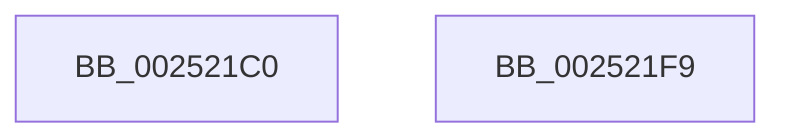

# HalSendSoftwareInterrupt

- RVA: `0x002521C0`–`0x002521FA` (길이 `58` bytes)
- VA: `0x00000001402521C0`
- 실행 섹션: `.text`
- PDB 이름 있음: `예`; PDB Function 태그: `아니요`
- unwind 정보 RVA: `0x00063458`
- 디코드: `15`개 명령, `58/58` bytes 표시
- 미해석 바이트: `0` (있으면 어셈블리에 `.byte`로 보존)

> 이 문서는 커널 이미지의 기계어와 PDB 기호를 분석해 생성했습니다. 4번과 5번은 함수 원형과 자료형을 바이너리 사용 방식에서 추정한 C 해석이며 원본 소스 복구 결과는 아닙니다.

## 1. Dependencies

- 직접 호출 지점: **1**; 고유 호출 대상: **1**
- 직접 호출자로 확인된 함수: **0**
- RIP 상대 이미지 참조: **0**

### Outgoing calls
- `0x002521EF` → [HalpInterruptSendIpi](HalpInterruptSendIpi_function_00252310.md) (function, `0x00252310`)

### Direct callers
- 이 함수 시작 RVA로 연결되는 직접 call은 확인되지 않았습니다. 간접 호출은 완전히 역산할 수 없습니다.

### Static image references
- 디코드된 RIP-relative 메모리 참조가 없습니다.

## 2. Other-region calls and transfers

- 다른 실행 섹션으로 향하는 call: **0**
- 별도 외부 분기/꼬리 이동을 확인하지 못했습니다.

## 3. Assembly (complete function range)

```asm
002521C0  48 83 EC 48                     sub rsp, 0x48
002521C4  0F B6 C2                        movzx eax, dl
002521C7  89 4C 24 28                     mov dword ptr [rsp + 0x28], ecx
002521CB  33 D2                           xor edx, edx
002521CD  48 C7 44 24 20 06 00 00 00      mov qword ptr [rsp + 0x20], 6
002521D6  48 89 54 24 2C                  mov qword ptr [rsp + 0x2c], rdx
002521DB  3C 01                           cmp al, 1
002521DD  BA 1F 00 00 00                  mov edx, 0x1f
002521E2  B9 2F 00 00 00                  mov ecx, 0x2f
002521E7  0F 45 D1                        cmovne edx, ecx
002521EA  48 8D 4C 24 20                  lea rcx, [rsp + 0x20]
002521EF  E8 1C 01 00 00                  call 0x140252310
002521F4  48 83 C4 48                     add rsp, 0x48
002521F8  C3                              ret
002521F9  CC                              int3
```

## 4. C-style interpretation (structured pseudocode)

```c
__int64 __fastcall HalSendSoftwareInterrupt(int a1, int a2)
{
    __int64 result;
    __int64 v_rsp;
    unsigned __int64 v_stack_m1C;
    unsigned int v_stack_m20;
    unsigned __int64 v_stack_m28;

    v_rsp = (v_rsp) - (72);
    v_stack_m20 = a1;
    a2 = 0;
    v_stack_m28 = 6;
    v_stack_m1C = 0;
    a2 = 31;
    if (((unsigned __int8)((unsigned __int8)(a2))) != 1) { a2 = 47; }
    result = HalpInterruptSendIpi(v_stack_m28, a2, a3, a4);
    v_rsp = (v_rsp) + (72);
    return result;
}
```

## 5. (Beta) C Style

```c
int64_t HalSendSoftwareInterrupt(int32_t Arg1, int32_t Arg2)
{
    int64_t result;
    int64_t local_rsp;
    uint64_t v_stack_m1C;
    uint32_t v_stack_m20;
    uint64_t v_stack_m28;

    local_rsp = (local_rsp) - (72);
    v_stack_m20 = Arg1;
    Arg2 = 0;
    v_stack_m28 = 6;
    v_stack_m1C = 0;
    Arg2 = 31;
    if (((uint8_t)((uint8_t)(Arg2))) != 1) { Arg2 = 47; }
    result = HalpInterruptSendIpi(v_stack_m28, Arg2, a3, a4);
    local_rsp = (local_rsp) + (72);
    return result;
}
```

## 6. Execution-region graph

[열기: 2D/3D 그래프와 함수 탐색 컨트롤 패널](../../../control-panel.html?section=text&rva=0x002521C0&view=graph)

- 2D 그래프는 위에서 아래로 흐르고, 3D 그래프는 빈 공간을 드래그해 회전합니다. Shift+드래그는 이동, 휠은 확대·축소, 함수 노드 선택은 대상 보고서 이동입니다.

### Static fallback


