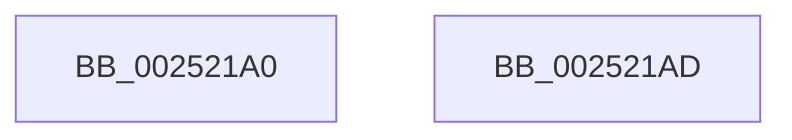

# HalpDisableInterrupts

- RVA: `0x002521A0`–`0x002521AE` (길이 `14` bytes)
- VA: `0x00000001402521A0`
- 실행 섹션: `.text`
- PDB 이름 있음: `예`; PDB Function 태그: `아니요`
- unwind 정보 RVA: `0x000635B8`
- 디코드: `8`개 명령, `14/14` bytes 표시
- 미해석 바이트: `0` (있으면 어셈블리에 `.byte`로 보존)

> 이 문서는 커널 이미지의 기계어와 PDB 기호를 분석해 생성했습니다. 4번과 5번은 함수 원형과 자료형을 바이너리 사용 방식에서 추정한 C 해석이며 원본 소스 복구 결과는 아닙니다.

## 1. Dependencies

- 직접 호출 지점: **0**; 고유 호출 대상: **0**
- 직접 호출자로 확인된 함수: **44**
- RIP 상대 이미지 참조: **0**

### Outgoing calls
- 직접 디코드된 call 명령이 없습니다.

### Direct callers
- [KiSignalThreadForApc](../20/KiSignalThreadForApc_function_00204360.md) at `0x002044D5`
- [sub_00207D3E](../20/Unknown_function_00207D3E.md) at `0x00208157`
- [sub_002174A7](../21/Unknown_function_002174A7.md) at `0x00217512`
- [sub_00217F67](../21/Unknown_function_00217F67.md) at `0x00217FD2`
- [sub_002187BE](../21/Unknown_function_002187BE.md) at `0x00218815`
- [KiQueueReadyThread](../21/KiQueueReadyThread_function_0021C7B0.md) at `0x0021CF77`
- [KiCheckForThreadDispatch](KiCheckForThreadDispatch_function_00250648.md) at `0x00250788`
- [KiRequestSoftwareInterrupt](KiRequestSoftwareInterrupt_function_00250950.md) at `0x00250985`
- [sub_00251ED3](Unknown_function_00251ED3.md) at `0x00251EEF`
- [HalpInterruptSendIpi](HalpInterruptSendIpi_function_00252310.md) at `0x0025240F`
- [sub_002525D7](Unknown_function_002525D7.md) at `0x002526E4`
- [sub_002525D7](Unknown_function_002525D7.md) at `0x002527C8`
- [sub_00252888](Unknown_function_00252888.md) at `0x002528BA`
- [sub_00252912](Unknown_function_00252912.md) at `0x00252977`
- [sub_0028EF98](../28/Unknown_function_0028EF98.md) at `0x0028F097`
- [HalpInterruptSetLineStateInternal](../2D/HalpInterruptSetLineStateInternal_function_002D2104.md) at `0x002D2150`
- [KiCheckForKernelApcDelivery](../2E/KiCheckForKernelApcDelivery_function_002E2C80.md) at `0x002E2CFE`
- [HalpCollectPmcCounters](../2F/HalpCollectPmcCounters_function_002FD080.md) at `0x002FD0A1`
- [HalpCollectPmcCounters](../2F/HalpCollectPmcCounters_function_002FD080.md) at `0x002FD0DC`
- [KiStartThreadCycleAccumulationContextSwap](../30/KiStartThreadCycleAccumulationContextSwap_function_00309C10.md) at `0x0030A119`
- [KiUpdateRunTime](../39/KiUpdateRunTime_function_0039BB70.md) at `0x0039BFBE`
- [sub_0039CA0B](../39/Unknown_function_0039CA0B.md) at `0x0039CCF7`
- [KiRequestTimer2Expiration](../39/KiRequestTimer2Expiration_function_0039F118.md) at `0x0039F193`
- [sub_003C7508](../3C/Unknown_function_003C7508.md) at `0x003C7545`
- [sub_003C79DD](../3C/Unknown_function_003C79DD.md) at `0x003C7A28`
- [HalRequestSoftwareInterrupt](../3F/HalRequestSoftwareInterrupt_function_003FADA0.md) at `0x003FADCC`
- [HalpAcquireCmosSpinLock](../42/HalpAcquireCmosSpinLock_function_0042DEE8.md) at `0x0042DEF0`
- [HalpTimerSetProfilingTarget](../4C/HalpTimerSetProfilingTarget_function_004CAE84.md) at `0x004CAE8B`
- [HalpFlushTLB](../4F/HalpFlushTLB_function_004F5E9C.md) at `0x004F5EA0`
- [HalpInterruptResetThisProcessor](../54/HalpInterruptResetThisProcessor_function_00543930.md) at `0x0054394D`
- [HalSendNMI](../54/HalSendNMI_function_00545E80.md) at `0x00545EC7`
- [HalSendNMI](../54/HalSendNMI_function_00545E80.md) at `0x00545F84`
- [HalSendNMI](../54/HalSendNMI_function_00545E80.md) at `0x0054609B`
- [HalSendNMI](../54/HalSendNMI_function_00545E80.md) at `0x0054616B`
- [HalSendNMI](../54/HalSendNMI_function_00545E80.md) at `0x00546222`
- [HalpInterruptSendIpiToPhysicalTarget](../54/HalpInterruptSendIpiToPhysicalTarget_function_005464B0.md) at `0x00546502`
- [HalpReboot](../54/HalpReboot_function_00546870.md) at `0x0054687F`
- [HalpTimerClockActivate](../54/HalpTimerClockActivate_function_005480B0.md) at `0x005480BF`
- [HalpTscCompatibilitySynchronization](../54/HalpTscCompatibilitySynchronization_function_0054AB14.md) at `0x0054AB1B`
- [HalpTscFallback](../54/HalpTscFallback_function_0054AC40.md) at `0x0054AC57`
- [HalpTscSynchronizationWorker](../54/HalpTscSynchronizationWorker_function_0054B090.md) at `0x0054B117`
- [HalpTimerResetProfileAdjustment](../54/HalpTimerResetProfileAdjustment_function_0054B660.md) at `0x0054B664`
- [HalpTimerMeasureProcessorsWorker](../54/HalpTimerMeasureProcessorsWorker_function_0054D910.md) at `0x0054D941`
- [HalEfiResetSystem](../54/HalEfiResetSystem_function_0054DDE8.md) at `0x0054DE04`
- [HalpInterruptInitializeLocalUnit](../55/HalpInterruptInitializeLocalUnit_function_00557A2C.md) at `0x00557A63`
- [HalpTimerUpdateApiConsumers](../56/HalpTimerUpdateApiConsumers_function_00562D28.md) at `0x00562D32`
- [HaliAcpiSleep](../56/HaliAcpiSleep_function_0056AD60.md) at `0x0056ADAB`
- [HalpInterruptStartProcessor](../../pagelk/B5/HalpInterruptStartProcessor_function_00B5BEF0.md) at `0x00B5BFDA`
- [HalpDpOfflineProcessorForReplace](../../pagelk/B5/HalpDpOfflineProcessorForReplace_function_00B5FC20.md) at `0x00B5FC37`
- [HalpInterruptReinitialize](../../pagelk/B7/HalpInterruptReinitialize_function_00B79BEC.md) at `0x00B79CB4`

### Static image references
- 디코드된 RIP-relative 메모리 참조가 없습니다.

## 2. Other-region calls and transfers

- 다른 실행 섹션으로 향하는 call: **0**
- 별도 외부 분기/꼬리 이동을 확인하지 못했습니다.

## 3. Assembly (complete function range)

```asm
002521A0  48 9C                           pushfq
002521A2  FA                              cli
002521A3  8B 04 24                        mov eax, dword ptr [rsp]
002521A6  C1 E8 09                        shr eax, 9
002521A9  24 01                           and al, 1
002521AB  59                              pop rcx
002521AC  C3                              ret
002521AD  CC                              int3
```

## 4. C-style interpretation (structured pseudocode)

```c
__int64 __fastcall HalpDisableInterrupts(void)
{
    __int64 result;
    unsigned int v_stack_m8;

    result = (unsigned int)(((unsigned int)(v_stack_m8)) >> (9));
    result = (unsigned __int8)((result) & (1));
    return result;
}
```

## 5. (Beta) C Style

```c
void HalpDisableInterrupts(void)
{
    int64_t result;
    uint32_t v_stack_m8;

    result = (uint32_t)(((uint32_t)(v_stack_m8)) >> (9));
    result = (uint8_t)((result) & (1));
    return result;
}
```

## 6. Execution-region graph

[열기: 2D/3D 그래프와 함수 탐색 컨트롤 패널](../../../control-panel.html?section=text&rva=0x002521A0&view=graph)

- 2D 그래프는 위에서 아래로 흐르고, 3D 그래프는 빈 공간을 드래그해 회전합니다. Shift+드래그는 이동, 휠은 확대·축소, 함수 노드 선택은 대상 보고서 이동입니다.

### Static fallback


