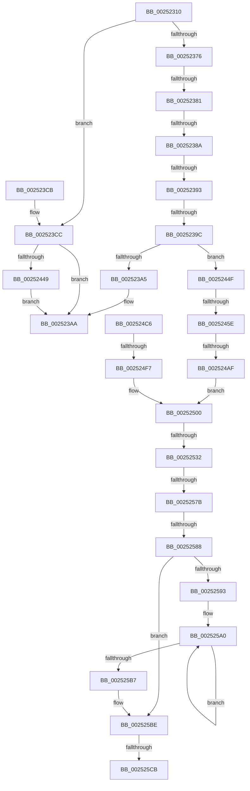

# HalpInterruptSendIpi

- RVA: `0x00252310`–`0x002525D7` (길이 `711` bytes)
- VA: `0x0000000140252310`
- 실행 섹션: `.text`
- PDB 이름 있음: `예`; PDB Function 태그: `아니요`
- unwind 정보 RVA: `0x00063610`
- 디코드: `164`개 명령, `711/711` bytes 표시
- 미해석 바이트: `0` (있으면 어셈블리에 `.byte`로 보존)

> 이 문서는 커널 이미지의 기계어와 PDB 기호를 분석해 생성했습니다. 4번과 5번은 함수 원형과 자료형을 바이너리 사용 방식에서 추정한 C 해석이며 원본 소스 복구 결과는 아닙니다.

## 1. Dependencies

- 직접 호출 지점: **8**; 고유 호출 대상: **4**
- 직접 호출자로 확인된 함수: **36**
- RIP 상대 이미지 참조: **9**

### Outgoing calls
- `0x00252351` → [memset](../6C/memset_function_006C6C40.md) (function, `0x006C6C40`)
- `0x002523B4` → [_security_check_cookie](../6A/_security_check_cookie_function_006AC640.md) (function, `0x006AC640`)
- `0x0025240F` → [HalpDisableInterrupts](HalpDisableInterrupts_function_002521A0.md) (function, `0x002521A0`)
- `0x0025243C` → [guard_dispatch_icall](../6B/guard_dispatch_icall_function_006BAAD0.md) (function, `0x006BAAD0`)
- `0x0025247F` → [memset](../6C/memset_function_006C6C40.md) (function, `0x006C6C40`)
- `0x002524E0` → [memset](../6C/memset_function_006C6C40.md) (function, `0x006C6C40`)
- `0x0025250F` → [memset](../6C/memset_function_006C6C40.md) (function, `0x006C6C40`)
- `0x00252548` → [memset](../6C/memset_function_006C6C40.md) (function, `0x006C6C40`)

### Direct callers
- [KiSignalThreadForApc](../20/KiSignalThreadForApc_function_00204360.md) at `0x00204536`
- [sub_00207D3E](../20/Unknown_function_00207D3E.md) at `0x002081FC`
- [sub_002174A7](../21/Unknown_function_002174A7.md) at `0x0021756E`
- [sub_00217F67](../21/Unknown_function_00217F67.md) at `0x0021802E`
- [sub_002187BE](../21/Unknown_function_002187BE.md) at `0x00218871`
- [KiQueueReadyThread](../21/KiQueueReadyThread_function_0021C7B0.md) at `0x0021CFD1`
- [KiSendClockInterruptToTargetProcessor](../23/KiSendClockInterruptToTargetProcessor_function_00234700.md) at `0x002347C7`
- [KiCheckForThreadDispatch](KiCheckForThreadDispatch_function_00250648.md) at `0x002507E3`
- [KiProcessDeferredReadyList](KiProcessDeferredReadyList_function_00250800.md) at `0x00250912`
- [KiRequestSoftwareInterrupt](KiRequestSoftwareInterrupt_function_00250950.md) at `0x002509F1`
- [KiSendSoftwareInterrupt](KiSendSoftwareInterrupt_function_00250A30.md) at `0x00250A71`
- [sub_00251ED3](Unknown_function_00251ED3.md) at `0x00251F4B`
- [HalSendSoftwareInterrupt](HalSendSoftwareInterrupt_function_002521C0.md) at `0x002521EF`
- [sub_00252215](Unknown_function_00252215.md) at `0x002522A9`
- [sub_002522D4](Unknown_function_002522D4.md) at `0x00252300`
- [KiProcessThreadWaitList](KiProcessThreadWaitList_function_00252CC0.md) at `0x00252EDF`
- [KiExecuteAllDpcs](KiExecuteAllDpcs_function_0025B740.md) at `0x0025BD60`
- [sub_0028EF98](../28/Unknown_function_0028EF98.md) at `0x0028F0F3`
- [KiIntRedirectQueueRequestOnProcessor](../2D/KiIntRedirectQueueRequestOnProcessor_function_002D1240.md) at `0x002D1304`
- [HalRequestClockInterrupt](../2D/HalRequestClockInterrupt_function_002D14C0.md) at `0x002D1513`
- [HalRequestIpi](../2D/HalRequestIpi_function_002D1720.md) at `0x002D178E`
- [KiCheckForKernelApcDelivery](../2E/KiCheckForKernelApcDelivery_function_002E2C80.md) at `0x002E2D5A`
- [KiStartThreadCycleAccumulationContextSwap](../30/KiStartThreadCycleAccumulationContextSwap_function_00309C10.md) at `0x0030A173`
- [KiReadyDeferredReadyList](../30/KiReadyDeferredReadyList_function_0030DD80.md) at `0x0030DE76`
- [KiAbDeferredProcessingWorker](../30/KiAbDeferredProcessingWorker_function_0030DEB0.md) at `0x0030E1BE`
- [KiSendSoftwareInterruptAffinity](../30/KiSendSoftwareInterruptAffinity_function_0030E834.md) at `0x0030E8A7`
- [KiSearchForNewThreadsOnTarget](../30/KiSearchForNewThreadsOnTarget_function_0030F500.md) at `0x0030F93A`
- [KiSearchForNewThreadsOnTarget](../30/KiSearchForNewThreadsOnTarget_function_0030F500.md) at `0x0030F98A`
- [KiSearchForNewThreadsOnTarget](../30/KiSearchForNewThreadsOnTarget_function_0030F500.md) at `0x0030F9D3`
- [KiIpiSendRequest](../31/KiIpiSendRequest_function_003113C0.md) at `0x00311857`
- [KiIpiSendRequest](../31/KiIpiSendRequest_function_003113C0.md) at `0x00311947`
- [KiUpdateRunTime](../39/KiUpdateRunTime_function_0039BB70.md) at `0x0039C018`
- [sub_0039CA0B](../39/Unknown_function_0039CA0B.md) at `0x0039CD51`
- [KiRequestTimer2Expiration](../39/KiRequestTimer2Expiration_function_0039F118.md) at `0x0039F1F5`
- [sub_003C7508](../3C/Unknown_function_003C7508.md) at `0x003C75A1`
- [sub_003C79DD](../3C/Unknown_function_003C79DD.md) at `0x003C7A84`
- [HalRequestSoftwareInterrupt](../3F/HalRequestSoftwareInterrupt_function_003FADA0.md) at `0x003FAE38`
- [HalRequestIpiSpecifyVector](../43/HalRequestIpiSpecifyVector_function_0043E750.md) at `0x0043E7A8`
- [HalRequestIpiSpecifyVector](../43/HalRequestIpiSpecifyVector_function_0043E750.md) at `0x0043E7D4`
- [HalRequestIpiSpecifyVector](../43/HalRequestIpiSpecifyVector_function_0043E750.md) at `0x0043E7F4`
- [HalRequestDeferredRecoveryServiceInterrupt](../54/HalRequestDeferredRecoveryServiceInterrupt_function_00545E40.md) at `0x00545E60`

### Static image references
- `0x0025232A` → RVA `0x00E0A740` (`.data`; read)
- `0x0025235C` → RVA `0x00E101F0` (`.data`; read)
- `0x002523CF` → RVA `0x00E101F8` (`.data`; read)
- `0x002523E5` → RVA `0x00E102D8` (`.data`; read)
- `0x0025248E` → RVA `0x00F231B0` (`.data`; read)
- `0x0025251D` → RVA `0x00FC1D28` (`.data`; read)
- `0x00252551` → RVA `0x00FC3900` (`.data`; read)
- `0x002525BE` → RVA `0x00E0A790` (`.data`; read)
- `0x002525CB` → RVA `0x00F90698` (`.data`; read)

## 2. Other-region calls and transfers

- 다른 실행 섹션으로 향하는 call: **0**
- call이 아닌 외부 분기/꼬리 이동: **11**
  - `0x0025237B` → [sub_00252A54](Unknown_function_00252A54.md) (`tail-transfer`)
  - `0x00252384` → [sub_00252A54](Unknown_function_00252A54.md) (`tail-transfer`)
  - `0x0025238D` → [sub_00252A85 + 0x10F](Unknown_function_00252A85.md) (`tail-transfer`)
  - `0x00252396` → [sub_00252A85](Unknown_function_00252A85.md) (`tail-transfer`)
  - `0x00252458` → [sub_0025280E](Unknown_function_0025280E.md) (`tail-transfer`)
  - `0x002524A9` → [sub_00252A85 + 0xF7](Unknown_function_00252A85.md) (`tail-transfer`)
  - `0x002524F1` → [sub_00252A85 + 0x1F1](Unknown_function_00252A85.md) (`tail-transfer`)
  - `0x0025252C` → [sub_0025280E + 0x58](Unknown_function_0025280E.md) (`tail-transfer`)
  - `0x00252575` → [sub_00252A85 + 0x213](Unknown_function_00252A85.md) (`tail-transfer`)
  - `0x00252582` → [sub_0025280E + 0x1A](Unknown_function_0025280E.md) (`tail-transfer`)
  - `0x002525C5` → [sub_00252912](Unknown_function_00252912.md) (`tail-transfer`)

## 3. Assembly (complete function range)

```asm
00252310  40 55                           push rbp
00252312  53                              push rbx
00252313  56                              push rsi
00252314  57                              push rdi
00252315  41 54                           push r12
00252317  41 56                           push r14
00252319  41 57                           push r15
0025231B  48 8D AC 24 20 FE FF FF         lea rbp, [rsp - 0x1e0]
00252323  48 81 EC E0 02 00 00            sub rsp, 0x2e0
0025232A  48 8B 05 0F 84 BB 00            mov rax, qword ptr [rip + 0xbb840f]
00252331  48 33 C4                        xor rax, rsp
00252334  48 89 85 D0 01 00 00            mov qword ptr [rbp + 0x1d0], rax
0025233B  44 8B FA                        mov r15d, edx
0025233E  89 54 24 50                     mov dword ptr [rsp + 0x50], edx
00252342  48 8B D9                        mov rbx, rcx
00252345  33 D2                           xor edx, edx
00252347  48 8D 4D B0                     lea rcx, [rbp - 0x50]
0025234B  41 B8 08 01 00 00               mov r8d, 0x108
00252351  E8 EA 48 47 00                  call 0x1406c6c40
00252356  8B 13                           mov edx, dword ptr [rbx]
00252358  4C 8D 75 B0                     lea r14, [rbp - 0x50]
0025235C  4C 8B 15 8D DE BB 00            mov r10, qword ptr [rip + 0xbbde8d]
00252363  33 C0                           xor eax, eax
00252365  89 44 24 78                     mov dword ptr [rsp + 0x78], eax
00252369  0F 57 C0                        xorps xmm0, xmm0
0025236C  0F 11 44 24 68                  movups xmmword ptr [rsp + 0x68], xmm0
00252371  83 FA 06                        cmp edx, 6
00252374  74 56                           je 0x1402523cc
00252376  8B CA                           mov ecx, edx
00252378  83 E9 01                        sub ecx, 1
0025237B  0F 84 D3 06 00 00               je 0x140252a54
00252381  83 E9 01                        sub ecx, 1
00252384  0F 84 CA 06 00 00               je 0x140252a54
0025238A  83 E9 01                        sub ecx, 1
0025238D  0F 84 01 08 00 00               je 0x140252b94
00252393  83 E9 01                        sub ecx, 1
00252396  0F 84 E9 06 00 00               je 0x140252a85
0025239C  83 F9 01                        cmp ecx, 1
0025239F  0F 84 AA 00 00 00               je 0x14025244f
002523A5  B8 0D 00 00 C0                  mov eax, 0xc000000d
002523AA  48 8B 8D D0 01 00 00            mov rcx, qword ptr [rbp + 0x1d0]
002523B1  48 33 CC                        xor rcx, rsp
002523B4  E8 87 A2 45 00                  call 0x1406ac640
002523B9  48 81 C4 E0 02 00 00            add rsp, 0x2e0
002523C0  41 5F                           pop r15
002523C2  41 5E                           pop r14
002523C4  41 5C                           pop r12
002523C6  5F                              pop rdi
002523C7  5E                              pop rsi
002523C8  5B                              pop rbx
002523C9  5D                              pop rbp
002523CA  C3                              ret
002523CB  CC                              int3
002523CC  8B 4B 08                        mov ecx, dword ptr [rbx + 8]
002523CF  48 8B 05 22 DE BB 00            mov rax, qword ptr [rip + 0xbbde22]
002523D6  C7 44 24 68 04 00 00 00         mov dword ptr [rsp + 0x68], 4
002523DE  8B 0C 88                        mov ecx, dword ptr [rax + rcx*4]
002523E1  89 4C 24 70                     mov dword ptr [rsp + 0x70], ecx
002523E5  48 8B 0D EC DE BB 00            mov rcx, qword ptr [rip + 0xbbdeec]
002523EC  BE FF FF FF FF                  mov esi, 0xffffffff
002523F1  4D 8B 52 78                     mov r10, qword ptr [r10 + 0x78]
002523F5  89 74 24 60                     mov dword ptr [rsp + 0x60], esi
002523F9  C7 44 24 64 01 00 00 00         mov dword ptr [rsp + 0x64], 1
00252401  8B 41 14                        mov eax, dword ptr [rcx + 0x14]
00252404  89 44 24 5C                     mov dword ptr [rsp + 0x5c], eax
00252408  8B 41 10                        mov eax, dword ptr [rcx + 0x10]
0025240B  89 44 24 58                     mov dword ptr [rsp + 0x58], eax
0025240F  E8 8C FD FF FF                  call 0x1402521a0
00252414  48 8B 0D D5 DD BB 00            mov rcx, qword ptr [rip + 0xbbddd5]
0025241B  4C 8D 44 24 68                  lea r8, [rsp + 0x68]
00252420  0F B6 D8                        movzx ebx, al
00252423  48 8D 54 24 58                  lea rdx, [rsp + 0x58]
00252428  48 8D 44 24 60                  lea rax, [rsp + 0x60]
0025242D  45 8B CF                        mov r9d, r15d
00252430  48 89 44 24 20                  mov qword ptr [rsp + 0x20], rax
00252435  49 8B C2                        mov rax, r10
00252438  48 8B 49 10                     mov rcx, qword ptr [rcx + 0x10]
0025243C  E8 8F 86 46 00                  call 0x1406baad0
00252441  84 DB                           test bl, bl
00252443  0F 84 61 FF FF FF               je 0x1402523aa
00252449  FB                              sti
0025244A  E9 5B FF FF FF                  jmp 0x1402523aa
0025244F  41 8B 82 F4 00 00 00            mov eax, dword ptr [r10 + 0xf4]
00252456  A8 40                           test al, 0x40
00252458  0F 85 B0 03 00 00               jne 0x14025280e
0025245E  41 BC 01 00 00 00               mov r12d, 1
00252464  48 C7 45 B0 01 00 20 00         mov qword ptr [rbp - 0x50], 0x200001
0025246C  33 D2                           xor edx, edx
0025246E  48 8D 4D B8                     lea rcx, [rbp - 0x48]
00252472  41 B8 00 01 00 00               mov r8d, 0x100
00252478  33 FF                           xor edi, edi
0025247A  41 8D 5C 24 1F                  lea ebx, [r12 + 0x1f]
0025247F  E8 BC 47 47 00                  call 0x1406c6c40
00252484  65 8B 04 25 A4 01 00 00         mov eax, dword ptr gs:[0x1a4]
0025248C  8B C8                           mov ecx, eax
0025248E  48 8B 05 1B 0D CD 00            mov rax, qword ptr [rip + 0xcd0d1b]
00252495  44 8B 04 88                     mov r8d, dword ptr [rax + rcx*4]
00252499  41 8B C8                        mov ecx, r8d
0025249C  0F B7 45 B0                     movzx eax, word ptr [rbp - 0x50]
002524A0  41 83 E0 3F                     and r8d, 0x3f
002524A4  C1 E9 06                        shr ecx, 6
002524A7  3B C1                           cmp eax, ecx
002524A9  0F 86 CD 06 00 00               jbe 0x140252b7c
002524AF  48 8D 55 B8                     lea rdx, [rbp - 0x48]
002524B3  41 8B C0                        mov eax, r8d
002524B6  48 8D 14 CA                     lea rdx, [rdx + rcx*8]
002524BA  48 8B 0A                        mov rcx, qword ptr [rdx]
002524BD  48 0F AB C1                     bts rcx, rax
002524C1  48 89 0A                        mov qword ptr [rdx], rcx
002524C4  EB 3A                           jmp 0x140252500
002524C6  33 D2                           xor edx, edx
002524C8  48 C7 45 B0 01 00 20 00         mov qword ptr [rbp - 0x50], 0x200001
002524D0  41 B8 00 01 00 00               mov r8d, 0x100
002524D6  48 8D 4D B8                     lea rcx, [rbp - 0x48]
002524DA  41 BC 01 00 00 00               mov r12d, 1
002524E0  E8 5B 47 47 00                  call 0x1406c6c40
002524E5  41 0F B7 4E 08                  movzx ecx, word ptr [r14 + 8]
002524EA  49 8B 16                        mov rdx, qword ptr [r14]
002524ED  66 39 4D B0                     cmp word ptr [rbp - 0x50], cx
002524F1  0F 86 7F 07 00 00               jbe 0x140252c76
002524F7  48 09 54 CD B8                  or qword ptr [rbp + rcx*8 - 0x48], rdx
002524FC  4C 8D 75 B0                     lea r14, [rbp - 0x50]
00252500  33 D2                           xor edx, edx
00252502  48 8D 8D C8 00 00 00            lea rcx, [rbp + 0xc8]
00252509  41 B8 00 01 00 00               mov r8d, 0x100
0025250F  E8 2C 47 47 00                  call 0x1406c6c40
00252514  33 C0                           xor eax, eax
00252516  0F 57 C0                        xorps xmm0, xmm0
00252519  89 44 24 48                     mov dword ptr [rsp + 0x48], eax
0025251D  48 8B 05 04 F8 D6 00            mov rax, qword ptr [rip + 0xd6f804]
00252524  0F 11 44 24 38                  movups xmmword ptr [rsp + 0x38], xmm0
00252529  48 85 C0                        test rax, rax
0025252C  0F 85 34 03 00 00               jne 0x140252866
00252532  33 D2                           xor edx, edx
00252534  66 89 9D C2 00 00 00            mov word ptr [rbp + 0xc2], bx
0025253B  41 B8 00 01 00 00               mov r8d, 0x100
00252541  48 8D 8D C8 00 00 00            lea rcx, [rbp + 0xc8]
00252548  E8 F3 46 47 00                  call 0x1406c6c40
0025254D  41 0F B7 0E                     movzx ecx, word ptr [r14]
00252551  66 39 0D A8 13 D7 00            cmp word ptr [rip + 0xd713a8], cx
00252558  0F B7 95 C2 00 00 00            movzx edx, word ptr [rbp + 0xc2]
0025255F  66 0F 42 0D 99 13 D7 00         cmovb cx, word ptr [rip + 0xd71399]
00252567  66 89 8D C0 00 00 00            mov word ptr [rbp + 0xc0], cx
0025256E  44 0F B7 C1                     movzx r8d, cx
00252572  66 3B CA                        cmp cx, dx
00252575  0F 87 1D 07 00 00               ja 0x140252c98
0025257B  0F B7 C7                        movzx eax, di
0025257E  66 41 3B F8                     cmp di, r8w
00252582  0F 82 A0 02 00 00               jb 0x140252828
00252588  89 BD C4 00 00 00               mov dword ptr [rbp + 0xc4], edi
0025258E  66 3B C2                        cmp ax, dx
00252591  73 2B                           jae 0x1402525be
00252593  0F 1F 40 00                     nop dword ptr [rax]
00252597  66 0F 1F 84 00 00 00 00 00      nop word ptr [rax + rax]
002525A0  0F B7 C8                        movzx ecx, ax
002525A3  66 FF C0                        inc ax
002525A6  48 89 BC CD C8 00 00 00         mov qword ptr [rbp + rcx*8 + 0xc8], rdi
002525AE  66 3B 85 C2 00 00 00            cmp ax, word ptr [rbp + 0xc2]
002525B5  72 E9                           jb 0x1402525a0
002525B7  0F B7 8D C0 00 00 00            movzx ecx, word ptr [rbp + 0xc0]
002525BE  83 3D CB 81 BB 00 03            cmp dword ptr [rip + 0xbb81cb], 3
002525C5  0F 84 47 03 00 00               je 0x140252912
002525CB  80 3D C6 E0 D3 00 00            cmp byte ptr [rip + 0xd3e0c6], 0
002525D2  BE FF FF FF FF                  mov esi, 0xffffffff
```

## 4. C-style interpretation (structured pseudocode)

```c
__int64 __fastcall HalpInterruptSendIpi(__int64 a1, int a2)
{
    __int64 result;
    __int64 v_rdi;
    __int64 v_rsp;
    unsigned __int64 v_stack_m150;
    unsigned int v_stack_m154;
    unsigned __int16 v_stack_m156;
    unsigned __int16 v_stack_m158;
    unsigned __int64 v_stack_m218;
    unsigned __int64 v_stack_m260;
    unsigned __int64 v_stack_m268;
    unsigned int v_stack_m2A0;
    unsigned __int64 v_stack_m2B0;
    unsigned int v_stack_m2C8;
    unsigned __int64 v_stack_m48;
    unsigned __int64 v_stack_p20;
    unsigned __int64 v_stack_p38;
    unsigned int v_stack_p48;
    unsigned int v_stack_p58;
    unsigned int v_stack_p5C;
    unsigned int v_stack_p60;
    unsigned int v_stack_p64;
    unsigned int v_stack_p68;
    unsigned int v_stack_p70;

    v_rsp = (v_rsp) - (736);
    result = (*(unsigned __int64 *)(v_rip + 12289039)) ^ (v_rsp);
    v_stack_m48 = result;
    v_stack_m2C8 = a2;
    a2 = 0;
    result = memset(v_stack_m268, a2, 264, a4);
    result = 0;
    v_stack_m2A0 = 0;
    v_stack_m2B0 = v_xmm0;
    if (((unsigned int)((unsigned int)(*(unsigned int *)(a1)))) == 6) goto loc_002523CC;
    a1 = (unsigned int)(((unsigned int)((unsigned int)((unsigned int)(*(unsigned int *)(a1))))) - (1));
    a1 = (unsigned int)((a1) - (1));
    a1 = (unsigned int)((a1) - (1));
    a1 = (unsigned int)((a1) - (1));
    if (((unsigned int)(a1)) == 1) goto loc_0025244F;
loc_002523AA:
    a1 = (v_stack_m48) ^ (v_rsp);
    result = _security_check_cookie(a1, (unsigned int)(*(unsigned int *)(a1)), 264, a4);
    v_rsp = (v_rsp) + (736);
    return result;
loc_002523CC:
    v_stack_p68 = 4;
    v_stack_p70 = (unsigned int)((unsigned int)(*(unsigned int *)(*(unsigned __int64 *)(v_rip + 12312098) + (unsigned int)(*(unsigned int *)(a1 + 8)) * 4)));
    v_stack_p60 = (unsigned int)((unsigned int)(0xFFFFFFFFULL));
    v_stack_p64 = 1;
    v_stack_p5C = (unsigned int)((unsigned int)(*(unsigned int *)(*(unsigned __int64 *)(v_rip + 12312300) + 20)));
    v_stack_p58 = (unsigned int)((unsigned int)(*(unsigned int *)(*(unsigned __int64 *)(v_rip + 12312300) + 16)));
    result = HalpDisableInterrupts(*(unsigned __int64 *)(v_rip + 12312300), (unsigned int)(*(unsigned int *)(a1)), 264, a4);
    v_stack_p20 = v_stack_p60;
    result = guard_dispatch_icall(*(unsigned __int64 *)(*(unsigned __int64 *)(v_rip + 12312021) + 16), v_stack_p58, v_stack_p68, (unsigned int)((unsigned int)((unsigned int)(a2))));
    if ((unsigned __int8)((unsigned __int8)(result)) == 0) goto loc_002523AA;
    goto loc_002523AA;
loc_0025244F:
    v_stack_m268 = 0x200001ULL;
    a2 = 0;
    v_rdi = 0;
    result = memset(v_stack_m260, a2, 256, (unsigned int)((unsigned int)((unsigned int)(a2))));
    a3 = (unsigned int)(((unsigned int)(*(unsigned int *)(*(unsigned __int64 *)(v_rip + 13438235) + (unsigned int)((unsigned int)((unsigned int)(*(unsigned int *)(gs_base + (0 + 420))))) * 4))) & (63));
    a1 = (unsigned int)(((unsigned int)((unsigned int)((unsigned int)(*(unsigned int *)(*(unsigned __int64 *)(v_rip + 13438235) + (unsigned int)((unsigned int)((unsigned int)(*(unsigned int *)(gs_base + (0 + 420))))) * 4))))) >> (6));
    *(unsigned __int64 *)(v_stack_m260 + a1 * 8) = *(unsigned __int64 *)(v_stack_m260 + a1 * 8);
    goto loc_00252500;
loc_00252500:
    a2 = 0;
    result = memset(v_stack_m150, a2, 256, (unsigned int)((unsigned int)((unsigned int)(a2))));
    result = 0;
    v_stack_p48 = 0;
    v_stack_p38 = v_xmm0;
    a2 = 0;
    v_stack_m156 = (unsigned __int16)(1 + 31);
    result = memset(v_stack_m150, a2, 256, (unsigned int)((unsigned int)((unsigned int)(a2))));
    a1 = *(unsigned __int16 *)(v_stack_m268);
    if ((*(unsigned __int16 *)(v_rip + 14095272)) < ((unsigned __int16)(*(unsigned __int16 *)(v_stack_m268)))) { a1 = *(unsigned __int16 *)(v_rip + 14095257); }
    v_stack_m158 = (unsigned __int16)(a1);
    v_stack_m154 = 0;
    if (0 >= ((unsigned __int16)(v_stack_m156))) goto loc_002525BE;
loc_002525A0:
    result = (unsigned __int16)((0) + 1);
    *(unsigned __int64 *)(v_stack_m218 + 0 * 8 + 200) = 0;
    if (((unsigned __int16)(result)) < v_stack_m156) goto loc_002525A0;
loc_002525BE:
    return result;
}
```

## 5. (Beta) C Style

```c
int64_t HalpInterruptSendIpi(void *Arg1, int32_t Arg2)
{
    uint8_t *arg1 = (uint8_t *)Arg1;

    int64_t result;
    int64_t local_rdi;
    int64_t local_rsp;
    uint64_t v_stack_m150;
    uint32_t v_stack_m154;
    uint16_t v_stack_m156;
    uint16_t v_stack_m158;
    uint64_t v_stack_m218;
    uint64_t v_stack_m260;
    uint64_t v_stack_m268;
    uint32_t v_stack_m2A0;
    uint64_t v_stack_m2B0;
    uint32_t v_stack_m2C8;
    uint64_t v_stack_m48;
    uint64_t v_stack_p20;
    uint64_t v_stack_p38;
    uint32_t v_stack_p48;
    uint32_t v_stack_p58;
    uint32_t v_stack_p5C;
    uint32_t v_stack_p60;
    uint32_t v_stack_p64;
    uint32_t v_stack_p68;
    uint32_t v_stack_p70;

    local_rsp = (local_rsp) - (736);
    result = (*(uint64_t *)(v_rip + 0xBB840F)) ^ (local_rsp);
    v_stack_m48 = result;
    v_stack_m2C8 = Arg2;
    Arg2 = 0;
    result = memset(v_stack_m268, Arg2, 264, a4);
    result = 0;
    v_stack_m2A0 = 0;
    v_stack_m2B0 = v_xmm0;
    if (((uint32_t)((uint32_t)(*(uint32_t *)(arg1)))) == 6) goto loc_002523CC;
    Arg1 = (uint32_t)(((uint32_t)((uint32_t)((uint32_t)(*(uint32_t *)(arg1))))) - (1));
    Arg1 = (uint32_t)((Arg1) - (1));
    Arg1 = (uint32_t)((Arg1) - (1));
    Arg1 = (uint32_t)((Arg1) - (1));
    if (((uint32_t)(Arg1)) == 1) goto loc_0025244F;
loc_002523AA:
    Arg1 = (v_stack_m48) ^ (local_rsp);
    result = _security_check_cookie(Arg1, (uint32_t)(*(uint32_t *)(arg1)), 264, a4);
    local_rsp = (local_rsp) + (736);
    return result;
loc_002523CC:
    v_stack_p68 = 4;
    v_stack_p70 = (uint32_t)((uint32_t)(*(uint32_t *)(*(uint64_t *)(v_rip + 0xBBDE22) + (uint32_t)(*(uint32_t *)(arg1 + 0x8)) * 4)));
    v_stack_p60 = (uint32_t)((uint32_t)(0xFFFFFFFFULL));
    v_stack_p64 = 1;
    v_stack_p5C = (uint32_t)((uint32_t)(*(uint32_t *)(*(uint64_t *)(v_rip + 0xBBDEEC) + 0x14)));
    v_stack_p58 = (uint32_t)((uint32_t)(*(uint32_t *)(*(uint64_t *)(v_rip + 0xBBDEEC) + 0x10)));
    result = HalpDisableInterrupts(*(uint64_t *)(v_rip + 0xBBDEEC), (uint32_t)(*(uint32_t *)(arg1)), 264, a4);
    v_stack_p20 = v_stack_p60;
    result = guard_dispatch_icall(*(uint64_t *)(*(uint64_t *)(v_rip + 0xBBDDD5) + 0x10), v_stack_p58, v_stack_p68, (uint32_t)((uint32_t)((uint32_t)(Arg2))));
    if ((uint8_t)((uint8_t)(result)) == 0) goto loc_002523AA;
    goto loc_002523AA;
loc_0025244F:
    v_stack_m268 = 0x200001ULL;
    Arg2 = 0;
    local_rdi = 0;
    result = memset(v_stack_m260, Arg2, 256, (uint32_t)((uint32_t)((uint32_t)(Arg2))));
    a3 = (uint32_t)(((uint32_t)(*(uint32_t *)(*(uint64_t *)(v_rip + 0xCD0D1B) + (uint32_t)((uint32_t)((uint32_t)(*(uint32_t *)(gs_base + (0 + 0x1A4))))) * 4))) & (63));
    Arg1 = (uint32_t)(((uint32_t)((uint32_t)((uint32_t)(*(uint32_t *)(*(uint64_t *)(v_rip + 0xCD0D1B) + (uint32_t)((uint32_t)((uint32_t)(*(uint32_t *)(gs_base + (0 + 0x1A4))))) * 4))))) >> (6));
    *(uint64_t *)(v_stack_m260 + arg1 * 8) = *(uint64_t *)(v_stack_m260 + arg1 * 8);
    goto loc_00252500;
loc_00252500:
    Arg2 = 0;
    result = memset(v_stack_m150, Arg2, 256, (uint32_t)((uint32_t)((uint32_t)(Arg2))));
    result = 0;
    v_stack_p48 = 0;
    v_stack_p38 = v_xmm0;
    Arg2 = 0;
    v_stack_m156 = (uint16_t)(1 + 31);
    result = memset(v_stack_m150, Arg2, 256, (uint32_t)((uint32_t)((uint32_t)(Arg2))));
    Arg1 = *(uint16_t *)(v_stack_m268);
    if ((*(uint16_t *)(v_rip + 0xD713A8)) < ((uint16_t)(*(uint16_t *)(v_stack_m268)))) { Arg1 = *(uint16_t *)(v_rip + 0xD71399); }
    v_stack_m158 = (uint16_t)(Arg1);
    v_stack_m154 = 0;
    if (0 >= ((uint16_t)(v_stack_m156))) goto loc_002525BE;
loc_002525A0:
    result = (uint16_t)((0) + 1);
    *(uint64_t *)(v_stack_m218 + 0x0 * 8 + 0xC8) = 0;
    if (((uint16_t)(result)) < v_stack_m156) goto loc_002525A0;
loc_002525BE:
    return result;
}
```

### 관측된 메모리 오프셋

구조체 형식이 확인되지 않은 접근은 인자 기준의 오프셋으로만 기록했습니다.

| 기준 인자 | 오프셋 표현 | 폭 (bit) | 접근 |
|---|---:|---:|---|
| `Arg1` | `+ 0x0` | `32` | `R` |
| `Arg1` | `+ 0x8` | `32` | `R` |

## 6. Execution-region graph

[열기: 2D/3D 그래프와 함수 탐색 컨트롤 패널](../../../control-panel.html?section=text&rva=0x00252310&view=graph)

- 2D 그래프는 위에서 아래로 흐르고, 3D 그래프는 빈 공간을 드래그해 회전합니다. Shift+드래그는 이동, 휠은 확대·축소, 함수 노드 선택은 대상 보고서 이동입니다.

### Static fallback


