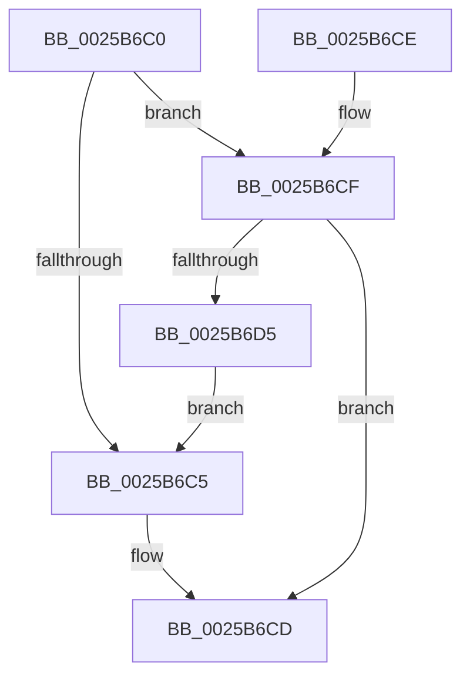

# KeAddGroupAffinityEx

- RVA: `0x0025B6C0`–`0x0025B6DD` (길이 `29` bytes)
- VA: `0x000000014025B6C0`
- 실행 섹션: `.text`
- PDB 이름 있음: `예`; PDB Function 태그: `아니요`
- unwind 정보 RVA: `0x000DB714`
- 디코드: `11`개 명령, `29/29` bytes 표시
- 미해석 바이트: `0` (있으면 어셈블리에 `.byte`로 보존)

> 이 문서는 커널 이미지의 기계어와 PDB 기호를 분석해 생성했습니다. 4번과 5번은 함수 원형과 자료형을 바이너리 사용 방식에서 추정한 C 해석이며 원본 소스 복구 결과는 아닙니다.

## 1. Dependencies

- 직접 호출 지점: **0**; 고유 호출 대상: **0**
- 직접 호출자로 확인된 함수: **46**
- RIP 상대 이미지 참조: **0**

### Outgoing calls
- 직접 디코드된 call 명령이 없습니다.

### Direct callers
- [KiDeferGroupSchedulingPreemption](../20/KiDeferGroupSchedulingPreemption_function_0020076C.md) at `0x00200D19`
- [KiHaltOnAddressWakeEntireList](../21/KiHaltOnAddressWakeEntireList_function_00217AF4.md) at `0x00217B7B`
- [sub_0021D7F8](../21/Unknown_function_0021D7F8.md) at `0x0021E75A`
- [sub_0025308F](Unknown_function_0025308F.md) at `0x00253F2D`
- [KiAttemptToScheduleThreadToBusyIsolationUnit](KiAttemptToScheduleThreadToBusyIsolationUnit_function_00259B00.md) at `0x0025A07D`
- [KiExecuteAllDpcs](KiExecuteAllDpcs_function_0025B740.md) at `0x0025C2E0`
- [KeQueryLogicalProcessorRelationship](../2C/KeQueryLogicalProcessorRelationship_function_002CEA60.md) at `0x002CEDED`
- [KeQueryLogicalProcessorRelationship](../2C/KeQueryLogicalProcessorRelationship_function_002CEA60.md) at `0x002CF5F1`
- [KiIntSteerConnect](../2D/KiIntSteerConnect_function_002D44F0.md) at `0x002D48E2`
- [KiIntSteerChooseInitialTargetProcessors](../2D/KiIntSteerChooseInitialTargetProcessors_function_002D4B98.md) at `0x002D4C97`
- [KiGroupSchedulingGenerationEnd](../30/KiGroupSchedulingGenerationEnd_function_0030A9B4.md) at `0x0030AE19`
- [KiAddProcessorToSoftwareInterruptBatch](../30/KiAddProcessorToSoftwareInterruptBatch_function_0030B138.md) at `0x0030B18F`
- [KiSoftParkElectionUnparkProcessor](../30/KiSoftParkElectionUnparkProcessor_function_0030B818.md) at `0x0030BB4C`
- [KiSoftParkElectionUnparkProcessor](../30/KiSoftParkElectionUnparkProcessor_function_0030B818.md) at `0x0030BC51`
- [KiRescheduleThreadAfterAffinityChange](../30/KiRescheduleThreadAfterAffinityChange_function_0030C9E8.md) at `0x0030CDB6`
- [KiSearchForNewThreadsOnTarget](../30/KiSearchForNewThreadsOnTarget_function_0030F500.md) at `0x003102BD`
- [KiSearchForNewThreadsOnTarget](../30/KiSearchForNewThreadsOnTarget_function_0030F500.md) at `0x00310619`
- [KiSearchForNewThreadsOnTarget](../30/KiSearchForNewThreadsOnTarget_function_0030F500.md) at `0x00310CB0`
- [KiPrepareFlushCurrentAffinity](../31/KiPrepareFlushCurrentAffinity_function_00313424.md) at `0x00313466`
- [KiSendHeteroRescheduleIntRequestHelper](../35/KiSendHeteroRescheduleIntRequestHelper_function_0035420C.md) at `0x0035473B`
- [sub_003563DE](../35/Unknown_function_003563DE.md) at `0x00356414`
- [KiSetSystemAffinityThread](../39/KiSetSystemAffinityThread_function_003993E0.md) at `0x00399928`
- [PoCopyDeepIdleMask](../3C/PoCopyDeepIdleMask_function_003C04C8.md) at `0x003C0581`
- [PpmParkComputeDiff](../4A/PpmParkComputeDiff_function_004ADCAC.md) at `0x004ADD3E`
- [PpmParkComputeDiff](../4A/PpmParkComputeDiff_function_004ADCAC.md) at `0x004ADD52`
- [PpmGetIdleConstrainedMask](../4B/PpmGetIdleConstrainedMask_function_004BCC5C.md) at `0x004BCD20`
- [KeSetSystemMultipleGroupAffinityThread](../4D/KeSetSystemMultipleGroupAffinityThread_function_004D0C88.md) at `0x004D0E60`
- [KeRevertToUserMultipleGroupAffinityThread](../4D/KeRevertToUserMultipleGroupAffinityThread_function_004D8A90.md) at `0x004D8BBC`
- [KeCpuSetQueryUnparkRecommendationEx](../4F/KeCpuSetQueryUnparkRecommendationEx_function_004F22B0.md) at `0x004F2354`
- [HvlMapDeviceInterrupt](../58/HvlMapDeviceInterrupt_function_00588A90.md) at `0x00588B32`
- [KiCpuPartitionCheckAffinitization](../5C/KiCpuPartitionCheckAffinitization_function_005C1420.md) at `0x005C14FC`
- [KiExtendProcessAffinity](../5C/KiExtendProcessAffinity_function_005CA600.md) at `0x005CA69B`
- [PpmIdleRecheckCoordinatedIdleMask](../5D/PpmIdleRecheckCoordinatedIdleMask_function_005D00FC.md) at `0x005D017A`
- [PpmHeteroHgsDetectContainmentPresence](../5D/PpmHeteroHgsDetectContainmentPresence_function_005D8768.md) at `0x005D8849`
- [PpmParkRegisterParking](../5D/PpmParkRegisterParking_function_005DB508.md) at `0x005DB62A`
- [PpmParkRegisterParking](../5D/PpmParkRegisterParking_function_005DB508.md) at `0x005DB9F9`
- [PpmParkRegisterParking](../5D/PpmParkRegisterParking_function_005DB508.md) at `0x005DBA97`
- [PpmParkCalculateCoreParkingMaskEx](../5D/PpmParkCalculateCoreParkingMaskEx_function_005DFBE0.md) at `0x005DFF35`
- [PpmParkCalculateCoreParkingMaskEx](../5D/PpmParkCalculateCoreParkingMaskEx_function_005DFBE0.md) at `0x005E000E`
- [PpmParkCalculateCoreParkingMaskEx](../5D/PpmParkCalculateCoreParkingMaskEx_function_005DFBE0.md) at `0x005E00BA`
- [PpmParkCalculateCoreParkingMaskEx](../5D/PpmParkCalculateCoreParkingMaskEx_function_005DFBE0.md) at `0x005E013F`
- [PpmParkComputeUnparkMaskEx](../5E/PpmParkComputeUnparkMaskEx_function_005E05E0.md) at `0x005E0F0D`
- [sub_006D6848](../6D/Unknown_function_006D6848.md) at `0x006D686D`
- [sub_006DDCDE](../6D/Unknown_function_006DDCDE.md) at `0x006DDD22`
- [sub_006E7E46](../6E/Unknown_function_006E7E46.md) at `0x006E7E6F`
- [sub_006F3648](../6F/Unknown_function_006F3648.md) at `0x006F3709`
- [sub_006F3648](../6F/Unknown_function_006F3648.md) at `0x006F371C`
- [sub_006F3648](../6F/Unknown_function_006F3648.md) at `0x006F3733`
- [HalAllocateHardwareCounters](../../page/70/HalAllocateHardwareCounters_function_00707050.md) at `0x00707136`
- [PpmParkApplyForcedMask](../../page/76/PpmParkApplyForcedMask_function_0076A904.md) at `0x0076AA40`
- [PpmParkApplyForcedMask](../../page/76/PpmParkApplyForcedMask_function_0076A904.md) at `0x0076AA50`
- [NtSetInformationCpuPartition](../../page/78/NtSetInformationCpuPartition_function_00783510.md) at `0x007836D4`
- [ExpProfileCreate](../../page/7D/ExpProfileCreate_function_007D1AB8.md) at `0x007D1D66`
- [PspInsertThread](../../page/9F/PspInsertThread_function_009F0314.md) at `0x009F0479`
- [NtSetInformationJobObject](../../page/9F/NtSetInformationJobObject_function_009F84C0.md) at `0x009F9126`
- [NtSetInformationJobObject](../../page/9F/NtSetInformationJobObject_function_009F84C0.md) at `0x009F96C4`
- [PpmParkUpdateConcurrencyTracking](../../page/A8/PpmParkUpdateConcurrencyTracking_function_00A850B8.md) at `0x00A85183`
- [PpmParkUpdateConcurrencyTracking](../../page/A8/PpmParkUpdateConcurrencyTracking_function_00A850B8.md) at `0x00A85217`
- [KiSetCacheInformationAmd](../../pagelk/B6/KiSetCacheInformationAmd_function_00B69CBC.md) at `0x00B69DA7`
- [KiSetCacheInformationAmd](../../pagelk/B6/KiSetCacheInformationAmd_function_00B69CBC.md) at `0x00B69E12`
- [KiSetCacheInformationAmd](../../pagelk/B6/KiSetCacheInformationAmd_function_00B69CBC.md) at `0x00B69E2C`
- [KiSetCacheInformationAmd](../../pagelk/B6/KiSetCacheInformationAmd_function_00B69CBC.md) at `0x00B69E93`
- [KiSetCacheInformationAmd](../../pagelk/B6/KiSetCacheInformationAmd_function_00B69CBC.md) at `0x00B69EE7`
- [KiSetStandardizedCacheInformation](../../pagelk/B6/KiSetStandardizedCacheInformation_function_00B6A940.md) at `0x00B6AA56`
- [KiSetStandardizedCacheInformation](../../pagelk/B6/KiSetStandardizedCacheInformation_function_00B6A940.md) at `0x00B6AACA`
- [KiSetStandardizedCacheInformation](../../pagelk/B6/KiSetStandardizedCacheInformation_function_00B6A940.md) at `0x00B6AAE7`
- [PopReadLegacySimulatedArchitecturalClasses](../../init/C4/PopReadLegacySimulatedArchitecturalClasses_function_00C41138.md) at `0x00C4122D`

### Static image references
- 디코드된 RIP-relative 메모리 참조가 없습니다.

## 2. Other-region calls and transfers

- 다른 실행 섹션으로 향하는 call: **0**
- 별도 외부 분기/꼬리 이동을 확인하지 못했습니다.

## 3. Assembly (complete function range)

```asm
0025B6C0  66 39 11                        cmp word ptr [rcx], dx
0025B6C3  76 0A                           jbe 0x14025b6cf
0025B6C5  0F B7 C2                        movzx eax, dx
0025B6C8  4C 09 44 C1 08                  or qword ptr [rcx + rax*8 + 8], r8
0025B6CD  C3                              ret
0025B6CE  CC                              int3
0025B6CF  66 39 51 02                     cmp word ptr [rcx + 2], dx
0025B6D3  76 F8                           jbe 0x14025b6cd
0025B6D5  8D 42 01                        lea eax, [rdx + 1]
0025B6D8  66 89 01                        mov word ptr [rcx], ax
0025B6DB  EB E8                           jmp 0x14025b6c5
```

## 4. C-style interpretation (structured pseudocode)

```c
__int64 __fastcall KeAddGroupAffinityEx(__int64 a1, __int64 a2, __int64 a3)
{
    if ((*(unsigned __int16 *)(a1)) <= ((unsigned __int16)(a2))) goto loc_0025B6CF;
loc_0025B6C5:
loc_0025B6CD:
    return (unsigned __int16)(a2);
loc_0025B6CF:
    if ((*(unsigned __int16 *)(a1 + 2)) <= ((unsigned __int16)(a2))) goto loc_0025B6CD;
    *(unsigned __int16 *)(a1) = (unsigned __int16)(a2 + 1);
    goto loc_0025B6C5;
}
```

## 5. (Beta) C Style

```c
int64_t KeAddGroupAffinityEx(void *Arg1, void *Arg2, int64_t Arg3)
{
    uint8_t *arg1 = (uint8_t *)Arg1;
    uint8_t *arg2 = (uint8_t *)Arg2;

    if ((*(uint16_t *)(arg1)) <= ((uint16_t)(Arg2))) goto loc_0025B6CF;
loc_0025B6C5:
loc_0025B6CD:
    return (uint16_t)(Arg2);
loc_0025B6CF:
    if ((*(uint16_t *)(arg1 + 0x2)) <= ((uint16_t)(Arg2))) goto loc_0025B6CD;
    *(uint16_t *)(arg1) = (uint16_t)(Arg2 + 1);
    goto loc_0025B6C5;
}
```

### 관측된 메모리 오프셋

구조체 형식이 확인되지 않은 접근은 인자 기준의 오프셋으로만 기록했습니다.

| 기준 인자 | 오프셋 표현 | 폭 (bit) | 접근 |
|---|---:|---:|---|
| `Arg1` | `+ 0x0` | `16` | `R` |
| `Arg1` | `+ 0x0` | `16` | `W` |
| `Arg1` | `+ 0x2` | `16` | `R` |
| `Arg1` | `+ 0x8 + rax*8` | `64` | `R/W` |
| `Arg2` | `+ 0x1` | `32` | `R` |

## 6. Execution-region graph

[열기: 2D/3D 그래프와 함수 탐색 컨트롤 패널](../../../control-panel.html?section=text&rva=0x0025B6C0&view=graph)

- 2D 그래프는 위에서 아래로 흐르고, 3D 그래프는 빈 공간을 드래그해 회전합니다. Shift+드래그는 이동, 휠은 확대·축소, 함수 노드 선택은 대상 보고서 이동입니다.

### Static fallback


