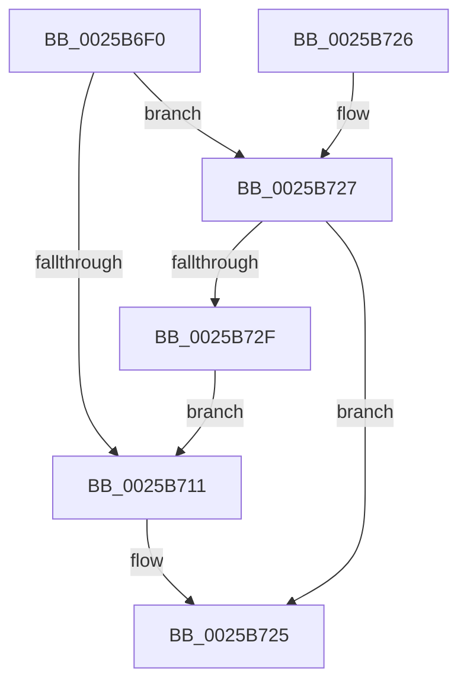

# KeAddProcessorAffinityEx

- RVA: `0x0025B6F0`–`0x0025B738` (길이 `72` bytes)
- VA: `0x000000014025B6F0`
- 실행 섹션: `.text`
- PDB 이름 있음: `예`; PDB Function 태그: `아니요`
- unwind 정보 RVA: `0x000DB714`
- 디코드: `23`개 명령, `72/72` bytes 표시
- 미해석 바이트: `0` (있으면 어셈블리에 `.byte`로 보존)

> 이 문서는 커널 이미지의 기계어와 PDB 기호를 분석해 생성했습니다. 4번과 5번은 함수 원형과 자료형을 바이너리 사용 방식에서 추정한 C 해석이며 원본 소스 복구 결과는 아닙니다.

## 1. Dependencies

- 직접 호출 지점: **0**; 고유 호출 대상: **0**
- 직접 호출자로 확인된 함수: **67**
- RIP 상대 이미지 참조: **1**

### Outgoing calls
- 직접 디코드된 call 명령이 없습니다.

### Direct callers
- [KiDeferGroupSchedulingPreemption](../20/KiDeferGroupSchedulingPreemption_function_0020076C.md) at `0x00200D03`
- [sub_0021D7F8](../21/Unknown_function_0021D7F8.md) at `0x0021E744`
- [sub_0025308F](Unknown_function_0025308F.md) at `0x00253F17`
- [KiAttemptToScheduleThreadToBusyIsolationUnit](KiAttemptToScheduleThreadToBusyIsolationUnit_function_00259B00.md) at `0x0025A067`
- [KiExecuteAllDpcs](KiExecuteAllDpcs_function_0025B740.md) at `0x0025C2C9`
- [PpmIdleSelectStates](../2C/PpmIdleSelectStates_function_002CFFE8.md) at `0x002D0216`
- [PpmWakeClockOwnerIfNeeded](../2D/PpmWakeClockOwnerIfNeeded_function_002D0924.md) at `0x002D09CF`
- [PpmUnlockProcessors](../2D/PpmUnlockProcessors_function_002D15B0.md) at `0x002D170F`
- [sub_002D95FE](../2D/Unknown_function_002D95FE.md) at `0x002D9665`
- [sub_002D9674](../2D/Unknown_function_002D9674.md) at `0x002D967A`
- [KiStopProfileTarget](../30/KiStopProfileTarget_function_00304510.md) at `0x0030467E`
- [KiCheckKeepAlive](../30/KiCheckKeepAlive_function_00305058.md) at `0x00305122`
- [KiGroupSchedulingGenerationEnd](../30/KiGroupSchedulingGenerationEnd_function_0030A9B4.md) at `0x0030AE03`
- [KiAddProcessorToSoftwareInterruptBatch](../30/KiAddProcessorToSoftwareInterruptBatch_function_0030B138.md) at `0x0030B179`
- [KiSoftParkElectionUnparkProcessor](../30/KiSoftParkElectionUnparkProcessor_function_0030B818.md) at `0x0030BB36`
- [KiSoftParkElectionUnparkProcessor](../30/KiSoftParkElectionUnparkProcessor_function_0030B818.md) at `0x0030BC3B`
- [KiRescheduleThreadAfterAffinityChange](../30/KiRescheduleThreadAfterAffinityChange_function_0030C9E8.md) at `0x0030CDA0`
- [KiSearchForNewThreadsOnTarget](../30/KiSearchForNewThreadsOnTarget_function_0030F500.md) at `0x003102A1`
- [KiSearchForNewThreadsOnTarget](../30/KiSearchForNewThreadsOnTarget_function_0030F500.md) at `0x00310603`
- [KiSearchForNewThreadsOnTarget](../30/KiSearchForNewThreadsOnTarget_function_0030F500.md) at `0x00310C9A`
- [KiSendHeteroRescheduleIntRequestHelper](../35/KiSendHeteroRescheduleIntRequestHelper_function_0035420C.md) at `0x00354725`
- [sub_003563DE](../35/Unknown_function_003563DE.md) at `0x003563FE`
- [KiSetSystemAffinityThread](../39/KiSetSystemAffinityThread_function_003993E0.md) at `0x00399912`
- [HalpTimerWatchdogTriggerSystemReset](../39/HalpTimerWatchdogTriggerSystemReset_function_0039B410.md) at `0x0039B4A1`
- [PoExecuteIdleCheck](../39/PoExecuteIdleCheck_function_0039CF20.md) at `0x0039D069`
- [KeDisableTimer2](../39/KeDisableTimer2_function_0039FD58.md) at `0x0039FF76`
- [PpmHeteroUpdateHgsConfiguration](../3B/PpmHeteroUpdateHgsConfiguration_function_003BF344.md) at `0x003BF6E5`
- [PpmHeteroUpdateHgsConfiguration](../3B/PpmHeteroUpdateHgsConfiguration_function_003BF344.md) at `0x003BF7B2`
- [PpmHeteroUpdateHgsConfiguration](../3B/PpmHeteroUpdateHgsConfiguration_function_003BF344.md) at `0x003BF7C0`
- [PpmHeteroUpdateHgsConfiguration](../3B/PpmHeteroUpdateHgsConfiguration_function_003BF344.md) at `0x003BFBDA`
- [KeFlushQueuedDpcs](../3C/KeFlushQueuedDpcs_function_003C0300.md) at `0x003C044D`
- [KiComputeHeteroConfig](../42/KiComputeHeteroConfig_function_00427544.md) at `0x0042782F`
- [KiComputeHeteroConfig](../42/KiComputeHeteroConfig_function_00427544.md) at `0x00427848`
- [KiComputeHeteroConfig](../42/KiComputeHeteroConfig_function_00427544.md) at `0x004278B6`
- [KiComputeHeteroConfig](../42/KiComputeHeteroConfig_function_00427544.md) at `0x004278C9`
- [KiComputeHeteroConfig](../42/KiComputeHeteroConfig_function_00427544.md) at `0x004278F5`
- [KiForceIdleUpdateSchedulerParkState](../48/KiForceIdleUpdateSchedulerParkState_function_0048D874.md) at `0x0048D93F`
- [PopIdleWakeStopActiveIntervalAccounting](../4B/PopIdleWakeStopActiveIntervalAccounting_function_004B40D4.md) at `0x004B41A3`
- [KiSendThawExecution](../4E/KiSendThawExecution_function_004E2800.md) at `0x004E2954`
- [PpmParkFindOverUtilizedProcessorsEx](../4F/PpmParkFindOverUtilizedProcessorsEx_function_004F1394.md) at `0x004F1441`
- [PpmParkApplyPolicyEx](../4F/PpmParkApplyPolicyEx_function_004F3090.md) at `0x004F34B7`
- [HalpInterruptInitializeLocalUnit](../55/HalpInterruptInitializeLocalUnit_function_00557A2C.md) at `0x00557CCB`
- [EmonReleaseProfileResourcesInternal](../55/EmonReleaseProfileResourcesInternal_function_0055EF54.md) at `0x0055EFD8`
- [KeUpdateProcessorRestrictionsEx](../5B/KeUpdateProcessorRestrictionsEx_function_005B64E8.md) at `0x005B6785`
- [KiStartPrcbThread](../5B/KiStartPrcbThread_function_005B941C.md) at `0x005B947F`
- [KiStartPrcbThread](../5B/KiStartPrcbThread_function_005B941C.md) at `0x005B94D8`
- [KiSrcuReadUnlockRemote](../5C/KiSrcuReadUnlockRemote_function_005C2B1C.md) at `0x005C2BA0`
- [KiAdjustUserIsolationDomainThread](../5C/KiAdjustUserIsolationDomainThread_function_005C3B54.md) at `0x005C3EC7`
- [KiRequestApcInterruptSynchronously](../5C/KiRequestApcInterruptSynchronously_function_005C47CC.md) at `0x005C4821`
- [KeGetAffinitizedInterruptsInfo](../5C/KeGetAffinitizedInterruptsInfo_function_005C5634.md) at `0x005C5656`
- [KiIpiTargetCall](../5C/KiIpiTargetCall_function_005C94B0.md) at `0x005C9554`
- [PpmRemoveIdleStates](../5D/PpmRemoveIdleStates_function_005D0730.md) at `0x005D07A1`
- [PpmTestAndLockProcessor](../5D/PpmTestAndLockProcessor_function_005D08B4.md) at `0x005D0A10`
- [PpmUpdateProcessorIdleVeto](../5D/PpmUpdateProcessorIdleVeto_function_005D0C50.md) at `0x005D0DAA`
- [PpmHeteroHgsRegisterContainmentGroups](../5D/PpmHeteroHgsRegisterContainmentGroups_function_005D8D14.md) at `0x005D8E16`
- [PpmHeteroHgsRegisterContainmentGroups](../5D/PpmHeteroHgsRegisterContainmentGroups_function_005D8D14.md) at `0x005D8EA2`
- [PpmParkCalculateCoreParkingMaskEx](../5D/PpmParkCalculateCoreParkingMaskEx_function_005DFBE0.md) at `0x005E0017`
- [PpmParkCalculateCoreParkingMaskEx](../5D/PpmParkCalculateCoreParkingMaskEx_function_005DFBE0.md) at `0x005E0148`
- [PpmParkInitParkNode](../5E/PpmParkInitParkNode_function_005E1444.md) at `0x005E15D6`
- [sub_006DDBFA](../6D/Unknown_function_006DDBFA.md) at `0x006DDC04`
- [sub_006E0608](../6E/Unknown_function_006E0608.md) at `0x006E0645`
- [sub_006EDD50](../6E/Unknown_function_006EDD50.md) at `0x006EDDCE`
- [sub_006EDD50](../6E/Unknown_function_006EDD50.md) at `0x006EDDDC`
- [sub_006EDD50](../6E/Unknown_function_006EDD50.md) at `0x006EDDEA`
- [sub_006EDD50](../6E/Unknown_function_006EDD50.md) at `0x006EDDF8`
- [HalAllocateHardwareCounters](../../page/70/HalAllocateHardwareCounters_function_00707050.md) at `0x0070715F`
- [KiPrepareUpdateCoresHeteroMask](../../page/74/KiPrepareUpdateCoresHeteroMask_function_0074508C.md) at `0x007451AC`
- [KiPrepareUpdateCoresHeteroMask](../../page/74/KiPrepareUpdateCoresHeteroMask_function_0074508C.md) at `0x007451F3`
- [KiPrepareUpdateCoresHeteroMask](../../page/74/KiPrepareUpdateCoresHeteroMask_function_0074508C.md) at `0x0074521C`
- [KiPrepareUpdateCoresHeteroMask](../../page/74/KiPrepareUpdateCoresHeteroMask_function_0074508C.md) at `0x0074535F`
- [KiPrepareUpdateCoresHeteroMask](../../page/74/KiPrepareUpdateCoresHeteroMask_function_0074508C.md) at `0x00745377`
- [KiPrepareUpdateCoresHeteroMask](../../page/74/KiPrepareUpdateCoresHeteroMask_function_0074508C.md) at `0x00745388`
- [KiPrepareUpdateCoresHeteroMask](../../page/74/KiPrepareUpdateCoresHeteroMask_function_0074508C.md) at `0x0074548F`
- [KiPrepareUpdateCoresHeteroMask](../../page/74/KiPrepareUpdateCoresHeteroMask_function_0074508C.md) at `0x007454A1`
- [KiPrepareUpdateCoresHeteroMask](../../page/74/KiPrepareUpdateCoresHeteroMask_function_0074508C.md) at `0x007454BC`
- [KiPrepareUpdateCoresHeteroMask](../../page/74/KiPrepareUpdateCoresHeteroMask_function_0074508C.md) at `0x007454C8`
- [PpmRegisterPerfStates](../../page/75/PpmRegisterPerfStates_function_0075B084.md) at `0x0075B3C6`
- [PspAllocateProcess](../../page/A1/PspAllocateProcess_function_00A13B3C.md) at `0x00A14E5E`
- [DefaultInitializeProfilingEnhanced](../../pagelk/B5/DefaultInitializeProfilingEnhanced_function_00B5CA68.md) at `0x00B5CB1C`
- [DefaultInitializeProfilingOriginal](../../pagelk/B5/DefaultInitializeProfilingOriginal_function_00B5CB30.md) at `0x00B5CBE4`
- [EmonInitializeProfilingEnhanced](../../pagelk/B5/EmonInitializeProfilingEnhanced_function_00B5F320.md) at `0x00B5F4E8`
- [EmonInitializeProfilingOriginal](../../pagelk/B5/EmonInitializeProfilingOriginal_function_00B5F630.md) at `0x00B5F927`
- [Amd64InitializeProfilingEnhanced](../../pagelk/B6/Amd64InitializeProfilingEnhanced_function_00B61318.md) at `0x00B61856`
- [Amd64InitializeProfilingOriginal](../../pagelk/B6/Amd64InitializeProfilingOriginal_function_00B618D8.md) at `0x00B61D45`
- [KiUpdateProcessorCount](../../pagelk/B6/KiUpdateProcessorCount_function_00B65D18.md) at `0x00B65D4D`
- [KiInitializeDynamicProcessorDpc](../../pagelk/B6/KiInitializeDynamicProcessorDpc_function_00B67A30.md) at `0x00B67B20`
- [KiAddCpuToSystemCpuPartition](../../pagelk/B6/KiAddCpuToSystemCpuPartition_function_00B680F0.md) at `0x00B68112`
- [KiAddCpuToSystemCpuPartition](../../pagelk/B6/KiAddCpuToSystemCpuPartition_function_00B680F0.md) at `0x00B68174`
- [KiInitializeBootStructures](../../pagelk/B6/KiInitializeBootStructures_function_00B68530.md) at `0x00B689E8`
- [KiInitializeTopologyStructures](../../pagelk/B6/KiInitializeTopologyStructures_function_00B69708.md) at `0x00B698D8`
- [KiInitializeTopologyStructures](../../pagelk/B6/KiInitializeTopologyStructures_function_00B69708.md) at `0x00B699F8`
- [KiInitializeTopologyStructures](../../pagelk/B6/KiInitializeTopologyStructures_function_00B69708.md) at `0x00B69A09`
- [KiInitializeIdleProcess](../../init/C3/KiInitializeIdleProcess_function_00C38900.md) at `0x00C3895F`
- [KiIntSteerInit](../../init/C3/KiIntSteerInit_function_00C3A1CC.md) at `0x00C3A232`
- [PspCopyNodeRelativeMaskToAffinityEx](../../init/C4/PspCopyNodeRelativeMaskToAffinityEx_function_00C451AC.md) at `0x00C452A2`

### Static image references
- `0x0025B6F0` → RVA `0x00F231B0` (`.data`; read)

## 2. Other-region calls and transfers

- 다른 실행 섹션으로 향하는 call: **0**
- 별도 외부 분기/꼬리 이동을 확인하지 못했습니다.

## 3. Assembly (complete function range)

```asm
0025B6F0  48 8B 05 B9 7A CC 00            mov rax, qword ptr [rip + 0xcc7ab9]
0025B6F7  4C 8B C9                        mov r9, rcx
0025B6FA  8B D2                           mov edx, edx
0025B6FC  44 8B 04 90                     mov r8d, dword ptr [rax + rdx*4]
0025B700  41 8B C0                        mov eax, r8d
0025B703  0F B7 11                        movzx edx, word ptr [rcx]
0025B706  41 83 E0 3F                     and r8d, 0x3f
0025B70A  C1 E8 06                        shr eax, 6
0025B70D  3B D0                           cmp edx, eax
0025B70F  76 16                           jbe 0x14025b727
0025B711  49 8B 4C C1 08                  mov rcx, qword ptr [r9 + rax*8 + 8]
0025B716  49 8D 14 C1                     lea rdx, [r9 + rax*8]
0025B71A  41 8B C0                        mov eax, r8d
0025B71D  48 0F AB C1                     bts rcx, rax
0025B721  48 89 4A 08                     mov qword ptr [rdx + 8], rcx
0025B725  C3                              ret
0025B726  CC                              int3
0025B727  0F B7 49 02                     movzx ecx, word ptr [rcx + 2]
0025B72B  3B C8                           cmp ecx, eax
0025B72D  76 F6                           jbe 0x14025b725
0025B72F  8D 48 01                        lea ecx, [rax + 1]
0025B732  66 41 89 09                     mov word ptr [r9], cx
0025B736  EB D9                           jmp 0x14025b711
```

## 4. C-style interpretation (structured pseudocode)

```c
__int64 __fastcall KeAddProcessorAffinityEx(__int64 a1, int a2)
{
    __int64 result;

    a3 = (unsigned int)(((unsigned int)(*(unsigned int *)(*(unsigned __int64 *)(v_rip + 13400761) + (unsigned int)(a2) * 4))) & (63));
    result = (unsigned int)(((unsigned int)((unsigned int)((unsigned int)(*(unsigned int *)(*(unsigned __int64 *)(v_rip + 13400761) + (unsigned int)(a2) * 4))))) >> (6));
    if (((unsigned int)(*(unsigned __int16 *)(a1))) <= ((unsigned int)(result))) goto loc_0025B727;
loc_0025B711:
    *(unsigned __int64 *)(a1 + result * 8 + 8) = *(unsigned __int64 *)(a1 + result * 8 + 8);
loc_0025B725:
    return (unsigned int)((unsigned int)(a3));
loc_0025B727:
    if (((unsigned int)(*(unsigned __int16 *)(*(unsigned __int64 *)(a1 + result * 8 + 8) + 2))) <= ((unsigned int)((unsigned int)((unsigned int)(a3))))) goto loc_0025B725;
    *(unsigned __int16 *)(a1) = (unsigned __int16)((unsigned int)((unsigned int)(a3)) + 1);
    goto loc_0025B711;
}
```

## 5. (Beta) C Style

```c
int64_t KeAddProcessorAffinityEx(void *Arg1, int32_t Arg2)
{
    uint8_t *arg1 = (uint8_t *)Arg1;

    int64_t result;

    a3 = (uint32_t)(((uint32_t)(*(uint32_t *)(*(uint64_t *)(v_rip + 0xCC7AB9) + (uint32_t)(Arg2) * 4))) & (63));
    result = (uint32_t)(((uint32_t)((uint32_t)((uint32_t)(*(uint32_t *)(*(uint64_t *)(v_rip + 0xCC7AB9) + (uint32_t)(Arg2) * 4))))) >> (6));
    if (((uint32_t)(*(uint16_t *)(arg1))) <= ((uint32_t)(result))) goto loc_0025B727;
loc_0025B711:
    *(uint64_t *)(arg1 + result * 8 + 0x8) = *(uint64_t *)(arg1 + result * 8 + 0x8);
loc_0025B725:
    return (uint32_t)((uint32_t)(a3));
loc_0025B727:
    if (((uint32_t)(*(uint16_t *)(*(uint64_t *)(arg1 + result * 8 + 0x8) + 0x2))) <= ((uint32_t)((uint32_t)((uint32_t)(a3))))) goto loc_0025B725;
    *(uint16_t *)(arg1) = (uint16_t)((uint32_t)((uint32_t)(a3)) + 1);
    goto loc_0025B711;
}
```

### 관측된 메모리 오프셋

구조체 형식이 확인되지 않은 접근은 인자 기준의 오프셋으로만 기록했습니다.

| 기준 인자 | 오프셋 표현 | 폭 (bit) | 접근 |
|---|---:|---:|---|
| `Arg1` | `+ 0x0` | `16` | `R` |
| `Arg1` | `+ 0x0` | `16` | `W` |
| `Arg1` | `+ 0x0 + rax*8` | `64` | `R` |
| `Arg1` | `+ 0x2` | `16` | `R` |
| `Arg1` | `+ 0x8` | `64` | `W` |
| `Arg1` | `+ 0x8 + rax*8` | `64` | `R` |

## 6. Execution-region graph

[열기: 2D/3D 그래프와 함수 탐색 컨트롤 패널](../../../control-panel.html?section=text&rva=0x0025B6F0&view=graph)

- 2D 그래프는 위에서 아래로 흐르고, 3D 그래프는 빈 공간을 드래그해 회전합니다. Shift+드래그는 이동, 휠은 확대·축소, 함수 노드 선택은 대상 보고서 이동입니다.

### Static fallback


