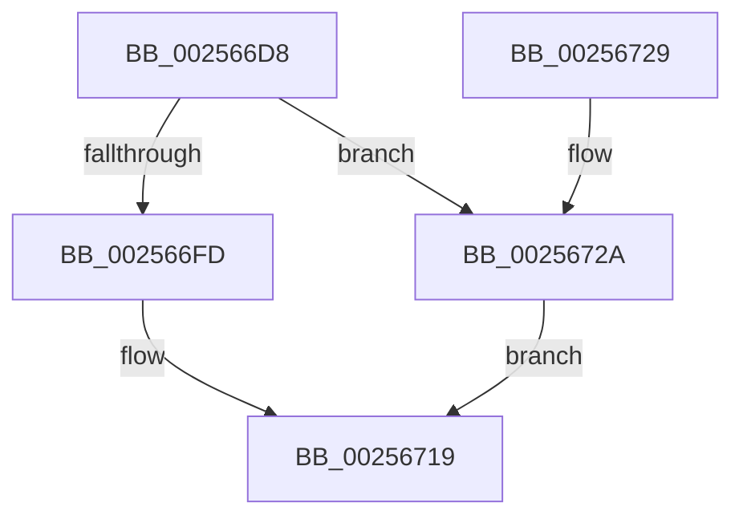

# KeEnumerateNextSchedulerSubNodeInNode

- RVA: `0x002566D8`–`0x00256731` (길이 `89` bytes)
- VA: `0x00000001402566D8`
- 실행 섹션: `.text`
- PDB 이름 있음: `예`; PDB Function 태그: `아니요`
- unwind 정보 RVA: `0x0006383C`
- 디코드: `27`개 명령, `89/89` bytes 표시
- 미해석 바이트: `0` (있으면 어셈블리에 `.byte`로 보존)

> 이 문서는 커널 이미지의 기계어와 PDB 기호를 분석해 생성했습니다. 4번과 5번은 함수 원형과 자료형을 바이너리 사용 방식에서 추정한 C 해석이며 원본 소스 복구 결과는 아닙니다.

## 1. Dependencies

- 직접 호출 지점: **2**; 고유 호출 대상: **2**
- 직접 호출자로 확인된 함수: **9**
- RIP 상대 이미지 참조: **0**

### Outgoing calls
- `0x002566F4` → [KeIsEmptyGroupMask](KeIsEmptyGroupMask_function_002553B0.md) (function, `0x002553B0`)
- `0x00256700` → [KeFindFirstSetRightGroupMask](KeFindFirstSetRightGroupMask_function_00256BE4.md) (function, `0x00256BE4`)

### Direct callers
- [KeUpdateProcessorRestrictionsEx](../5B/KeUpdateProcessorRestrictionsEx_function_005B64E8.md) at `0x005B68AC`
- [KeUpdateProcessorRestrictionsEx](../5B/KeUpdateProcessorRestrictionsEx_function_005B64E8.md) at `0x005B68DA`
- [KeQueryNodeActiveProcessorCount](../5B/KeQueryNodeActiveProcessorCount_function_005BBDF0.md) at `0x005BBE68`
- [PoAllProcessorsDeepIdle](../5C/PoAllProcessorsDeepIdle_function_005CF1C4.md) at `0x005CF23B`
- [PpmParkRegisterParking](../5D/PpmParkRegisterParking_function_005DB508.md) at `0x005DB690`
- [PpmParkRegisterParking](../5D/PpmParkRegisterParking_function_005DB508.md) at `0x005DB782`
- [sub_006D831E](../6D/Unknown_function_006D831E.md) at `0x006D85F1`
- [sub_006D831E](../6D/Unknown_function_006D831E.md) at `0x006D870F`
- [ExpQuerySystemInformation](../../page/A5/ExpQuerySystemInformation_function_00A57858.md) at `0x00A5AD59`
- [KiSynchNumaCounterSetCallback](../../page/A7/KiSynchNumaCounterSetCallback_function_00A77BE0.md) at `0x00A77D0A`
- [KeStartAllProcessors](../../init/C3/KeStartAllProcessors_function_00C36F78.md) at `0x00C37626`
- [KiConfigureAllSchedulingInformation](../../init/C3/KiConfigureAllSchedulingInformation_function_00C380D0.md) at `0x00C38197`

### Static image references
- 디코드된 RIP-relative 메모리 참조가 없습니다.

## 2. Other-region calls and transfers

- 다른 실행 섹션으로 향하는 call: **0**
- 별도 외부 분기/꼬리 이동을 확인하지 못했습니다.

## 3. Assembly (complete function range)

```asm
002566D8  48 89 5C 24 08                  mov qword ptr [rsp + 8], rbx
002566DD  48 89 74 24 10                  mov qword ptr [rsp + 0x10], rsi
002566E2  57                              push rdi
002566E3  48 83 EC 20                     sub rsp, 0x20
002566E7  48 8D 59 08                     lea rbx, [rcx + 8]
002566EB  48 8B F9                        mov rdi, rcx
002566EE  48 8B CB                        mov rcx, rbx
002566F1  48 8B F2                        mov rsi, rdx
002566F4  E8 B7 EC FF FF                  call 0x1402553b0
002566F9  85 C0                           test eax, eax
002566FB  75 2D                           jne 0x14025672a
002566FD  48 8B CB                        mov rcx, rbx
00256700  E8 DF 04 00 00                  call 0x140256be4
00256705  0F B7 C8                        movzx ecx, ax
00256708  48 0F B3 0B                     btr qword ptr [rbx], rcx
0025670C  48 8B 07                        mov rax, qword ptr [rdi]
0025670F  48 8B 4C C8 20                  mov rcx, qword ptr [rax + rcx*8 + 0x20]
00256714  33 C0                           xor eax, eax
00256716  48 89 0E                        mov qword ptr [rsi], rcx
00256719  48 8B 5C 24 30                  mov rbx, qword ptr [rsp + 0x30]
0025671E  48 8B 74 24 38                  mov rsi, qword ptr [rsp + 0x38]
00256723  48 83 C4 20                     add rsp, 0x20
00256727  5F                              pop rdi
00256728  C3                              ret
00256729  CC                              int3
0025672A  B8 1A 00 00 80                  mov eax, 0x8000001a
0025672F  EB E8                           jmp 0x140256719
```

## 4. C-style interpretation (structured pseudocode)

```c
__int64 __fastcall KeEnumerateNextSchedulerSubNodeInNode(__int64 a1, __int64 a2)
{
    __int64 result;
    __int64 v_rsp;
    unsigned __int64 v_stack_p10;
    unsigned __int64 v_stack_p8;

    v_stack_p8 = v_rbx;
    v_stack_p10 = v_rsi;
    v_rsp = (v_rsp) - (32);
    result = KeIsEmptyGroupMask(a1 + 8, a2, a3, a4);
    if ((unsigned int)(result) != 0) goto loc_0025672A;
    result = KeFindFirstSetRightGroupMask(a1 + 8, a2, a3, a4);
    result = 0;
    *(unsigned __int64 *)(a2) = *(unsigned __int64 *)(*(unsigned __int64 *)(a1) + (unsigned __int16)(result) * 8 + 32);
loc_00256719:
    v_rsp = (v_rsp) + (32);
    return result;
loc_0025672A:
    goto loc_00256719;
}
```

## 5. (Beta) C Style

```c
int64_t KeEnumerateNextSchedulerSubNodeInNode(void *Arg1, void *Arg2)
{
    uint8_t *arg1 = (uint8_t *)Arg1;
    uint8_t *arg2 = (uint8_t *)Arg2;

    int64_t result;
    int64_t local_rsp;
    uint64_t v_stack_p10;
    uint64_t v_stack_p8;

    v_stack_p8 = local_rbx;
    v_stack_p10 = local_rsi;
    local_rsp = (local_rsp) - (32);
    result = KeIsEmptyGroupMask(Arg1 + 8, Arg2, a3, a4);
    if ((uint32_t)(result) != 0) goto loc_0025672A;
    result = KeFindFirstSetRightGroupMask(Arg1 + 8, Arg2, a3, a4);
    result = 0;
    *(uint64_t *)(arg2) = *(uint64_t *)(*(uint64_t *)(arg1) + (uint16_t)(result) * 8 + 0x20);
loc_00256719:
    local_rsp = (local_rsp) + (32);
    return result;
loc_0025672A:
    goto loc_00256719;
}
```

### 관측된 메모리 오프셋

구조체 형식이 확인되지 않은 접근은 인자 기준의 오프셋으로만 기록했습니다.

| 기준 인자 | 오프셋 표현 | 폭 (bit) | 접근 |
|---|---:|---:|---|
| `Arg1` | `+ 0x0` | `64` | `R` |
| `Arg1` | `+ 0x0` | `64` | `R/W` |
| `Arg1` | `+ 0x8` | `64` | `R` |
| `Arg2` | `+ 0x0` | `64` | `W` |

## 6. Execution-region graph

[열기: 2D/3D 그래프와 함수 탐색 컨트롤 패널](../../../control-panel.html?section=text&rva=0x002566D8&view=graph)

- 2D 그래프는 위에서 아래로 흐르고, 3D 그래프는 빈 공간을 드래그해 회전합니다. Shift+드래그는 이동, 휠은 확대·축소, 함수 노드 선택은 대상 보고서 이동입니다.

### Static fallback


