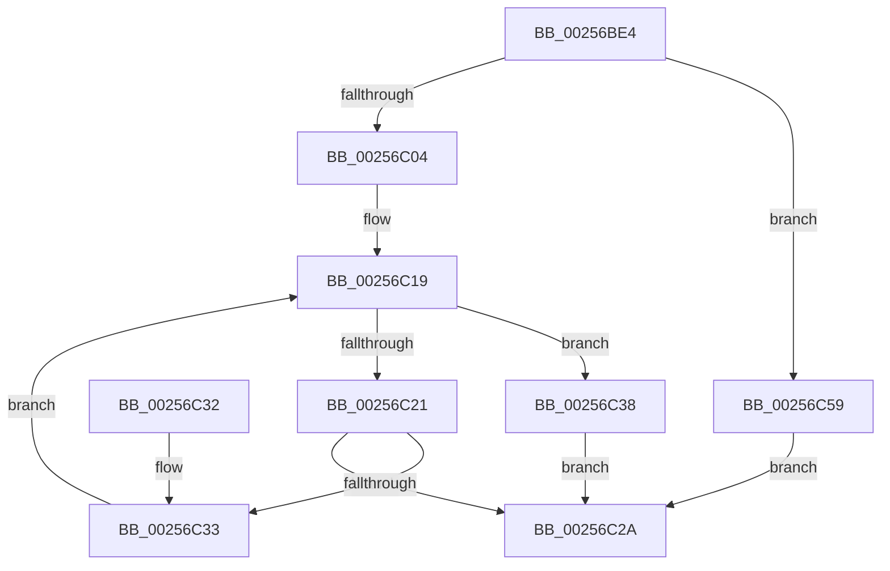

# KeFindFirstSetRightGroupMask

- RVA: `0x00256BE4`–`0x00256C5F` (길이 `123` bytes)
- VA: `0x0000000140256BE4`
- 실행 섹션: `.text`
- PDB 이름 있음: `예`; PDB Function 태그: `아니요`
- unwind 정보 RVA: `0x0006390C`
- 디코드: `38`개 명령, `123/123` bytes 표시
- 미해석 바이트: `0` (있으면 어셈블리에 `.byte`로 보존)

> 이 문서는 커널 이미지의 기계어와 PDB 기호를 분석해 생성했습니다. 4번과 5번은 함수 원형과 자료형을 바이너리 사용 방식에서 추정한 C 해석이며 원본 소스 복구 결과는 아닙니다.

## 1. Dependencies

- 직접 호출 지점: **0**; 고유 호출 대상: **0**
- 직접 호출자로 확인된 함수: **12**
- RIP 상대 이미지 참조: **0**

### Outgoing calls
- 직접 디코드된 call 명령이 없습니다.

### Direct callers
- [KiChooseTargetProcessor](KiChooseTargetProcessor_function_002556D8.md) at `0x00255B5F`
- [KiChooseTargetProcessor](KiChooseTargetProcessor_function_002556D8.md) at `0x00255E73`
- [KeEnumerateNextSchedulerSubNodeInNode](KeEnumerateNextSchedulerSubNodeInNode_function_002566D8.md) at `0x00256700`
- [sub_002567A2](Unknown_function_002567A2.md) at `0x002568A9`
- [KiEnumerateNextSchedulerSubNodeInSystem](KiEnumerateNextSchedulerSubNodeInSystem_function_002569C0.md) at `0x00256AA4`
- [PoCopyDeepIdleMask](../3C/PoCopyDeepIdleMask_function_003C04C8.md) at `0x003C0558`
- [EtwTraceThreadAffinity](../3C/EtwTraceThreadAffinity_function_003C29A0.md) at `0x003C2AB9`
- [EtwTraceThreadAffinity](../3C/EtwTraceThreadAffinity_function_003C29A0.md) at `0x003C2AE5`
- [KeQueryNodeActiveAffinity2](../41/KeQueryNodeActiveAffinity2_function_004189C0.md) at `0x00418A64`
- [PpmEventTraceHeteroSets](../42/PpmEventTraceHeteroSets_function_00426DB4.md) at `0x00426F6F`
- [PpmGetIdleConstrainedMask](../4B/PpmGetIdleConstrainedMask_function_004BCC5C.md) at `0x004BCCF7`
- [MmCreatePeb](../../page/98/MmCreatePeb_function_00980FB4.md) at `0x0098105B`
- [NtQueryInformationProcess](../../page/9A/NtQueryInformationProcess_function_009AA250.md) at `0x009ADA6E`
- [KeInitializeProcess](../../page/A6/KeInitializeProcess_function_00A63CF4.md) at `0x00A63F3C`

### Static image references
- 디코드된 RIP-relative 메모리 참조가 없습니다.

## 2. Other-region calls and transfers

- 다른 실행 섹션으로 향하는 call: **0**
- 별도 외부 분기/꼬리 이동을 확인하지 못했습니다.

## 3. Assembly (complete function range)

```asm
00256BE4  48 83 EC 18                     sub rsp, 0x18
00256BE8  48 C7 04 24 20 00 00 00         mov qword ptr [rsp], 0x20
00256BF0  4C 8B C1                        mov r8, rcx
00256BF3  4C 8B 0C 24                     mov r9, qword ptr [rsp]
00256BF7  49 FF C9                        dec r9
00256BFA  49 8D 41 01                     lea rax, [r9 + 1]
00256BFE  48 83 F8 01                     cmp rax, 1
00256C02  72 55                           jb 0x140256c59
00256C04  49 8B C1                        mov rax, r9
00256C07  48 C1 E8 06                     shr rax, 6
00256C0B  48 83 CA FF                     or rdx, 0xffffffffffffffff
00256C0F  4C 8D 14 C1                     lea r10, [rcx + rax*8]
00256C13  48 8B C1                        mov rax, rcx
00256C16  48 8B 09                        mov rcx, qword ptr [rcx]
00256C19  48 F7 D1                        not rcx
00256C1C  48 3B CA                        cmp rcx, rdx
00256C1F  75 17                           jne 0x140256c38
00256C21  48 83 C0 08                     add rax, 8
00256C25  49 3B C2                        cmp rax, r10
00256C28  76 09                           jbe 0x140256c33
00256C2A  0F B7 C2                        movzx eax, dx
00256C2D  48 83 C4 18                     add rsp, 0x18
00256C31  C3                              ret
00256C32  CC                              int3
00256C33  48 8B 08                        mov rcx, qword ptr [rax]
00256C36  EB E1                           jmp 0x140256c19
00256C38  49 2B C0                        sub rax, r8
00256C3B  48 F7 D1                        not rcx
00256C3E  48 C1 F8 03                     sar rax, 3
00256C42  48 C1 E0 06                     shl rax, 6
00256C46  48 0F BC C9                     bsf rcx, rcx
00256C4A  48 03 C1                        add rax, rcx
00256C4D  49 3B C1                        cmp rax, r9
00256C50  48 0F 47 C2                     cmova rax, rdx
00256C54  48 8B D0                        mov rdx, rax
00256C57  EB D1                           jmp 0x140256c2a
00256C59  48 83 CA FF                     or rdx, 0xffffffffffffffff
00256C5D  EB CB                           jmp 0x140256c2a
```

## 4. C-style interpretation (structured pseudocode)

```c
__int64 __fastcall KeFindFirstSetRightGroupMask(__int64 a1, __int64 a2)
{
    __int64 result;
    __int64 v_rsp;
    unsigned __int64 v_stack_m18;

    v_rsp = (v_rsp) - (24);
    v_stack_m18 = 32;
    a4 = (v_stack_m18) - 1;
    if ((a4 + 1) < 1) goto loc_00256C59;
    result = (a4) >> (6);
    a2 = (a2) | (-1);
loc_00256C19:
    a1 = ~(*(unsigned __int64 *)(a1));
    if (a1 != a2) goto loc_00256C38;
    result = (a1) + (8);
    if (result <= (a1 + result * 8)) goto loc_00256C33;
loc_00256C2A:
    v_rsp = (v_rsp) + (24);
    return (unsigned __int16)(a2);
loc_00256C33:
    goto loc_00256C19;
loc_00256C38:
    result = ((unsigned __int16)(a2)) - (a1);
    a1 = ~(*(unsigned __int64 *)((unsigned __int16)(a2)));
    result = (result) >> (3);
    result = (result) << (6);
    result = (result) + (a1);
    if (result > a4) { result = a2; }
    goto loc_00256C2A;
loc_00256C59:
    a2 = (result) | (-1);
    goto loc_00256C2A;
}
```

## 5. (Beta) C Style

```c
int64_t KeFindFirstSetRightGroupMask(void *Arg1, int64_t Arg2)
{
    uint8_t *arg1 = (uint8_t *)Arg1;

    int64_t result;
    int64_t local_rsp;
    uint64_t v_stack_m18;

    local_rsp = (local_rsp) - (24);
    v_stack_m18 = 32;
    a4 = (v_stack_m18) - 1;
    if ((a4 + 1) < 1) goto loc_00256C59;
    result = (a4) >> (6);
    Arg2 = (Arg2) | (-1);
loc_00256C19:
    Arg1 = ~(*(uint64_t *)(arg1));
    if (Arg1 != Arg2) goto loc_00256C38;
    result = (Arg1) + (8);
    if (result <= (Arg1 + result * 8)) goto loc_00256C33;
loc_00256C2A:
    local_rsp = (local_rsp) + (24);
    return (uint16_t)(Arg2);
loc_00256C33:
    goto loc_00256C19;
loc_00256C38:
    result = ((uint16_t)(Arg2)) - (Arg1);
    Arg1 = ~(*(uint64_t *)((uint16_t)(Arg2)));
    result = (result) >> (3);
    result = (result) << (6);
    result = (result) + (Arg1);
    if (result > a4) { result = Arg2; }
    goto loc_00256C2A;
loc_00256C59:
    Arg2 = (result) | (-1);
    goto loc_00256C2A;
}
```

### 관측된 메모리 오프셋

구조체 형식이 확인되지 않은 접근은 인자 기준의 오프셋으로만 기록했습니다.

| 기준 인자 | 오프셋 표현 | 폭 (bit) | 접근 |
|---|---:|---:|---|
| `Arg1` | `+ 0x0` | `64` | `R` |
| `Arg1` | `+ 0x0 + rax*8` | `64` | `R` |

## 6. Execution-region graph

[열기: 2D/3D 그래프와 함수 탐색 컨트롤 패널](../../../control-panel.html?section=text&rva=0x00256BE4&view=graph)

- 2D 그래프는 위에서 아래로 흐르고, 3D 그래프는 빈 공간을 드래그해 회전합니다. Shift+드래그는 이동, 휠은 확대·축소, 함수 노드 선택은 대상 보고서 이동입니다.

### Static fallback


