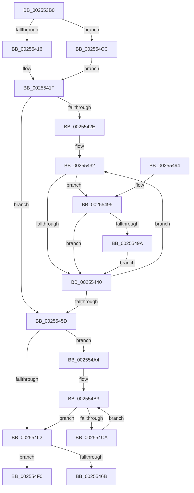

# KeIsEmptyGroupMask

- RVA: `0x002553B0`–`0x002554FC` (길이 `332` bytes)
- VA: `0x00000001402553B0`
- 실행 섹션: `.text`
- PDB 이름 있음: `예`; PDB Function 태그: `예`
- unwind 정보 RVA: `0x00063798`
- 디코드: `95`개 명령, `332/332` bytes 표시
- 미해석 바이트: `0` (있으면 어셈블리에 `.byte`로 보존)

> 이 문서는 커널 이미지의 기계어와 PDB 기호를 분석해 생성했습니다. 4번과 5번은 함수 원형과 자료형을 바이너리 사용 방식에서 추정한 C 해석이며 원본 소스 복구 결과는 아닙니다.

## 1. Dependencies

- 직접 호출 지점: **0**; 고유 호출 대상: **0**
- 직접 호출자로 확인된 함수: **15**
- RIP 상대 이미지 참조: **1**

### Outgoing calls
- 직접 디코드된 call 명령이 없습니다.

### Direct callers
- [sub_0025308F](Unknown_function_0025308F.md) at `0x00253A7D`
- [sub_0025308F](Unknown_function_0025308F.md) at `0x00253ACA`
- [KiChooseTargetProcessor](KiChooseTargetProcessor_function_002556D8.md) at `0x00255B4B`
- [KiChooseTargetProcessor](KiChooseTargetProcessor_function_002556D8.md) at `0x00255E5F`
- [KeEnumerateNextSchedulerSubNodeInNode](KeEnumerateNextSchedulerSubNodeInNode_function_002566D8.md) at `0x002566F4`
- [PoCopyDeepIdleMask](../3C/PoCopyDeepIdleMask_function_003C04C8.md) at `0x003C054A`
- [PpmEventTraceHeteroSets](../42/PpmEventTraceHeteroSets_function_00426DB4.md) at `0x00426F5E`
- [KeGetNodePrimarySubNode](../43/KeGetNodePrimarySubNode_function_0043EFF4.md) at `0x0043F02D`
- [PpmGetIdleConstrainedMask](../4B/PpmGetIdleConstrainedMask_function_004BCC5C.md) at `0x004BCCE9`
- [KeQueryActiveNodeCount](../5B/KeQueryActiveNodeCount_function_005BBD10.md) at `0x005BBD47`
- [NtQueryInformationProcess](../../page/9A/NtQueryInformationProcess_function_009AA250.md) at `0x009ADAAF`
- [PspBuildCreateProcessContext](../../page/9E/PspBuildCreateProcessContext_function_009ED6E0.md) at `0x009EE2C2`
- [PspReadIFEONodeOptions](../../page/A2/PspReadIFEONodeOptions_function_00A2CEB8.md) at `0x00A2CF33`
- [KeInitializeProcess](../../page/A6/KeInitializeProcess_function_00A63CF4.md) at `0x00A63F0F`
- [KeInitializeProcess](../../page/A6/KeInitializeProcess_function_00A63CF4.md) at `0x00A63F2F`
- [KeInitializeProcess](../../page/A6/KeInitializeProcess_function_00A63CF4.md) at `0x00A63F6C`
- [KeInitializeProcess](../../page/A6/KeInitializeProcess_function_00A63CF4.md) at `0x00A63F7E`
- [KeInitializeProcess](../../page/A6/KeInitializeProcess_function_00A63CF4.md) at `0x00A63F8F`
- [PspSelectNodeForProcess](../../page/A8/PspSelectNodeForProcess_function_00A89BDC.md) at `0x00A89C4C`
- [PspSelectNodeForProcess](../../page/A8/PspSelectNodeForProcess_function_00A89BDC.md) at `0x00A89C7B`
- [KiConfigureProcessorBlock](../../pagelk/B6/KiConfigureProcessorBlock_function_00B663E8.md) at `0x00B66487`
- [KiComputeNumaCosts](../../init/C3/KiComputeNumaCosts_function_00C37AD4.md) at `0x00C37C43`
- [KiComputeNumaCosts](../../init/C3/KiComputeNumaCosts_function_00C37AD4.md) at `0x00C37C75`

### Static image references
- `0x0025541F` → RVA `0x00000000` (`image boundary/outside`; read)

## 2. Other-region calls and transfers

- 다른 실행 섹션으로 향하는 call: **0**
- call이 아닌 외부 분기/꼬리 이동: **1**
  - `0x002554F7` → [sub_006D82DE](../6D/Unknown_function_006D82DE.md) (`tail-transfer`)

## 3. Assembly (complete function range)

```asm
002553B0  48 89 5C 24 08                  mov qword ptr [rsp + 8], rbx
002553B5  48 89 6C 24 10                  mov qword ptr [rsp + 0x10], rbp
002553BA  48 89 74 24 18                  mov qword ptr [rsp + 0x18], rsi
002553BF  48 89 7C 24 20                  mov qword ptr [rsp + 0x20], rdi
002553C4  41 54                           push r12
002553C6  41 56                           push r14
002553C8  41 57                           push r15
002553CA  48 83 EC 10                     sub rsp, 0x10
002553CE  45 33 D2                        xor r10d, r10d
002553D1  48 C7 04 24 20 00 00 00         mov qword ptr [rsp], 0x20
002553D9  4C 8B 3C 24                     mov r15, qword ptr [rsp]
002553DD  41 8B FA                        mov edi, r10d
002553E0  49 8B F7                        mov rsi, r15
002553E3  4D 8B CF                        mov r9, r15
002553E6  49 C1 E9 03                     shr r9, 3
002553EA  83 E6 07                        and esi, 7
002553ED  48 85 F6                        test rsi, rsi
002553F0  8B D9                           mov ebx, ecx
002553F2  41 B8 08 00 00 00               mov r8d, 8
002553F8  45 8B DA                        mov r11d, r10d
002553FB  40 0F 95 C7                     setne dil
002553FF  41 8B C0                        mov eax, r8d
00255402  83 E3 07                        and ebx, 7
00255405  49 03 F9                        add rdi, r9
00255408  8B D3                           mov edx, ebx
0025540A  48 2B C2                        sub rax, rdx
0025540D  49 3B C1                        cmp rax, r9
00255410  0F 86 B6 00 00 00               jbe 0x1402554cc
00255416  44 8B C7                        mov r8d, edi
00255419  45 8B F2                        mov r14d, r10d
0025541C  41 8B EA                        mov ebp, r10d
0025541F  4C 8D 25 DA AB DA FF            lea r12, [rip - 0x255426]
00255426  45 8B CA                        mov r9d, r10d
00255429  45 85 C0                        test r8d, r8d
0025542C  74 2F                           je 0x14025545d
0025542E  48 8D 5F FF                     lea rbx, [rdi - 1]
00255432  0F B6 11                        movzx edx, byte ptr [rcx]
00255435  48 FF C1                        inc rcx
00255438  41 8B C1                        mov eax, r9d
0025543B  48 3B C3                        cmp rax, rbx
0025543E  74 55                           je 0x140255495
00255440  0F B6 C2                        movzx eax, dl
00255443  41 FF C1                        inc r9d
00255446  F7 D0                           not eax
00255448  0F B6 D0                        movzx edx, al
0025544B  42 0F B6 84 22 40 41 03 00      movzx eax, byte ptr [rdx + r12 + 0x34140]
00255454  4C 03 D8                        add r11, rax
00255457  41 83 C0 FF                     add r8d, -1
0025545B  75 D5                           jne 0x140255432
0025545D  48 85 ED                        test rbp, rbp
00255460  75 42                           jne 0x1402554a4
00255462  45 85 F6                        test r14d, r14d
00255465  0F 85 85 00 00 00               jne 0x1402554f0
0025546B  48 8B 5C 24 30                  mov rbx, qword ptr [rsp + 0x30]
00255470  4D 85 DB                        test r11, r11
00255473  48 8B 6C 24 38                  mov rbp, qword ptr [rsp + 0x38]
00255478  48 8B 74 24 40                  mov rsi, qword ptr [rsp + 0x40]
0025547D  41 0F 94 C2                     sete r10b
00255481  48 8B 7C 24 48                  mov rdi, qword ptr [rsp + 0x48]
00255486  41 8B C2                        mov eax, r10d
00255489  48 83 C4 10                     add rsp, 0x10
0025548D  41 5F                           pop r15
0025548F  41 5E                           pop r14
00255491  41 5C                           pop r12
00255493  C3                              ret
00255494  CC                              int3
00255495  48 85 F6                        test rsi, rsi
00255498  74 A6                           je 0x140255440
0025549A  42 22 94 26 90 C8 02 00         and dl, byte ptr [rsi + r12 + 0x2c890]
002554A2  EB 9C                           jmp 0x140255440
002554A4  4C 8D 45 FF                     lea r8, [rbp - 1]
002554A8  49 C1 E8 03                     shr r8, 3
002554AC  49 FF C0                        inc r8
002554AF  47 8D 0C C1                     lea r9d, [r9 + r8*8]
002554B3  48 8B 01                        mov rax, qword ptr [rcx]
002554B6  48 83 C1 08                     add rcx, 8
002554BA  F3 48 0F B8 D0                  popcnt rdx, rax
002554BF  8B D2                           mov edx, edx
002554C1  4C 03 DA                        add r11, rdx
002554C4  49 83 E8 01                     sub r8, 1
002554C8  74 98                           je 0x140255462
002554CA  EB E7                           jmp 0x1402554b3
002554CC  44 2B C3                        sub r8d, ebx
002554CF  48 8B EF                        mov rbp, rdi
002554D2  45 2B C8                        sub r9d, r8d
002554D5  41 83 E1 07                     and r9d, 7
002554D9  48 85 F6                        test rsi, rsi
002554DC  45 8D 71 01                     lea r14d, [r9 + 1]
002554E0  45 0F 44 F1                     cmove r14d, r9d
002554E4  43 8D 14 06                     lea edx, [r14 + r8]
002554E8  48 2B EA                        sub rbp, rdx
002554EB  E9 2F FF FF FF                  jmp 0x14025541f
002554F0  48 FF CF                        dec rdi
002554F3  41 83 E7 07                     and r15d, 7
002554F7  E9 E2 2D 48 00                  jmp 0x1406d82de
```

## 4. C-style interpretation (structured pseudocode)

```c
__int64 __fastcall KeIsEmptyGroupMask(__int64 a1)
{
    __int64 result;
    __int64 v_r10;
    __int64 v_r11;
    __int64 v_r14;
    __int64 v_r15;
    __int64 v_rbp;
    __int64 v_rbx;
    __int64 v_rdi;
    __int64 v_rsi;
    __int64 v_rsp;
    unsigned __int64 v_stack_m28;
    unsigned __int64 v_stack_p10;
    unsigned __int64 v_stack_p18;
    unsigned __int64 v_stack_p20;
    unsigned __int64 v_stack_p8;

    v_stack_p8 = v_rbx;
    v_stack_p10 = v_rbp;
    v_stack_p18 = v_rsi;
    v_stack_p20 = v_rdi;
    v_rsp = (v_rsp) - (16);
    v_r10 = 0;
    v_stack_m28 = 32;
    a4 = (v_stack_m28) >> (3);
    v_rsi = (unsigned int)((v_stack_m28) & (7));
    v_rdi = (v_rsi != 0) ? 1 : 0;
    v_rbx = (unsigned int)(((unsigned int)((unsigned int)(a1))) & (7));
    v_rdi = (v_rdi) + (a4);
    result = (8) - ((unsigned int)((unsigned int)(v_rbx)));
    if (result <= a4) goto loc_002554CC;
loc_0025541F:
    if ((unsigned int)((unsigned int)((unsigned int)(v_rdi))) == 0) goto loc_0025545D;
loc_00255432:
    a1 = (a1) + 1;
    if (0 == (v_rdi - 1)) goto loc_00255495;
loc_00255440:
    a4 = (unsigned int)((0) + 1);
    result = (unsigned int)(~((unsigned __int8)(*(unsigned __int8 *)(a1))));
    v_r11 = (0) + (*(unsigned __int8 *)((unsigned __int8)(result) + v_rip - 2446374 * 1 + 213312));
    a3 = (unsigned int)(((unsigned int)((unsigned int)(v_rdi))) + (-1));
    if (condition_is_not_equal) goto loc_00255432;
loc_0025545D:
    if (0 != 0) goto loc_002554A4;
loc_00255462:
    if (0 != 0) goto loc_002554F0;
    v_r10 = (v_r11 == 0) ? 1 : 0;
    v_rsp = (v_rsp) + (16);
    return (unsigned int)((unsigned int)(v_r10));
loc_00255495:
    if (v_stack_p18 == 0) goto loc_00255440;
    a2 = (unsigned __int8)(((unsigned __int8)(result)) & (*(unsigned __int8 *)(v_stack_p18 + v_rip - 2446374 * 1 + 182416)));
    goto loc_00255440;
loc_002554A4:
    a3 = (v_stack_p10 - 1) >> (3);
    a3 = (a3) + 1;
loc_002554B3:
    a1 = (a1) + (8);
    v_r11 = (v_r11) + ((unsigned int)((unsigned int)(a2)));
    a3 = (a3) - (1);
    if (condition_is_equal) goto loc_00255462;
    goto loc_002554B3;
loc_002554CC:
    a3 = (unsigned int)((a3) - ((unsigned int)(v_stack_p8)));
    a4 = (unsigned int)((a4 + a3 * 8) - ((unsigned int)(a3)));
    a4 = (unsigned int)((a4) & (7));
    v_r14 = a4 + 1;
    if (v_stack_p18 == 0) { v_r14 = (unsigned int)(a4); }
    v_rbp = (v_stack_p20) - (v_r14 + a3 * 1);
    goto loc_0025541F;
loc_002554F0:
    v_rdi = (v_stack_p20) - 1;
    v_r15 = (unsigned int)((v_stack_m28) & (7));
}
```

## 5. (Beta) C Style

```c
int64_t KeIsEmptyGroupMask(int64_t Arg1)
{
    int64_t result;
    int64_t local_r10;
    int64_t local_r11;
    int64_t local_r14;
    int64_t local_r15;
    int64_t local_rbp;
    int64_t local_rbx;
    int64_t local_rdi;
    int64_t local_rsi;
    int64_t local_rsp;
    uint64_t v_stack_m28;
    uint64_t v_stack_p10;
    uint64_t v_stack_p18;
    uint64_t v_stack_p20;
    uint64_t v_stack_p8;

    v_stack_p8 = local_rbx;
    v_stack_p10 = local_rbp;
    v_stack_p18 = local_rsi;
    v_stack_p20 = local_rdi;
    local_rsp = (local_rsp) - (16);
    local_r10 = 0;
    v_stack_m28 = 32;
    a4 = (v_stack_m28) >> (3);
    local_rsi = (uint32_t)((v_stack_m28) & (7));
    local_rdi = (local_rsi != 0) ? 1 : 0;
    local_rbx = (uint32_t)(((uint32_t)((uint32_t)(Arg1))) & (7));
    local_rdi = (local_rdi) + (a4);
    result = (8) - ((uint32_t)((uint32_t)(local_rbx)));
    if (result <= a4) goto loc_002554CC;
loc_0025541F:
    if ((uint32_t)((uint32_t)((uint32_t)(local_rdi))) == 0) goto loc_0025545D;
loc_00255432:
    Arg1 = (Arg1) + 1;
    if (0 == (local_rdi - 1)) goto loc_00255495;
loc_00255440:
    a4 = (uint32_t)((0) + 1);
    result = (uint32_t)(~((uint8_t)(*(uint8_t *)(Arg1))));
    local_r11 = (0) + (*(uint8_t *)((uint8_t)(result) + v_rip - 0x255426 * 1 + 0x34140));
    a3 = (uint32_t)(((uint32_t)((uint32_t)(local_rdi))) + (-1));
    if (condition_is_not_equal) goto loc_00255432;
loc_0025545D:
    if (0 != 0) goto loc_002554A4;
loc_00255462:
    if (0 != 0) goto loc_002554F0;
    local_r10 = (local_r11 == 0) ? 1 : 0;
    local_rsp = (local_rsp) + (16);
    return (uint32_t)((uint32_t)(local_r10));
loc_00255495:
    if (v_stack_p18 == 0) goto loc_00255440;
    a2 = (uint8_t)(((uint8_t)(result)) & (*(uint8_t *)(v_stack_p18 + v_rip - 0x255426 * 1 + 0x2C890)));
    goto loc_00255440;
loc_002554A4:
    a3 = (v_stack_p10 - 1) >> (3);
    a3 = (a3) + 1;
loc_002554B3:
    Arg1 = (Arg1) + (8);
    local_r11 = (local_r11) + ((uint32_t)((uint32_t)(a2)));
    a3 = (a3) - (1);
    if (condition_is_equal) goto loc_00255462;
    goto loc_002554B3;
loc_002554CC:
    a3 = (uint32_t)((a3) - ((uint32_t)(v_stack_p8)));
    a4 = (uint32_t)((a4 + a3 * 8) - ((uint32_t)(a3)));
    a4 = (uint32_t)((a4) & (7));
    local_r14 = a4 + 1;
    if (v_stack_p18 == 0) { local_r14 = (uint32_t)(a4); }
    local_rbp = (v_stack_p20) - (local_r14 + a3 * 1);
    goto loc_0025541F;
loc_002554F0:
    local_rdi = (v_stack_p20) - 1;
    local_r15 = (uint32_t)((v_stack_m28) & (7));
}
```

## 6. Execution-region graph

[열기: 2D/3D 그래프와 함수 탐색 컨트롤 패널](../../../control-panel.html?section=text&rva=0x002553B0&view=graph)

- 2D 그래프는 위에서 아래로 흐르고, 3D 그래프는 빈 공간을 드래그해 회전합니다. Shift+드래그는 이동, 휠은 확대·축소, 함수 노드 선택은 대상 보고서 이동입니다.

### Static fallback


