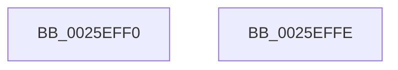

# KeLeaveCriticalRegionThread

- RVA: `0x0025EFF0`–`0x0025EFFF` (길이 `15` bytes)
- VA: `0x000000014025EFF0`
- 실행 섹션: `.text`
- PDB 이름 있음: `예`; PDB Function 태그: `아니요`
- unwind 정보 RVA: `0x0005C788`
- 디코드: `5`개 명령, `15/15` bytes 표시
- 미해석 바이트: `0` (있으면 어셈블리에 `.byte`로 보존)

> 이 문서는 커널 이미지의 기계어와 PDB 기호를 분석해 생성했습니다. 4번과 5번은 함수 원형과 자료형을 바이너리 사용 방식에서 추정한 C 해석이며 원본 소스 복구 결과는 아닙니다.

## 1. Dependencies

- 직접 호출 지점: **1**; 고유 호출 대상: **1**
- 직접 호출자로 확인된 함수: **258**
- RIP 상대 이미지 참조: **0**

### Outgoing calls
- `0x0025EFF4` → [KiLeaveCriticalRegionUnsafe](KiLeaveCriticalRegionUnsafe_function_0025F010.md) (function, `0x0025F010`)

### Direct callers
- [sub_00210084](../21/Unknown_function_00210084.md) at `0x002101B1`
- [sub_002136F8](../21/Unknown_function_002136F8.md) at `0x0021370A`
- [sub_00235EB4](../23/Unknown_function_00235EB4.md) at `0x002360A0`
- [sub_00247C30](../24/Unknown_function_00247C30.md) at `0x00247D48`
- [IopReleaseFileObjectLock](IopReleaseFileObjectLock_function_00250A90.md) at `0x00250D1B`
- [EtwpLogKernelEvent](EtwpLogKernelEvent_function_0025CC00.md) at `0x0025CEF4`
- [KeLeaveCriticalRegion](KeLeaveCriticalRegion_function_0025D8B0.md) at `0x0025D8BD`
- [sub_0025D903](Unknown_function_0025D903.md) at `0x0025E5B1`
- [sub_0025F532](Unknown_function_0025F532.md) at `0x0025F5EA`
- [PspUnlockProcessShared](../26/PspUnlockProcessShared_function_00263950.md) at `0x00263A1B`
- [sub_00263D49](../26/Unknown_function_00263D49.md) at `0x00263E5D`
- [FsRtlLookupPerFileObjectContext](../26/FsRtlLookupPerFileObjectContext_function_002641F0.md) at `0x00264280`
- [FsRtlLookupPerStreamContextInternal](../26/FsRtlLookupPerStreamContextInternal_function_00265020.md) at `0x002650AF`
- [FsRtlReleaseAutoExpandPushLockShared](../26/FsRtlReleaseAutoExpandPushLockShared_function_00265514.md) at `0x00265528`
- [FsRtlReleaseAutoExpandPushLockExclusive](../26/FsRtlReleaseAutoExpandPushLockExclusive_function_00265B5C.md) at `0x00265BBD`
- [MiUnlockImageSection](../2A/MiUnlockImageSection_function_002A3AF0.md) at `0x002A3B83`
- [MiReleaseLoadLock](../2A/MiReleaseLoadLock_function_002A3CD0.md) at `0x002A3D17`
- [MiStoreWriteModifiedPages](../2B/MiStoreWriteModifiedPages_function_002B46C4.md) at `0x002B5114`
- [MiFinishHardFault](../2B/MiFinishHardFault_function_002B6F10.md) at `0x002B7314`
- [PopPepWork](../2B/PopPepWork_function_002BCBC0.md) at `0x002BCE96`
- [PpmReleaseLock](../2D/PpmReleaseLock_function_002DA428.md) at `0x002DA4A8`
- [PoGetIdleTimes](../2D/PoGetIdleTimes_function_002DF570.md) at `0x002DF727`
- [PopReleaseRwLock](../2D/PopReleaseRwLock_function_002DFBBC.md) at `0x002DFC03`
- [EtwpOpenLogger](../2F/EtwpOpenLogger_function_002F77F0.md) at `0x002F78AC`
- [AlpcpSignalAndWait](../2F/AlpcpSignalAndWait_function_002F9620.md) at `0x002F9854`
- [NtTraceEvent](../2F/NtTraceEvent_function_002FA6C0.md) at `0x002FB0DA`
- [EtwpTraceMessageVa](../2F/EtwpTraceMessageVa_function_002FB2B0.md) at `0x002FBAB2`
- [EtwpTraceMessageVa](../2F/EtwpTraceMessageVa_function_002FB2B0.md) at `0x002FBCB6`
- [EtwpLogSystemEventUnsafe](../2F/EtwpLogSystemEventUnsafe_function_002FBF10.md) at `0x002FC396`
- [EtwTraceEvent](../2F/EtwTraceEvent_function_002FD290.md) at `0x002FD7D1`
- [EtwTraceEvent](../2F/EtwTraceEvent_function_002FD290.md) at `0x002FD82B`
- [SepCanTokenMatchAllPackageSid](../2F/SepCanTokenMatchAllPackageSid_function_002FFE90.md) at `0x002FFF63`
- [sub_00301D13](../30/Unknown_function_00301D13.md) at `0x00301D25`
- [MiEmptyPteBins](../31/MiEmptyPteBins_function_0031AAE4.md) at `0x0031AC01`
- [sub_0034A1FD](../34/Unknown_function_0034A1FD.md) at `0x0034A21F`
- [sub_0036C6B5](../36/Unknown_function_0036C6B5.md) at `0x0036CA22`
- [MiGatherPagefilePages](../37/MiGatherPagefilePages_function_00372B08.md) at `0x00372CC4`
- [MiGatherPagefilePages](../37/MiGatherPagefilePages_function_00372B08.md) at `0x003735A1`
- [MiIssueHardFault](../38/MiIssueHardFault_function_00380074.md) at `0x00380745`
- [NtWaitForWorkViaWorkerFactory](../39/NtWaitForWorkViaWorkerFactory_function_00394270.md) at `0x0039489E`
- [IopCreateSecurityCheck](../3A/IopCreateSecurityCheck_function_003A5DA0.md) at `0x003A5EE1`
- [sub_003A7AB1](../3A/Unknown_function_003A7AB1.md) at `0x003A7B16`
- [MiFlushAllPagesWorker](../3B/MiFlushAllPagesWorker_function_003BCED4.md) at `0x003BCFEF`
- [PspUnlockProcessThreadListShared](../3E/PspUnlockProcessThreadListShared_function_003ECC10.md) at `0x003ECCDB`
- [SepTrustLevelCheck](../3E/SepTrustLevelCheck_function_003ED7E0.md) at `0x003ED93B`
- [MiFlushSection](../40/MiFlushSection_function_004036B0.md) at `0x00403E90`
- [MiFlushSection](../40/MiFlushSection_function_004036B0.md) at `0x004040D9`
- [EtwpCloseLogger](../41/EtwpCloseLogger_function_00418060.md) at `0x00418089`
- [MiFinishVadDeletion](../43/MiFinishVadDeletion_function_00430ED0.md) at `0x00431122`
- [AlpcpWaitForSingleObject](../43/AlpcpWaitForSingleObject_function_0043F680.md) at `0x0043F6AA`
- [MiUnlockControlAreaSectionExtend](../44/MiUnlockControlAreaSectionExtend_function_0044BDC4.md) at `0x0044BE75`
- [SeTokenGetNoChildProcessRestricted](../45/SeTokenGetNoChildProcessRestricted_function_004584DC.md) at `0x00458535`
- [ExQueryHandleExceptionsPermanency](../45/ExQueryHandleExceptionsPermanency_function_00458CE0.md) at `0x00458D7D`
- [SepReleaseOrderedReadLocks](../45/SepReleaseOrderedReadLocks_function_0045C4C8.md) at `0x0045C4E3`
- [SepReleaseOrderedReadLocks](../45/SepReleaseOrderedReadLocks_function_0045C4C8.md) at `0x0045C4FA`
- [PspUnlockProcessExclusive](../46/PspUnlockProcessExclusive_function_004601C0.md) at `0x004601F6`
- [ExpUnlockHandleTableExclusive](../46/ExpUnlockHandleTableExclusive_function_004608A8.md) at `0x004608DB`
- [ExReleaseFastMutexUnsafeAndLeaveCriticalRegion](../46/ExReleaseFastMutexUnsafeAndLeaveCriticalRegion_function_00460A40.md) at `0x00460A52`
- [ExGetWakeTimerList](../4C/ExGetWakeTimerList_function_004CB964.md) at `0x004CBBC5`
- [PspUnlockQuotaListExclusive](../4D/PspUnlockQuotaListExclusive_function_004D9988.md) at `0x004D99BA`
- [MiStoreExtendVirtualPagefile](../4F/MiStoreExtendVirtualPagefile_function_004F73AC.md) at `0x004F74AD`
- [IoUpdateDumpPhysicalRanges](../59/IoUpdateDumpPhysicalRanges_function_0059343C.md) at `0x005934AD`
- [KasaniReportTelemetry](../5A/KasaniReportTelemetry_function_005AB1D0.md) at `0x005AB2BE`
- [sub_005AF44B](../5A/Unknown_function_005AF44B.md) at `0x005AF5B6`
- [sub_006DF40E](../6D/Unknown_function_006DF40E.md) at `0x006DF5C3`
- [DbgkpRemoveErrorPort](../../page/71/DbgkpRemoveErrorPort_function_00711038.md) at `0x00711100`
- [IopBootLogToFile](../../page/71/IopBootLogToFile_function_0071AD54.md) at `0x0071AEFE`
- [NtSetInformationKey](../../page/84/NtSetInformationKey_function_00843720.md) at `0x00843B6A`
- [NtSetValueKey](../../page/84/NtSetValueKey_function_00844EA0.md) at `0x008455BE`
- [sub_0085EBA1](../../page/85/Unknown_function_0085EBA1.md) at `0x0085EDC2`
- [ObpDecrementHandleCount](../../page/86/ObpDecrementHandleCount_function_008632E0.md) at `0x0086356C`
- [ObpDecrementHandleCount](../../page/86/ObpDecrementHandleCount_function_008632E0.md) at `0x00863695`
- [ObpDecrementHandleCount](../../page/86/ObpDecrementHandleCount_function_008632E0.md) at `0x00863890`
- [ObpDecrementHandleCount](../../page/86/ObpDecrementHandleCount_function_008632E0.md) at `0x00863934`
- [ObpDecrementHandleCount](../../page/86/ObpDecrementHandleCount_function_008632E0.md) at `0x00863982`
- [ObpDecrementHandleCount](../../page/86/ObpDecrementHandleCount_function_008632E0.md) at `0x00863A65`
- [CmpCloseKeyObject](../../page/86/CmpCloseKeyObject_function_00863AD0.md) at `0x00863CA3`
- [CmpCloseKeyObject](../../page/86/CmpCloseKeyObject_function_00863AD0.md) at `0x00863CF4`
- [sub_008654CA](../../page/86/Unknown_function_008654CA.md) at `0x00865512`
- [sub_00865538](../../page/86/Unknown_function_00865538.md) at `0x0086555D`
- [sub_0086560A](../../page/86/Unknown_function_0086560A.md) at `0x0086574F`
- [sub_0086560A](../../page/86/Unknown_function_0086560A.md) at `0x00865B16`
- [CmpCallCallBacksEx](../../page/86/CmpCallCallBacksEx_function_00865F40.md) at `0x008660C6`
- [CmpCallCallBacksEx](../../page/86/CmpCallCallBacksEx_function_00865F40.md) at `0x008662B0`
- [CmpCallbackFillObjectContext](../../page/86/CmpCallbackFillObjectContext_function_00866A10.md) at `0x00866BE8`
- [CmpCallbackFillObjectContext](../../page/86/CmpCallbackFillObjectContext_function_00866A10.md) at `0x00866EB4`
- [CmpCallbackFillObjectContext](../../page/86/CmpCallbackFillObjectContext_function_00866A10.md) at `0x00866F0F`
- [CmpCallbackFillObjectContext](../../page/86/CmpCallbackFillObjectContext_function_00866A10.md) at `0x00866F6A`
- [CmpCallbackFillObjectContext](../../page/86/CmpCallbackFillObjectContext_function_00866A10.md) at `0x00866FC5`
- [CmpCallbackFillObjectContext](../../page/86/CmpCallbackFillObjectContext_function_00866A10.md) at `0x00867251`
- [NtQueryKey](../../page/86/NtQueryKey_function_008676E0.md) at `0x00867B54`
- [NtAlpcSendWaitReceivePort](../../page/86/NtAlpcSendWaitReceivePort_function_00868040.md) at `0x008680DB`
- [ObpCloseHandle](../../page/86/ObpCloseHandle_function_008685B0.md) at `0x0086870E`
- [NtClose](../../page/86/NtClose_function_00868870.md) at `0x008689EB`
- [ObpReferenceObjectByHandleWithTag](../../page/86/ObpReferenceObjectByHandleWithTag_function_00869650.md) at `0x0086987E`
- [ObpReferenceObjectByHandleWithTag](../../page/86/ObpReferenceObjectByHandleWithTag_function_00869650.md) at `0x00869A74`
- [ObCloseHandleTableEntry](../../page/86/ObCloseHandleTableEntry_function_00869E20.md) at `0x0086A025`
- [ObCloseHandleTableEntry](../../page/86/ObCloseHandleTableEntry_function_00869E20.md) at `0x0086A314`
- [ObCloseHandleTableEntry](../../page/86/ObCloseHandleTableEntry_function_00869E20.md) at `0x0086A433`
- [ObCloseHandleTableEntry](../../page/86/ObCloseHandleTableEntry_function_00869E20.md) at `0x0086A604`
- [ObCloseHandleTableEntry](../../page/86/ObCloseHandleTableEntry_function_00869E20.md) at `0x0086A650`
- [ObCloseHandleTableEntry](../../page/86/ObCloseHandleTableEntry_function_00869E20.md) at `0x0086A7FC`
- [ObCloseHandleTableEntry](../../page/86/ObCloseHandleTableEntry_function_00869E20.md) at `0x0086A89A`
- [ObCloseHandleTableEntry](../../page/86/ObCloseHandleTableEntry_function_00869E20.md) at `0x0086A8E8`
- [ObCloseHandleTableEntry](../../page/86/ObCloseHandleTableEntry_function_00869E20.md) at `0x0086A9D1`
- [sub_0086AE9A](../../page/86/Unknown_function_0086AE9A.md) at `0x0086AE9D`
- [ObpCreateHandle](../../page/86/ObpCreateHandle_function_0086B950.md) at `0x0086BC87`
- [ObpCreateHandle](../../page/86/ObpCreateHandle_function_0086B950.md) at `0x0086BCA7`
- [ObpCreateHandle](../../page/86/ObpCreateHandle_function_0086B950.md) at `0x0086C162`
- [ObpCreateHandle](../../page/86/ObpCreateHandle_function_0086B950.md) at `0x0086C38B`
- [ObpCreateHandle](../../page/86/ObpCreateHandle_function_0086B950.md) at `0x0086C720`
- [ObpCreateHandle](../../page/86/ObpCreateHandle_function_0086B950.md) at `0x0086C737`
- [ObpCreateHandle](../../page/86/ObpCreateHandle_function_0086B950.md) at `0x0086CB1A`
- [ObpCreateHandle](../../page/86/ObpCreateHandle_function_0086B950.md) at `0x0086D77C`
- [ObpCreateHandle](../../page/86/ObpCreateHandle_function_0086B950.md) at `0x0086D8AD`
- [ObpIncrementHandleCountEx](../../page/86/ObpIncrementHandleCountEx_function_0086DA10.md) at `0x0086DCCA`
- [ObpIncrementHandleCountEx](../../page/86/ObpIncrementHandleCountEx_function_0086DA10.md) at `0x0086DD63`
- [ObpIncrementHandleCountEx](../../page/86/ObpIncrementHandleCountEx_function_0086DA10.md) at `0x0086DFBC`
- [ObpIncrementHandleCountEx](../../page/86/ObpIncrementHandleCountEx_function_0086DA10.md) at `0x0086E0E3`
- [sub_0086E95E](../../page/86/Unknown_function_0086E95E.md) at `0x0086E9E9`
- [ObpGrantAccess](../../page/86/ObpGrantAccess_function_0086F250.md) at `0x0086F4A7`
- [ObpGrantAccess](../../page/86/ObpGrantAccess_function_0086F250.md) at `0x0086F4C7`
- [sub_0086FA65](../../page/86/Unknown_function_0086FA65.md) at `0x0086FCC5`
- [sub_0086FA65](../../page/86/Unknown_function_0086FA65.md) at `0x0086FCE5`
- [CmpCheckOpenAccessOnKeyBody](../../page/87/CmpCheckOpenAccessOnKeyBody_function_00870000.md) at `0x008703BE`
- [CmpCheckOpenAccessOnKeyBody](../../page/87/CmpCheckOpenAccessOnKeyBody_function_00870000.md) at `0x008703DE`
- [CmpSecurityMethod](../../page/87/CmpSecurityMethod_function_00870CC0.md) at `0x00871069`
- [ObCheckObjectAccess](../../page/87/ObCheckObjectAccess_function_00872260.md) at `0x008724B0`
- [ObCheckObjectAccess](../../page/87/ObCheckObjectAccess_function_00872260.md) at `0x008724D0`
- [sub_00874165](../../page/87/Unknown_function_00874165.md) at `0x008741A2`
- [sub_008741C8](../../page/87/Unknown_function_008741C8.md) at `0x008741ED`
- [NtAlpcDeleteSecurityContext](../../page/88/NtAlpcDeleteSecurityContext_function_00889E00.md) at `0x00889EC6`
- [LpcRequestPort](../../page/88/LpcRequestPort_function_0088A940.md) at `0x0088A99C`
- [PspChargeProcessWakeCounter](../../page/88/PspChargeProcessWakeCounter_function_0088D2A0.md) at `0x0088D3F7`
- [NtAlpcCreateSecurityContext](../../page/89/NtAlpcCreateSecurityContext_function_00890B50.md) at `0x00890CE4`
- [AlpcpExposeTokenAttribute](../../page/89/AlpcpExposeTokenAttribute_function_00891390.md) at `0x008915C5`
- [ObpReferenceProcessObjectByHandle](../../page/89/ObpReferenceProcessObjectByHandle_function_00893C00.md) at `0x00893D2A`
- [ObpReferenceProcessObjectByHandle](../../page/89/ObpReferenceProcessObjectByHandle_function_00893C00.md) at `0x00893DDD`
- [NtAlpcQueryInformationMessage](../../page/89/NtAlpcQueryInformationMessage_function_00894700.md) at `0x00894944`
- [NtAlpcOpenSenderProcess](../../page/89/NtAlpcOpenSenderProcess_function_008953B0.md) at `0x00895645`
- [NtReplyWaitReceivePortEx](../../page/89/NtReplyWaitReceivePortEx_function_00895850.md) at `0x00895960`
- [NtAlpcImpersonateClientOfPort](../../page/89/NtAlpcImpersonateClientOfPort_function_008961A0.md) at `0x00896529`
- [AlpcpReceiveMessagePort](../../page/89/AlpcpReceiveMessagePort_function_00896B40.md) at `0x00896E51`
- [AlpcpReceiveMessagePort](../../page/89/AlpcpReceiveMessagePort_function_00896B40.md) at `0x00896F28`
- [AlpcpReceiveMessagePort](../../page/89/AlpcpReceiveMessagePort_function_00896B40.md) at `0x008970FB`
- [sub_0089A43D](../../page/89/Unknown_function_0089A43D.md) at `0x0089A4EE`
- [sub_0089A511](../../page/89/Unknown_function_0089A511.md) at `0x0089A657`
- [sub_0089A511](../../page/89/Unknown_function_0089A511.md) at `0x0089A6FB`
- [sub_0089A511](../../page/89/Unknown_function_0089A511.md) at `0x0089A749`
- [sub_0089A511](../../page/89/Unknown_function_0089A511.md) at `0x0089A82C`
- [sub_0089A903](../../page/89/Unknown_function_0089A903.md) at `0x0089AB80`
- [ObpLookupObjectName](../../page/89/ObpLookupObjectName_function_0089BE90.md) at `0x0089C6DB`
- [ObpLookupObjectName](../../page/89/ObpLookupObjectName_function_0089BE90.md) at `0x0089C8A2`
- [CmpParseKey](../../page/89/CmpParseKey_function_0089DDC0.md) at `0x0089E1E9`
- [IopParseDevice](../../page/89/IopParseDevice_function_0089E510.md) at `0x0089EBA3`
- [IopParseDevice](../../page/89/IopParseDevice_function_0089E510.md) at `0x008A00C6`
- [DbgkForwardException](../../page/8A/DbgkForwardException_function_008A2D60.md) at `0x008A2F70`
- [DbgkpSuspendProcess](../../page/8A/DbgkpSuspendProcess_function_008A34D4.md) at `0x008A3502`
- [NtQueryObject](../../page/8A/NtQueryObject_function_008A6DB0.md) at `0x008A719F`
- [NtQueryObject](../../page/8A/NtQueryObject_function_008A6DB0.md) at `0x008A729F`
- [NtQueryObject](../../page/8A/NtQueryObject_function_008A6DB0.md) at `0x008A739F`
- [NtQueryObject](../../page/8A/NtQueryObject_function_008A6DB0.md) at `0x008A73C2`
- [ObQueryNameStringMode](../../page/8A/ObQueryNameStringMode_function_008A7ED0.md) at `0x008A8133`
- [ObQueryNameStringMode](../../page/8A/ObQueryNameStringMode_function_008A7ED0.md) at `0x008A8290`
- [ObQueryNameStringMode](../../page/8A/ObQueryNameStringMode_function_008A7ED0.md) at `0x008A82DA`
- [ObQueryNameStringMode](../../page/8A/ObQueryNameStringMode_function_008A7ED0.md) at `0x008A8514`
- [ObQueryNameStringMode](../../page/8A/ObQueryNameStringMode_function_008A7ED0.md) at `0x008A86B3`
- [ObQueryNameStringMode](../../page/8A/ObQueryNameStringMode_function_008A7ED0.md) at `0x008A875E`
- [ObQueryNameStringMode](../../page/8A/ObQueryNameStringMode_function_008A7ED0.md) at `0x008A87F0`
- [sub_008A9240](../../page/8A/Unknown_function_008A9240.md) at `0x008A924E`
- [IopWaitAndAcquireFileObjectLock](../../page/8A/IopWaitAndAcquireFileObjectLock_function_008AE6D8.md) at `0x008AE76F`
- [NtEnumerateValueKey](../../page/8B/NtEnumerateValueKey_function_008B3B50.md) at `0x008B41D9`
- [SepAppendAceToTokenObjectAcl](../../page/8B/SepAppendAceToTokenObjectAcl_function_008B6430.md) at `0x008B699E`
- [SepAppendAceToTokenObjectAcl](../../page/8B/SepAppendAceToTokenObjectAcl_function_008B6430.md) at `0x008B69F2`
- [NtDuplicateToken](../../page/8B/NtDuplicateToken_function_008B6DF0.md) at `0x008B711B`
- [ObInsertObjectEx](../../page/8B/ObInsertObjectEx_function_008B97A0.md) at `0x008B9E26`
- [sub_008BA32C](../../page/8B/Unknown_function_008BA32C.md) at `0x008BA50A`
- [sub_008BA32C](../../page/8B/Unknown_function_008BA32C.md) at `0x008BA621`
- [sub_008BA676](../../page/8B/Unknown_function_008BA676.md) at `0x008BA733`
- [sub_008BA74A](../../page/8B/Unknown_function_008BA74A.md) at `0x008BA98C`
- [sub_008BA74A](../../page/8B/Unknown_function_008BA74A.md) at `0x008BAA29`
- [sub_008BAA3C](../../page/8B/Unknown_function_008BAA3C.md) at `0x008BAA65`
- [sub_008BAA6F](../../page/8B/Unknown_function_008BAA6F.md) at `0x008BABC2`
- [sub_008BAA6F](../../page/8B/Unknown_function_008BAA6F.md) at `0x008BAC13`
- [ObSetSecurityDescriptorInfo](../../page/8B/ObSetSecurityDescriptorInfo_function_008BAE20.md) at `0x008BAFF8`
- [ObSetSecurityDescriptorInfo](../../page/8B/ObSetSecurityDescriptorInfo_function_008BAE20.md) at `0x008BB0CB`
- [ObSetSecurityDescriptorInfo](../../page/8B/ObSetSecurityDescriptorInfo_function_008BAE20.md) at `0x008BB27B`
- [ObSetSecurityDescriptorInfo](../../page/8B/ObSetSecurityDescriptorInfo_function_008BAE20.md) at `0x008BB3A5`
- [ObSetSecurityDescriptorInfo](../../page/8B/ObSetSecurityDescriptorInfo_function_008BAE20.md) at `0x008BB3F3`
- [ObSetSecurityDescriptorInfo](../../page/8B/ObSetSecurityDescriptorInfo_function_008BAE20.md) at `0x008BB438`
- [sub_008BBC01](../../page/8B/Unknown_function_008BBC01.md) at `0x008BBD44`
- [EtwpReceiveNotification](../../page/8B/EtwpReceiveNotification_function_008BF9F0.md) at `0x008BFB22`
- [EtwpReceiveNotification](../../page/8B/EtwpReceiveNotification_function_008BF9F0.md) at `0x008BFBA2`
- [sub_008BFCE3](../../page/8B/Unknown_function_008BFCE3.md) at `0x008BFDBF`
- [sub_008BFE54](../../page/8B/Unknown_function_008BFE54.md) at `0x008BFE7C`
- [ObLogSecurityDescriptor](../../page/8C/ObLogSecurityDescriptor_function_008C0020.md) at `0x008C01CD`
- [ObLogSecurityDescriptor](../../page/8C/ObLogSecurityDescriptor_function_008C0020.md) at `0x008C0284`
- [ObLogSecurityDescriptor](../../page/8C/ObLogSecurityDescriptor_function_008C0020.md) at `0x008C0301`
- [EtwpRundownNotifications](../../page/8C/EtwpRundownNotifications_function_008C1284.md) at `0x008C138D`
- [EtwpClearSessionAndUnreferenceEntry](../../page/8C/EtwpClearSessionAndUnreferenceEntry_function_008C1438.md) at `0x008C157E`
- [EtwpFindOrCreateGuidEntry](../../page/8C/EtwpFindOrCreateGuidEntry_function_008C1B70.md) at `0x008C1C6A`
- [EtwpFindGuidEntryByGuid](../../page/8C/EtwpFindGuidEntryByGuid_function_008C1DB0.md) at `0x008C1EA4`
- [EtwpDeleteRegistrationObject](../../page/8C/EtwpDeleteRegistrationObject_function_008C1F30.md) at `0x008C2123`
- [EtwpDeleteRegistrationObject](../../page/8C/EtwpDeleteRegistrationObject_function_008C1F30.md) at `0x008C2178`
- [sub_008C2328](../../page/8C/Unknown_function_008C2328.md) at `0x008C2422`
- [sub_008C2328](../../page/8C/Unknown_function_008C2328.md) at `0x008C2844`
- [EtwpGetGuidList](../../page/8C/EtwpGetGuidList_function_008C2F00.md) at `0x008C308C`
- [EtwpGetNextGuidEntry](../../page/8C/EtwpGetNextGuidEntry_function_008C3170.md) at `0x008C328B`
- [sub_008C33F4](../../page/8C/Unknown_function_008C33F4.md) at `0x008C342A`
- [ObDuplicateObject](../../page/8C/ObDuplicateObject_function_008C4FA0.md) at `0x008C51B7`
- [ObDuplicateObject](../../page/8C/ObDuplicateObject_function_008C4FA0.md) at `0x008C555C`
- [ObDuplicateObject](../../page/8C/ObDuplicateObject_function_008C4FA0.md) at `0x008C5687`
- [ObDuplicateObject](../../page/8C/ObDuplicateObject_function_008C4FA0.md) at `0x008C58EA`
- [SeUnlockSubjectContext](../../page/8C/SeUnlockSubjectContext_function_008C6520.md) at `0x008C653F`
- [SeUnlockSubjectContext](../../page/8C/SeUnlockSubjectContext_function_008C6520.md) at `0x008C655E`
- [ObpCallPreOperationCallbacks](../../page/8C/ObpCallPreOperationCallbacks_function_008C6570.md) at `0x008C6812`
- [ObpCallPreOperationCallbacks](../../page/8C/ObpCallPreOperationCallbacks_function_008C6570.md) at `0x008C6958`
- [EtwpQueueNotification](../../page/8C/EtwpQueueNotification_function_008C870C.md) at `0x008C8860`
- [PsGetNextProcessThread](../../page/8C/PsGetNextProcessThread_function_008C9CF0.md) at `0x008C9DBF`
- [sub_008D6D5D](../../page/8D/Unknown_function_008D6D5D.md) at `0x008D6D70`
- [EtwpCovSampCaptureBufferMapAddressesAndQueue](../../page/8D/EtwpCovSampCaptureBufferMapAddressesAndQueue_function_008D7430.md) at `0x008D75BD`
- [EtwpCovSampCaptureBufferMapAddressesAndQueue](../../page/8D/EtwpCovSampCaptureBufferMapAddressesAndQueue_function_008D7430.md) at `0x008D7786`
- [EtwpCovSampReleaseSamplerRundown](../../page/8D/EtwpCovSampReleaseSamplerRundown_function_008D7850.md) at `0x008D7883`
- [PiDqQueryUnlock](../../page/8D/PiDqQueryUnlock_function_008DDA6C.md) at `0x008DDAAE`
- [sub_008DFC46](../../page/8D/Unknown_function_008DFC46.md) at `0x008DFC86`
- [PiPnpRtlGetCurrentOperation](../../page/8E/PiPnpRtlGetCurrentOperation_function_008E0460.md) at `0x008E04C7`
- [PiPnpRtlOperationListReleaseLock](../../page/8E/PiPnpRtlOperationListReleaseLock_function_008E0630.md) at `0x008E0649`
- [sub_008E06CC](../../page/8E/Unknown_function_008E06CC.md) at `0x008E072C`
- [sub_008E078C](../../page/8E/Unknown_function_008E078C.md) at `0x008E0A01`
- [sub_008E2AB2](../../page/8E/Unknown_function_008E2AB2.md) at `0x008E2C0B`
- [sub_008E2AB2](../../page/8E/Unknown_function_008E2AB2.md) at `0x008E2D95`
- [sub_008E2EB2](../../page/8E/Unknown_function_008E2EB2.md) at `0x008E2FA1`
- [PiDmEnumObjectsWithCallback](../../page/8E/PiDmEnumObjectsWithCallback_function_008E3920.md) at `0x008E3AD1`
- [sub_008E41B3](../../page/8E/Unknown_function_008E41B3.md) at `0x008E4383`
- [sub_008E41B3](../../page/8E/Unknown_function_008E41B3.md) at `0x008E4418`
- [sub_008E4520](../../page/8E/Unknown_function_008E4520.md) at `0x008E4535`
- [sub_008E48BF](../../page/8E/Unknown_function_008E48BF.md) at `0x008E4A06`
- [sub_008E4A5E](../../page/8E/Unknown_function_008E4A5E.md) at `0x008E4BBA`
- [sub_008E4A5E](../../page/8E/Unknown_function_008E4A5E.md) at `0x008E4C7F`
- [IopDeviceInterfaceFilterCallback](../../page/8E/IopDeviceInterfaceFilterCallback_function_008E5410.md) at `0x008E54A8`
- [PiDmObjectReleaseLock](../../page/8E/PiDmObjectReleaseLock_function_008E5584.md) at `0x008E55C5`
- [PiPnpRtlApplyMandatoryFilters](../../page/8E/PiPnpRtlApplyMandatoryFilters_function_008E5C80.md) at `0x008E5CF2`
- [PiPnpRtlApplyMandatoryDeviceFilters](../../page/8E/PiPnpRtlApplyMandatoryDeviceFilters_function_008E5E90.md) at `0x008E5F15`
- [PiCMMandatoryFilterCallback](../../page/8E/PiCMMandatoryFilterCallback_function_008E6490.md) at `0x008E650B`
- [sub_008E6883](../../page/8E/Unknown_function_008E6883.md) at `0x008E68CD`
- [NtAlpcQueryInformation](../../page/8E/NtAlpcQueryInformation_function_008E7200.md) at `0x008E7360`
- [NtWriteFile](../../page/8E/NtWriteFile_function_008E92D0.md) at `0x008E942F`
- [NtWriteFile](../../page/8E/NtWriteFile_function_008E92D0.md) at `0x008E96A8`
- [sub_008F346A](../../page/8F/Unknown_function_008F346A.md) at `0x008F35DE`
- [IoDisconnectInterrupt](../../page/90/IoDisconnectInterrupt_function_00900890.md) at `0x00900981`
- [ExpRemoveHandleTable](../../page/90/ExpRemoveHandleTable_function_00903A90.md) at `0x00903B37`
- [PspExitProcess](../../page/90/PspExitProcess_function_00904830.md) at `0x009048DA`
- [PsTerminateProcess](../../page/90/PsTerminateProcess_function_00904C64.md) at `0x00904C95`
- [ExSweepHandleTable](../../page/90/ExSweepHandleTable_function_00904D3C.md) at `0x00904EA3`
- [KeRundownApcQueues](../../page/90/KeRundownApcQueues_function_00905C44.md) at `0x00905C73`
- [NtGetCompleteWnfStateSubscription](../../page/90/NtGetCompleteWnfStateSubscription_function_00909450.md) at `0x00909561`
- [NtQueryWnfStateData](../../page/90/NtQueryWnfStateData_function_00909DF0.md) at `0x0090A4DC`
- [ExpNtUpdateWnfStateData](../../page/90/ExpNtUpdateWnfStateData_function_0090A7A0.md) at `0x0090AF14`
- [ExpWnfWorkItemRoutine](../../page/90/ExpWnfWorkItemRoutine_function_0090C4C0.md) at `0x0090C502`
- [ExUuidCreate](../../page/91/ExUuidCreate_function_00917500.md) at `0x00917635`
- [ExUuidCreate](../../page/91/ExUuidCreate_function_00917500.md) at `0x0091766E`
- [PsQueryStatisticsProcess](../../page/91/PsQueryStatisticsProcess_function_00919350.md) at `0x00919564`
- [sub_0091BD7D](../../page/91/Unknown_function_0091BD7D.md) at `0x0091BD88`
- [ExEnumHandleTable](../../page/91/ExEnumHandleTable_function_0091DB20.md) at `0x0091DC20`
- [DbgkpSendErrorMessage](../../page/92/DbgkpSendErrorMessage_function_009210A8.md) at `0x009212B6`
- [RtlpNewSecurityObject](../../page/92/RtlpNewSecurityObject_function_0092AB50.md) at `0x0092AF54`
- [RtlpNewSecurityObject](../../page/92/RtlpNewSecurityObject_function_0092AB50.md) at `0x0092AF73`
- [RtlpNewSecurityObject](../../page/92/RtlpNewSecurityObject_function_0092AB50.md) at `0x0092B469`
- [RtlpNewSecurityObject](../../page/92/RtlpNewSecurityObject_function_0092AB50.md) at `0x0092B488`
- [DrvDbReleaseDatabaseNodeBaseKey](../../page/93/DrvDbReleaseDatabaseNodeBaseKey_function_00930D44.md) at `0x00930D9E`
- [sub_00930E38](../../page/93/Unknown_function_00930E38.md) at `0x00930E71`
- [sub_00930F36](../../page/93/Unknown_function_00930F36.md) at `0x00930F4B`
- [sub_00930F5A](../../page/93/Unknown_function_00930F5A.md) at `0x00930FA0`
- [sub_0093107C](../../page/93/Unknown_function_0093107C.md) at `0x00931183`
- [sub_0093107C](../../page/93/Unknown_function_0093107C.md) at `0x00931244`
- [sub_009312D7](../../page/93/Unknown_function_009312D7.md) at `0x0093131A`
- [sub_00931420](../../page/93/Unknown_function_00931420.md) at `0x00931435`
- [sub_00931420](../../page/93/Unknown_function_00931420.md) at `0x009315D3`
- [sub_00931420](../../page/93/Unknown_function_00931420.md) at `0x00931644`
- [PiDrvDbNodeActionCallback](../../page/93/PiDrvDbNodeActionCallback_function_00931980.md) at `0x00931A45`
- [PiDrvDbLoadNode](../../page/93/PiDrvDbLoadNode_function_00931AB0.md) at `0x00931B36`
- [sub_009333F9](../../page/93/Unknown_function_009333F9.md) at `0x00933414`
- [VrpUnlockJobContextShared](../../page/93/VrpUnlockJobContextShared_function_009345D8.md) at `0x00934607`
- [sub_0093691A](../../page/93/Unknown_function_0093691A.md) at `0x00936B27`
- [sub_0093691A](../../page/93/Unknown_function_0093691A.md) at `0x00936B71`
- [CmpUnlockContextList](../../page/93/CmpUnlockContextList_function_00936C10.md) at `0x00936C5C`
- [MiPrefetchControlArea](../../page/93/MiPrefetchControlArea_function_0093E830.md) at `0x0093E8F9`
- [sub_0094BE3F](../../page/94/Unknown_function_0094BE3F.md) at `0x0094BF04`
- [sub_0094C011](../../page/94/Unknown_function_0094C011.md) at `0x0094C0E1`
- [ObpAuditObjectAccess](../../page/94/ObpAuditObjectAccess_function_0094C270.md) at `0x0094C307`
- [sub_0094D712](../../page/94/Unknown_function_0094D712.md) at `0x0094D770`
- [PiDmObjectManagerReleaseLock](../../page/95/PiDmObjectManagerReleaseLock_function_0095111C.md) at `0x0095112E`
- [IoGetDeviceObjectPointer](../../page/95/IoGetDeviceObjectPointer_function_00953220.md) at `0x0095330F`
- [RtlRunOnceExecuteOnce](../../page/95/RtlRunOnceExecuteOnce_function_0095DC00.md) at `0x0095DC5D`
- [RtlRunOnceExecuteOnce](../../page/95/RtlRunOnceExecuteOnce_function_0095DC00.md) at `0x0095DCD2`
- [NtQuerySecurityAttributesToken](../../page/97/NtQuerySecurityAttributesToken_function_00972C80.md) at `0x00972ED0`
- [SeExamineGlobalSacl](../../page/97/SeExamineGlobalSacl_function_00973C98.md) at `0x00973CFA`
- [CmpUnlockCallbackList](../../page/97/CmpUnlockCallbackList_function_0097D760.md) at `0x0097D7AC`
- [sub_009848DC](../../page/98/Unknown_function_009848DC.md) at `0x00984A48`
- [sub_009848DC](../../page/98/Unknown_function_009848DC.md) at `0x00984AEA`
- [sub_00984D37](../../page/98/Unknown_function_00984D37.md) at `0x00984D6D`
- [sub_00984D37](../../page/98/Unknown_function_00984D37.md) at `0x00984DDD`
- [FsRtlReleaseFile](../../page/98/FsRtlReleaseFile_function_00985B70.md) at `0x00985CED`
- [SeQueryUserSidToken](../../page/99/SeQueryUserSidToken_function_00990950.md) at `0x009909CF`
- [_CmGetDeviceSoftwareKeyPath](../../page/99/_CmGetDeviceSoftwareKeyPath_function_00991090.md) at `0x00991292`
- [RtlLookupAtomInAtomTable](../../page/99/RtlLookupAtomInAtomTable_function_00992DF0.md) at `0x009930EA`
- [RtlLookupAtomInAtomTable](../../page/99/RtlLookupAtomInAtomTable_function_00992DF0.md) at `0x00993230`
- [RtlLookupAtomInAtomTable](../../page/99/RtlLookupAtomInAtomTable_function_00992DF0.md) at `0x0099328F`
- [RtlLookupAtomInAtomTable](../../page/99/RtlLookupAtomInAtomTable_function_00992DF0.md) at `0x009932E8`
- [RtlLookupAtomInAtomTable](../../page/99/RtlLookupAtomInAtomTable_function_00992DF0.md) at `0x00993371`
- [RtlpHashStringToAtom](../../page/99/RtlpHashStringToAtom_function_0099E760.md) at `0x0099E90E`
- [RtlpHashStringToAtom](../../page/99/RtlpHashStringToAtom_function_0099E760.md) at `0x0099E987`
- [ObpUnlockDirectory](../../page/99/ObpUnlockDirectory_function_0099F8A0.md) at `0x0099F911`
- [IopInvalidateVolumesForDevice](../../page/9A/IopInvalidateVolumesForDevice_function_009A5E74.md) at `0x009A60BD`
- [sub_009A732C](../../page/9A/Unknown_function_009A732C.md) at `0x009A74F2`
- [sub_009A732C](../../page/9A/Unknown_function_009A732C.md) at `0x009A75E8`
- [sub_009A764D](../../page/9A/Unknown_function_009A764D.md) at `0x009A7699`
- [ObpCallPostOperationCallbacks](../../page/9A/ObpCallPostOperationCallbacks_function_009A7BC0.md) at `0x009A7C5C`
- [sub_009A8E57](../../page/9A/Unknown_function_009A8E57.md) at `0x009A8E76`
- [sub_009A9D17](../../page/9A/Unknown_function_009A9D17.md) at `0x009AA0A3`
- [sub_009AA100](../../page/9A/Unknown_function_009AA100.md) at `0x009AA11C`
- [RtlQueryAtomInAtomTable](../../page/9C/RtlQueryAtomInAtomTable_function_009C4690.md) at `0x009C47E6`
- [RtlQueryAtomInAtomTable](../../page/9C/RtlQueryAtomInAtomTable_function_009C4690.md) at `0x009C48B4`
- [RtlQueryAtomInAtomTable](../../page/9C/RtlQueryAtomInAtomTable_function_009C4690.md) at `0x009C49BF`
- [RtlpUnlockAtomTable](../../page/9C/RtlpUnlockAtomTable_function_009C4A8C.md) at `0x009C4ABE`
- [RtlpAtomMapAtomToHandleEntry](../../page/9C/RtlpAtomMapAtomToHandleEntry_function_009C4AD0.md) at `0x009C4B7C`
- [RtlpAtomMapAtomToHandleEntry](../../page/9C/RtlpAtomMapAtomToHandleEntry_function_009C4AD0.md) at `0x009C4BB0`
- [NtSetTimerResolution](../../page/9C/NtSetTimerResolution_function_009C5170.md) at `0x009C52CB`
- [ExReleaseTimeRefreshLockExclusive](../../page/9C/ExReleaseTimeRefreshLockExclusive_function_009C5874.md) at `0x009C58AC`
- [NtSubscribeWnfStateChange](../../page/9D/NtSubscribeWnfStateChange_function_009D4C20.md) at `0x009D4CF3`
- [PsQueryRuntimeProcess](../../page/9D/PsQueryRuntimeProcess_function_009D6C10.md) at `0x009D6CDA`
- [FsRtlAcquireFileForCcFlushEx](../../page/9D/FsRtlAcquireFileForCcFlushEx_function_009D72F0.md) at `0x009D7582`
- [FsRtlReleaseFileForCcFlush](../../page/9D/FsRtlReleaseFileForCcFlush_function_009D75A0.md) at `0x009D7749`
- [sub_009D78BF](../../page/9D/Unknown_function_009D78BF.md) at `0x009D78FA`
- [sub_009D7920](../../page/9D/Unknown_function_009D7920.md) at `0x009D793D`
- [FsRtlAcquireFileExclusiveCommon](../../page/9D/FsRtlAcquireFileExclusiveCommon_function_009D8E50.md) at `0x009D90AC`
- [SeGetTokenControlInformation](../../page/9E/SeGetTokenControlInformation_function_009E47E0.md) at `0x009E483C`
- [AlpciDestroyDeferredMessageContext](../../page/9E/AlpciDestroyDeferredMessageContext_function_009E62A0.md) at `0x009E62EB`
- [SeQuerySessionIdTokenEx](../../page/9E/SeQuerySessionIdTokenEx_function_009E7680.md) at `0x009E76D1`
- [sub_009E8C24](../../page/9E/Unknown_function_009E8C24.md) at `0x009E8E77`
- [sub_009E8C24](../../page/9E/Unknown_function_009E8C24.md) at `0x009E8F33`
- [sub_009E8C24](../../page/9E/Unknown_function_009E8C24.md) at `0x009E91A1`
- [NtQuerySymbolicLinkObject](../../page/9E/NtQuerySymbolicLinkObject_function_009EBA20.md) at `0x009EBC4C`
- [ExReferenceHandleDebugInfo](../../page/9F/ExReferenceHandleDebugInfo_function_009F1E18.md) at `0x009F1EA0`
- [SeQuerySecurityAttributesToken](../../page/9F/SeQuerySecurityAttributesToken_function_009F6410.md) at `0x009F6498`
- [PspStorageGetObject](../../page/9F/PspStorageGetObject_function_009FC6F4.md) at `0x009FC7B1`
- [PspSetProcessDefaultHardErrorMode](../../page/A0/PspSetProcessDefaultHardErrorMode_function_00A041A8.md) at `0x00A0424C`
- [SeQuerySessionIdToken](../../page/A0/SeQuerySessionIdToken_function_00A04490.md) at `0x00A044D3`
- [IopMountVolume](../../page/A3/IopMountVolume_function_00A329D0.md) at `0x00A32D68`
- [MiLockImageSection](../../page/A4/MiLockImageSection_function_00A48D78.md) at `0x00A48E11`
- [NtRequestPort](../../page/A9/NtRequestPort_function_00A98DA0.md) at `0x00A98E57`
- [MiForceCrashForInvalidAccess](../../page/AC/MiForceCrashForInvalidAccess_function_00ACEFA4.md) at `0x00ACF1AA`
- [NtTerminateProcess](../../page/AE/NtTerminateProcess_function_00AEC320.md) at `0x00AEC57F`
- [sub_00B1AE6C](../../page/B1/Unknown_function_00B1AE6C.md) at `0x00B1AEC8`
- [sub_00B1AF56](../../page/B1/Unknown_function_00B1AF56.md) at `0x00B1AFC7`
- [sub_00B1BF5E](../../page/B1/Unknown_function_00B1BF5E.md) at `0x00B1C105`
- [sub_00B1BF5E](../../page/B1/Unknown_function_00B1BF5E.md) at `0x00B1C1A0`
- [sub_00B1BF5E](../../page/B1/Unknown_function_00B1BF5E.md) at `0x00B1C295`
- [sub_00B20C44](../../page/B2/Unknown_function_00B20C44.md) at `0x00B20CBC`
- [sub_00B20E92](../../page/B2/Unknown_function_00B20E92.md) at `0x00B20EE2`
- [sub_00B240D8](../../page/B2/Unknown_function_00B240D8.md) at `0x00B24154`
- [sub_00B24164](../../page/B2/Unknown_function_00B24164.md) at `0x00B241A8`
- [sub_00B39BB0](../../page/B3/Unknown_function_00B39BB0.md) at `0x00B39BC2`
- [sub_00BC945D](../../pagecmrc/BC/Unknown_function_00BC945D.md) at `0x00BC9466`
- [CmpReleaseShutdownRundown](../../pagecmrc/BC/CmpReleaseShutdownRundown_function_00BC9880.md) at `0x00BC98AE`

### Static image references
- 디코드된 RIP-relative 메모리 참조가 없습니다.

## 2. Other-region calls and transfers

- 다른 실행 섹션으로 향하는 call: **0**
- 별도 외부 분기/꼬리 이동을 확인하지 못했습니다.

## 3. Assembly (complete function range)

```asm
0025EFF0  48 83 EC 28                     sub rsp, 0x28
0025EFF4  E8 17 00 00 00                  call 0x14025f010
0025EFF9  48 83 C4 28                     add rsp, 0x28
0025EFFD  C3                              ret
0025EFFE  CC                              int3
```

## 4. C-style interpretation (structured pseudocode)

```c
__int64 __fastcall KeLeaveCriticalRegionThread(void)
{
    __int64 result;
    __int64 v_rsp;

    v_rsp = (v_rsp) - (40);
    result = KiLeaveCriticalRegionUnsafe(a1, a2, a3, a4);
    v_rsp = (v_rsp) + (40);
    return result;
}
```

## 5. (Beta) C Style

```c
void KeLeaveCriticalRegionThread(void)
{
    int64_t result;
    int64_t local_rsp;

    local_rsp = (local_rsp) - (40);
    result = KiLeaveCriticalRegionUnsafe(a1, a2, a3, a4);
    local_rsp = (local_rsp) + (40);
    return result;
}
```

## 6. Execution-region graph

[열기: 2D/3D 그래프와 함수 탐색 컨트롤 패널](../../../control-panel.html?section=text&rva=0x0025EFF0&view=graph)

- 2D 그래프는 위에서 아래로 흐르고, 3D 그래프는 빈 공간을 드래그해 회전합니다. Shift+드래그는 이동, 휠은 확대·축소, 함수 노드 선택은 대상 보고서 이동입니다.

### Static fallback


