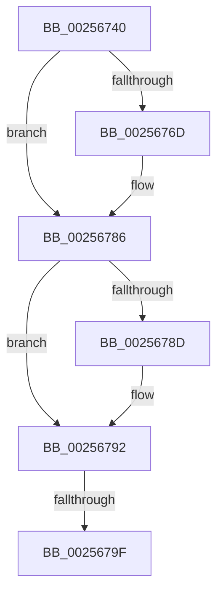

# KeQueryNodeActiveAffinityEx

- RVA: `0x00256740`–`0x002567A2` (길이 `98` bytes)
- VA: `0x0000000140256740`
- 실행 섹션: `.text`
- PDB 이름 있음: `예`; PDB Function 태그: `예`
- unwind 정보 RVA: `0x00063850`
- 디코드: `27`개 명령, `98/98` bytes 표시
- 미해석 바이트: `0` (있으면 어셈블리에 `.byte`로 보존)

> 이 문서는 커널 이미지의 기계어와 PDB 기호를 분석해 생성했습니다. 4번과 5번은 함수 원형과 자료형을 바이너리 사용 방식에서 추정한 C 해석이며 원본 소스 복구 결과는 아닙니다.

## 1. Dependencies

- 직접 호출 지점: **1**; 고유 호출 대상: **1**
- 직접 호출자로 확인된 함수: **10**
- RIP 상대 이미지 참조: **2**

### Outgoing calls
- `0x0025677B` → [memset](../6C/memset_function_006C6C40.md) (function, `0x006C6C40`)

### Direct callers
- [KeQueryLogicalProcessorRelationship](../2C/KeQueryLogicalProcessorRelationship_function_002CEA60.md) at `0x002CEE4D`
- [ExpWorkerThread](../4E/ExpWorkerThread_function_004ECAF0.md) at `0x004ECF0B`
- [PpmParkRegisterParkingEx](../5E/PpmParkRegisterParkingEx_function_005E183C.md) at `0x005E1972`
- [PpmParkRegisterParkingEx](../5E/PpmParkRegisterParkingEx_function_005E183C.md) at `0x005E1A83`
- [SMKM_STORE_MGR&lt;SM_TRAITS&gt;::SmCompressManagerUpdateTopology](../60/SMKM_STORE_MGR_SM_TRAITS_SmCompressManagerUpdateTopology_function_0060C634.md) at `0x0060C69F`
- [ExpNodeHotAddProcessor](../65/ExpNodeHotAddProcessor_function_0065A664.md) at `0x0065A6EE`
- [sub_006DB99C](../6D/Unknown_function_006DB99C.md) at `0x006DB9B6`
- [ExpNodeInitialize](../../page/7C/ExpNodeInitialize_function_007CF8A0.md) at `0x007CF944`
- [ExProcessorCounterSetCallback](../../page/9E/ExProcessorCounterSetCallback_function_009E4880.md) at `0x009E4AF3`
- [ExpWorkQueueManagerThread](../../page/AF/ExpWorkQueueManagerThread_function_00AF6D60.md) at `0x00AF7201`
- [PspCopyNodeRelativeMaskToAffinityEx](../../init/C4/PspCopyNodeRelativeMaskToAffinityEx_function_00C451AC.md) at `0x00C45241`

### Static image references
- `0x0025674B` → RVA `0x00E0A740` (`.data`; read)
- `0x00256792` → RVA `0x00FC5000` (`ALMOSTRO`; read)

## 2. Other-region calls and transfers

- 다른 실행 섹션으로 향하는 call: **0**
- call이 아닌 외부 분기/꼬리 이동: **1**
  - `0x00256799` → [sub_00256931](Unknown_function_00256931.md) (`tail-transfer`)

## 3. Assembly (complete function range)

```asm
00256740  40 53                           push rbx
00256742  55                              push rbp
00256743  41 54                           push r12
00256745  41 57                           push r15
00256747  48 83 EC 78                     sub rsp, 0x78
0025674B  48 8B 05 EE 3F BB 00            mov rax, qword ptr [rip + 0xbb3fee]
00256752  48 33 C4                        xor rax, rsp
00256755  48 89 44 24 58                  mov qword ptr [rsp + 0x58], rax
0025675A  4C 89 44 24 28                  mov qword ptr [rsp + 0x28], r8
0025675F  4D 8B E0                        mov r12, r8
00256762  0F B7 D9                        movzx ebx, cx
00256765  4C 8B FA                        mov r15, rdx
00256768  48 85 D2                        test rdx, rdx
0025676B  74 19                           je 0x140256786
0025676D  44 0F B7 02                     movzx r8d, word ptr [rdx]
00256771  48 8D 4A 08                     lea rcx, [rdx + 8]
00256775  49 C1 E0 03                     shl r8, 3
00256779  33 D2                           xor edx, edx
0025677B  E8 C0 04 47 00                  call 0x1406c6c40
00256780  66 41 C7 07 01 00               mov word ptr [r15], 1
00256786  33 ED                           xor ebp, ebp
00256788  4D 85 E4                        test r12, r12
0025678B  74 05                           je 0x140256792
0025678D  66 41 89 2C 24                  mov word ptr [r12], bp
00256792  66 3B 1D 67 E8 D6 00            cmp bx, word ptr [rip + 0xd6e867]
00256799  0F 83 92 01 00 00               jae 0x140256931
0025679F  48 8B C3                        mov rax, rbx
```

## 4. C-style interpretation (structured pseudocode)

```c
__int64 __fastcall KeQueryNodeActiveAffinityEx(unsigned __int16 a1, __int64 a2, __int64 a3)
{
    __int64 result;
    __int64 v_rbp;
    __int64 v_rsp;
    unsigned __int64 v_stack_m40;
    unsigned __int64 v_stack_m70;

    v_rsp = (v_rsp) - (120);
    result = (*(unsigned __int64 *)(v_rip + 12271598)) ^ (v_rsp);
    v_stack_m40 = result;
    v_stack_m70 = a3;
    if (a2 != 0) {
        a3 = *(unsigned __int16 *)(a2);
        a1 = a2 + 8;
        a3 = (a3) << (3);
        a2 = 0;
        result = memset(a1, a2, a3, a4);
        *(unsigned __int16 *)(a2) = 1;
    }
    v_rbp = 0;
    if (a3 != 0) {
        *(unsigned __int16 *)(a3) = 0;
    }
    return a1;
}
```

## 5. (Beta) C Style

```c
int64_t KeQueryNodeActiveAffinityEx(uint16_t Arg1, void *Arg2, int64_t Arg3)
{
    uint8_t *arg2 = (uint8_t *)Arg2;

    int64_t result;
    int64_t local_rbp;
    int64_t local_rsp;
    uint64_t v_stack_m40;
    uint64_t v_stack_m70;

    local_rsp = (local_rsp) - (120);
    result = (*(uint64_t *)(v_rip + 0xBB3FEE)) ^ (local_rsp);
    v_stack_m40 = result;
    v_stack_m70 = Arg3;
    if (Arg2 != NULL) {
        Arg3 = *(uint16_t *)(arg2);
        Arg1 = Arg2 + 8;
        Arg3 = (Arg3) << (3);
        Arg2 = 0;
        result = memset(Arg1, Arg2, Arg3, a4);
        *(uint16_t *)(arg2) = 1;
    }
    local_rbp = 0;
    if (Arg3 != 0) {
        *(uint16_t *)(Arg3) = 0;
    }
    return Arg1;
}
```

### 관측된 메모리 오프셋

구조체 형식이 확인되지 않은 접근은 인자 기준의 오프셋으로만 기록했습니다.

| 기준 인자 | 오프셋 표현 | 폭 (bit) | 접근 |
|---|---:|---:|---|
| `Arg2` | `+ 0x0` | `16` | `W` |

## 6. Execution-region graph

[열기: 2D/3D 그래프와 함수 탐색 컨트롤 패널](../../../control-panel.html?section=text&rva=0x00256740&view=graph)

- 2D 그래프는 위에서 아래로 흐르고, 3D 그래프는 빈 공간을 드래그해 회전합니다. Shift+드래그는 이동, 휠은 확대·축소, 함수 노드 선택은 대상 보고서 이동입니다.

### Static fallback


