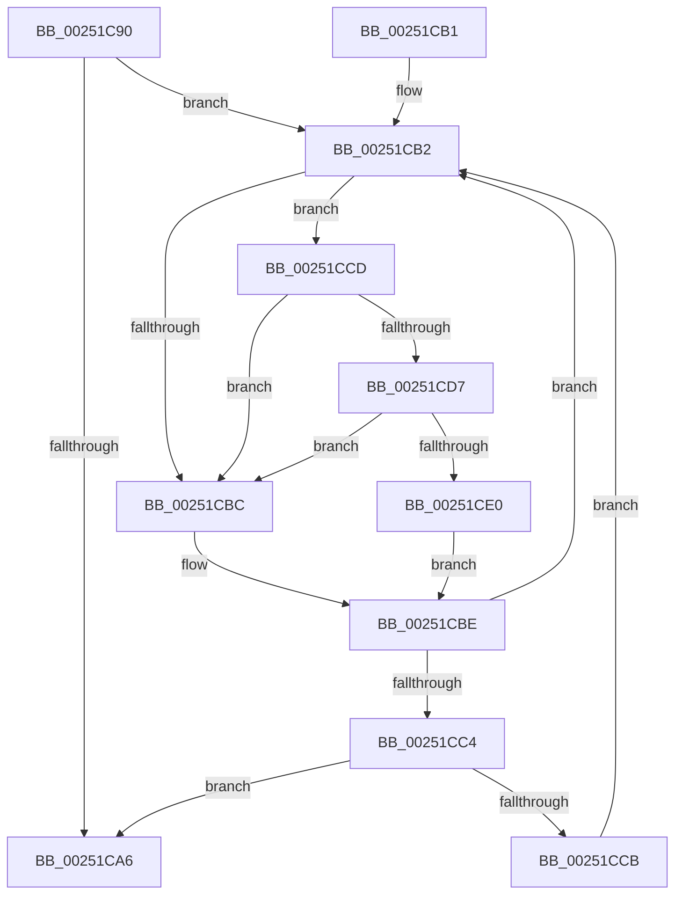

# KiAcquireKobjectLockSafe

- RVA: `0x00251C90`–`0x00251CE9` (길이 `89` bytes)
- VA: `0x0000000140251C90`
- 실행 섹션: `.text`
- PDB 이름 있음: `예`; PDB Function 태그: `아니요`
- unwind 정보 RVA: `0x00063524`
- 디코드: `31`개 명령, `89/89` bytes 표시
- 미해석 바이트: `0` (있으면 어셈블리에 `.byte`로 보존)

> 이 문서는 커널 이미지의 기계어와 PDB 기호를 분석해 생성했습니다. 4번과 5번은 함수 원형과 자료형을 바이너리 사용 방식에서 추정한 C 해석이며 원본 소스 복구 결과는 아닙니다.

## 1. Dependencies

- 직접 호출 지점: **2**; 고유 호출 대상: **2**
- 직접 호출자로 확인된 함수: **81**
- RIP 상대 이미지 참조: **2**

### Outgoing calls
- `0x00251CD7` → [KiCheckVpBackingLongSpinWaitHypercall](../30/KiCheckVpBackingLongSpinWaitHypercall_function_0030F490.md) (function, `0x0030F490`)
- `0x00251CE2` → [HvlNotifyLongSpinWait](../30/HvlNotifyLongSpinWait_function_0030F460.md) (function, `0x0030F460`)

### Direct callers
- [KeResumeThread](../20/KeResumeThread_function_00202858.md) at `0x002028A2`
- [KeForceResumeThread](../20/KeForceResumeThread_function_0020292C.md) at `0x00202974`
- [KiThawSingleThread](../20/KiThawSingleThread_function_00203560.md) at `0x0020358F`
- [KiResumeThread](../20/KiResumeThread_function_00203644.md) at `0x00203798`
- [sub_0020BDAA](../20/Unknown_function_0020BDAA.md) at `0x0020BFBF`
- [sub_0020C2D4](../20/Unknown_function_0020C2D4.md) at `0x0020C63A`
- [KiActivateWaiterQueueWithNoLocks](../20/KiActivateWaiterQueueWithNoLocks_function_0020CEB0.md) at `0x0020CF88`
- [KiCommitThreadWait](../20/KiCommitThreadWait_function_0020DFE0.md) at `0x0020E2CF`
- [sub_002175E7](../21/Unknown_function_002175E7.md) at `0x0021763C`
- [sub_002180B5](../21/Unknown_function_002180B5.md) at `0x0021810A`
- [sub_002188FB](../21/Unknown_function_002188FB.md) at `0x0021894C`
- [sub_00219EB5](../21/Unknown_function_00219EB5.md) at `0x00219F41`
- [sub_0021D7F8](../21/Unknown_function_0021D7F8.md) at `0x0021D936`
- [KeInsertPriQueue](../21/KeInsertPriQueue_function_0021EDD0.md) at `0x0021EE38`
- [IoSetIoCompletionEx3](../24/IoSetIoCompletionEx3_function_0024EEE0.md) at `0x0024EFC5`
- [IopCompleteIrpInFileObjectList](../24/IopCompleteIrpInFileObjectList_function_0024F330.md) at `0x0024F44C`
- [IoSetIoCompletionEx](../24/IoSetIoCompletionEx_function_0024FA80.md) at `0x0024FB1C`
- [sub_0024FEBE](../24/Unknown_function_0024FEBE.md) at `0x0024FF02`
- [ExReleaseFastMutexUnsafe](ExReleaseFastMutexUnsafe_function_002503A0.md) at `0x0025042A`
- [FsRtlReleaseHeaderMutex](FsRtlReleaseHeaderMutex_function_002516C0.md) at `0x00251772`
- [ExReleaseFastMutex](ExReleaseFastMutex_function_002519C0.md) at `0x00251A4B`
- [sub_0025D903](Unknown_function_0025D903.md) at `0x0025E0D7`
- [sub_0025E5F6](Unknown_function_0025E5F6.md) at `0x0025E7AD`
- [sub_00260129](../26/Unknown_function_00260129.md) at `0x00260214`
- [sub_00260366](../26/Unknown_function_00260366.md) at `0x002609D5`
- [ExReleaseFastResource](../26/ExReleaseFastResource_function_002613D0.md) at `0x002618D9`
- [sub_00261DFE](../26/Unknown_function_00261DFE.md) at `0x00262047`
- [sub_00262F80](../26/Unknown_function_00262F80.md) at `0x00262FFE`
- [sub_00274581](../27/Unknown_function_00274581.md) at `0x00274666`
- [sub_0027475D](../27/Unknown_function_0027475D.md) at `0x00274E27`
- [sub_002A1645](../2A/Unknown_function_002A1645.md) at `0x002A1667`
- [KeSignalGate](../2C/KeSignalGate_function_002C748C.md) at `0x002C74D5`
- [KeWaitForGate](../2C/KeWaitForGate_function_002CA794.md) at `0x002CA81D`
- [AlpcpSignalAndWait](../2F/AlpcpSignalAndWait_function_002F9620.md) at `0x002F97D8`
- [sub_003439EB](../34/Unknown_function_003439EB.md) at `0x00343B1B`
- [ExpLeaveWorkerFactoryAwayMode](../34/ExpLeaveWorkerFactoryAwayMode_function_00344350.md) at `0x003443AB`
- [KeReleaseSemaphoreEx](../34/KeReleaseSemaphoreEx_function_003468C0.md) at `0x0034690D`
- [KeWakeWaitChain](../34/KeWakeWaitChain_function_0034F8C0.md) at `0x0034F97F`
- [KeTimeOutQueueWaiters](../34/KeTimeOutQueueWaiters_function_0034FB58.md) at `0x0034FBBC`
- [KeSetEventBoostPriorityEx](../35/KeSetEventBoostPriorityEx_function_00350148.md) at `0x00350190`
- [KeRundownQueueEx](../35/KeRundownQueueEx_function_00351508.md) at `0x0035153B`
- [KeDeleteMutant](../35/KeDeleteMutant_function_00351788.md) at `0x003517E3`
- [KePulseEvent](../35/KePulseEvent_function_00351EF0.md) at `0x00351F42`
- [KeSetProcess](../35/KeSetProcess_function_003520E8.md) at `0x0035212F`
- [KeTerminateThread](../35/KeTerminateThread_function_00355138.md) at `0x0035521A`
- [KeTerminateThread](../35/KeTerminateThread_function_00355138.md) at `0x0035529B`
- [KiInSwapSingleProcess](../35/KiInSwapSingleProcess_function_00355474.md) at `0x0035549E`
- [KeRegisterObjectNotification](../39/KeRegisterObjectNotification_function_00393454.md) at `0x00393499`
- [KiDeregisterObjectWaitBlock](../39/KiDeregisterObjectWaitBlock_function_00394F3C.md) at `0x00394F72`
- [AlpcpSignal](../39/AlpcpSignal_function_003955E0.md) at `0x003957AD`
- [AlpcpSignal](../39/AlpcpSignal_function_003955E0.md) at `0x00395933`
- [AlpcpSignal](../39/AlpcpSignal_function_003955E0.md) at `0x00395A20`
- [KiReadyOutSwappedThreads](../39/KiReadyOutSwappedThreads_function_00396E30.md) at `0x00396F88`
- [KiReadyOutSwappedThreads](../39/KiReadyOutSwappedThreads_function_00396E30.md) at `0x00396FF7`
- [AlpcpQueueIoCompletion](../39/AlpcpQueueIoCompletion_function_00397480.md) at `0x00397576`
- [sub_00397982](../39/Unknown_function_00397982.md) at `0x0039798F`
- [KiInswapAndReadyThread](../39/KiInswapAndReadyThread_function_00398318.md) at `0x003983EA`
- [KiInswapAndReadyThread](../39/KiInswapAndReadyThread_function_00398318.md) at `0x00398432`
- [sub_003A18D4](../3A/Unknown_function_003A18D4.md) at `0x003A192B`
- [KeStartThread](../3C/KeStartThread_function_003C21B8.md) at `0x003C2398`
- [KeRemovePriQueue](../3C/KeRemovePriQueue_function_003C5090.md) at `0x003C5230`
- [KiWaitForAllObjects](../3C/KiWaitForAllObjects_function_003C5800.md) at `0x003C5A10`
- [KiWaitForAllObjects](../3C/KiWaitForAllObjects_function_003C5800.md) at `0x003C5A35`
- [sub_003C67DC](../3C/Unknown_function_003C67DC.md) at `0x003C684A`
- [KiSwitchPriQueue](../3C/KiSwitchPriQueue_function_003C6DC0.md) at `0x003C6DF0`
- [KiOutSwapProcesses](../3C/KiOutSwapProcesses_function_003C8038.md) at `0x003C807F`
- [KiOutSwapProcesses](../3C/KiOutSwapProcesses_function_003C8038.md) at `0x003C8116`
- [KiOutSwapProcesses](../3C/KiOutSwapProcesses_function_003C8038.md) at `0x003C8146`
- [AlpcpQueueIoCompletionPort](../3F/AlpcpQueueIoCompletionPort_function_003FF760.md) at `0x003FF9A2`
- [KeRemoveQueueEntry](../42/KeRemoveQueueEntry_function_0042F770.md) at `0x0042F7A6`
- [KiInSwapProcesses](../46/KiInSwapProcesses_function_00463218.md) at `0x0046325F`
- [IopPassiveInterruptDpc](../46/IopPassiveInterruptDpc_function_00469D40.md) at `0x00469D9D`
- [KiFreezeSingleThread](../46/KiFreezeSingleThread_function_0046B890.md) at `0x0046B8C1`
- [KiSuspendThread](../46/KiSuspendThread_function_0046B964.md) at `0x0046BABE`
- [KeInsertQueue](../46/KeInsertQueue_function_0046C8F0.md) at `0x0046C951`
- [KeQueryTimerDueTime](../49/KeQueryTimerDueTime_function_00499CC0.md) at `0x00499CEA`
- [KeQueryOwnerMutant](../49/KeQueryOwnerMutant_function_0049A720.md) at `0x0049A757`
- [KeRetryOutswapProcess](../4A/KeRetryOutswapProcess_function_004A2E20.md) at `0x004A2E4B`
- [KeSuspendThread](../4E/KeSuspendThread_function_004E8B9C.md) at `0x004E8C13`
- [ExpCheckForWorker](../4E/ExpCheckForWorker_function_004EC8FC.md) at `0x004EC9F4`
- [FsRtlpPostStackOverflow](../58/FsRtlpPostStackOverflow_function_0058351C.md) at `0x0058360D`
- [KeRegisterObjectDpc](../5B/KeRegisterObjectDpc_function_005B2544.md) at `0x005B259B`
- [KeQueryTotalSuspendCountThread](../5B/KeQueryTotalSuspendCountThread_function_005B8EF8.md) at `0x005B8F32`
- [KeSuspendThreadOld](../5B/KeSuspendThreadOld_function_005B9000.md) at `0x005B904D`
- [KeInsertHeadQueue](../5B/KeInsertHeadQueue_function_005BE5D0.md) at `0x005BE647`
- [KiAdjustThreadTimer](../5C/KiAdjustThreadTimer_function_005C3A3C.md) at `0x005C3A6D`
- [KeRundownPriQueue](../5C/KeRundownPriQueue_function_005CA930.md) at `0x005CA95E`
- [PspSetProcessTimerDelayForKTimers](../5E/PspSetProcessTimerDelayForKTimers_function_005E3C40.md) at `0x005E3CE5`
- [sub_006F59B4](../6F/Unknown_function_006F59B4.md) at `0x006F5A2D`

### Static image references
- `0x00251CB4` → RVA `0x00FC52AC` (`ALMOSTRO`; reference)
- `0x00251CCD` → RVA `0x00FC6AB8` (`ALMOSTRO`; read)

## 2. Other-region calls and transfers

- 다른 실행 섹션으로 향하는 call: **0**
- 별도 외부 분기/꼬리 이동을 확인하지 못했습니다.

## 3. Assembly (complete function range)

```asm
00251C90  48 89 5C 24 10                  mov qword ptr [rsp + 0x10], rbx
00251C95  57                              push rdi
00251C96  48 83 EC 20                     sub rsp, 0x20
00251C9A  33 FF                           xor edi, edi
00251C9C  48 8B D9                        mov rbx, rcx
00251C9F  F0 0F BA 29 07                  lock bts dword ptr [rcx], 7
00251CA4  72 0C                           jb 0x140251cb2
00251CA6  48 8B 5C 24 38                  mov rbx, qword ptr [rsp + 0x38]
00251CAB  48 83 C4 20                     add rsp, 0x20
00251CAF  5F                              pop rdi
00251CB0  C3                              ret
00251CB1  CC                              int3
00251CB2  FF C7                           inc edi
00251CB4  85 3D F2 35 D7 00               test dword ptr [rip + 0xd735f2], edi
00251CBA  74 11                           je 0x140251ccd
00251CBC  F3 90                           pause
00251CBE  8B 03                           mov eax, dword ptr [rbx]
00251CC0  84 C0                           test al, al
00251CC2  78 EE                           js 0x140251cb2
00251CC4  F0 0F BA 2B 07                  lock bts dword ptr [rbx], 7
00251CC9  73 DB                           jae 0x140251ca6
00251CCB  EB E5                           jmp 0x140251cb2
00251CCD  8B 05 E5 4D D7 00               mov eax, dword ptr [rip + 0xd74de5]
00251CD3  A8 40                           test al, 0x40
00251CD5  74 E5                           je 0x140251cbc
00251CD7  E8 B4 D7 0B 00                  call 0x14030f490
00251CDC  84 C0                           test al, al
00251CDE  74 DC                           je 0x140251cbc
00251CE0  8B CF                           mov ecx, edi
00251CE2  E8 79 D7 0B 00                  call 0x14030f460
00251CE7  EB D5                           jmp 0x140251cbe
```

## 4. C-style interpretation (structured pseudocode)

```c
__int64 __fastcall KiAcquireKobjectLockSafe(__int64 a1)
{
    __int64 result;
    __int64 v_rdi;
    __int64 v_rsp;
    unsigned __int64 v_stack_p10;

    v_stack_p10 = v_rbx;
    v_rsp = (v_rsp) - (32);
    v_rdi = 0;
    if (condition_is_below) goto loc_00251CB2;
loc_00251CA6:
    v_rsp = (v_rsp) + (32);
    return result;
loc_00251CB2:
    v_rdi = (unsigned int)((v_rdi) + 1);
    if (((*(unsigned int *)(v_rip + 14104050)) & ((unsigned int)(v_rdi))) == 0) goto loc_00251CCD;
loc_00251CBC:
loc_00251CBE:
    if (sign_flag) goto loc_00251CB2;
    if (condition_is_above_or_equal) goto loc_00251CA6;
    goto loc_00251CB2;
loc_00251CCD:
    if ((((unsigned __int8)((unsigned int)(*(unsigned int *)(v_rip + 14110181)))) & (64)) == 0) goto loc_00251CBC;
    result = KiCheckVpBackingLongSpinWaitHypercall(a1, a2, a3, a4);
    if ((unsigned __int8)(result) == 0) goto loc_00251CBC;
    result = HvlNotifyLongSpinWait((unsigned int)((unsigned int)(v_rdi)), a2, a3, a4);
    goto loc_00251CBE;
}
```

## 5. (Beta) C Style

```c
int64_t KiAcquireKobjectLockSafe(void *Arg1)
{
    uint8_t *arg1 = (uint8_t *)Arg1;

    int64_t result;
    int64_t local_rdi;
    int64_t local_rsp;
    uint64_t v_stack_p10;

    v_stack_p10 = local_rbx;
    local_rsp = (local_rsp) - (32);
    local_rdi = 0;
    if (condition_is_below) goto loc_00251CB2;
loc_00251CA6:
    local_rsp = (local_rsp) + (32);
    return result;
loc_00251CB2:
    local_rdi = (uint32_t)((local_rdi) + 1);
    if (((*(uint32_t *)(v_rip + 0xD735F2)) & ((uint32_t)(local_rdi))) == 0) goto loc_00251CCD;
loc_00251CBC:
loc_00251CBE:
    if (sign_flag) goto loc_00251CB2;
    if (condition_is_above_or_equal) goto loc_00251CA6;
    goto loc_00251CB2;
loc_00251CCD:
    if ((((uint8_t)((uint32_t)(*(uint32_t *)(v_rip + 0xD74DE5)))) & (64)) == 0) goto loc_00251CBC;
    result = KiCheckVpBackingLongSpinWaitHypercall(Arg1, a2, a3, a4);
    if ((uint8_t)(result) == 0) goto loc_00251CBC;
    result = HvlNotifyLongSpinWait((uint32_t)((uint32_t)(local_rdi)), a2, a3, a4);
    goto loc_00251CBE;
}
```

### 관측된 메모리 오프셋

구조체 형식이 확인되지 않은 접근은 인자 기준의 오프셋으로만 기록했습니다.

| 기준 인자 | 오프셋 표현 | 폭 (bit) | 접근 |
|---|---:|---:|---|
| `Arg1` | `+ 0x0` | `32` | `R` |
| `Arg1` | `+ 0x0` | `32` | `R/W` |

## 6. Execution-region graph

[열기: 2D/3D 그래프와 함수 탐색 컨트롤 패널](../../../control-panel.html?section=text&rva=0x00251C90&view=graph)

- 2D 그래프는 위에서 아래로 흐르고, 3D 그래프는 빈 공간을 드래그해 회전합니다. Shift+드래그는 이동, 휠은 확대·축소, 함수 노드 선택은 대상 보고서 이동입니다.

### Static fallback


