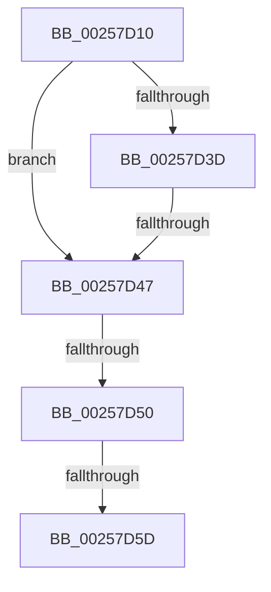

# KiCanLocalReadyThreadBeScheduledToRescheduleContextEntry

- RVA: `0x00257D10`–`0x00257D66` (길이 `86` bytes)
- VA: `0x0000000140257D10`
- 실행 섹션: `.text`
- PDB 이름 있음: `예`; PDB Function 태그: `아니요`
- unwind 정보 RVA: `0x00063CB0`
- 디코드: `21`개 명령, `86/86` bytes 표시
- 미해석 바이트: `0` (있으면 어셈블리에 `.byte`로 보존)

> 이 문서는 커널 이미지의 기계어와 PDB 기호를 분석해 생성했습니다. 4번과 5번은 함수 원형과 자료형을 바이너리 사용 방식에서 추정한 C 해석이며 원본 소스 복구 결과는 아닙니다.

## 1. Dependencies

- 직접 호출 지점: **0**; 고유 호출 대상: **0**
- 직접 호출자로 확인된 함수: **2**
- RIP 상대 이미지 참조: **1**

### Outgoing calls
- 직접 디코드된 call 명령이 없습니다.

### Direct callers
- [KiSearchForNewThreadsForRescheduleContext](KiSearchForNewThreadsForRescheduleContext_function_00258620.md) at `0x002596A1`
- [KiAttemptToScheduleThreadToBusyIsolationUnit](KiAttemptToScheduleThreadToBusyIsolationUnit_function_00259B00.md) at `0x0025B2B1`

### Static image references
- `0x00257D25` → RVA `0x00FC52E0` (`ALMOSTRO`; read)

## 2. Other-region calls and transfers

- 다른 실행 섹션으로 향하는 call: **0**
- call이 아닌 외부 분기/꼬리 이동: **4**
  - `0x00257D41` → [sub_00257DDC + 0x56](Unknown_function_00257DDC.md) (`tail-transfer`)
  - `0x00257D4A` → [sub_00257DDC + 0x68](Unknown_function_00257DDC.md) (`tail-transfer`)
  - `0x00257D57` → [sub_00257DDC + 0x86](Unknown_function_00257DDC.md) (`tail-transfer`)
  - `0x00257D60` → [sub_00257DDC + 0x86](Unknown_function_00257DDC.md) (`tail-transfer`)

## 3. Assembly (complete function range)

```asm
00257D10  48 89 5C 24 10                  mov qword ptr [rsp + 0x10], rbx
00257D15  48 89 6C 24 18                  mov qword ptr [rsp + 0x18], rbp
00257D1A  48 89 74 24 20                  mov qword ptr [rsp + 0x20], rsi
00257D1F  41 56                           push r14
00257D21  48 83 EC 20                     sub rsp, 0x20
00257D25  83 3D B4 D5 D6 00 00            cmp dword ptr [rip + 0xd6d5b4], 0
00257D2C  49 8B F1                        mov rsi, r9
00257D2F  48 8B 19                        mov rbx, qword ptr [rcx]
00257D32  4C 8B C9                        mov r9, rcx
00257D35  49 8B E8                        mov rbp, r8
00257D38  4C 8B F2                        mov r14, rdx
00257D3B  74 0A                           je 0x140257d47
00257D3D  F6 43 23 20                     test byte ptr [rbx + 0x23], 0x20
00257D41  0F 85 EB 00 00 00               jne 0x140257e32
00257D47  48 85 F6                        test rsi, rsi
00257D4A  0F 84 F4 00 00 00               je 0x140257e44
00257D50  49 8B 41 08                     mov rax, qword ptr [r9 + 8]
00257D54  48 85 C0                        test rax, rax
00257D57  0F 84 05 01 00 00               je 0x140257e62
00257D5D  48 3B C6                        cmp rax, rsi
00257D60  0F 85 FC 00 00 00               jne 0x140257e62
```

## 4. C-style interpretation (structured pseudocode)

```c
__int64 __fastcall KiCanLocalReadyThreadBeScheduledToRescheduleContextEntry(__int64 a1, __int64 a2, __int64 a3, __int64 a4)
{
    __int64 v_rsp;
    unsigned __int64 v_stack_p10;
    unsigned __int64 v_stack_p18;
    unsigned __int64 v_stack_p20;

    v_stack_p10 = v_rbx;
    v_stack_p18 = v_rbp;
    v_stack_p20 = v_rsi;
    v_rsp = (v_rsp) - (32);
    if ((*(unsigned int *)(v_rip + 14079412)) == 0) goto loc_00257D47;
loc_00257D47:
}
```

## 5. (Beta) C Style

```c
int64_t KiCanLocalReadyThreadBeScheduledToRescheduleContextEntry(void *Arg1, int64_t Arg2, int64_t Arg3, int64_t Arg4)
{
    uint8_t *arg1 = (uint8_t *)Arg1;

    int64_t local_rsp;
    uint64_t v_stack_p10;
    uint64_t v_stack_p18;
    uint64_t v_stack_p20;

    v_stack_p10 = local_rbx;
    v_stack_p18 = local_rbp;
    v_stack_p20 = local_rsi;
    local_rsp = (local_rsp) - (32);
    if ((*(uint32_t *)(v_rip + 0xD6D5B4)) == 0) goto loc_00257D47;
loc_00257D47:
}
```

### 관측된 메모리 오프셋

구조체 형식이 확인되지 않은 접근은 인자 기준의 오프셋으로만 기록했습니다.

| 기준 인자 | 오프셋 표현 | 폭 (bit) | 접근 |
|---|---:|---:|---|
| `Arg1` | `+ 0x0` | `64` | `R` |
| `Arg1` | `+ 0x8` | `64` | `R` |

## 6. Execution-region graph

[열기: 2D/3D 그래프와 함수 탐색 컨트롤 패널](../../../control-panel.html?section=text&rva=0x00257D10&view=graph)

- 2D 그래프는 위에서 아래로 흐르고, 3D 그래프는 빈 공간을 드래그해 회전합니다. Shift+드래그는 이동, 휠은 확대·축소, 함수 노드 선택은 대상 보고서 이동입니다.

### Static fallback


