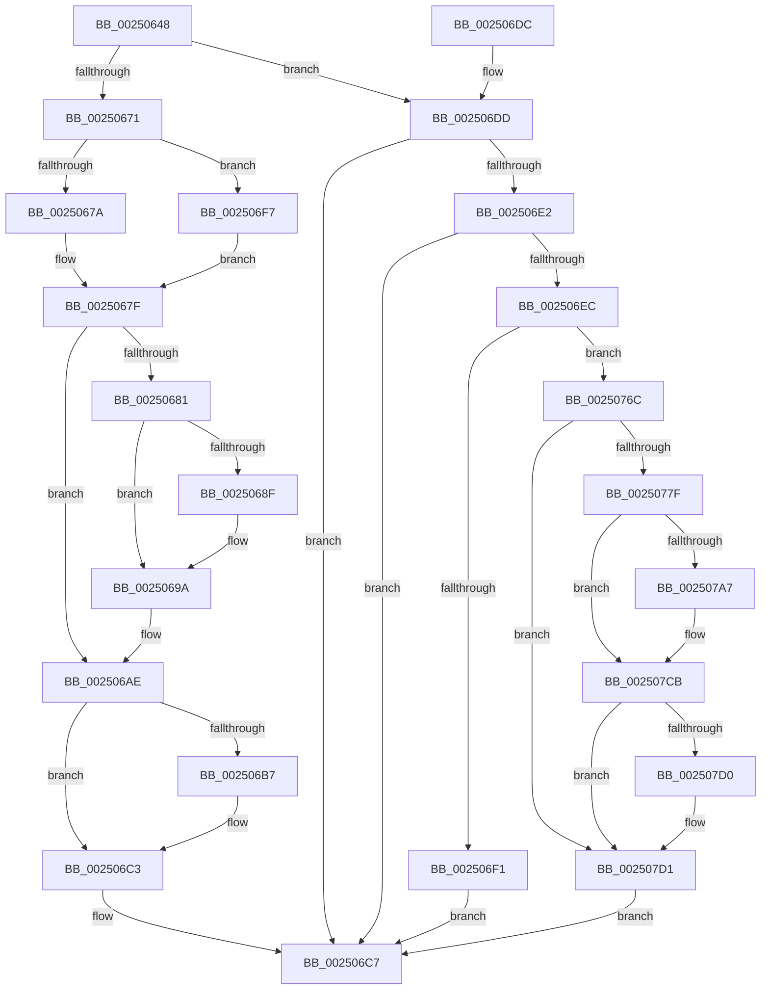

# KiCheckForThreadDispatch

- RVA: `0x00250648`–`0x002507ED` (길이 `421` bytes)
- VA: `0x0000000140250648`
- 실행 섹션: `.text`
- PDB 이름 있음: `예`; PDB Function 태그: `아니요`
- unwind 정보 RVA: `0x00063410`
- 디코드: `113`개 명령, `421/421` bytes 표시
- 미해석 바이트: `0` (있으면 어셈블리에 `.byte`로 보존)

> 이 문서는 커널 이미지의 기계어와 PDB 기호를 분석해 생성했습니다. 4번과 5번은 함수 원형과 자료형을 바이너리 사용 방식에서 추정한 C 해석이며 원본 소스 복구 결과는 아닙니다.

## 1. Dependencies

- 직접 호출 지점: **12**; 고유 호출 대상: **11**
- 직접 호출자로 확인된 함수: **13**
- RIP 상대 이미지 참조: **2**

### Outgoing calls
- `0x00250695` → [KiLowerIrqlProcessIrqlFlags](../4F/KiLowerIrqlProcessIrqlFlags_function_004F5698.md) (function, `0x004F5698`)
- `0x002506A9` → [KiDeliverApc](KiDeliverApc_function_00250F20.md) (function, `0x00250F20`)
- `0x002506BE` → [KiLowerIrqlProcessIrqlFlags](../4F/KiLowerIrqlProcessIrqlFlags_function_004F5698.md) (function, `0x004F5698`)
- `0x002506FC` → [KiAbProcessPreContextSwitch](../21/KiAbProcessPreContextSwitch_function_0021D420.md) (function, `0x0021D420`)
- `0x0025070B` → [KiAcquirePrcbLocksForIsolationUnit](../30/KiAcquirePrcbLocksForIsolationUnit_function_0030ED60.md) (function, `0x0030ED60`)
- `0x0025071F` → [KiCaptureTotalCyclesCurrentThread](../37/KiCaptureTotalCyclesCurrentThread_function_0037CB90.md) (function, `0x0037CB90`)
- `0x0025072A` → [KiUpdatePriorityMatrixForRunningTransition](../37/KiUpdatePriorityMatrixForRunningTransition_function_0037B3A0.md) (function, `0x0037B3A0`)
- `0x00250748` → [KiQueueReadyThread](../21/KiQueueReadyThread_function_0021C7B0.md) (function, `0x0021C7B0`)
- `0x00250756` → [KiSwapContext](../6B/KiSwapContext_function_006B9740.md) (function, `0x006B9740`)
- `0x00250760` → [KiAbProcessPostContextSwitch](../24/KiAbProcessPostContextSwitch_function_00248790.md) (function, `0x00248790`)
- `0x00250788` → [HalpDisableInterrupts](HalpDisableInterrupts_function_002521A0.md) (function, `0x002521A0`)
- `0x002507E3` → [HalpInterruptSendIpi](HalpInterruptSendIpi_function_00252310.md) (function, `0x00252310`)

### Direct callers
- [sub_00208F87](../20/Unknown_function_00208F87.md) at `0x002090FB`
- [sub_00210BCA](../21/Unknown_function_00210BCA.md) at `0x00210DCC`
- [sub_00213F4F](../21/Unknown_function_00213F4F.md) at `0x002141A2`
- [sub_002142F9](../21/Unknown_function_002142F9.md) at `0x002147D4`
- [sub_0021D4DD](../21/Unknown_function_0021D4DD.md) at `0x0021D606`
- [KiProcessDeferredReadyList](KiProcessDeferredReadyList_function_00250800.md) at `0x002508AF`
- [KeSetIdealProcessorThreadEx](../2D/KeSetIdealProcessorThreadEx_function_002DD36C.md) at `0x002DD40C`
- [KiReadyOutSwappedThreads](../39/KiReadyOutSwappedThreads_function_00396E30.md) at `0x00396F5F`
- [KiFastReadyThread](../39/KiFastReadyThread_function_00398548.md) at `0x003985EC`
- [sub_00398945](../39/Unknown_function_00398945.md) at `0x003989AC`
- [KeGenericProcessorCallback](../39/KeGenericProcessorCallback_function_00398C2C.md) at `0x00398E38`
- [KeRevertToUserGroupAffinityThread](../39/KeRevertToUserGroupAffinityThread_function_00398EC0.md) at `0x00399014`
- [sub_0039926C](../39/Unknown_function_0039926C.md) at `0x003992C9`

### Static image references
- `0x00250681` → RVA `0x00FC6D20` (`ALMOSTRO`; read)
- `0x00250771` → RVA `0x00FC6BC5` (`ALMOSTRO`; read)

## 2. Other-region calls and transfers

- 다른 실행 섹션으로 향하는 call: **0**
- 별도 외부 분기/꼬리 이동을 확인하지 못했습니다.

## 3. Assembly (complete function range)

```asm
00250648  48 8B C4                        mov rax, rsp
0025064B  48 89 58 08                     mov qword ptr [rax + 8], rbx
0025064F  48 89 68 10                     mov qword ptr [rax + 0x10], rbp
00250653  48 89 70 20                     mov qword ptr [rax + 0x20], rsi
00250657  57                              push rdi
00250658  48 83 EC 40                     sub rsp, 0x40
0025065C  48 83 60 18 00                  and qword ptr [rax + 0x18], 0
00250661  48 8B F9                        mov rdi, rcx
00250664  48 8B 41 10                     mov rax, qword ptr [rcx + 0x10]
00250668  0F B6 EA                        movzx ebp, dl
0025066B  40 80 FD 02                     cmp bpl, 2
0025066F  73 6C                           jae 0x1402506dd
00250671  48 8B 71 08                     mov rsi, qword ptr [rcx + 8]
00250675  48 85 C0                        test rax, rax
00250678  75 7D                           jne 0x1402506f7
0025067A  8B 46 74                        mov eax, dword ptr [rsi + 0x74]
0025067D  A8 40                           test al, 0x40
0025067F  74 2D                           je 0x1402506ae
00250681  83 3D 98 66 D7 00 00            cmp dword ptr [rip + 0xd76698], 0
00250688  BB 01 00 00 00                  mov ebx, 1
0025068D  74 0B                           je 0x14025069a
0025068F  8A D3                           mov dl, bl
00250691  44 0F 20 C1                     mov rcx, cr8
00250695  E8 FE 4F 2A 00                  call 0x1404f5698
0025069A  44 0F 22 C3                     mov cr8, rbx
0025069E  83 66 74 BF                     and dword ptr [rsi + 0x74], 0xffffffbf
002506A2  45 33 C0                        xor r8d, r8d
002506A5  33 D2                           xor edx, edx
002506A7  33 C9                           xor ecx, ecx
002506A9  E8 72 08 00 00                  call 0x140250f20
002506AE  83 3D 6B 66 D7 00 00            cmp dword ptr [rip + 0xd7666b], 0
002506B5  74 0C                           je 0x1402506c3
002506B7  44 0F 20 C1                     mov rcx, cr8
002506BB  40 8A D5                        mov dl, bpl
002506BE  E8 D5 4F 2A 00                  call 0x1404f5698
002506C3  44 0F 22 C5                     mov cr8, rbp
002506C7  48 8B 5C 24 50                  mov rbx, qword ptr [rsp + 0x50]
002506CC  48 8B 6C 24 58                  mov rbp, qword ptr [rsp + 0x58]
002506D1  48 8B 74 24 68                  mov rsi, qword ptr [rsp + 0x68]
002506D6  48 83 C4 40                     add rsp, 0x40
002506DA  5F                              pop rdi
002506DB  C3                              ret
002506DC  CC                              int3
002506DD  48 85 C0                        test rax, rax
002506E0  74 E5                           je 0x1402506c7
002506E2  8A 81 BA 38 00 00               mov al, byte ptr [rcx + 0x38ba]
002506E8  84 C0                           test al, al
002506EA  75 DB                           jne 0x1402506c7
002506EC  38 41 20                        cmp byte ptr [rcx + 0x20], al
002506EF  74 7B                           je 0x14025076c
002506F1  C6 41 06 01                     mov byte ptr [rcx + 6], 1
002506F5  EB D0                           jmp 0x1402506c7
002506F7  33 D2                           xor edx, edx
002506F9  48 8B CE                        mov rcx, rsi
002506FC  E8 1F CD FC FF                  call 0x14021d420
00250701  4C 8D 44 24 60                  lea r8, [rsp + 0x60]
00250706  33 D2                           xor edx, edx
00250708  48 8B CF                        mov rcx, rdi
0025070B  E8 50 E6 0B 00                  call 0x14030ed60
00250710  48 8B 5F 10                     mov rbx, qword ptr [rdi + 0x10]
00250714  48 8B D6                        mov rdx, rsi
00250717  48 83 67 10 00                  and qword ptr [rdi + 0x10], 0
0025071C  48 8B CF                        mov rcx, rdi
0025071F  E8 6C C4 12 00                  call 0x14037cb90
00250724  48 8B D3                        mov rdx, rbx
00250727  48 8B CF                        mov rcx, rdi
0025072A  E8 71 AC 12 00                  call 0x14037b3a0
0025072F  4C 8B C6                        mov r8, rsi
00250732  C6 86 83 02 00 00 20            mov byte ptr [rsi + 0x283], 0x20
00250739  48 8D 54 24 60                  lea rdx, [rsp + 0x60]
0025073E  40 88 AE 86 01 00 00            mov byte ptr [rsi + 0x186], bpl
00250745  48 8B CF                        mov rcx, rdi
00250748  E8 63 C0 FC FF                  call 0x14021c7b0
0025074D  44 8A C5                        mov r8b, bpl
00250750  48 8B D3                        mov rdx, rbx
00250753  48 8B CE                        mov rcx, rsi
00250756  E8 E5 8F 46 00                  call 0x1406b9740
0025075B  48 8B CE                        mov rcx, rsi
0025075E  8A D8                           mov bl, al
00250760  E8 2B 80 FF FF                  call 0x140248790
00250765  84 DB                           test bl, bl
00250767  E9 13 FF FF FF                  jmp 0x14025067f
0025076C  33 C0                           xor eax, eax
0025076E  0F 57 C0                        xorps xmm0, xmm0
00250771  38 05 4E 64 D7 00               cmp byte ptr [rip + 0xd7644e], al
00250777  F3 0F 7F 44 24 24               movdqu xmmword ptr [rsp + 0x24], xmm0
0025077D  74 52                           je 0x1402507d1
0025077F  65 4C 8B 04 25 20 00 00 00      mov r8, qword ptr gs:[0x20]
00250788  E8 13 1A 00 00                  call 0x1402521a0
0025078D  41 8B 90 A8 00 00 00            mov edx, dword ptr [r8 + 0xa8]
00250794  44 8A C8                        mov r9b, al
00250797  8B CA                           mov ecx, edx
00250799  83 C9 04                        or ecx, 4
0025079C  41 89 88 A8 00 00 00            mov dword ptr [r8 + 0xa8], ecx
002507A3  85 D2                           test edx, edx
002507A5  75 24                           jne 0x1402507cb
002507A7  B9 15 00 01 C0                  mov ecx, 0xc0010015
002507AC  0F 32                           rdmsr
002507AE  48 C1 E2 20                     shl rdx, 0x20
002507B2  48 0B C2                        or rax, rdx
002507B5  48 BA 00 00 00 00 01 00 00 00   movabs rdx, 0x100000000
002507BF  48 0B C2                        or rax, rdx
002507C2  48 8B D0                        mov rdx, rax
002507C5  48 C1 EA 20                     shr rdx, 0x20
002507C9  0F 30                           wrmsr
002507CB  45 84 C9                        test r9b, r9b
002507CE  74 01                           je 0x1402507d1
002507D0  FB                              sti
002507D1  BA 2F 00 00 00                  mov edx, 0x2f
002507D6  C7 44 24 20 05 00 00 00         mov dword ptr [rsp + 0x20], 5
002507DE  48 8D 4C 24 20                  lea rcx, [rsp + 0x20]
002507E3  E8 28 1B 00 00                  call 0x140252310
002507E8  E9 DA FE FF FF                  jmp 0x1402506c7
```

## 4. C-style interpretation (structured pseudocode)

```c
__int64 __fastcall KiCheckForThreadDispatch(__int64 a1, unsigned __int8 a2, int a3)
{
    __int64 result;
    __int64 v_rsp;
    unsigned __int64 v_stack_p10;
    unsigned __int64 v_stack_p20;
    unsigned __int64 v_stack_p24;
    unsigned __int64 v_stack_p60;
    unsigned __int64 v_stack_p8;

    *(unsigned __int64 *)(v_rsp + 8) = v_rbx;
    *(unsigned __int64 *)(v_rsp + 16) = v_rbp;
    *(unsigned __int64 *)(v_rsp + 32) = v_rsi;
    v_rsp = (v_rsp) - (64);
    if (a2 >= 2) goto loc_002506DD;
    if (*(unsigned __int64 *)(a1 + 16) != 0) goto loc_002506F7;
loc_0025067F:
    if ((((unsigned __int8)((unsigned int)(*(unsigned int *)(*(unsigned __int64 *)(a1 + 8) + 116)))) & (64)) == 0) goto loc_002506AE;
    result = (unsigned int)(*(unsigned int *)(*(unsigned __int64 *)(a1 + 8) + 116));
    if ((*(unsigned int *)(v_rip + 14116504)) != 0) {
        a2 = 1;
        a1 = v_cr8;
        result = KiLowerIrqlProcessIrqlFlags(a1, a2, a3, a4);
    }
    a3 = 0;
    a2 = 0;
    a1 = 0;
    result = KiDeliverApc(a1, a2, a3, a4);
loc_002506AE:
    if ((*(unsigned int *)(v_rip + 14116459)) != 0) {
        a1 = 1;
        a2 = 0;
        result = KiLowerIrqlProcessIrqlFlags(a1, a2, a3, a4);
    }
loc_002506C7:
    v_rsp = (v_rsp) + (64);
    return result;
loc_002506DD:
    if (result == 0) goto loc_002506C7;
    if ((unsigned __int8)(*(unsigned __int8 *)(a1 + 14522)) != 0) goto loc_002506C7;
    if ((*(unsigned __int8 *)(a1 + 32)) == ((unsigned __int8)(*(unsigned __int8 *)(a1 + 14522)))) goto loc_0025076C;
    *(unsigned __int8 *)(a1 + 6) = 1;
    goto loc_002506C7;
loc_002506F7:
    a2 = 0;
    result = KiAbProcessPreContextSwitch(v_stack_p20, a2, a3, a4);
    a2 = 0;
    result = KiAcquirePrcbLocksForIsolationUnit(a1, a2, v_stack_p60, a4);
    result = KiCaptureTotalCyclesCurrentThread(a1, v_stack_p20, v_stack_p60, a4);
    result = KiUpdatePriorityMatrixForRunningTransition(a1, *(unsigned __int64 *)(a1 + 16), v_stack_p60, a4);
    *(unsigned __int8 *)(v_stack_p20 + 643) = 32;
    *(unsigned __int8 *)(v_stack_p20 + 390) = (unsigned __int8)(v_stack_p10);
    result = KiQueueReadyThread(a1, v_stack_p60, v_stack_p20, a4);
    result = KiSwapContext(v_stack_p20, *(unsigned __int64 *)(a1 + 16), (unsigned __int8)(v_stack_p10), a4);
    result = KiAbProcessPostContextSwitch(v_stack_p20, *(unsigned __int64 *)(a1 + 16), (unsigned __int8)(v_stack_p10), a4);
    goto loc_0025067F;
loc_0025076C:
    result = 0;
    v_stack_p24 = v_xmm0;
    if ((*(unsigned __int8 *)(v_rip + 14115918)) == 0) goto loc_002507D1;
    result = HalpDisableInterrupts(v_stack_p20, *(unsigned __int64 *)(a1 + 16), *(unsigned __int64 *)(gs_base + (0 + 32)), a4);
    a1 = (unsigned int)(((unsigned int)((unsigned int)((unsigned int)(*(unsigned int *)(*(unsigned __int64 *)(gs_base + (0 + 32)) + 168))))) | (4));
    *(unsigned int *)(*(unsigned __int64 *)(gs_base + (0 + 32)) + 168) = (unsigned int)(a1);
    if ((unsigned int)((unsigned int)(*(unsigned int *)(*(unsigned __int64 *)(gs_base + (0 + 32)) + 168))) == 0) {
        a1 = 0xC0010015ULL;
        a2 = ((unsigned int)(*(unsigned int *)(*(unsigned __int64 *)(gs_base + (0 + 32)) + 168))) << (32);
        result = (result) | (a2);
        result = (result) | (a2);
        a2 = result;
        a2 = (a2) >> (32);
    }
    if ((unsigned __int8)((unsigned __int8)(result)) != 0) {
    }
    v_stack_p20 = 5;
    result = HalpInterruptSendIpi(v_stack_p20, 47, *(unsigned __int64 *)(gs_base + (0 + 32)), (unsigned __int8)(result));
    goto loc_002506C7;
}
```

## 5. (Beta) C Style

```c
int64_t KiCheckForThreadDispatch(void *Arg1, uint8_t Arg2, int32_t Arg3)
{
    uint8_t *arg1 = (uint8_t *)Arg1;

    int64_t result;
    int64_t local_rsp;
    uint64_t v_stack_p10;
    uint64_t v_stack_p20;
    uint64_t v_stack_p24;
    uint64_t v_stack_p60;
    uint64_t v_stack_p8;

    *(uint64_t *)(local_rsp + 0x8) = local_rbx;
    *(uint64_t *)(local_rsp + 0x10) = local_rbp;
    *(uint64_t *)(local_rsp + 0x20) = local_rsi;
    local_rsp = (local_rsp) - (64);
    if (Arg2 >= 2) goto loc_002506DD;
    if (*(uint64_t *)(arg1 + 0x10) != 0) goto loc_002506F7;
loc_0025067F:
    if ((((uint8_t)((uint32_t)(*(uint32_t *)(*(uint64_t *)(arg1 + 0x8) + 0x74)))) & (64)) == 0) goto loc_002506AE;
    result = (uint32_t)(*(uint32_t *)(*(uint64_t *)(arg1 + 0x8) + 0x74));
    if ((*(uint32_t *)(v_rip + 0xD76698)) != 0) {
        Arg2 = 1;
        Arg1 = v_cr8;
        result = KiLowerIrqlProcessIrqlFlags(Arg1, Arg2, Arg3, a4);
    }
    Arg3 = 0;
    Arg2 = 0;
    Arg1 = 0;
    result = KiDeliverApc(Arg1, Arg2, Arg3, a4);
loc_002506AE:
    if ((*(uint32_t *)(v_rip + 0xD7666B)) != 0) {
        Arg1 = 1;
        Arg2 = 0;
        result = KiLowerIrqlProcessIrqlFlags(Arg1, Arg2, Arg3, a4);
    }
loc_002506C7:
    local_rsp = (local_rsp) + (64);
    return result;
loc_002506DD:
    if (result == 0) goto loc_002506C7;
    if ((uint8_t)(*(uint8_t *)(arg1 + 0x38BA)) != 0) goto loc_002506C7;
    if ((*(uint8_t *)(arg1 + 0x20)) == ((uint8_t)(*(uint8_t *)(arg1 + 0x38BA)))) goto loc_0025076C;
    *(uint8_t *)(arg1 + 0x6) = 1;
    goto loc_002506C7;
loc_002506F7:
    Arg2 = 0;
    result = KiAbProcessPreContextSwitch(v_stack_p20, Arg2, Arg3, a4);
    Arg2 = 0;
    result = KiAcquirePrcbLocksForIsolationUnit(Arg1, Arg2, v_stack_p60, a4);
    result = KiCaptureTotalCyclesCurrentThread(Arg1, v_stack_p20, v_stack_p60, a4);
    result = KiUpdatePriorityMatrixForRunningTransition(Arg1, *(uint64_t *)(arg1 + 0x10), v_stack_p60, a4);
    *(uint8_t *)(v_stack_p20 + 0x283) = 32;
    *(uint8_t *)(v_stack_p20 + 0x186) = (uint8_t)(v_stack_p10);
    result = KiQueueReadyThread(Arg1, v_stack_p60, v_stack_p20, a4);
    result = KiSwapContext(v_stack_p20, *(uint64_t *)(arg1 + 0x10), (uint8_t)(v_stack_p10), a4);
    result = KiAbProcessPostContextSwitch(v_stack_p20, *(uint64_t *)(arg1 + 0x10), (uint8_t)(v_stack_p10), a4);
    goto loc_0025067F;
loc_0025076C:
    result = 0;
    v_stack_p24 = v_xmm0;
    if ((*(uint8_t *)(v_rip + 0xD7644E)) == 0) goto loc_002507D1;
    result = HalpDisableInterrupts(v_stack_p20, *(uint64_t *)(arg1 + 0x10), *(uint64_t *)(gs_base + (0 + 0x20)), a4);
    Arg1 = (uint32_t)(((uint32_t)((uint32_t)((uint32_t)(*(uint32_t *)(*(uint64_t *)(gs_base + (0 + 0x20)) + 0xA8))))) | (4));
    *(uint32_t *)(*(uint64_t *)(gs_base + (0 + 0x20)) + 0xA8) = (uint32_t)(Arg1);
    if ((uint32_t)((uint32_t)(*(uint32_t *)(*(uint64_t *)(gs_base + (0 + 0x20)) + 0xA8))) == 0) {
        Arg1 = 0xC0010015ULL;
        Arg2 = ((uint32_t)(*(uint32_t *)(*(uint64_t *)(gs_base + (0 + 0x20)) + 0xA8))) << (32);
        result = (result) | (Arg2);
        result = (result) | (Arg2);
        Arg2 = result;
        Arg2 = (Arg2) >> (32);
    }
    if ((uint8_t)((uint8_t)(result)) != 0) {
    }
    v_stack_p20 = 5;
    result = HalpInterruptSendIpi(v_stack_p20, 47, *(uint64_t *)(gs_base + (0 + 0x20)), (uint8_t)(result));
    goto loc_002506C7;
}
```

### 관측된 메모리 오프셋

구조체 형식이 확인되지 않은 접근은 인자 기준의 오프셋으로만 기록했습니다.

| 기준 인자 | 오프셋 표현 | 폭 (bit) | 접근 |
|---|---:|---:|---|
| `Arg1` | `+ 0x6` | `8` | `W` |
| `Arg1` | `+ 0x8` | `64` | `R` |
| `Arg1` | `+ 0x10` | `64` | `R` |
| `Arg1` | `+ 0x10` | `64` | `R/W` |
| `Arg1` | `+ 0x20` | `8` | `R` |
| `Arg1` | `+ 0x38BA` | `8` | `R` |

## 6. Execution-region graph

[열기: 2D/3D 그래프와 함수 탐색 컨트롤 패널](../../../control-panel.html?section=text&rva=0x00250648&view=graph)

- 2D 그래프는 위에서 아래로 흐르고, 3D 그래프는 빈 공간을 드래그해 회전합니다. Shift+드래그는 이동, 휠은 확대·축소, 함수 노드 선택은 대상 보고서 이동입니다.

### Static fallback


