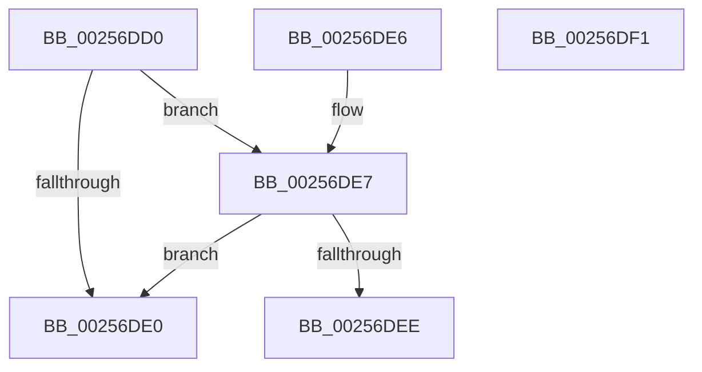

# KiCheckThreadAffinity

- RVA: `0x00256DD0`–`0x00256DF2` (길이 `34` bytes)
- VA: `0x0000000140256DD0`
- 실행 섹션: `.text`
- PDB 이름 있음: `예`; PDB Function 태그: `아니요`
- unwind 정보 RVA: `0x000DB714`
- 디코드: `12`개 명령, `34/34` bytes 표시
- 미해석 바이트: `0` (있으면 어셈블리에 `.byte`로 보존)

> 이 문서는 커널 이미지의 기계어와 PDB 기호를 분석해 생성했습니다. 4번과 5번은 함수 원형과 자료형을 바이너리 사용 방식에서 추정한 C 해석이며 원본 소스 복구 결과는 아닙니다.

## 1. Dependencies

- 직접 호출 지점: **0**; 고유 호출 대상: **0**
- 직접 호출자로 확인된 함수: **3**
- RIP 상대 이미지 참조: **1**

### Outgoing calls
- 직접 디코드된 call 명령이 없습니다.

### Direct callers
- [KiQueueReadyThread](../21/KiQueueReadyThread_function_0021C7B0.md) at `0x0021CF2E`
- [KiUpdateGlobalCpuSetConfiguration](../30/KiUpdateGlobalCpuSetConfiguration_function_00305AB8.md) at `0x00305CC1`
- [KiUpdateGlobalCpuSetConfiguration](../30/KiUpdateGlobalCpuSetConfiguration_function_00305AB8.md) at `0x00305D2D`
- [KiSearchForNewThreadsOnTarget](../30/KiSearchForNewThreadsOnTarget_function_0030F500.md) at `0x0030FD86`
- [KiSearchForNewThreadsOnTarget](../30/KiSearchForNewThreadsOnTarget_function_0030F500.md) at `0x0030FE31`
- [KiSearchForNewThreadsOnTarget](../30/KiSearchForNewThreadsOnTarget_function_0030F500.md) at `0x00310F37`

### Static image references
- `0x00256DD0` → RVA `0x00FC6BF8` (`ALMOSTRO`; read)

## 2. Other-region calls and transfers

- 다른 실행 섹션으로 향하는 call: **0**
- 별도 외부 분기/꼬리 이동을 확인하지 못했습니다.

## 3. Assembly (complete function range)

```asm
00256DD0  48 8B 05 21 FE D6 00            mov rax, qword ptr [rip + 0xd6fe21]
00256DD7  48 39 81 38 02 00 00            cmp qword ptr [rcx + 0x238], rax
00256DDE  75 07                           jne 0x140256de7
00256DE0  B8 01 00 00 00                  mov eax, 1
00256DE5  C3                              ret
00256DE6  CC                              int3
00256DE7  8B 41 74                        mov eax, dword ptr [rcx + 0x74]
00256DEA  A8 08                           test al, 8
00256DEC  75 F2                           jne 0x140256de0
00256DEE  33 C0                           xor eax, eax
00256DF0  C3                              ret
00256DF1  CC                              int3
```

## 4. C-style interpretation (structured pseudocode)

```c
__int64 __fastcall KiCheckThreadAffinity(__int64 a1)
{
    __int64 result;

    if ((*(unsigned __int64 *)(a1 + 568)) != (*(unsigned __int64 *)(v_rip + 14089761))) goto loc_00256DE7;
loc_00256DE0:
    return 1;
loc_00256DE7:
    if ((((unsigned __int8)((unsigned int)(*(unsigned int *)(a1 + 116)))) & (8)) != 0) goto loc_00256DE0;
    result = 0;
    return result;
}
```

## 5. (Beta) C Style

```c
int64_t KiCheckThreadAffinity(void *Arg1)
{
    uint8_t *arg1 = (uint8_t *)Arg1;

    int64_t result;

    if ((*(uint64_t *)(arg1 + 0x238)) != (*(uint64_t *)(v_rip + 0xD6FE21))) goto loc_00256DE7;
loc_00256DE0:
    return 1;
loc_00256DE7:
    if ((((uint8_t)((uint32_t)(*(uint32_t *)(arg1 + 0x74)))) & (8)) != 0) goto loc_00256DE0;
    result = 0;
    return result;
}
```

### 관측된 메모리 오프셋

구조체 형식이 확인되지 않은 접근은 인자 기준의 오프셋으로만 기록했습니다.

| 기준 인자 | 오프셋 표현 | 폭 (bit) | 접근 |
|---|---:|---:|---|
| `Arg1` | `+ 0x74` | `32` | `R` |
| `Arg1` | `+ 0x238` | `64` | `R` |

## 6. Execution-region graph

[열기: 2D/3D 그래프와 함수 탐색 컨트롤 패널](../../../control-panel.html?section=text&rva=0x00256DD0&view=graph)

- 2D 그래프는 위에서 아래로 흐르고, 3D 그래프는 빈 공간을 드래그해 회전합니다. Shift+드래그는 이동, 휠은 확대·축소, 함수 노드 선택은 대상 보고서 이동입니다.

### Static fallback


