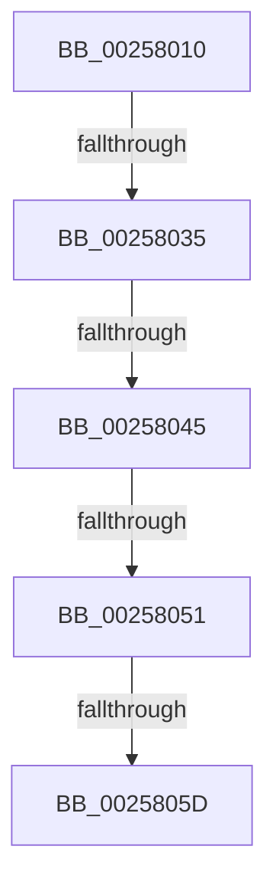

# KiComputeThreadQos

- RVA: `0x00258010`–`0x00258064` (길이 `84` bytes)
- VA: `0x0000000140258010`
- 실행 섹션: `.text`
- PDB 이름 있음: `예`; PDB Function 태그: `아니요`
- unwind 정보 RVA: `0x00063D20`
- 디코드: `18`개 명령, `84/84` bytes 표시
- 미해석 바이트: `0` (있으면 어셈블리에 `.byte`로 보존)

> 이 문서는 커널 이미지의 기계어와 PDB 기호를 분석해 생성했습니다. 4번과 5번은 함수 원형과 자료형을 바이너리 사용 방식에서 추정한 C 해석이며 원본 소스 복구 결과는 아닙니다.

## 1. Dependencies

- 직접 호출 지점: **0**; 고유 호출 대상: **0**
- 직접 호출자로 확인된 함수: **12**
- RIP 상대 이미지 참조: **1**

### Outgoing calls
- 직접 디코드된 call 명령이 없습니다.

### Direct callers
- [sub_0021D7F8](../21/Unknown_function_0021D7F8.md) at `0x0021DA3F`
- [sub_0021D7F8](../21/Unknown_function_0021D7F8.md) at `0x0021DD22`
- [sub_0025308F](Unknown_function_0025308F.md) at `0x00253195`
- [sub_0025308F](Unknown_function_0025308F.md) at `0x002531D6`
- [KzRefreshWorkloadProperties](KzRefreshWorkloadProperties_function_002576D4.md) at `0x002576E9`
- [sub_00257816](Unknown_function_00257816.md) at `0x00257858`
- [sub_00257D66](Unknown_function_00257D66.md) at `0x00257D75`
- [KiSearchForNewThreadsForRescheduleContext](KiSearchForNewThreadsForRescheduleContext_function_00258620.md) at `0x00258BAC`
- [KiAttemptToScheduleThreadToBusyIsolationUnit](KiAttemptToScheduleThreadToBusyIsolationUnit_function_00259B00.md) at `0x0025A501`
- [KiSearchForNewThreadsOnTarget](../30/KiSearchForNewThreadsOnTarget_function_0030F500.md) at `0x0030FB90`
- [KiSearchForNewThreadsOnTarget](../30/KiSearchForNewThreadsOnTarget_function_0030F500.md) at `0x0030FC8C`
- [KiSearchForNewThreadsOnTarget](../30/KiSearchForNewThreadsOnTarget_function_0030F500.md) at `0x00310EA8`
- [KiUpdateRunTime](../39/KiUpdateRunTime_function_0039BB70.md) at `0x0039BDC4`
- [KeSetProcessPpmPolicy](../3C/KeSetProcessPpmPolicy_function_003C1CCC.md) at `0x003C1D34`
- [KeSetThreadPpmPolicy](../3C/KeSetThreadPpmPolicy_function_003C6C30.md) at `0x003C6C64`
- [KeUpdateThreadTag](../47/KeUpdateThreadTag_function_00475770.md) at `0x0047585D`
- [KeUpdateThreadTag](../47/KeUpdateThreadTag_function_00475770.md) at `0x004759F9`

### Static image references
- `0x00258016` → RVA `0x00E0A740` (`.data`; read)

## 2. Other-region calls and transfers

- 다른 실행 섹션으로 향하는 call: **0**
- call이 아닌 외부 분기/꼬리 이동: **4**
  - `0x0025802F` → [sub_00258149 + 0x6B](Unknown_function_00258149.md) (`tail-transfer`)
  - `0x0025803F` → [sub_00258149 + 0x7](Unknown_function_00258149.md) (`tail-transfer`)
  - `0x0025804B` → [sub_00258149 + 0x61](Unknown_function_00258149.md) (`tail-transfer`)
  - `0x00258057` → [sub_00258149](Unknown_function_00258149.md) (`tail-transfer`)

## 3. Assembly (complete function range)

```asm
00258010  40 53                           push rbx
00258012  48 83 EC 30                     sub rsp, 0x30
00258016  48 8B 05 23 27 BB 00            mov rax, qword ptr [rip + 0xbb2723]
0025801D  48 33 C4                        xor rax, rsp
00258020  48 89 44 24 28                  mov qword ptr [rsp + 0x28], rax
00258025  48 8B D9                        mov rbx, rcx
00258028  F7 41 78 00 00 40 00            test dword ptr [rcx + 0x78], 0x400000
0025802F  0F 85 7F 01 00 00               jne 0x1402581b4
00258035  48 8B 89 50 06 00 00            mov rcx, qword ptr [rcx + 0x650]
0025803C  48 85 C9                        test rcx, rcx
0025803F  0F 85 0B 01 00 00               jne 0x140258150
00258045  0F B6 43 7C                     movzx eax, byte ptr [rbx + 0x7c]
00258049  3C 01                           cmp al, 1
0025804B  0F 84 59 01 00 00               je 0x1402581aa
00258051  0F B6 43 7C                     movzx eax, byte ptr [rbx + 0x7c]
00258055  3C 02                           cmp al, 2
00258057  0F 84 EC 00 00 00               je 0x140258149
0025805D  0F B6 83 BE 03 00 00            movzx eax, byte ptr [rbx + 0x3be]
```

## 4. C-style interpretation (structured pseudocode)

```c
__int64 __fastcall KiComputeThreadQos(__int64 a1)
{
    __int64 result;
    __int64 v_rsp;
    unsigned __int64 v_stack_m10;

    v_rsp = (v_rsp) - (48);
    result = (*(unsigned __int64 *)(v_rip + 12265251)) ^ (v_rsp);
    v_stack_m10 = result;
    return *(unsigned __int8 *)(a1 + 958);
}
```

## 5. (Beta) C Style

```c
int64_t KiComputeThreadQos(void *Arg1)
{
    uint8_t *arg1 = (uint8_t *)Arg1;

    int64_t result;
    int64_t local_rsp;
    uint64_t v_stack_m10;

    local_rsp = (local_rsp) - (48);
    result = (*(uint64_t *)(v_rip + 0xBB2723)) ^ (local_rsp);
    v_stack_m10 = result;
    return *(uint8_t *)(arg1 + 0x3BE);
}
```

### 관측된 메모리 오프셋

구조체 형식이 확인되지 않은 접근은 인자 기준의 오프셋으로만 기록했습니다.

| 기준 인자 | 오프셋 표현 | 폭 (bit) | 접근 |
|---|---:|---:|---|
| `Arg1` | `+ 0x78` | `32` | `R` |
| `Arg1` | `+ 0x7C` | `8` | `R` |
| `Arg1` | `+ 0x3BE` | `8` | `R` |
| `Arg1` | `+ 0x650` | `64` | `R` |

## 6. Execution-region graph

[열기: 2D/3D 그래프와 함수 탐색 컨트롤 패널](../../../control-panel.html?section=text&rva=0x00258010&view=graph)

- 2D 그래프는 위에서 아래로 흐르고, 3D 그래프는 빈 공간을 드래그해 회전합니다. Shift+드래그는 이동, 휠은 확대·축소, 함수 노드 선택은 대상 보고서 이동입니다.

### Static fallback


