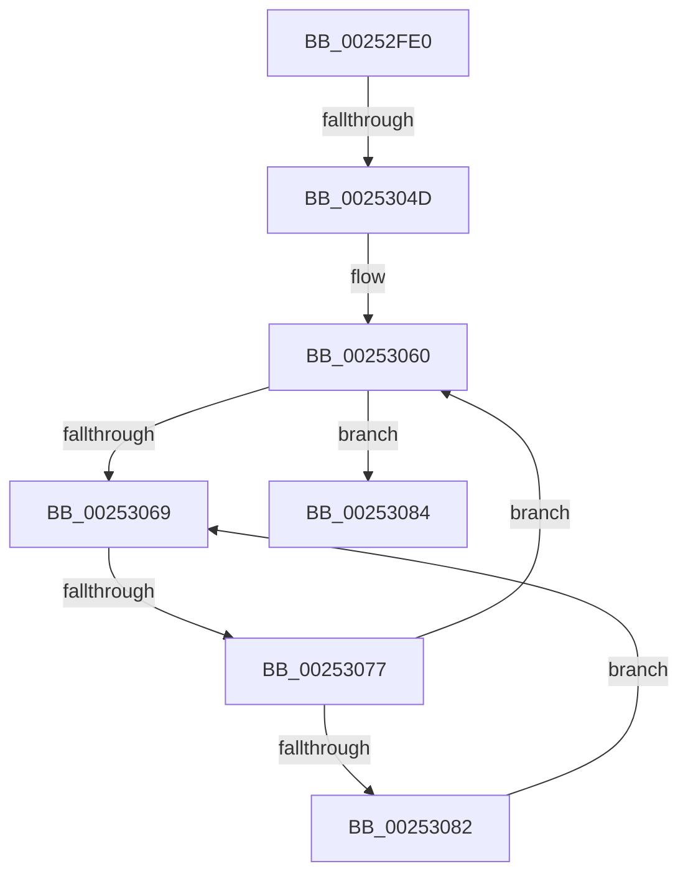

# KiDeferredReadySingleThread

- RVA: `0x00252FE0`–`0x0025308F` (길이 `175` bytes)
- VA: `0x0000000140252FE0`
- 실행 섹션: `.text`
- PDB 이름 있음: `예`; PDB Function 태그: `예`
- unwind 정보 RVA: `0x00063704`
- 디코드: `45`개 명령, `175/175` bytes 표시
- 미해석 바이트: `0` (있으면 어셈블리에 `.byte`로 보존)

> 이 문서는 커널 이미지의 기계어와 PDB 기호를 분석해 생성했습니다. 4번과 5번은 함수 원형과 자료형을 바이너리 사용 방식에서 추정한 C 해석이며 원본 소스 복구 결과는 아닙니다.

## 1. Dependencies

- 직접 호출 지점: **0**; 고유 호출 대상: **0**
- 직접 호출자로 확인된 함수: **18**
- RIP 상대 이미지 참조: **2**

### Outgoing calls
- 직접 디코드된 call 명령이 없습니다.

### Direct callers
- [sub_002092A9](../20/Unknown_function_002092A9.md) at `0x00209370`
- [sub_00210BCA](../21/Unknown_function_00210BCA.md) at `0x00210D8C`
- [sub_002142F9](../21/Unknown_function_002142F9.md) at `0x002144BC`
- [sub_002142F9](../21/Unknown_function_002142F9.md) at `0x00214789`
- [KiQueueReadyThread](../21/KiQueueReadyThread_function_0021C7B0.md) at `0x0021C9A9`
- [KiQueueReadyThread](../21/KiQueueReadyThread_function_0021C7B0.md) at `0x0021C9D3`
- [sub_0021D4DD](../21/Unknown_function_0021D4DD.md) at `0x0021D5B9`
- [KiProcessDeferredReadyList](KiProcessDeferredReadyList_function_00250800.md) at `0x00250850`
- [KiProcessThreadWaitList](KiProcessThreadWaitList_function_00252CC0.md) at `0x00252DC1`
- [KiExecuteAllDpcs](KiExecuteAllDpcs_function_0025B740.md) at `0x0025BC73`
- [KiReadyDeferredReadyList](../30/KiReadyDeferredReadyList_function_0030DD80.md) at `0x0030DDC6`
- [KiAbDeferredProcessingWorker](../30/KiAbDeferredProcessingWorker_function_0030DEB0.md) at `0x0030E104`
- [KiSearchForNewThreadsOnTarget](../30/KiSearchForNewThreadsOnTarget_function_0030F500.md) at `0x0030F78F`
- [KiReadyOutSwappedThreads](../39/KiReadyOutSwappedThreads_function_00396E30.md) at `0x00396EE6`
- [KiReadyOutSwappedThreads](../39/KiReadyOutSwappedThreads_function_00396E30.md) at `0x00396F14`
- [KiInswapAndReadyThread](../39/KiInswapAndReadyThread_function_00398318.md) at `0x00398360`
- [KiInswapAndReadyThread](../39/KiInswapAndReadyThread_function_00398318.md) at `0x0039838E`
- [KiDeferredReadyThread](../39/KiDeferredReadyThread_function_00398640.md) at `0x00398663`
- [sub_0039867C](../39/Unknown_function_0039867C.md) at `0x0039869D`
- [sub_00398945](../39/Unknown_function_00398945.md) at `0x00398969`
- [KeRevertToUserGroupAffinityThread](../39/KeRevertToUserGroupAffinityThread_function_00398EC0.md) at `0x00398FD2`
- [sub_0039926C](../39/Unknown_function_0039926C.md) at `0x00399286`

### Static image references
- `0x00252FFA` → RVA `0x00E0A740` (`.data`; read)
- `0x0025306B` → RVA `0x00FC52AC` (`ALMOSTRO`; reference)

## 2. Other-region calls and transfers

- 다른 실행 섹션으로 향하는 call: **0**
- call이 아닌 외부 분기/꼬리 이동: **2**
  - `0x00253047` → [sub_00254457](Unknown_function_00254457.md) (`tail-transfer`)
  - `0x00253071` → [sub_002546C5](Unknown_function_002546C5.md) (`tail-transfer`)

## 3. Assembly (complete function range)

```asm
00252FE0  40 55                           push rbp
00252FE2  53                              push rbx
00252FE3  56                              push rsi
00252FE4  57                              push rdi
00252FE5  41 55                           push r13
00252FE7  41 56                           push r14
00252FE9  41 57                           push r15
00252FEB  48 8D AC 24 40 FF FF FF         lea rbp, [rsp - 0xc0]
00252FF3  48 81 EC C0 01 00 00            sub rsp, 0x1c0
00252FFA  48 8B 05 3F 77 BB 00            mov rax, qword ptr [rip + 0xbb773f]
00253001  48 33 C4                        xor rax, rsp
00253004  48 89 85 A8 00 00 00            mov qword ptr [rbp + 0xa8], rax
0025300B  4C 8B 6A 48                     mov r13, qword ptr [rdx + 0x48]
0025300F  33 FF                           xor edi, edi
00253011  32 C0                           xor al, al
00253013  4C 89 4D A0                     mov qword ptr [rbp - 0x60], r9
00253017  40 32 F6                        xor sil, sil
0025301A  4C 89 45 D0                     mov qword ptr [rbp - 0x30], r8
0025301E  80 BA 36 02 00 00 01            cmp byte ptr [rdx + 0x236], 1
00253025  0F 57 C0                        xorps xmm0, xmm0
00253028  4C 8B F2                        mov r14, rdx
0025302B  48 89 54 24 48                  mov qword ptr [rsp + 0x48], rdx
00253030  4C 8B F9                        mov r15, rcx
00253033  48 89 4D E0                     mov qword ptr [rbp - 0x20], rcx
00253037  48 89 7D A8                     mov qword ptr [rbp - 0x58], rdi
0025303B  0F 11 45 40                     movups xmmword ptr [rbp + 0x40], xmm0
0025303F  89 44 24 78                     mov dword ptr [rsp + 0x78], eax
00253043  89 7C 24 58                     mov dword ptr [rsp + 0x58], edi
00253047  0F 85 0A 14 00 00               jne 0x140254457
0025304D  0F B6 82 37 02 00 00            movzx eax, byte ptr [rdx + 0x237]
00253054  88 44 24 43                     mov byte ptr [rsp + 0x43], al
00253058  8B DF                           mov ebx, edi
0025305A  66 0F 1F 44 00 00               nop word ptr [rax + rax]
00253060  F0 49 0F BA 6E 40 00            lock bts qword ptr [r14 + 0x40], 0
00253067  73 1B                           jae 0x140253084
00253069  FF C3                           inc ebx
0025306B  85 1D 3B 22 D7 00               test dword ptr [rip + 0xd7223b], ebx
00253071  0F 84 4E 16 00 00               je 0x1402546c5
00253077  F3 90                           pause
00253079  49 8B 46 40                     mov rax, qword ptr [r14 + 0x40]
0025307D  48 85 C0                        test rax, rax
00253080  74 DE                           je 0x140253060
00253082  EB E5                           jmp 0x140253069
00253084  41 F7 46 78 00 00 40 00         test dword ptr [r14 + 0x78], 0x400000
0025308C  49 8B DE                        mov rbx, r14
```

## 4. C-style interpretation (structured pseudocode)

```c
__int64 __fastcall KiDeferredReadySingleThread(__int64 a1, __int64 a2, __int64 a3, __int64 a4)
{
    __int64 result;
    __int64 v_rbx;
    __int64 v_rdi;
    __int64 v_rsi;
    __int64 v_rsp;
    unsigned __int64 v_stack_m118;
    unsigned __int64 v_stack_m128;
    unsigned __int64 v_stack_m150;
    unsigned __int64 v_stack_m158;
    unsigned int v_stack_m180;
    unsigned int v_stack_m1A0;
    unsigned __int64 v_stack_m1B0;
    unsigned __int8 v_stack_m1B5;
    unsigned __int64 v_stack_m50;
    unsigned __int64 v_stack_mB8;
    unsigned __int64 v_stack_mF8;

    v_rsp = (v_rsp) - (448);
    result = (*(unsigned __int64 *)(v_rip + 12285759)) ^ (v_rsp);
    v_stack_m50 = result;
    v_rdi = 0;
    result = 0;
    v_stack_m158 = a4;
    v_rsi = 0;
    v_stack_m128 = a3;
    v_stack_m1B0 = a2;
    v_stack_m118 = a1;
    v_stack_m150 = 0;
    v_stack_mB8 = v_xmm0;
    v_stack_m180 = 0;
    v_stack_m1A0 = 0;
    v_stack_m1B5 = (unsigned __int8)(*(unsigned __int8 *)(a2 + 567));
loc_00253060:
    if ((*(unsigned __int8 *)(a2 + 566)) >= 1) goto loc_00253084;
loc_00253069:
    v_rbx = (unsigned int)((0) + 1);
    if (*(unsigned __int64 *)(a2 + 64) == 0) goto loc_00253060;
    goto loc_00253069;
loc_00253084:
    return *(unsigned __int64 *)(a2 + 64);
}
```

## 5. (Beta) C Style

```c
int64_t KiDeferredReadySingleThread(int64_t Arg1, void *Arg2, int64_t Arg3, int64_t Arg4)
{
    uint8_t *arg2 = (uint8_t *)Arg2;

    int64_t result;
    int64_t local_rbx;
    int64_t local_rdi;
    int64_t local_rsi;
    int64_t local_rsp;
    uint64_t v_stack_m118;
    uint64_t v_stack_m128;
    uint64_t v_stack_m150;
    uint64_t v_stack_m158;
    uint32_t v_stack_m180;
    uint32_t v_stack_m1A0;
    uint64_t v_stack_m1B0;
    uint8_t v_stack_m1B5;
    uint64_t v_stack_m50;
    uint64_t v_stack_mB8;
    uint64_t v_stack_mF8;

    local_rsp = (local_rsp) - (448);
    result = (*(uint64_t *)(v_rip + 0xBB773F)) ^ (local_rsp);
    v_stack_m50 = result;
    local_rdi = 0;
    result = 0;
    v_stack_m158 = Arg4;
    local_rsi = 0;
    v_stack_m128 = Arg3;
    v_stack_m1B0 = Arg2;
    v_stack_m118 = Arg1;
    v_stack_m150 = 0;
    v_stack_mB8 = v_xmm0;
    v_stack_m180 = 0;
    v_stack_m1A0 = 0;
    v_stack_m1B5 = (uint8_t)(*(uint8_t *)(arg2 + 0x237));
loc_00253060:
    if ((*(uint8_t *)(arg2 + 0x236)) >= 1) goto loc_00253084;
loc_00253069:
    local_rbx = (uint32_t)((0) + 1);
    if (*(uint64_t *)(arg2 + 0x40) == 0) goto loc_00253060;
    goto loc_00253069;
loc_00253084:
    return *(uint64_t *)(arg2 + 0x40);
}
```

### 관측된 메모리 오프셋

구조체 형식이 확인되지 않은 접근은 인자 기준의 오프셋으로만 기록했습니다.

| 기준 인자 | 오프셋 표현 | 폭 (bit) | 접근 |
|---|---:|---:|---|
| `Arg2` | `+ 0x40` | `64` | `R` |
| `Arg2` | `+ 0x40` | `64` | `R/W` |
| `Arg2` | `+ 0x48` | `64` | `R` |
| `Arg2` | `+ 0x78` | `32` | `R` |
| `Arg2` | `+ 0x236` | `8` | `R` |
| `Arg2` | `+ 0x237` | `8` | `R` |

## 6. Execution-region graph

[열기: 2D/3D 그래프와 함수 탐색 컨트롤 패널](../../../control-panel.html?section=text&rva=0x00252FE0&view=graph)

- 2D 그래프는 위에서 아래로 흐르고, 3D 그래프는 빈 공간을 드래그해 회전합니다. Shift+드래그는 이동, 휠은 확대·축소, 함수 노드 선택은 대상 보고서 이동입니다.

### Static fallback


