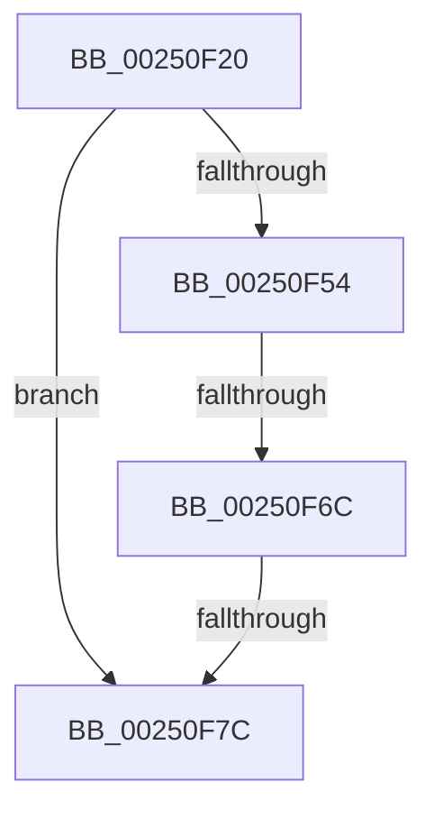

# KiDeliverApc

- RVA: `0x00250F20`–`0x00250F85` (길이 `101` bytes)
- VA: `0x0000000140250F20`
- 실행 섹션: `.text`
- PDB 이름 있음: `예`; PDB Function 태그: `아니요`
- unwind 정보 RVA: `0x00063480`
- 디코드: `26`개 명령, `101/101` bytes 표시
- 미해석 바이트: `0` (있으면 어셈블리에 `.byte`로 보존)

> 이 문서는 커널 이미지의 기계어와 PDB 기호를 분석해 생성했습니다. 4번과 5번은 함수 원형과 자료형을 바이너리 사용 방식에서 추정한 C 해석이며 원본 소스 복구 결과는 아닙니다.

## 1. Dependencies

- 직접 호출 지점: **0**; 고유 호출 대상: **0**
- 직접 호출자로 확인된 함수: **19**
- RIP 상대 이미지 참조: **1**

### Outgoing calls
- 직접 디코드된 call 명령이 없습니다.

### Direct callers
- [KiHandleDeferredPreemption](../20/KiHandleDeferredPreemption_function_00202ECC.md) at `0x0020319E`
- [sub_002099FA](../20/Unknown_function_002099FA.md) at `0x00209AA6`
- [sub_002099FA](../20/Unknown_function_002099FA.md) at `0x00209CCC`
- [sub_0020C2D4](../20/Unknown_function_0020C2D4.md) at `0x0020C401`
- [sub_0020D5AD](../20/Unknown_function_0020D5AD.md) at `0x0020D674`
- [KeWaitForSingleObject](../20/KeWaitForSingleObject_function_0020E6B0.md) at `0x0020EDB8`
- [KeWaitForSingleObject](../20/KeWaitForSingleObject_function_0020E6B0.md) at `0x0020F232`
- [KeWaitForSingleObject](../20/KeWaitForSingleObject_function_0020E6B0.md) at `0x0020F5AC`
- [sub_002203EB](../22/Unknown_function_002203EB.md) at `0x00220442`
- [KiFastExitThreadWait](../22/KiFastExitThreadWait_function_00220BB0.md) at `0x00220E45`
- [KiCheckForThreadDispatch](KiCheckForThreadDispatch_function_00250648.md) at `0x002506A9`
- [sub_00251D54](Unknown_function_00251D54.md) at `0x00251D92`
- [KiBeginThreadWait](../2C/KiBeginThreadWait_function_002CA8E0.md) at `0x002CAAAD`
- [KiCheckForKernelApcDelivery](../2E/KiCheckForKernelApcDelivery_function_002E2C80.md) at `0x002E2CAD`
- [sub_00352D10](../35/Unknown_function_00352D10.md) at `0x00352E93`
- [KiSwapThread](../35/KiSwapThread_function_00355640.md) at `0x0035592E`
- [KeWaitForAlertByThreadId](../3C/KeWaitForAlertByThreadId_function_003C4B14.md) at `0x003C4EAD`
- [KeRemovePriQueue](../3C/KeRemovePriQueue_function_003C5090.md) at `0x003C54B8`
- [KiWaitForAllObjects](../3C/KiWaitForAllObjects_function_003C5800.md) at `0x003C5E7C`
- [KiContinueEx](../41/KiContinueEx_function_0041C370.md) at `0x0041C484`
- [KiApcInterrupt](../6B/KiApcInterrupt_function_006B5E20.md) at `0x006B61C6`
- [KiInitiateUserApc](../6B/KiInitiateUserApc_function_006B6540.md) at `0x006B65AB`

### Static image references
- `0x00250F6C` → RVA `0x00FC74C8` (`ALMOSTRO`; read)

## 2. Other-region calls and transfers

- 다른 실행 섹션으로 향하는 call: **0**
- call이 아닌 외부 분기/꼬리 이동: **2**
  - `0x00250F66` → [sub_002511EE](Unknown_function_002511EE.md) (`tail-transfer`)
  - `0x00250F76` → [sub_0025148C](Unknown_function_0025148C.md) (`tail-transfer`)

## 3. Assembly (complete function range)

```asm
00250F20  48 89 54 24 10                  mov qword ptr [rsp + 0x10], rdx
00250F25  55                              push rbp
00250F26  53                              push rbx
00250F27  57                              push rdi
00250F28  41 54                           push r12
00250F2A  41 55                           push r13
00250F2C  41 57                           push r15
00250F2E  48 8B EC                        mov rbp, rsp
00250F31  48 83 EC 68                     sub rsp, 0x68
00250F35  45 33 E4                        xor r12d, r12d
00250F38  49 8B F8                        mov rdi, r8
00250F3B  4C 89 65 E0                     mov qword ptr [rbp - 0x20], r12
00250F3F  44 0F B6 E9                     movzx r13d, cl
00250F43  4C 89 65 E8                     mov qword ptr [rbp - 0x18], r12
00250F47  4C 89 65 D8                     mov qword ptr [rbp - 0x28], r12
00250F4B  4C 89 65 50                     mov qword ptr [rbp + 0x50], r12
00250F4F  4D 85 C0                        test r8, r8
00250F52  74 28                           je 0x140250f7c
00250F54  0F B7 87 70 01 00 00            movzx eax, word ptr [rdi + 0x170]
00250F5B  4D 8B 80 68 01 00 00            mov r8, qword ptr [r8 + 0x168]
00250F62  66 83 F8 33                     cmp ax, 0x33
00250F66  0F 85 82 02 00 00               jne 0x1402511ee
00250F6C  48 8B 05 55 65 D7 00            mov rax, qword ptr [rip + 0xd76555]
00250F73  4C 3B C0                        cmp r8, rax
00250F76  0F 87 10 05 00 00               ja 0x14025148c
00250F7C  65 48 8B 1C 25 88 01 00 00      mov rbx, qword ptr gs:[0x188]
```

## 4. C-style interpretation (structured pseudocode)

```c
__int64 __fastcall KiDeliverApc(unsigned __int8 a1, __int64 a2, __int64 a3)
{
    __int64 v_r12;
    __int64 v_rsp;
    unsigned __int64 v_stack_m48;
    unsigned __int64 v_stack_m50;
    unsigned __int64 v_stack_m58;
    unsigned __int64 v_stack_p10;
    unsigned __int64 v_stack_p20;

    v_stack_p10 = a2;
    v_rsp = (v_rsp) - (104);
    v_r12 = 0;
    v_stack_m50 = 0;
    v_stack_m48 = 0;
    v_stack_m58 = 0;
    v_stack_p20 = 0;
    if (a3 == 0) goto loc_00250F7C;
loc_00250F7C:
    return *(unsigned __int64 *)(v_rip + 14116181);
}
```

## 5. (Beta) C Style

```c
int64_t KiDeliverApc(uint8_t Arg1, int64_t Arg2, void *Arg3)
{
    uint8_t *arg3 = (uint8_t *)Arg3;

    int64_t local_r12;
    int64_t local_rsp;
    uint64_t v_stack_m48;
    uint64_t v_stack_m50;
    uint64_t v_stack_m58;
    uint64_t v_stack_p10;
    uint64_t v_stack_p20;

    v_stack_p10 = Arg2;
    local_rsp = (local_rsp) - (104);
    local_r12 = 0;
    v_stack_m50 = 0;
    v_stack_m48 = 0;
    v_stack_m58 = 0;
    v_stack_p20 = 0;
    if (Arg3 == NULL) goto loc_00250F7C;
loc_00250F7C:
    return *(uint64_t *)(v_rip + 0xD76555);
}
```

### 관측된 메모리 오프셋

구조체 형식이 확인되지 않은 접근은 인자 기준의 오프셋으로만 기록했습니다.

| 기준 인자 | 오프셋 표현 | 폭 (bit) | 접근 |
|---|---:|---:|---|
| `Arg3` | `+ 0x170` | `16` | `R` |

## 6. Execution-region graph

[열기: 2D/3D 그래프와 함수 탐색 컨트롤 패널](../../../control-panel.html?section=text&rva=0x00250F20&view=graph)

- 2D 그래프는 위에서 아래로 흐르고, 3D 그래프는 빈 공간을 드래그해 회전합니다. Shift+드래그는 이동, 휠은 확대·축소, 함수 노드 선택은 대상 보고서 이동입니다.

### Static fallback


