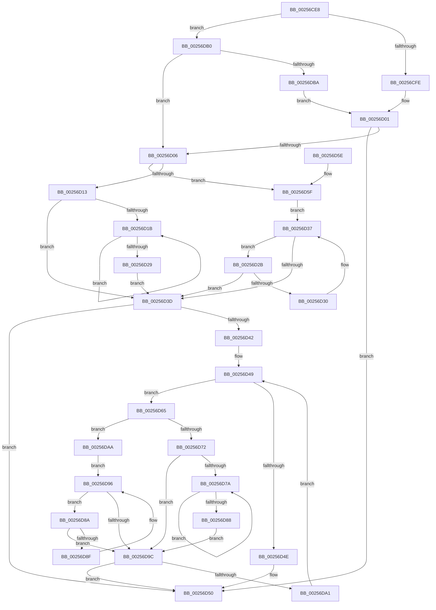

# KiDetermineNextScbForScbReadyQueueEnumerator

- RVA: `0x00256CE8`–`0x00256DC6` (길이 `222` bytes)
- VA: `0x0000000140256CE8`
- 실행 섹션: `.text`
- PDB 이름 있음: `예`; PDB Function 태그: `아니요`
- unwind 정보 RVA: `0x000DB714`
- 디코드: `71`개 명령, `222/222` bytes 표시
- 미해석 바이트: `0` (있으면 어셈블리에 `.byte`로 보존)

> 이 문서는 커널 이미지의 기계어와 PDB 기호를 분석해 생성했습니다. 4번과 5번은 함수 원형과 자료형을 바이너리 사용 방식에서 추정한 C 해석이며 원본 소스 복구 결과는 아닙니다.

## 1. Dependencies

- 직접 호출 지점: **0**; 고유 호출 대상: **0**
- 직접 호출자로 확인된 함수: **2**
- RIP 상대 이미지 참조: **0**

### Outgoing calls
- 직접 디코드된 call 명령이 없습니다.

### Direct callers
- [KiRemoveCurrentThreadScbReadyQueueEnumerator](../20/KiRemoveCurrentThreadScbReadyQueueEnumerator_function_00201538.md) at `0x00201565`
- [KiSearchForNewThreadsOnTarget](../30/KiSearchForNewThreadsOnTarget_function_0030F500.md) at `0x0031079D`

### Static image references
- 디코드된 RIP-relative 메모리 참조가 없습니다.

## 2. Other-region calls and transfers

- 다른 실행 섹션으로 향하는 call: **0**
- 별도 외부 분기/꼬리 이동을 확인하지 못했습니다.

## 3. Assembly (complete function range)

```asm
00256CE8  48 8D 91 90 01 00 00            lea rdx, [rcx + 0x190]
00256CEF  4C 8B C1                        mov r8, rcx
00256CF2  48 8B 42 08                     mov rax, qword ptr [rdx + 8]
00256CF6  A8 01                           test al, 1
00256CF8  0F 85 B2 00 00 00               jne 0x140256db0
00256CFE  48 8B D0                        mov rdx, rax
00256D01  48 85 D2                        test rdx, rdx
00256D04  75 4A                           jne 0x140256d50
00256D06  48 8B 51 60                     mov rdx, qword ptr [rcx + 0x60]
00256D0A  48 83 C1 58                     add rcx, 0x58
00256D0E  48 85 D2                        test rdx, rdx
00256D11  74 4C                           je 0x140256d5f
00256D13  48 8B 0A                        mov rcx, qword ptr [rdx]
00256D16  48 85 C9                        test rcx, rcx
00256D19  74 22                           je 0x140256d3d
00256D1B  48 8B 01                        mov rax, qword ptr [rcx]
00256D1E  48 8B D1                        mov rdx, rcx
00256D21  48 8B C8                        mov rcx, rax
00256D24  48 85 C0                        test rax, rax
00256D27  75 F2                           jne 0x140256d1b
00256D29  EB 12                           jmp 0x140256d3d
00256D2B  48 39 0A                        cmp qword ptr [rdx], rcx
00256D2E  74 0D                           je 0x140256d3d
00256D30  48 8B CA                        mov rcx, rdx
00256D33  48 8B 52 10                     mov rdx, qword ptr [rdx + 0x10]
00256D37  48 83 E2 FC                     and rdx, 0xfffffffffffffffc
00256D3B  75 EE                           jne 0x140256d2b
00256D3D  48 85 D2                        test rdx, rdx
00256D40  75 0E                           jne 0x140256d50
00256D42  49 8B 88 A0 01 00 00            mov rcx, qword ptr [r8 + 0x1a0]
00256D49  48 85 C9                        test rcx, rcx
00256D4C  75 17                           jne 0x140256d65
00256D4E  33 D2                           xor edx, edx
00256D50  48 8D 4A A8                     lea rcx, [rdx - 0x58]
00256D54  48 F7 DA                        neg rdx
00256D57  48 1B C0                        sbb rax, rax
00256D5A  48 23 C1                        and rax, rcx
00256D5D  C3                              ret
00256D5E  CC                              int3
00256D5F  48 8B 51 10                     mov rdx, qword ptr [rcx + 0x10]
00256D63  EB D2                           jmp 0x140256d37
00256D65  4C 8D 41 58                     lea r8, [rcx + 0x58]
00256D69  49 8B 50 08                     mov rdx, qword ptr [r8 + 8]
00256D6D  48 85 D2                        test rdx, rdx
00256D70  74 38                           je 0x140256daa
00256D72  4C 8B 02                        mov r8, qword ptr [rdx]
00256D75  4D 85 C0                        test r8, r8
00256D78  74 22                           je 0x140256d9c
00256D7A  49 8B 00                        mov rax, qword ptr [r8]
00256D7D  49 8B D0                        mov rdx, r8
00256D80  4C 8B C0                        mov r8, rax
00256D83  48 85 C0                        test rax, rax
00256D86  75 F2                           jne 0x140256d7a
00256D88  EB 12                           jmp 0x140256d9c
00256D8A  4C 39 02                        cmp qword ptr [rdx], r8
00256D8D  74 0D                           je 0x140256d9c
00256D8F  4C 8B C2                        mov r8, rdx
00256D92  48 8B 52 10                     mov rdx, qword ptr [rdx + 0x10]
00256D96  48 83 E2 FC                     and rdx, 0xfffffffffffffffc
00256D9A  75 EE                           jne 0x140256d8a
00256D9C  48 85 D2                        test rdx, rdx
00256D9F  75 AF                           jne 0x140256d50
00256DA1  48 8B 89 A0 01 00 00            mov rcx, qword ptr [rcx + 0x1a0]
00256DA8  EB 9F                           jmp 0x140256d49
00256DAA  49 8B 50 10                     mov rdx, qword ptr [r8 + 0x10]
00256DAE  EB E6                           jmp 0x140256d96
00256DB0  48 83 F8 01                     cmp rax, 1
00256DB4  0F 84 4C FF FF FF               je 0x140256d06
00256DBA  48 83 CA 01                     or rdx, 1
00256DBE  48 33 D0                        xor rdx, rax
00256DC1  E9 3B FF FF FF                  jmp 0x140256d01
```

## 4. C-style interpretation (structured pseudocode)

```c
__int64 __fastcall KiDetermineNextScbForScbReadyQueueEnumerator(__int64 a1)
{
    __int64 result;

    if ((((unsigned __int8)(*(unsigned __int64 *)(a1 + 400 + 8))) & (1)) != 0) goto loc_00256DB0;
loc_00256D01:
    if (*(unsigned __int64 *)(a1 + 400 + 8) != 0) goto loc_00256D50;
loc_00256D06:
    a1 = (a1) + (88);
    if (*(unsigned __int64 *)(a1 + 96) == 0) goto loc_00256D5F;
    if (*(unsigned __int64 *)(*(unsigned __int64 *)(a1 + 96)) == 0) goto loc_00256D3D;
loc_00256D1B:
    if (*(unsigned __int64 *)(*(unsigned __int64 *)(*(unsigned __int64 *)(a1 + 96))) != 0) goto loc_00256D1B;
    goto loc_00256D3D;
loc_00256D2B:
    if ((*(unsigned __int64 *)(*(unsigned __int64 *)(*(unsigned __int64 *)(a1 + 96)))) == (*(unsigned __int64 *)(*(unsigned __int64 *)(*(unsigned __int64 *)(a1 + 96))))) goto loc_00256D3D;
loc_00256D37:
    a2 = (*(unsigned __int64 *)(*(unsigned __int64 *)(*(unsigned __int64 *)(a1 + 96)) + 16)) & (-4);
    if (condition_is_not_equal) goto loc_00256D2B;
loc_00256D3D:
    if (a2 != 0) goto loc_00256D50;
loc_00256D49:
    if (*(unsigned __int64 *)(a1 + 416) != 0) goto loc_00256D65;
    a2 = 0;
loc_00256D50:
    a2 = -(a2);
    result = (*(unsigned __int64 *)(*(unsigned __int64 *)(*(unsigned __int64 *)(a1 + 96)))) & (a2 - 88);
    return result;
loc_00256D5F:
    goto loc_00256D37;
loc_00256D65:
    if (*(unsigned __int64 *)(a2 - 88 + 88 + 8) == 0) goto loc_00256DAA;
    if (*(unsigned __int64 *)(*(unsigned __int64 *)(a2 - 88 + 88 + 8)) == 0) goto loc_00256D9C;
loc_00256D7A:
    if (*(unsigned __int64 *)(*(unsigned __int64 *)(*(unsigned __int64 *)(a2 - 88 + 88 + 8))) != 0) goto loc_00256D7A;
    goto loc_00256D9C;
loc_00256D8A:
    if ((*(unsigned __int64 *)(*(unsigned __int64 *)(*(unsigned __int64 *)(a2 - 88 + 88 + 8)))) == (*(unsigned __int64 *)(*(unsigned __int64 *)(*(unsigned __int64 *)(a2 - 88 + 88 + 8))))) goto loc_00256D9C;
loc_00256D96:
    a2 = (*(unsigned __int64 *)(*(unsigned __int64 *)(*(unsigned __int64 *)(a2 - 88 + 88 + 8)) + 16)) & (-4);
    if (condition_is_not_equal) goto loc_00256D8A;
loc_00256D9C:
    if (a2 != 0) goto loc_00256D50;
    goto loc_00256D49;
loc_00256DAA:
    goto loc_00256D96;
loc_00256DB0:
    if ((*(unsigned __int64 *)(*(unsigned __int64 *)(*(unsigned __int64 *)(a2 - 88 + 88 + 8)))) == 1) goto loc_00256D06;
    a2 = (*(unsigned __int64 *)(*(unsigned __int64 *)(*(unsigned __int64 *)(a2 - 88 + 88 + 8)) + 16)) | (1);
    a2 = (a2) ^ (*(unsigned __int64 *)(*(unsigned __int64 *)(*(unsigned __int64 *)(a2 - 88 + 88 + 8))));
    goto loc_00256D01;
}
```

## 5. (Beta) C Style

```c
int64_t KiDetermineNextScbForScbReadyQueueEnumerator(void *Arg1)
{
    uint8_t *arg1 = (uint8_t *)Arg1;

    int64_t result;

    if ((((uint8_t)(*(uint64_t *)(arg1 + 0x190 + 0x8))) & (1)) != 0) goto loc_00256DB0;
loc_00256D01:
    if (*(uint64_t *)(arg1 + 0x190 + 0x8) != 0) goto loc_00256D50;
loc_00256D06:
    Arg1 = (Arg1) + (88);
    if (*(uint64_t *)(arg1 + 0x60) == 0) goto loc_00256D5F;
    if (*(uint64_t *)(*(uint64_t *)(arg1 + 0x60)) == 0) goto loc_00256D3D;
loc_00256D1B:
    if (*(uint64_t *)(*(uint64_t *)(*(uint64_t *)(arg1 + 0x60))) != 0) goto loc_00256D1B;
    goto loc_00256D3D;
loc_00256D2B:
    if ((*(uint64_t *)(*(uint64_t *)(*(uint64_t *)(arg1 + 0x60)))) == (*(uint64_t *)(*(uint64_t *)(*(uint64_t *)(arg1 + 0x60))))) goto loc_00256D3D;
loc_00256D37:
    a2 = (*(uint64_t *)(*(uint64_t *)(*(uint64_t *)(arg1 + 0x60)) + 0x10)) & (-4);
    if (condition_is_not_equal) goto loc_00256D2B;
loc_00256D3D:
    if (a2 != 0) goto loc_00256D50;
loc_00256D49:
    if (*(uint64_t *)(arg1 + 0x1A0) != 0) goto loc_00256D65;
    a2 = 0;
loc_00256D50:
    a2 = -(a2);
    result = (*(uint64_t *)(*(uint64_t *)(*(uint64_t *)(arg1 + 0x60)))) & (a2 - 88);
    return result;
loc_00256D5F:
    goto loc_00256D37;
loc_00256D65:
    if (*(uint64_t *)(a2 - 0x58 + 0x58 + 0x8) == 0) goto loc_00256DAA;
    if (*(uint64_t *)(*(uint64_t *)(a2 - 0x58 + 0x58 + 0x8)) == 0) goto loc_00256D9C;
loc_00256D7A:
    if (*(uint64_t *)(*(uint64_t *)(*(uint64_t *)(a2 - 0x58 + 0x58 + 0x8))) != 0) goto loc_00256D7A;
    goto loc_00256D9C;
loc_00256D8A:
    if ((*(uint64_t *)(*(uint64_t *)(*(uint64_t *)(a2 - 0x58 + 0x58 + 0x8)))) == (*(uint64_t *)(*(uint64_t *)(*(uint64_t *)(a2 - 0x58 + 0x58 + 0x8))))) goto loc_00256D9C;
loc_00256D96:
    a2 = (*(uint64_t *)(*(uint64_t *)(*(uint64_t *)(a2 - 0x58 + 0x58 + 0x8)) + 0x10)) & (-4);
    if (condition_is_not_equal) goto loc_00256D8A;
loc_00256D9C:
    if (a2 != 0) goto loc_00256D50;
    goto loc_00256D49;
loc_00256DAA:
    goto loc_00256D96;
loc_00256DB0:
    if ((*(uint64_t *)(*(uint64_t *)(*(uint64_t *)(a2 - 0x58 + 0x58 + 0x8)))) == 1) goto loc_00256D06;
    a2 = (*(uint64_t *)(*(uint64_t *)(*(uint64_t *)(a2 - 0x58 + 0x58 + 0x8)) + 0x10)) | (1);
    a2 = (a2) ^ (*(uint64_t *)(*(uint64_t *)(*(uint64_t *)(a2 - 0x58 + 0x58 + 0x8))));
    goto loc_00256D01;
}
```

### 관측된 메모리 오프셋

구조체 형식이 확인되지 않은 접근은 인자 기준의 오프셋으로만 기록했습니다.

| 기준 인자 | 오프셋 표현 | 폭 (bit) | 접근 |
|---|---:|---:|---|
| `Arg1` | `+ 0x8` | `64` | `R` |
| `Arg1` | `+ 0x10` | `64` | `R` |
| `Arg1` | `+ 0x60` | `64` | `R` |
| `Arg1` | `+ 0x190` | `64` | `R` |
| `Arg1` | `+ 0x1A0` | `64` | `R` |

## 6. Execution-region graph

[열기: 2D/3D 그래프와 함수 탐색 컨트롤 패널](../../../control-panel.html?section=text&rva=0x00256CE8&view=graph)

- 2D 그래프는 위에서 아래로 흐르고, 3D 그래프는 빈 공간을 드래그해 회전합니다. Shift+드래그는 이동, 휠은 확대·축소, 함수 노드 선택은 대상 보고서 이동입니다.

### Static fallback


