# KiDoesThreadDominateRescheduleContextEntry

- RVA: `0x002581D0`–`0x0025825B` (길이 `139` bytes)
- VA: `0x00000001402581D0`
- 실행 섹션: `.text`
- PDB 이름 있음: `예`; PDB Function 태그: `아니요`
- unwind 정보 RVA: `0x00063DA4`
- 디코드: `45`개 명령, `139/139` bytes 표시
- 미해석 바이트: `0` (있으면 어셈블리에 `.byte`로 보존)

> 이 문서는 커널 이미지의 기계어와 PDB 기호를 분석해 생성했습니다. 4번과 5번은 함수 원형과 자료형을 바이너리 사용 방식에서 추정한 C 해석이며 원본 소스 복구 결과는 아닙니다.

## 1. Dependencies

- 직접 호출 지점: **1**; 고유 호출 대상: **1**
- 직접 호출자로 확인된 함수: **7**
- RIP 상대 이미지 참조: **1**

### Outgoing calls
- `0x002581EF` → [KiEvaluateGroupSchedulingPreemption](KiEvaluateGroupSchedulingPreemption_function_00258270.md) (function, `0x00258270`)

### Direct callers
- [KiDeferGroupSchedulingPreemption](../20/KiDeferGroupSchedulingPreemption_function_0020076C.md) at `0x00201099`
- [sub_0021D7F8](../21/Unknown_function_0021D7F8.md) at `0x0021E9A8`
- [KiSearchForNewThreadsForRescheduleContext](KiSearchForNewThreadsForRescheduleContext_function_00258620.md) at `0x002596D1`
- [KiAttemptToScheduleThreadToBusyIsolationUnit](KiAttemptToScheduleThreadToBusyIsolationUnit_function_00259B00.md) at `0x0025AF59`
- [KiAttemptToScheduleThreadToBusyIsolationUnit](KiAttemptToScheduleThreadToBusyIsolationUnit_function_00259B00.md) at `0x0025B2DC`
- [KiExecuteAllDpcs](KiExecuteAllDpcs_function_0025B740.md) at `0x0025CAC7`
- [KiGroupSchedulingGenerationEnd](../30/KiGroupSchedulingGenerationEnd_function_0030A9B4.md) at `0x0030B0B1`
- [KiAdjustRescheduleContextForIsolationWidthChange](../5C/KiAdjustRescheduleContextForIsolationWidthChange_function_005C9030.md) at `0x005C90F7`

### Static image references
- `0x002581DC` → RVA `0x00FC6ABC` (`ALMOSTRO`; read)

## 2. Other-region calls and transfers

- 다른 실행 섹션으로 향하는 call: **0**
- 별도 외부 분기/꼬리 이동을 확인하지 못했습니다.

## 3. Assembly (complete function range)

```asm
002581D0  40 53                           push rbx
002581D2  48 83 EC 20                     sub rsp, 0x20
002581D6  49 8B D9                        mov rbx, r9
002581D9  45 33 C9                        xor r9d, r9d
002581DC  44 38 0D D9 E8 D6 00            cmp byte ptr [rip + 0xd6e8d9], r9b
002581E3  4C 89 4C 24 48                  mov qword ptr [rsp + 0x48], r9
002581E8  74 1E                           je 0x140258208
002581EA  4C 8D 4C 24 48                  lea r9, [rsp + 0x48]
002581EF  E8 7C 00 00 00                  call 0x140258270
002581F4  4C 8B 4C 24 48                  mov r9, qword ptr [rsp + 0x48]
002581F9  48 85 DB                        test rbx, rbx
002581FC  74 03                           je 0x140258201
002581FE  4C 89 0B                        mov qword ptr [rbx], r9
00258201  48 83 C4 20                     add rsp, 0x20
00258205  5B                              pop rbx
00258206  C3                              ret
00258207  CC                              int3
00258208  44 0F B6 51 20                  movzx r10d, byte ptr [rcx + 0x20]
0025820D  41 F6 C2 01                     test r10b, 1
00258211  75 2D                           jne 0x140258240
00258213  48 8B 41 10                     mov rax, qword ptr [rcx + 0x10]
00258217  44 0F B6 9A C3 00 00 00         movzx r11d, byte ptr [rdx + 0xc3]
0025821F  44 3A 98 C3 00 00 00            cmp r11b, byte ptr [rax + 0xc3]
00258226  7F 2B                           jg 0x140258253
00258228  75 1A                           jne 0x140258244
0025822A  41 F6 C2 18                     test r10b, 0x18
0025822E  0F 94 C1                        sete cl
00258231  41 F6 C0 01                     test r8b, 1
00258235  0F 94 C0                        sete al
00258238  84 C8                           test al, cl
0025823A  75 08                           jne 0x140258244
0025823C  B0 01                           mov al, 1
0025823E  EB B9                           jmp 0x1402581f9
00258240  B0 01                           mov al, 1
00258242  EB B5                           jmp 0x1402581f9
00258244  41 F6 C2 10                     test r10b, 0x10
00258248  74 0D                           je 0x140258257
0025824A  45 84 DB                        test r11b, r11b
0025824D  74 08                           je 0x140258257
0025824F  B0 01                           mov al, 1
00258251  EB A6                           jmp 0x1402581f9
00258253  B0 01                           mov al, 1
00258255  EB A2                           jmp 0x1402581f9
00258257  32 C0                           xor al, al
00258259  EB 9E                           jmp 0x1402581f9
```

## 4. C-style interpretation (structured pseudocode)

```c
__int64 __fastcall KiDoesThreadDominateRescheduleContextEntry(__int64 a1, __int64 a2, unsigned __int8 a3, __int64 a4)
{
    __int64 result;
    __int64 v_rsp;
    unsigned __int64 v_stack_p20;

    v_rsp = (v_rsp) - (32);
    a4 = 0;
    v_stack_p20 = 0;
    if ((*(unsigned __int8 *)(v_rip + 14084313)) == 0) goto loc_00258208;
    result = KiEvaluateGroupSchedulingPreemption(a1, a2, a3, v_stack_p20);
loc_002581F9:
    if (0 != 0) {
        *(unsigned __int64 *)(a4) = v_stack_p20;
    }
    v_rsp = (v_rsp) + (32);
    return result;
loc_00258208:
    if ((((unsigned __int8)(*(unsigned __int8 *)(a1 + 32))) & (1)) != 0) goto loc_00258240;
    if (((unsigned __int8)(*(unsigned __int8 *)(a2 + 195))) > (*(unsigned __int8 *)(*(unsigned __int64 *)(a1 + 16) + 195))) goto loc_00258253;
    if (((unsigned __int8)(*(unsigned __int8 *)(a2 + 195))) != (*(unsigned __int8 *)(*(unsigned __int64 *)(a1 + 16) + 195))) goto loc_00258244;
    a1 = ((((unsigned __int8)(*(unsigned __int8 *)(a1 + 32))) & (24)) == 0) ? 1 : 0;
    result = (((a3) & (1)) == 0) ? 1 : 0;
    if ((((unsigned __int8)(result)) & ((unsigned __int8)(a1))) != 0) goto loc_00258244;
    goto loc_002581F9;
loc_00258240:
    goto loc_002581F9;
loc_00258244:
    if ((((unsigned __int8)(*(unsigned __int8 *)(a1 + 32))) & (16)) == 0) goto loc_00258257;
    if ((unsigned __int8)(*(unsigned __int8 *)(a2 + 195)) == 0) goto loc_00258257;
    goto loc_002581F9;
loc_00258253:
    goto loc_002581F9;
loc_00258257:
    result = 0;
    goto loc_002581F9;
}
```

## 5. (Beta) C Style

```c
int64_t KiDoesThreadDominateRescheduleContextEntry(void *Arg1, void *Arg2, uint8_t Arg3, int64_t Arg4)
{
    uint8_t *arg1 = (uint8_t *)Arg1;
    uint8_t *arg2 = (uint8_t *)Arg2;

    int64_t result;
    int64_t local_rsp;
    uint64_t v_stack_p20;

    local_rsp = (local_rsp) - (32);
    Arg4 = 0;
    v_stack_p20 = 0;
    if ((*(uint8_t *)(v_rip + 0xD6E8D9)) == 0) goto loc_00258208;
    result = KiEvaluateGroupSchedulingPreemption(Arg1, Arg2, Arg3, v_stack_p20);
loc_002581F9:
    if (0 != 0) {
        *(uint64_t *)(Arg4) = v_stack_p20;
    }
    local_rsp = (local_rsp) + (32);
    return result;
loc_00258208:
    if ((((uint8_t)(*(uint8_t *)(arg1 + 0x20))) & (1)) != 0) goto loc_00258240;
    if (((uint8_t)(*(uint8_t *)(arg2 + 0xC3))) > (*(uint8_t *)(*(uint64_t *)(arg1 + 0x10) + 0xC3))) goto loc_00258253;
    if (((uint8_t)(*(uint8_t *)(arg2 + 0xC3))) != (*(uint8_t *)(*(uint64_t *)(arg1 + 0x10) + 0xC3))) goto loc_00258244;
    Arg1 = ((((uint8_t)(*(uint8_t *)(arg1 + 0x20))) & (24)) == 0) ? 1 : 0;
    result = (((Arg3) & (1)) == 0) ? 1 : 0;
    if ((((uint8_t)(result)) & ((uint8_t)(Arg1))) != 0) goto loc_00258244;
    goto loc_002581F9;
loc_00258240:
    goto loc_002581F9;
loc_00258244:
    if ((((uint8_t)(*(uint8_t *)(arg1 + 0x20))) & (16)) == 0) goto loc_00258257;
    if ((uint8_t)(*(uint8_t *)(arg2 + 0xC3)) == 0) goto loc_00258257;
    goto loc_002581F9;
loc_00258253:
    goto loc_002581F9;
loc_00258257:
    result = 0;
    goto loc_002581F9;
}
```

### 관측된 메모리 오프셋

구조체 형식이 확인되지 않은 접근은 인자 기준의 오프셋으로만 기록했습니다.

| 기준 인자 | 오프셋 표현 | 폭 (bit) | 접근 |
|---|---:|---:|---|
| `Arg1` | `+ 0x10` | `64` | `R` |
| `Arg1` | `+ 0x20` | `8` | `R` |
| `Arg2` | `+ 0xC3` | `8` | `R` |

## 6. Execution-region graph

[열기: 2D/3D 그래프와 함수 탐색 컨트롤 패널](../../../control-panel.html?section=text&rva=0x002581D0&view=graph)

- 2D 그래프는 위에서 아래로 흐르고, 3D 그래프는 빈 공간을 드래그해 회전합니다. Shift+드래그는 이동, 휠은 확대·축소, 함수 노드 선택은 대상 보고서 이동입니다.

### Static fallback

```mermaid
flowchart TD
  bb_002581D0[BB_002581D0]
  bb_002581EA[BB_002581EA]
  bb_002581F9[BB_002581F9]
  bb_002581FE[BB_002581FE]
  bb_00258201[BB_00258201]
  bb_00258207[BB_00258207]
  bb_00258208[BB_00258208]
  bb_00258213[BB_00258213]
  bb_00258228[BB_00258228]
  bb_0025822A[BB_0025822A]
  bb_0025823C[BB_0025823C]
  bb_00258240[BB_00258240]
  bb_00258244[BB_00258244]
  bb_0025824A[BB_0025824A]
  bb_0025824F[BB_0025824F]
  bb_00258253[BB_00258253]
  bb_00258257[BB_00258257]
  bb_002581D0 -->|branch| bb_00258208
  bb_002581D0 -->|fallthrough| bb_002581EA
  bb_002581EA -->|flow| bb_002581F9
  bb_002581F9 -->|branch| bb_00258201
  bb_002581F9 -->|fallthrough| bb_002581FE
  bb_002581FE -->|flow| bb_00258201
  bb_00258207 -->|flow| bb_00258208
  bb_00258208 -->|branch| bb_00258240
  bb_00258208 -->|fallthrough| bb_00258213
  bb_00258213 -->|branch| bb_00258253
  bb_00258213 -->|fallthrough| bb_00258228
  bb_00258228 -->|branch| bb_00258244
  bb_00258228 -->|fallthrough| bb_0025822A
  bb_0025822A -->|branch| bb_00258244
  bb_0025822A -->|fallthrough| bb_0025823C
  bb_0025823C -->|branch| bb_002581F9
  bb_00258240 -->|branch| bb_002581F9
  bb_00258244 -->|branch| bb_00258257
  bb_00258244 -->|fallthrough| bb_0025824A
  bb_0025824A -->|branch| bb_00258257
  bb_0025824A -->|fallthrough| bb_0025824F
  bb_0025824F -->|branch| bb_002581F9
  bb_00258253 -->|branch| bb_002581F9
  bb_00258257 -->|branch| bb_002581F9
```


