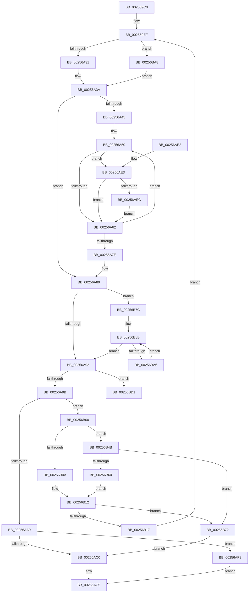

# KiEnumerateNextSchedulerSubNodeInSystem

- RVA: `0x002569C0`–`0x00256BDD` (길이 `541` bytes)
- VA: `0x00000001402569C0`
- 실행 섹션: `.text`
- PDB 이름 있음: `예`; PDB Function 태그: `예`
- unwind 정보 RVA: `0x000638DC`
- 디코드: `143`개 명령, `541/541` bytes 표시
- 미해석 바이트: `0` (있으면 어셈블리에 `.byte`로 보존)

> 이 문서는 커널 이미지의 기계어와 PDB 기호를 분석해 생성했습니다. 4번과 5번은 함수 원형과 자료형을 바이너리 사용 방식에서 추정한 C 해석이며 원본 소스 복구 결과는 아닙니다.

## 1. Dependencies

- 직접 호출 지점: **2**; 고유 호출 대상: **2**
- 직접 호출자로 확인된 함수: **6**
- RIP 상대 이미지 참조: **3**

### Outgoing calls
- `0x00256AA4` → [KeFindFirstSetRightGroupMask](KeFindFirstSetRightGroupMask_function_00256BE4.md) (function, `0x00256BE4`)
- `0x00256B41` → [RtlCopyVolatileMemory](../6B/RtlCopyVolatileMemory_function_006BC9D0.md) (function, `0x006BC9D0`)

### Direct callers
- [KeConfigureHeteroProcessors](../42/KeConfigureHeteroProcessors_function_00427338.md) at `0x00427434`
- [KiGetNumberOfActiveSubNodes](../42/KiGetNumberOfActiveSubNodes_function_00427920.md) at `0x00427964`
- [KiRemoveForceParkedProcessorsFromAffinity](../42/KiRemoveForceParkedProcessorsFromAffinity_function_00427F70.md) at `0x00427FEA`
- [KiConfigureCooperativeIdleSearchContextTargets](../5B/KiConfigureCooperativeIdleSearchContextTargets_function_005B78D8.md) at `0x005B79A0`
- [KiGetNextClockOwner](../5B/KiGetNextClockOwner_function_005BB5D4.md) at `0x005BB6E1`
- [KiGetNextClockOwner](../5B/KiGetNextClockOwner_function_005BB5D4.md) at `0x005BB75A`
- [sub_006D831E](../6D/Unknown_function_006D831E.md) at `0x006D8B78`

### Static image references
- `0x002569F4` → RVA `0x00000000` (`image boundary/outside`; read)
- `0x00256B4E` → RVA `0x00FC5000` (`ALMOSTRO`; read)
- `0x00256B60` → RVA `0x00E2DBD0` (`.data`; read)

## 2. Other-region calls and transfers

- 다른 실행 섹션으로 향하는 call: **0**
- call이 아닌 외부 분기/꼬리 이동: **1**
  - `0x00256BD8` → [sub_006D8C66](../6D/Unknown_function_006D8C66.md) (`tail-transfer`)

## 3. Assembly (complete function range)

```asm
002569C0  48 89 5C 24 08                  mov qword ptr [rsp + 8], rbx
002569C5  48 89 6C 24 10                  mov qword ptr [rsp + 0x10], rbp
002569CA  48 89 74 24 18                  mov qword ptr [rsp + 0x18], rsi
002569CF  57                              push rdi
002569D0  41 54                           push r12
002569D2  41 55                           push r13
002569D4  41 56                           push r14
002569D6  41 57                           push r15
002569D8  48 83 EC 30                     sub rsp, 0x30
002569DC  4C 8B EA                        mov r13, rdx
002569DF  48 C7 44 24 20 20 00 00 00      mov qword ptr [rsp + 0x20], 0x20
002569E8  48 8B F1                        mov rsi, rcx
002569EB  48 8D 69 10                     lea rbp, [rcx + 0x10]
002569EF  4C 8B 64 24 20                  mov r12, qword ptr [rsp + 0x20]
002569F4  4C 8D 1D 05 96 DA FF            lea r11, [rip - 0x2569fb]
002569FB  33 DB                           xor ebx, ebx
002569FD  49 8B FC                        mov rdi, r12
00256A00  83 E7 07                        and edi, 7
00256A03  49 8B D4                        mov rdx, r12
00256A06  48 C1 EA 03                     shr rdx, 3
00256A0A  44 8B C5                        mov r8d, ebp
00256A0D  48 85 FF                        test rdi, rdi
00256A10  B9 08 00 00 00                  mov ecx, 8
00256A15  0F 95 C3                        setne bl
00256A18  41 83 E0 07                     and r8d, 7
00256A1C  41 8B C0                        mov eax, r8d
00256A1F  48 03 DA                        add rbx, rdx
00256A22  48 2B C8                        sub rcx, rax
00256A25  45 33 D2                        xor r10d, r10d
00256A28  48 3B CA                        cmp rcx, rdx
00256A2B  0F 86 77 01 00 00               jbe 0x140256ba8
00256A31  45 33 FF                        xor r15d, r15d
00256A34  44 8B CB                        mov r9d, ebx
00256A37  45 33 F6                        xor r14d, r14d
00256A3A  45 33 C0                        xor r8d, r8d
00256A3D  48 8B C5                        mov rax, rbp
00256A40  45 85 C9                        test r9d, r9d
00256A43  74 44                           je 0x140256a89
00256A45  4C 8D 5B FF                     lea r11, [rbx - 1]
00256A49  48 8D 2D B0 95 DA FF            lea rbp, [rip - 0x256a50]
00256A50  0F B6 10                        movzx edx, byte ptr [rax]
00256A53  48 FF C0                        inc rax
00256A56  41 8B C8                        mov ecx, r8d
00256A59  49 3B CB                        cmp rcx, r11
00256A5C  0F 84 81 00 00 00               je 0x140256ae3
00256A62  0F B6 CA                        movzx ecx, dl
00256A65  41 FF C0                        inc r8d
00256A68  F7 D1                           not ecx
00256A6A  0F B6 D1                        movzx edx, cl
00256A6D  0F B6 8C 2A 40 41 03 00         movzx ecx, byte ptr [rdx + rbp + 0x34140]
00256A75  4C 03 D1                        add r10, rcx
00256A78  41 83 C1 FF                     add r9d, -1
00256A7C  75 D2                           jne 0x140256a50
00256A7E  48 8D 6E 10                     lea rbp, [rsi + 0x10]
00256A82  4C 8D 1D 77 95 DA FF            lea r11, [rip - 0x256a89]
00256A89  4D 85 F6                        test r14, r14
00256A8C  0F 85 EA 00 00 00               jne 0x140256b7c
00256A92  45 85 FF                        test r15d, r15d
00256A95  0F 85 36 01 00 00               jne 0x140256bd1
00256A9B  4D 85 D2                        test r10, r10
00256A9E  74 60                           je 0x140256b00
00256AA0  48 8D 4E 10                     lea rcx, [rsi + 0x10]
00256AA4  E8 3B 01 00 00                  call 0x140256be4
00256AA9  44 0F B7 D8                     movzx r11d, ax
00256AAD  4C 0F B3 5E 10                  btr qword ptr [rsi + 0x10], r11
00256AB2  48 8B 46 08                     mov rax, qword ptr [rsi + 8]
00256AB6  4A 8B 4C D8 20                  mov rcx, qword ptr [rax + r11*8 + 0x20]
00256ABB  48 85 C9                        test rcx, rcx
00256ABE  75 38                           jne 0x140256af8
00256AC0  B8 1A 00 00 80                  mov eax, 0x8000001a
00256AC5  48 8B 5C 24 60                  mov rbx, qword ptr [rsp + 0x60]
00256ACA  48 8B 6C 24 68                  mov rbp, qword ptr [rsp + 0x68]
00256ACF  48 8B 74 24 70                  mov rsi, qword ptr [rsp + 0x70]
00256AD4  48 83 C4 30                     add rsp, 0x30
00256AD8  41 5F                           pop r15
00256ADA  41 5E                           pop r14
00256ADC  41 5D                           pop r13
00256ADE  41 5C                           pop r12
00256AE0  5F                              pop rdi
00256AE1  C3                              ret
00256AE2  CC                              int3
00256AE3  48 85 FF                        test rdi, rdi
00256AE6  0F 84 76 FF FF FF               je 0x140256a62
00256AEC  22 94 2F 90 C8 02 00            and dl, byte ptr [rdi + rbp + 0x2c890]
00256AF3  E9 6A FF FF FF                  jmp 0x140256a62
00256AF8  49 89 4D 00                     mov qword ptr [r13], rcx
00256AFC  33 C0                           xor eax, eax
00256AFE  EB C5                           jmp 0x140256ac5
00256B00  66 83 7E 02 00                  cmp word ptr [rsi + 2], 0
00256B05  0F B7 0E                        movzx ecx, word ptr [rsi]
00256B08  75 41                           jne 0x140256b4b
00256B0A  8B C1                           mov eax, ecx
00256B0C  66 C7 46 02 01 00               mov word ptr [rsi + 2], 1
00256B12  83 F8 FF                        cmp eax, -1
00256B15  74 5B                           je 0x140256b72
00256B17  49 8B 94 C3 C0 F6 FC 00         mov rdx, qword ptr [r11 + rax*8 + 0xfcf6c0]
00256B1F  48 8D 4E 10                     lea rcx, [rsi + 0x10]
00256B23  48 C7 46 10 00 00 00 00         mov qword ptr [rsi + 0x10], 0
00256B2B  41 B8 10 00 00 00               mov r8d, 0x10
00256B31  48 C7 46 18 00 00 00 00         mov qword ptr [rsi + 0x18], 0
00256B39  48 89 56 08                     mov qword ptr [rsi + 8], rdx
00256B3D  48 83 C2 10                     add rdx, 0x10
00256B41  E8 8A 5E 46 00                  call 0x1406bc9d0
00256B46  E9 A4 FE FF FF                  jmp 0x1402569ef
00256B4B  8B 56 04                        mov edx, dword ptr [rsi + 4]
00256B4E  44 0F B7 05 AA E4 D6 00         movzx r8d, word ptr [rip + 0xd6e4aa]
00256B56  FF C2                           inc edx
00256B58  89 56 04                        mov dword ptr [rsi + 4], edx
00256B5B  41 3B D0                        cmp edx, r8d
00256B5E  74 12                           je 0x140256b72
00256B60  48 8B 05 69 70 BD 00            mov rax, qword ptr [rip + 0xbd7069]
00256B67  41 0F AF C8                     imul ecx, r8d
00256B6B  03 CA                           add ecx, edx
00256B6D  8B 04 88                        mov eax, dword ptr [rax + rcx*4]
00256B70  EB A0                           jmp 0x140256b12
00256B72  66 C7 06 FF FF                  mov word ptr [rsi], 0xffff
00256B77  E9 44 FF FF FF                  jmp 0x140256ac0
00256B7C  4D 8D 4E FF                     lea r9, [r14 - 1]
00256B80  49 C1 E9 03                     shr r9, 3
00256B84  49 FF C1                        inc r9
00256B87  47 8D 04 C8                     lea r8d, [r8 + r9*8]
00256B8B  48 8B 08                        mov rcx, qword ptr [rax]
00256B8E  48 83 C0 08                     add rax, 8
00256B92  F3 48 0F B8 D1                  popcnt rdx, rcx
00256B97  8B D2                           mov edx, edx
00256B99  4C 03 D2                        add r10, rdx
00256B9C  49 83 E9 01                     sub r9, 1
00256BA0  0F 84 EC FE FF FF               je 0x140256a92
00256BA6  EB E3                           jmp 0x140256b8b
00256BA8  41 B9 08 00 00 00               mov r9d, 8
00256BAE  4C 8B F3                        mov r14, rbx
00256BB1  45 2B C8                        sub r9d, r8d
00256BB4  41 2B D1                        sub edx, r9d
00256BB7  83 E2 07                        and edx, 7
00256BBA  48 85 FF                        test rdi, rdi
00256BBD  44 8D 7A 01                     lea r15d, [rdx + 1]
00256BC1  44 0F 44 FA                     cmove r15d, edx
00256BC5  43 8D 0C 0F                     lea ecx, [r15 + r9]
00256BC9  4C 2B F1                        sub r14, rcx
00256BCC  E9 69 FE FF FF                  jmp 0x140256a3a
00256BD1  48 FF CB                        dec rbx
00256BD4  41 83 E4 07                     and r12d, 7
00256BD8  E9 89 20 48 00                  jmp 0x1406d8c66
```

## 4. C-style interpretation (structured pseudocode)

```c
__int64 __fastcall KiEnumerateNextSchedulerSubNodeInSystem(__int64 a1, __int64 a2)
{
    __int64 result;
    __int64 v_r10;
    __int64 v_r12;
    __int64 v_r14;
    __int64 v_r15;
    __int64 v_rbx;
    __int64 v_rdi;
    __int64 v_rsp;
    unsigned __int64 v_stack_m38;
    unsigned __int64 v_stack_p10;
    unsigned __int64 v_stack_p18;
    unsigned __int64 v_stack_p8;

    v_stack_p8 = v_rbx;
    v_stack_p10 = v_rbp;
    v_stack_p18 = v_rsi;
    v_rsp = (v_rsp) - (48);
    v_stack_m38 = 32;
loc_002569EF:
    v_rbx = 0;
    v_rdi = (unsigned int)((v_stack_m38) & (7));
    a2 = (v_stack_m38) >> (3);
    v_rbx = (v_rdi != 0) ? 1 : 0;
    a3 = (unsigned int)(((unsigned int)((unsigned int)(a1 + 16))) & (7));
    v_rbx = (v_rbx) + (a2);
    a1 = (8) - ((unsigned int)((unsigned int)(a3)));
    v_r10 = 0;
    if (a1 <= a2) goto loc_00256BA8;
    v_r15 = 0;
    v_r14 = 0;
loc_00256A3A:
    a3 = 0;
    if ((unsigned int)((unsigned int)((unsigned int)(v_rbx))) == 0) goto loc_00256A89;
loc_00256A50:
    result = (a1 + 16) + 1;
    if (0 == (v_rbx - 1)) goto loc_00256AE3;
loc_00256A62:
    a3 = (unsigned int)((a3) + 1);
    a1 = (unsigned int)(~((unsigned __int8)(*(unsigned __int8 *)(a1 + 16))));
    v_r10 = (v_r10) + (*(unsigned __int8 *)((unsigned __int8)(a1) + v_rip - 2452048 * 1 + 213312));
    a4 = (unsigned int)(((unsigned int)((unsigned int)(v_rbx))) + (-1));
    if (condition_is_not_equal) goto loc_00256A50;
loc_00256A89:
    if (0 != 0) goto loc_00256B7C;
loc_00256A92:
    if (0 != 0) goto loc_00256BD1;
    if (v_r10 == 0) goto loc_00256B00;
    result = KeFindFirstSetRightGroupMask(a1 + 16, (unsigned __int8)(a1), a3, a4);
    if (*(unsigned __int64 *)(*(unsigned __int64 *)(a1 + 8) + (unsigned __int16)(result) * 8 + 32) != 0) goto loc_00256AF8;
loc_00256AC0:
loc_00256AC5:
    v_rsp = (v_rsp) + (48);
    return (unsigned int)(0x8000001AULL);
loc_00256AE3:
    if (v_rdi == 0) goto loc_00256A62;
    a2 = (unsigned __int8)(((unsigned __int8)(a1)) & (*(unsigned __int8 *)(v_rdi + v_stack_p10 * 1 + 182416)));
    goto loc_00256A62;
loc_00256AF8:
    *(unsigned __int64 *)(a2) = *(unsigned __int64 *)(*(unsigned __int64 *)(a1 + 8) + (unsigned __int16)(result) * 8 + 32);
    result = 0;
    goto loc_00256AC5;
loc_00256B00:
    if ((*(unsigned __int16 *)(v_stack_p18 + 2)) != 0) goto loc_00256B4B;
    *(unsigned __int16 *)(v_stack_p18 + 2) = 1;
loc_00256B12:
    if (((unsigned int)((unsigned int)((unsigned int)(*(unsigned __int16 *)(v_stack_p18))))) == -1) goto loc_00256B72;
    *(unsigned __int64 *)(v_stack_p18 + 16) = 0;
    *(unsigned __int64 *)(v_stack_p18 + 24) = 0;
    *(unsigned __int64 *)(v_stack_p18 + 8) = *(unsigned __int64 *)((unsigned __int16)(result) + (unsigned int)((unsigned int)(*(unsigned __int16 *)(v_stack_p18))) * 8 + 16578240);
    a2 = (*(unsigned __int64 *)((unsigned __int16)(result) + (unsigned int)((unsigned int)(*(unsigned __int16 *)(v_stack_p18))) * 8 + 16578240)) + (16);
    result = RtlCopyVolatileMemory(v_stack_p18 + 16, a2, 16, a4);
    goto loc_002569EF;
loc_00256B4B:
    a2 = (unsigned int)(((unsigned int)(*(unsigned int *)(v_stack_p18 + 4))) + 1);
    *(unsigned int *)(v_stack_p18 + 4) = (unsigned int)(a2);
    if (((unsigned int)(a2)) == ((unsigned int)(*(unsigned __int16 *)(v_rip + 14083242)))) goto loc_00256B72;
    a1 = (unsigned int)((v_stack_p18 + 16) * ((unsigned int)(*(unsigned __int16 *)(v_rip + 14083242))));
    a1 = (unsigned int)((a1) + ((unsigned int)(a2)));
    goto loc_00256B12;
loc_00256B72:
    *(unsigned __int16 *)(v_stack_p18) = 0xFFFFULL;
    goto loc_00256AC0;
loc_00256B7C:
    a4 = (v_r14 - 1) >> (3);
    a4 = (a4) + 1;
loc_00256B8B:
    result = ((unsigned int)(*(unsigned int *)(*(unsigned __int64 *)(v_rip + 12415081) + a1 * 4))) + (8);
    v_r10 = (v_r10) + ((unsigned int)((unsigned int)(a2)));
    a4 = (a4) - (1);
    if (condition_is_equal) goto loc_00256A92;
    goto loc_00256B8B;
loc_00256BA8:
    a4 = (unsigned int)((8) - ((unsigned int)(*(unsigned __int16 *)(v_rip + 14083242) + a4 * 8)));
    a2 = (unsigned int)(((unsigned int)((unsigned int)(a2))) - ((unsigned int)(a4)));
    a2 = (unsigned int)((a2) & (7));
    v_r15 = a2 + 1;
    if (v_rdi == 0) { v_r15 = (unsigned int)(a2); }
    v_r14 = (v_stack_p8) - (v_r15 + a4 * 1);
    goto loc_00256A3A;
loc_00256BD1:
    v_rbx = (v_stack_p8) - 1;
    v_r12 = (unsigned int)((v_stack_m38) & (7));
}
```

## 5. (Beta) C Style

```c
int64_t KiEnumerateNextSchedulerSubNodeInSystem(void *Arg1, void *Arg2)
{
    uint8_t *arg1 = (uint8_t *)Arg1;
    uint8_t *arg2 = (uint8_t *)Arg2;

    int64_t result;
    int64_t local_r10;
    int64_t local_r12;
    int64_t local_r14;
    int64_t local_r15;
    int64_t local_rbx;
    int64_t local_rdi;
    int64_t local_rsp;
    uint64_t v_stack_m38;
    uint64_t v_stack_p10;
    uint64_t v_stack_p18;
    uint64_t v_stack_p8;

    v_stack_p8 = local_rbx;
    v_stack_p10 = local_rbp;
    v_stack_p18 = local_rsi;
    local_rsp = (local_rsp) - (48);
    v_stack_m38 = 32;
loc_002569EF:
    local_rbx = 0;
    local_rdi = (uint32_t)((v_stack_m38) & (7));
    Arg2 = (v_stack_m38) >> (3);
    local_rbx = (local_rdi != 0) ? 1 : 0;
    a3 = (uint32_t)(((uint32_t)((uint32_t)(Arg1 + 16))) & (7));
    local_rbx = (local_rbx) + (Arg2);
    Arg1 = (8) - ((uint32_t)((uint32_t)(a3)));
    local_r10 = 0;
    if (Arg1 <= Arg2) goto loc_00256BA8;
    local_r15 = 0;
    local_r14 = 0;
loc_00256A3A:
    a3 = 0;
    if ((uint32_t)((uint32_t)((uint32_t)(local_rbx))) == 0) goto loc_00256A89;
loc_00256A50:
    result = (Arg1 + 16) + 1;
    if (0 == (local_rbx - 1)) goto loc_00256AE3;
loc_00256A62:
    a3 = (uint32_t)((a3) + 1);
    Arg1 = (uint32_t)(~((uint8_t)(*(uint8_t *)(arg1 + 0x10))));
    local_r10 = (local_r10) + (*(uint8_t *)((uint8_t)(arg1) + v_rip - 0x256A50 * 1 + 0x34140));
    a4 = (uint32_t)(((uint32_t)((uint32_t)(local_rbx))) + (-1));
    if (condition_is_not_equal) goto loc_00256A50;
loc_00256A89:
    if (0 != 0) goto loc_00256B7C;
loc_00256A92:
    if (0 != 0) goto loc_00256BD1;
    if (local_r10 == 0) goto loc_00256B00;
    result = KeFindFirstSetRightGroupMask(Arg1 + 16, (uint8_t)(Arg1), a3, a4);
    if (*(uint64_t *)(*(uint64_t *)(arg1 + 0x8) + (uint16_t)(result) * 8 + 0x20) != 0) goto loc_00256AF8;
loc_00256AC0:
loc_00256AC5:
    local_rsp = (local_rsp) + (48);
    return (uint32_t)(0x8000001AULL);
loc_00256AE3:
    if (local_rdi == 0) goto loc_00256A62;
    Arg2 = (uint8_t)(((uint8_t)(Arg1)) & (*(uint8_t *)(local_rdi + v_stack_p10 * 1 + 0x2C890)));
    goto loc_00256A62;
loc_00256AF8:
    *(uint64_t *)(arg2) = *(uint64_t *)(*(uint64_t *)(arg1 + 0x8) + (uint16_t)(result) * 8 + 0x20);
    result = 0;
    goto loc_00256AC5;
loc_00256B00:
    if ((*(uint16_t *)(v_stack_p18 + 0x2)) != 0) goto loc_00256B4B;
    *(uint16_t *)(v_stack_p18 + 0x2) = 1;
loc_00256B12:
    if (((uint32_t)((uint32_t)((uint32_t)(*(uint16_t *)(v_stack_p18))))) == -1) goto loc_00256B72;
    *(uint64_t *)(v_stack_p18 + 0x10) = 0;
    *(uint64_t *)(v_stack_p18 + 0x18) = 0;
    *(uint64_t *)(v_stack_p18 + 0x8) = *(uint64_t *)((uint16_t)(result) + (uint32_t)((uint32_t)(*(uint16_t *)(v_stack_p18))) * 8 + 0xFCF6C0);
    Arg2 = (*(uint64_t *)((uint16_t)(result) + (uint32_t)((uint32_t)(*(uint16_t *)(v_stack_p18))) * 8 + 0xFCF6C0)) + (16);
    result = RtlCopyVolatileMemory(v_stack_p18 + 16, Arg2, 16, a4);
    goto loc_002569EF;
loc_00256B4B:
    Arg2 = (uint32_t)(((uint32_t)(*(uint32_t *)(v_stack_p18 + 0x4))) + 1);
    *(uint32_t *)(v_stack_p18 + 0x4) = (uint32_t)(Arg2);
    if (((uint32_t)(Arg2)) == ((uint32_t)(*(uint16_t *)(v_rip + 0xD6E4AA)))) goto loc_00256B72;
    Arg1 = (uint32_t)((v_stack_p18 + 16) * ((uint32_t)(*(uint16_t *)(v_rip + 0xD6E4AA))));
    Arg1 = (uint32_t)((Arg1) + ((uint32_t)(Arg2)));
    goto loc_00256B12;
loc_00256B72:
    *(uint16_t *)(v_stack_p18) = 0xFFFFULL;
    goto loc_00256AC0;
loc_00256B7C:
    a4 = (local_r14 - 1) >> (3);
    a4 = (a4) + 1;
loc_00256B8B:
    result = ((uint32_t)(*(uint32_t *)(*(uint64_t *)(v_rip + 0xBD7069) + arg1 * 4))) + (8);
    local_r10 = (local_r10) + ((uint32_t)((uint32_t)(Arg2)));
    a4 = (a4) - (1);
    if (condition_is_equal) goto loc_00256A92;
    goto loc_00256B8B;
loc_00256BA8:
    a4 = (uint32_t)((8) - ((uint32_t)(*(uint16_t *)(v_rip + 0xD6E4AA) + a4 * 8)));
    Arg2 = (uint32_t)(((uint32_t)((uint32_t)(Arg2))) - ((uint32_t)(a4)));
    Arg2 = (uint32_t)((Arg2) & (7));
    local_r15 = Arg2 + 1;
    if (local_rdi == 0) { local_r15 = (uint32_t)(Arg2); }
    local_r14 = (v_stack_p8) - (local_r15 + a4 * 1);
    goto loc_00256A3A;
loc_00256BD1:
    local_rbx = (v_stack_p8) - 1;
    local_r12 = (uint32_t)((v_stack_m38) & (7));
}
```

### 관측된 메모리 오프셋

구조체 형식이 확인되지 않은 접근은 인자 기준의 오프셋으로만 기록했습니다.

| 기준 인자 | 오프셋 표현 | 폭 (bit) | 접근 |
|---|---:|---:|---|
| `Arg1` | `+ 0x0` | `16` | `R` |
| `Arg1` | `+ 0x0` | `16` | `W` |
| `Arg1` | `+ 0x2` | `16` | `R` |
| `Arg1` | `+ 0x2` | `16` | `W` |
| `Arg1` | `+ 0x4` | `32` | `R` |
| `Arg1` | `+ 0x4` | `32` | `W` |
| `Arg1` | `+ 0x8` | `64` | `R` |
| `Arg1` | `+ 0x8` | `64` | `W` |
| `Arg1` | `+ 0x10` | `64` | `R` |
| `Arg1` | `+ 0x10` | `64` | `R/W` |
| `Arg1` | `+ 0x10` | `64` | `W` |
| `Arg1` | `+ 0x18` | `64` | `W` |
| `Arg2` | `+ 0x0` | `64` | `W` |

## 6. Execution-region graph

[열기: 2D/3D 그래프와 함수 탐색 컨트롤 패널](../../../control-panel.html?section=text&rva=0x002569C0&view=graph)

- 2D 그래프는 위에서 아래로 흐르고, 3D 그래프는 빈 공간을 드래그해 회전합니다. Shift+드래그는 이동, 휠은 확대·축소, 함수 노드 선택은 대상 보고서 이동입니다.

### Static fallback


