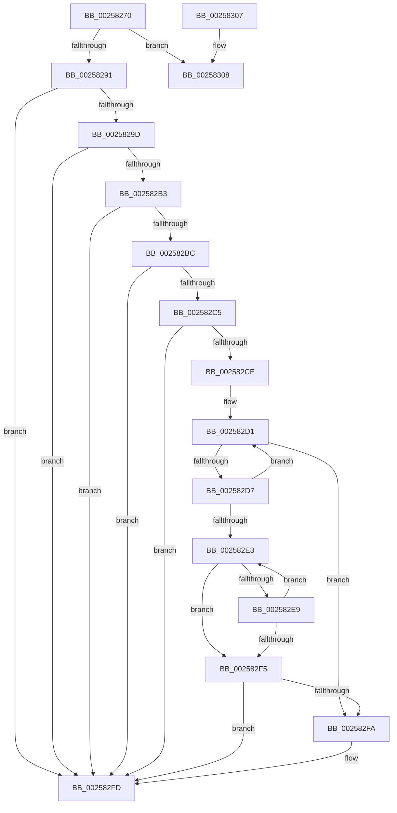

# KiEvaluateGroupSchedulingPreemption

- RVA: `0x00258270`–`0x0025830C` (길이 `156` bytes)
- VA: `0x0000000140258270`
- 실행 섹션: `.text`
- PDB 이름 있음: `예`; PDB Function 태그: `아니요`
- unwind 정보 RVA: `0x00063DB0`
- 디코드: `47`개 명령, `156/156` bytes 표시
- 미해석 바이트: `0` (있으면 어셈블리에 `.byte`로 보존)

> 이 문서는 커널 이미지의 기계어와 PDB 기호를 분석해 생성했습니다. 4번과 5번은 함수 원형과 자료형을 바이너리 사용 방식에서 추정한 C 해석이며 원본 소스 복구 결과는 아닙니다.

## 1. Dependencies

- 직접 호출 지점: **0**; 고유 호출 대상: **0**
- 직접 호출자로 확인된 함수: **4**
- RIP 상대 이미지 참조: **0**

### Outgoing calls
- 직접 디코드된 call 명령이 없습니다.

### Direct callers
- [sub_0021D7F8](../21/Unknown_function_0021D7F8.md) at `0x0021DE53`
- [KiDoesThreadDominateRescheduleContextEntry](KiDoesThreadDominateRescheduleContextEntry_function_002581D0.md) at `0x002581EF`
- [KiSearchForNewThreadsForRescheduleContext](KiSearchForNewThreadsForRescheduleContext_function_00258620.md) at `0x00258C67`
- [KiAttemptToScheduleThreadToBusyIsolationUnit](KiAttemptToScheduleThreadToBusyIsolationUnit_function_00259B00.md) at `0x00259D7C`
- [KiAttemptToScheduleThreadToBusyIsolationUnit](KiAttemptToScheduleThreadToBusyIsolationUnit_function_00259B00.md) at `0x0025A5B6`

### Static image references
- 디코드된 RIP-relative 메모리 참조가 없습니다.

## 2. Other-region calls and transfers

- 다른 실행 섹션으로 향하는 call: **0**
- 별도 외부 분기/꼬리 이동을 확인하지 못했습니다.

## 3. Assembly (complete function range)

```asm
00258270  40 57                           push rdi
00258272  41 57                           push r15
00258274  48 83 EC 28                     sub rsp, 0x28
00258278  48 8B 79 10                     mov rdi, qword ptr [rcx + 0x10]
0025827C  4C 8B D1                        mov r10, rcx
0025827F  0F B6 49 20                     movzx ecx, byte ptr [rcx + 0x20]
00258283  45 8B F8                        mov r15d, r8d
00258286  45 33 C0                        xor r8d, r8d
00258289  4D 8B 1A                        mov r11, qword ptr [r10]
0025828C  F6 C1 01                        test cl, 1
0025828F  74 77                           je 0x140258308
00258291  48 8B 42 68                     mov rax, qword ptr [rdx + 0x68]
00258295  4D 89 01                        mov qword ptr [r9], r8
00258298  48 85 C0                        test rax, rax
0025829B  74 60                           je 0x1402582fd
0025829D  45 8B 93 D8 00 00 00            mov r10d, dword ptr [r11 + 0xd8]
002582A4  4C 03 D0                        add r10, rax
002582A7  80 BA C3 00 00 00 10            cmp byte ptr [rdx + 0xc3], 0x10
002582AE  49 8B CA                        mov rcx, r10
002582B1  7D 4A                           jge 0x1402582fd
002582B3  F7 42 78 00 02 00 00            test dword ptr [rdx + 0x78], 0x200
002582BA  75 41                           jne 0x1402582fd
002582BC  44 39 82 E4 01 00 00            cmp dword ptr [rdx + 0x1e4], r8d
002582C3  75 38                           jne 0x1402582fd
002582C5  80 BA 86 01 00 00 01            cmp byte ptr [rdx + 0x186], 1
002582CC  74 2F                           je 0x1402582fd
002582CE  49 8B D2                        mov rdx, r10
002582D1  F6 42 70 02                     test byte ptr [rdx + 0x70], 2
002582D5  75 23                           jne 0x1402582fa
002582D7  48 8B 92 A0 01 00 00            mov rdx, qword ptr [rdx + 0x1a0]
002582DE  48 85 D2                        test rdx, rdx
002582E1  75 EE                           jne 0x1402582d1
002582E3  44 03 41 7C                     add r8d, dword ptr [rcx + 0x7c]
002582E7  75 0C                           jne 0x1402582f5
002582E9  48 8B 89 A0 01 00 00            mov rcx, qword ptr [rcx + 0x1a0]
002582F0  48 85 C9                        test rcx, rcx
002582F3  75 EE                           jne 0x1402582e3
002582F5  45 85 C0                        test r8d, r8d
002582F8  74 03                           je 0x1402582fd
002582FA  4D 89 11                        mov qword ptr [r9], r10
002582FD  B0 01                           mov al, 1
002582FF  48 83 C4 28                     add rsp, 0x28
00258303  41 5F                           pop r15
00258305  5F                              pop rdi
00258306  C3                              ret
00258307  CC                              int3
00258308  48 8B 47 68                     mov rax, qword ptr [rdi + 0x68]
```

## 4. C-style interpretation (structured pseudocode)

```c
__int64 __fastcall KiEvaluateGroupSchedulingPreemption(__int64 a1, __int64 a2, int a3, __int64 a4)
{
    __int64 v_r10;
    __int64 v_rsp;

    v_rsp = (v_rsp) - (40);
    a3 = 0;
    if ((((unsigned __int8)(*(unsigned __int8 *)(a1 + 32))) & (1)) == 0) goto loc_00258308;
    *(unsigned __int64 *)(a4) = 0;
    if (*(unsigned __int64 *)(a2 + 104) == 0) goto loc_002582FD;
    v_r10 = ((unsigned int)(*(unsigned int *)(*(unsigned __int64 *)(a1) + 216))) + (*(unsigned __int64 *)(a2 + 104));
    if ((*(unsigned __int8 *)(a2 + 195)) >= 16) goto loc_002582FD;
    if (((*(unsigned int *)(a2 + 120)) & (512)) != 0) goto loc_002582FD;
    if ((*(unsigned int *)(a2 + 484)) != 0) goto loc_002582FD;
    if ((*(unsigned __int8 *)(a2 + 390)) == 1) goto loc_002582FD;
loc_002582D1:
    if (((*(unsigned __int8 *)(v_r10 + 112)) & (2)) != 0) goto loc_002582FA;
    if (*(unsigned __int64 *)(v_r10 + 416) != 0) goto loc_002582D1;
loc_002582E3:
    a3 = (unsigned int)((a3) + (*(unsigned int *)(v_r10 + 124)));
    if (condition_is_not_equal) goto loc_002582F5;
    if (*(unsigned __int64 *)(v_r10 + 416) != 0) goto loc_002582E3;
loc_002582F5:
    if (a3 != 0) {
        *(unsigned __int64 *)(a4) = v_r10;
    }
    v_rsp = (v_rsp) + (40);
    return 1;
loc_00258308:
    return *(unsigned __int64 *)(*(unsigned __int64 *)(a1 + 16) + 104);
}
```

## 5. (Beta) C Style

```c
int64_t KiEvaluateGroupSchedulingPreemption(void *Arg1, void *Arg2, int32_t Arg3, void *Arg4)
{
    uint8_t *arg1 = (uint8_t *)Arg1;
    uint8_t *arg2 = (uint8_t *)Arg2;
    uint8_t *arg4 = (uint8_t *)Arg4;

    int64_t local_r10;
    int64_t local_rsp;

    local_rsp = (local_rsp) - (40);
    Arg3 = 0;
    if ((((uint8_t)(*(uint8_t *)(arg1 + 0x20))) & (1)) == 0) goto loc_00258308;
    *(uint64_t *)(arg4) = 0;
    if (*(uint64_t *)(arg2 + 0x68) == 0) goto loc_002582FD;
    local_r10 = ((uint32_t)(*(uint32_t *)(*(uint64_t *)(arg1) + 0xD8))) + (*(uint64_t *)(arg2 + 0x68));
    if ((*(uint8_t *)(arg2 + 0xC3)) >= 16) goto loc_002582FD;
    if (((*(uint32_t *)(arg2 + 0x78)) & (512)) != 0) goto loc_002582FD;
    if ((*(uint32_t *)(arg2 + 0x1E4)) != 0) goto loc_002582FD;
    if ((*(uint8_t *)(arg2 + 0x186)) == 1) goto loc_002582FD;
loc_002582D1:
    if (((*(uint8_t *)(local_r10 + 0x70)) & (2)) != 0) goto loc_002582FA;
    if (*(uint64_t *)(local_r10 + 0x1A0) != 0) goto loc_002582D1;
loc_002582E3:
    Arg3 = (uint32_t)((Arg3) + (*(uint32_t *)(local_r10 + 0x7C)));
    if (condition_is_not_equal) goto loc_002582F5;
    if (*(uint64_t *)(local_r10 + 0x1A0) != 0) goto loc_002582E3;
loc_002582F5:
    if (Arg3 != 0) {
        *(uint64_t *)(arg4) = local_r10;
    }
    local_rsp = (local_rsp) + (40);
    return 1;
loc_00258308:
    return *(uint64_t *)(*(uint64_t *)(arg1 + 0x10) + 0x68);
}
```

### 관측된 메모리 오프셋

구조체 형식이 확인되지 않은 접근은 인자 기준의 오프셋으로만 기록했습니다.

| 기준 인자 | 오프셋 표현 | 폭 (bit) | 접근 |
|---|---:|---:|---|
| `Arg1` | `+ 0x0` | `64` | `R` |
| `Arg1` | `+ 0x10` | `64` | `R` |
| `Arg1` | `+ 0x20` | `8` | `R` |
| `Arg2` | `+ 0x68` | `64` | `R` |
| `Arg2` | `+ 0x78` | `32` | `R` |
| `Arg2` | `+ 0xC3` | `8` | `R` |
| `Arg2` | `+ 0x186` | `8` | `R` |
| `Arg2` | `+ 0x1E4` | `32` | `R` |
| `Arg4` | `+ 0x0` | `64` | `W` |

## 6. Execution-region graph

[열기: 2D/3D 그래프와 함수 탐색 컨트롤 패널](../../../control-panel.html?section=text&rva=0x00258270&view=graph)

- 2D 그래프는 위에서 아래로 흐르고, 3D 그래프는 빈 공간을 드래그해 회전합니다. Shift+드래그는 이동, 휠은 확대·축소, 함수 노드 선택은 대상 보고서 이동입니다.

### Static fallback


