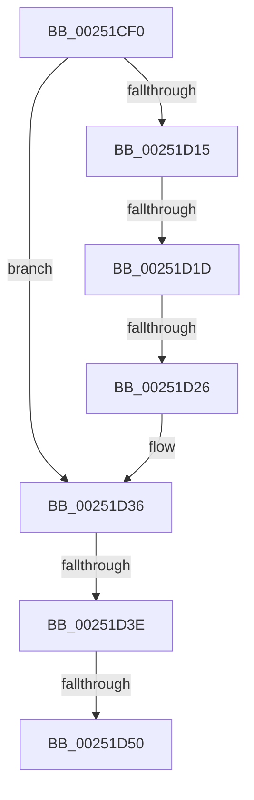

# KiExitDispatcher

- RVA: `0x00251CF0`–`0x00251D54` (길이 `100` bytes)
- VA: `0x0000000140251CF0`
- 실행 섹션: `.text`
- PDB 이름 있음: `예`; PDB Function 태그: `아니요`
- unwind 정보 RVA: `0x00063534`
- 디코드: `28`개 명령, `100/100` bytes 표시
- 미해석 바이트: `0` (있으면 어셈블리에 `.byte`로 보존)

> 이 문서는 커널 이미지의 기계어와 PDB 기호를 분석해 생성했습니다. 4번과 5번은 함수 원형과 자료형을 바이너리 사용 방식에서 추정한 C 해석이며 원본 소스 복구 결과는 아닙니다.

## 1. Dependencies

- 직접 호출 지점: **1**; 고유 호출 대상: **1**
- 직접 호출자로 확인된 함수: **63**
- RIP 상대 이미지 참조: **0**

### Outgoing calls
- `0x00251D31` → [KiProcessThreadWaitList](KiProcessThreadWaitList_function_00252CC0.md) (function, `0x00252CC0`)

### Direct callers
- [KeResumeThread](../20/KeResumeThread_function_00202858.md) at `0x002028F8`
- [KeForceResumeThread](../20/KeForceResumeThread_function_0020292C.md) at `0x002029B8`
- [KeThawMultiProcess](../20/KeThawMultiProcess_function_00202A04.md) at `0x00202B29`
- [KiSchedulerApc](../20/KiSchedulerApc_function_00202BC0.md) at `0x00202DDE`
- [KeInsertQueueApc](../20/KeInsertQueueApc_function_00203F10.md) at `0x0020409F`
- [sub_00219EB5](../21/Unknown_function_00219EB5.md) at `0x00219FEF`
- [KiRetireDpcList](../21/KiRetireDpcList_function_0021A0B0.md) at `0x0021A5FE`
- [KeInsertPriQueue](../21/KeInsertPriQueue_function_0021EDD0.md) at `0x0021EEE9`
- [ExpSetTimerObject](../23/ExpSetTimerObject_function_00231730.md) at `0x00231CCE`
- [KiSetTimerEx](../23/KiSetTimerEx_function_00232CB0.md) at `0x00232F38`
- [KeSetTimer](../23/KeSetTimer_function_00233BE0.md) at `0x00233E4A`
- [IoSetIoCompletionEx3](../24/IoSetIoCompletionEx3_function_0024EEE0.md) at `0x0024F20D`
- [IopCompleteIrpInFileObjectList](../24/IopCompleteIrpInFileObjectList_function_0024F330.md) at `0x0024F5FE`
- [IoSetIoCompletionEx](../24/IoSetIoCompletionEx_function_0024FA80.md) at `0x0024FD2B`
- [sub_0024FEBE](../24/Unknown_function_0024FEBE.md) at `0x00250148`
- [ExReleaseFastMutexUnsafe](ExReleaseFastMutexUnsafe_function_002503A0.md) at `0x0025048A`
- [IopReleaseFileObjectLock](IopReleaseFileObjectLock_function_00250A90.md) at `0x00250B68`
- [FsRtlReleaseHeaderMutex](FsRtlReleaseHeaderMutex_function_002516C0.md) at `0x002517D5`
- [ExReleaseFastMutex](ExReleaseFastMutex_function_002519C0.md) at `0x00251AAE`
- [sub_0025E5F6](Unknown_function_0025E5F6.md) at `0x0025E70F`
- [sub_0025E5F6](Unknown_function_0025E5F6.md) at `0x0025E885`
- [sub_00260366](../26/Unknown_function_00260366.md) at `0x00260936`
- [sub_00260366](../26/Unknown_function_00260366.md) at `0x00260AA3`
- [ExReleaseFastResource](../26/ExReleaseFastResource_function_002613D0.md) at `0x0026199D`
- [sub_00261DFE](../26/Unknown_function_00261DFE.md) at `0x00262108`
- [sub_00262F80](../26/Unknown_function_00262F80.md) at `0x002630AD`
- [sub_0027475D](../27/Unknown_function_0027475D.md) at `0x00274D7E`
- [sub_0027475D](../27/Unknown_function_0027475D.md) at `0x00274EF3`
- [sub_00286600](../28/Unknown_function_00286600.md) at `0x002866E6`
- [KeSignalGate](../2C/KeSignalGate_function_002C748C.md) at `0x002C7556`
- [AlpcpSignalAndWait](../2F/AlpcpSignalAndWait_function_002F9620.md) at `0x002F9846`
- [sub_0033F345](../33/Unknown_function_0033F345.md) at `0x0033F41C`
- [sub_003439EB](../34/Unknown_function_003439EB.md) at `0x00343B76`
- [KeReleaseSemaphoreEx](../34/KeReleaseSemaphoreEx_function_003468C0.md) at `0x00346A53`
- [KeWakeWaitChain](../34/KeWakeWaitChain_function_0034F8C0.md) at `0x0034FA5B`
- [KeTimeOutQueueWaiters](../34/KeTimeOutQueueWaiters_function_0034FB58.md) at `0x0034FC13`
- [KeSetEventBoostPriorityEx](../35/KeSetEventBoostPriorityEx_function_00350148.md) at `0x0035024E`
- [MiReturnWsToExpansionList](../35/MiReturnWsToExpansionList_function_003504E0.md) at `0x003505EC`
- [KeRundownQueueEx](../35/KeRundownQueueEx_function_00351508.md) at `0x00351594`
- [KeDeleteMutant](../35/KeDeleteMutant_function_00351788.md) at `0x00351817`
- [KePulseEvent](../35/KePulseEvent_function_00351EF0.md) at `0x00351FC0`
- [KeSetProcess](../35/KeSetProcess_function_003520E8.md) at `0x0035218D`
- [KeRegisterObjectNotification](../39/KeRegisterObjectNotification_function_00393454.md) at `0x003934F7`
- [AlpcpSignal](../39/AlpcpSignal_function_003955E0.md) at `0x003958AF`
- [KeReleaseMutantEx](../39/KeReleaseMutantEx_function_00396850.md) at `0x00396A51`
- [sub_003970FA](../39/Unknown_function_003970FA.md) at `0x0039721D`
- [AlpcpQueueIoCompletion](../39/AlpcpQueueIoCompletion_function_00397480.md) at `0x003977B5`
- [sub_00397982](../39/Unknown_function_00397982.md) at `0x00397B40`
- [KeAlertThreadByThreadIdEx](../39/KeAlertThreadByThreadIdEx_function_003984BC.md) at `0x00398518`
- [KeForceResumeProcess](../3C/KeForceResumeProcess_function_003C1BE4.md) at `0x003C1CA5`
- [AlpcpQueueIoCompletionPort](../3F/AlpcpQueueIoCompletionPort_function_003FF760.md) at `0x003FFCA1`
- [IopPassiveInterruptDpc](../46/IopPassiveInterruptDpc_function_00469D40.md) at `0x00469E02`
- [KeFreezeProcess](../46/KeFreezeProcess_function_0046B774.md) at `0x0046B854`
- [KeInsertQueue](../46/KeInsertQueue_function_0046C8F0.md) at `0x0046C9A5`
- [KiSetSystemTimeDpc](../48/KiSetSystemTimeDpc_function_00486130.md) at `0x00486350`
- [KeRequestTerminationThread](../48/KeRequestTerminationThread_function_00489A58.md) at `0x00489AFF`
- [KeAlertThread](../48/KeAlertThread_function_00489B40.md) at `0x00489BE0`
- [KeSuspendThread](../4E/KeSuspendThread_function_004E8B9C.md) at `0x004E8C9A`
- [FsRtlpPostStackOverflow](../58/FsRtlpPostStackOverflow_function_0058351C.md) at `0x005836A3`
- [KeRegisterObjectDpc](../5B/KeRegisterObjectDpc_function_005B2544.md) at `0x005B25E7`
- [KeAlertMultipleThreadByThreadId](../5B/KeAlertMultipleThreadByThreadId_function_005B8DA0.md) at `0x005B8E31`
- [KeSuspendThreadOld](../5B/KeSuspendThreadOld_function_005B9000.md) at `0x005B9098`
- [KeAdjustTimerDelayProcess](../5B/KeAdjustTimerDelayProcess_function_005B9658.md) at `0x005B96D5`
- [KeInsertHeadQueue](../5B/KeInsertHeadQueue_function_005BE5D0.md) at `0x005BE6E1`
- [KeRundownPriQueue](../5C/KeRundownPriQueue_function_005CA930.md) at `0x005CA9AA`
- [sub_006F59B4](../6F/Unknown_function_006F59B4.md) at `0x006F5B88`
- [sub_006F59B4](../6F/Unknown_function_006F59B4.md) at `0x006F5C4F`

### Static image references
- 디코드된 RIP-relative 메모리 참조가 없습니다.

## 2. Other-region calls and transfers

- 다른 실행 섹션으로 향하는 call: **0**
- call이 아닌 외부 분기/꼬리 이동: **4**
  - `0x00251D17` → [sub_00251DA5 + 0x4A](Unknown_function_00251DA5.md) (`tail-transfer`)
  - `0x00251D20` → [sub_00251DA5 + 0x4A](Unknown_function_00251DA5.md) (`tail-transfer`)
  - `0x00251D38` → [sub_00251DA5 + 0x67](Unknown_function_00251DA5.md) (`tail-transfer`)
  - `0x00251D4E` → [sub_00251DA5 + 0x1F](Unknown_function_00251DA5.md) (`tail-transfer`)

## 3. Assembly (complete function range)

```asm
00251CF0  48 89 5C 24 18                  mov qword ptr [rsp + 0x18], rbx
00251CF5  55                              push rbp
00251CF6  56                              push rsi
00251CF7  57                              push rdi
00251CF8  48 83 EC 40                     sub rsp, 0x40
00251CFC  0F B6 DA                        movzx ebx, dl
00251CFF  41 8B F1                        mov esi, r9d
00251D02  80 E3 01                        and bl, 1
00251D05  41 8B E8                        mov ebp, r8d
00251D08  48 83 B9 08 2D 00 00 00         cmp qword ptr [rcx + 0x2d08], 0
00251D10  48 8B F9                        mov rdi, rcx
00251D13  74 21                           je 0x140251d36
00251D15  84 DB                           test bl, bl
00251D17  0F 85 D2 00 00 00               jne 0x140251def
00251D1D  F6 C2 04                        test dl, 4
00251D20  0F 85 C9 00 00 00               jne 0x140251def
00251D26  45 33 C9                        xor r9d, r9d
00251D29  44 8B C6                        mov r8d, esi
00251D2C  8B D5                           mov edx, ebp
00251D2E  48 8B CF                        mov rcx, rdi
00251D31  E8 8A 0F 00 00                  call 0x140252cc0
00251D36  84 DB                           test bl, bl
00251D38  0F 85 CE 00 00 00               jne 0x140251e0c
00251D3E  0F B6 B4 24 80 00 00 00         movzx esi, byte ptr [rsp + 0x80]
00251D46  48 8B 47 10                     mov rax, qword ptr [rdi + 0x10]
00251D4A  40 80 FE 02                     cmp sil, 2
00251D4E  73 74                           jae 0x140251dc4
00251D50  48 8B 6F 08                     mov rbp, qword ptr [rdi + 8]
```

## 4. C-style interpretation (structured pseudocode)

```c
__int64 __fastcall KiExitDispatcher(__int64 a1, unsigned __int8 a2, int a3, int a4, unsigned __int8 a5)
{
    __int64 result;
    __int64 v_rbx;
    __int64 v_rsp;
    unsigned __int64 v_stack_p18;

    v_stack_p18 = v_rbx;
    v_rsp = (v_rsp) - (64);
    v_rbx = (unsigned __int8)((a2) & (1));
    if ((*(unsigned __int64 *)(a1 + 11528)) == 0) goto loc_00251D36;
    a4 = 0;
    result = KiProcessThreadWaitList(a1, (unsigned int)((unsigned int)((unsigned int)(a3))), (unsigned int)((unsigned int)((unsigned int)(a4))), a4);
loc_00251D36:
    return *(unsigned __int64 *)(a1 + 16);
}
```

## 5. (Beta) C Style

```c
int64_t KiExitDispatcher(void *Arg1, uint8_t Arg2, int32_t Arg3, int32_t Arg4, uint8_t Arg5)
{
    uint8_t *arg1 = (uint8_t *)Arg1;

    int64_t result;
    int64_t local_rbx;
    int64_t local_rsp;
    uint64_t v_stack_p18;

    v_stack_p18 = local_rbx;
    local_rsp = (local_rsp) - (64);
    local_rbx = (uint8_t)((Arg2) & (1));
    if ((*(uint64_t *)(arg1 + 0x2D08)) == 0) goto loc_00251D36;
    Arg4 = 0;
    result = KiProcessThreadWaitList(Arg1, (uint32_t)((uint32_t)((uint32_t)(Arg3))), (uint32_t)((uint32_t)((uint32_t)(Arg4))), Arg4);
loc_00251D36:
    return *(uint64_t *)(arg1 + 0x10);
}
```

### 관측된 메모리 오프셋

구조체 형식이 확인되지 않은 접근은 인자 기준의 오프셋으로만 기록했습니다.

| 기준 인자 | 오프셋 표현 | 폭 (bit) | 접근 |
|---|---:|---:|---|
| `Arg1` | `+ 0x8` | `64` | `R` |
| `Arg1` | `+ 0x10` | `64` | `R` |
| `Arg1` | `+ 0x2D08` | `64` | `R` |

## 6. Execution-region graph

[열기: 2D/3D 그래프와 함수 탐색 컨트롤 패널](../../../control-panel.html?section=text&rva=0x00251CF0&view=graph)

- 2D 그래프는 위에서 아래로 흐르고, 3D 그래프는 빈 공간을 드래그해 회전합니다. Shift+드래그는 이동, 휠은 확대·축소, 함수 노드 선택은 대상 보고서 이동입니다.

### Static fallback


