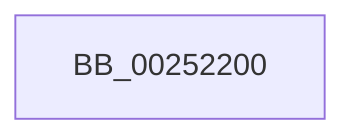

# KiFlushSoftwareInterruptBatch

- RVA: `0x00252200`–`0x00252215` (길이 `21` bytes)
- VA: `0x0000000140252200`
- 실행 섹션: `.text`
- PDB 이름 있음: `예`; PDB Function 태그: `아니요`
- unwind 정보 RVA: `0x000635C4`
- 디코드: `6`개 명령, `21/21` bytes 표시
- 미해석 바이트: `0` (있으면 어셈블리에 `.byte`로 보존)

> 이 문서는 커널 이미지의 기계어와 PDB 기호를 분석해 생성했습니다. 4번과 5번은 함수 원형과 자료형을 바이너리 사용 방식에서 추정한 C 해석이며 원본 소스 복구 결과는 아닙니다.

## 1. Dependencies

- 직접 호출 지점: **0**; 고유 호출 대상: **0**
- 직접 호출자로 확인된 함수: **43**
- RIP 상대 이미지 참조: **0**

### Outgoing calls
- 직접 디코드된 call 명령이 없습니다.

### Direct callers
- [KiDeferGroupSchedulingPreemption](../20/KiDeferGroupSchedulingPreemption_function_0020076C.md) at `0x00200CB3`
- [KiHandleDeferredPreemption](../20/KiHandleDeferredPreemption_function_00202ECC.md) at `0x00203206`
- [sub_00208F87](../20/Unknown_function_00208F87.md) at `0x002090EF`
- [sub_002092A9](../20/Unknown_function_002092A9.md) at `0x00209395`
- [KeYieldExecution](../20/KeYieldExecution_function_00209FA0.md) at `0x0020A40C`
- [sub_00210BCA](../21/Unknown_function_00210BCA.md) at `0x00210DAE`
- [sub_00210BCA](../21/Unknown_function_00210BCA.md) at `0x00210DBF`
- [sub_00213F4F](../21/Unknown_function_00213F4F.md) at `0x00214196`
- [sub_002142F9](../21/Unknown_function_002142F9.md) at `0x002144E1`
- [sub_002142F9](../21/Unknown_function_002142F9.md) at `0x002147AF`
- [sub_002142F9](../21/Unknown_function_002142F9.md) at `0x002147C8`
- [KiRemoveBoostThread](../21/KiRemoveBoostThread_function_00219128.md) at `0x002193D6`
- [sub_0021C4E3](../21/Unknown_function_0021C4E3.md) at `0x0021C523`
- [KiQueueReadyThread](../21/KiQueueReadyThread_function_0021C7B0.md) at `0x0021C9FB`
- [KiQueueReadyThread](../21/KiQueueReadyThread_function_0021C7B0.md) at `0x0021CA08`
- [sub_0021D4DD](../21/Unknown_function_0021D4DD.md) at `0x0021D5E5`
- [sub_0021D4DD](../21/Unknown_function_0021D4DD.md) at `0x0021D5F6`
- [sub_0021D7F8](../21/Unknown_function_0021D7F8.md) at `0x0021E719`
- [KiSetPriorityThread](../22/KiSetPriorityThread_function_00220E78.md) at `0x00221324`
- [KiProcessDeferredReadyList](KiProcessDeferredReadyList_function_00250800.md) at `0x00250875`
- [KiProcessThreadWaitList](KiProcessThreadWaitList_function_00252CC0.md) at `0x00252DE8`
- [KiExecuteAllDpcs](KiExecuteAllDpcs_function_0025B740.md) at `0x0025BC9F`
- [KiExecuteAllDpcs](KiExecuteAllDpcs_function_0025B740.md) at `0x0025C19F`
- [KiUpdateGlobalCpuSetConfiguration](../30/KiUpdateGlobalCpuSetConfiguration_function_00305AB8.md) at `0x00305C2B`
- [KiGroupSchedulingGenerationEnd](../30/KiGroupSchedulingGenerationEnd_function_0030A9B4.md) at `0x0030AD99`
- [KiRescheduleThreadAfterAffinityChange](../30/KiRescheduleThreadAfterAffinityChange_function_0030C9E8.md) at `0x0030CD76`
- [KiAttemptToStealStandbyThread](../30/KiAttemptToStealStandbyThread_function_0030D790.md) at `0x0030DCE4`
- [KiReadyDeferredReadyList](../30/KiReadyDeferredReadyList_function_0030DD80.md) at `0x0030DDEB`
- [KiAbDeferredProcessingWorker](../30/KiAbDeferredProcessingWorker_function_0030DEB0.md) at `0x0030E12B`
- [KiSearchForNewThreadsOnTarget](../30/KiSearchForNewThreadsOnTarget_function_0030F500.md) at `0x0030F7B2`
- [KiExitThreadWaitReschedule](../35/KiExitThreadWaitReschedule_function_00352EC8.md) at `0x00353008`
- [KiSendHeteroRescheduleIntRequestHelper](../35/KiSendHeteroRescheduleIntRequestHelper_function_0035420C.md) at `0x0035438C`
- [KiSearchForNewThread](../35/KiSearchForNewThread_function_00355C98.md) at `0x00355EFB`
- [KiReadyOutSwappedThreads](../39/KiReadyOutSwappedThreads_function_00396E30.md) at `0x00396F3A`
- [KiReadyOutSwappedThreads](../39/KiReadyOutSwappedThreads_function_00396E30.md) at `0x00396F4B`
- [KiInswapAndReadyThread](../39/KiInswapAndReadyThread_function_00398318.md) at `0x003983B4`
- [KiInswapAndReadyThread](../39/KiInswapAndReadyThread_function_00398318.md) at `0x003983C5`
- [sub_0039867C](../39/Unknown_function_0039867C.md) at `0x003986BF`
- [sub_003986CE](../39/Unknown_function_003986CE.md) at `0x003986D1`
- [sub_00398945](../39/Unknown_function_00398945.md) at `0x0039898F`
- [sub_00398945](../39/Unknown_function_00398945.md) at `0x003989A0`
- [KeRevertToUserGroupAffinityThread](../39/KeRevertToUserGroupAffinityThread_function_00398EC0.md) at `0x00398FF8`
- [KeRevertToUserGroupAffinityThread](../39/KeRevertToUserGroupAffinityThread_function_00398EC0.md) at `0x00399009`
- [sub_0039926C](../39/Unknown_function_0039926C.md) at `0x003992AC`
- [sub_0039926C](../39/Unknown_function_0039926C.md) at `0x003992BD`
- [KiSetSystemAffinityThread](../39/KiSetSystemAffinityThread_function_003993E0.md) at `0x003998DF`
- [KiSoftParkElectionDpcRoutine](../45/KiSoftParkElectionDpcRoutine_function_004508F0.md) at `0x00450A67`
- [KiApplyForegroundBoostThread](../4F/KiApplyForegroundBoostThread_function_004F7DC0.md) at `0x004F7FE3`
- [KiFinalizeCoreControlBlockAssignment](../5B/KiFinalizeCoreControlBlockAssignment_function_005B7D0C.md) at `0x005B7E59`
- [KiAdjustCoreIsolationReasonThread](../5C/KiAdjustCoreIsolationReasonThread_function_005C3818.md) at `0x005C3984`
- [KiForceParkDutyCycleDpcCallback](../5C/KiForceParkDutyCycleDpcCallback_function_005C97D0.md) at `0x005C9918`
- [sub_006E0C4E](../6E/Unknown_function_006E0C4E.md) at `0x006E0CA3`
- [sub_006E0CAE](../6E/Unknown_function_006E0CAE.md) at `0x006E0CDE`
- [sub_006E26C2](../6E/Unknown_function_006E26C2.md) at `0x006E2707`

### Static image references
- 디코드된 RIP-relative 메모리 참조가 없습니다.

## 2. Other-region calls and transfers

- 다른 실행 섹션으로 향하는 call: **0**
- call이 아닌 외부 분기/꼬리 이동: **1**
  - `0x0025220F` → [sub_002522CD](Unknown_function_002522CD.md) (`tail-transfer`)

## 3. Assembly (complete function range)

```asm
00252200  40 53                           push rbx
00252202  48 83 EC 40                     sub rsp, 0x40
00252206  0F B6 41 01                     movzx eax, byte ptr [rcx + 1]
0025220A  48 8B D9                        mov rbx, rcx
0025220D  84 C0                           test al, al
0025220F  0F 84 B8 00 00 00               je 0x1402522cd
```

## 4. C-style interpretation (structured pseudocode)

```c
__int64 __fastcall KiFlushSoftwareInterruptBatch(__int64 a1)
{
    __int64 v_rsp;

    v_rsp = (v_rsp) - (64);
}
```

## 5. (Beta) C Style

```c
int64_t KiFlushSoftwareInterruptBatch(void *Arg1)
{
    uint8_t *arg1 = (uint8_t *)Arg1;

    int64_t local_rsp;

    local_rsp = (local_rsp) - (64);
}
```

### 관측된 메모리 오프셋

구조체 형식이 확인되지 않은 접근은 인자 기준의 오프셋으로만 기록했습니다.

| 기준 인자 | 오프셋 표현 | 폭 (bit) | 접근 |
|---|---:|---:|---|
| `Arg1` | `+ 0x1` | `8` | `R` |

## 6. Execution-region graph

[열기: 2D/3D 그래프와 함수 탐색 컨트롤 패널](../../../control-panel.html?section=text&rva=0x00252200&view=graph)

- 2D 그래프는 위에서 아래로 흐르고, 3D 그래프는 빈 공간을 드래그해 회전합니다. Shift+드래그는 이동, 휠은 확대·축소, 함수 노드 선택은 대상 보고서 이동입니다.

### Static fallback


