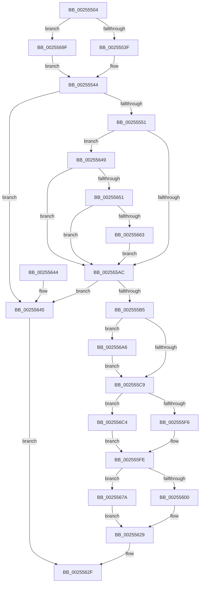

# KiHeteroSelectIdleProcessorFromSubNode

- RVA: `0x00255504`–`0x002556D2` (길이 `462` bytes)
- VA: `0x0000000140255504`
- 실행 섹션: `.text`
- PDB 이름 있음: `예`; PDB Function 태그: `아니요`
- unwind 정보 RVA: `0x000637C8`
- 디코드: `111`개 명령, `462/462` bytes 표시
- 미해석 바이트: `0` (있으면 어셈블리에 `.byte`로 보존)

> 이 문서는 커널 이미지의 기계어와 PDB 기호를 분석해 생성했습니다. 4번과 5번은 함수 원형과 자료형을 바이너리 사용 방식에서 추정한 C 해석이며 원본 소스 복구 결과는 아닙니다.

## 1. Dependencies

- 직접 호출 지점: **4**; 고유 호출 대상: **3**
- 직접 호출자로 확인된 함수: **1**
- RIP 상대 이미지 참조: **6**

### Outgoing calls
- `0x00255578` → [KiGenerateHeteroSets](../39/KiGenerateHeteroSets_function_0039ED50.md) (function, `0x0039ED50`)
- `0x002555DF` → [KiHeteroIdleSetReduction](../41/KiHeteroIdleSetReduction_function_00414A90.md) (function, `0x00414A90`)
- `0x00255698` → [KiFindBiasedProcessorIndex](../3C/KiFindBiasedProcessorIndex_function_003C185C.md) (function, `0x003C185C`)
- `0x002556B4` → [KiFindBiasedProcessorIndex](../3C/KiFindBiasedProcessorIndex_function_003C185C.md) (function, `0x003C185C`)

### Direct callers
- [sub_0025308F](Unknown_function_0025308F.md) at `0x00253B21`

### Static image references
- `0x002555B5` → RVA `0x00FC8C40` (`ALMOSTRO`; read)
- `0x002555E4` → RVA `0x00FC6D14` (`ALMOSTRO`; read)
- `0x002555F6` → RVA `0x00FC5080` (`ALMOSTRO`; read)
- `0x0025561A` → RVA `0x00F231B8` (`.data`; read)
- `0x0025567E` → RVA `0x00FC6FE4` (`ALMOSTRO`; read)
- `0x002556C4` → RVA `0x00FC6D10` (`ALMOSTRO`; read)

## 2. Other-region calls and transfers

- 다른 실행 섹션으로 향하는 call: **0**
- 별도 외부 분기/꼬리 이동을 확인하지 못했습니다.

## 3. Assembly (complete function range)

```asm
00255504  48 89 5C 24 08                  mov qword ptr [rsp + 8], rbx
00255509  48 89 6C 24 18                  mov qword ptr [rsp + 0x18], rbp
0025550E  56                              push rsi
0025550F  57                              push rdi
00255510  41 56                           push r14
00255512  48 83 EC 50                     sub rsp, 0x50
00255516  33 C0                           xor eax, eax
00255518  0F 57 C0                        xorps xmm0, xmm0
0025551B  48 89 44 24 40                  mov qword ptr [rsp + 0x40], rax
00255520  49 8B F0                        mov rsi, r8
00255523  0F B7 82 88 00 00 00            movzx eax, word ptr [rdx + 0x88]
0025552A  48 8B FA                        mov rdi, rdx
0025552D  4C 8B F1                        mov r14, rcx
00255530  0F 11 44 24 30                  movups xmmword ptr [rsp + 0x30], xmm0
00255535  66 41 3B 01                     cmp ax, word ptr [r9]
00255539  0F 83 60 01 00 00               jae 0x14025569f
0025553F  49 8B 5C C1 08                  mov rbx, qword ptr [r9 + rax*8 + 8]
00255544  48 85 9A 80 00 00 00            test qword ptr [rdx + 0x80], rbx
0025554B  0F 84 F4 00 00 00               je 0x140255645
00255551  48 8B AC 24 90 00 00 00         mov rbp, qword ptr [rsp + 0x90]
00255559  48 8D 44 24 30                  lea rax, [rsp + 0x30]
0025555E  48 89 44 24 28                  mov qword ptr [rsp + 0x28], rax
00255563  48 8B D3                        mov rdx, rbx
00255566  48 8B CF                        mov rcx, rdi
00255569  8B 45 08                        mov eax, dword ptr [rbp + 8]
0025556C  44 8B 4D 04                     mov r9d, dword ptr [rbp + 4]
00255570  44 8A 45 10                     mov r8b, byte ptr [rbp + 0x10]
00255574  89 44 24 20                     mov dword ptr [rsp + 0x20], eax
00255578  E8 D3 97 14 00                  call 0x14039ed50
0025557D  8B 4D 14                        mov ecx, dword ptr [rbp + 0x14]
00255580  39 8C 24 98 00 00 00            cmp dword ptr [rsp + 0x98], ecx
00255587  4C 8B 57 08                     mov r10, qword ptr [rdi + 8]
0025558B  0F 4F 8C 24 98 00 00 00         cmovg ecx, dword ptr [rsp + 0x98]
00255593  48 63 C9                        movsxd rcx, ecx
00255596  48 8B 4C CF 10                  mov rcx, qword ptr [rdi + rcx*8 + 0x10]
0025559B  4C 8B 44 24 40                  mov r8, qword ptr [rsp + 0x40]
002555A0  4C 23 D1                        and r10, rcx
002555A3  4D 85 C2                        test r10, r8
002555A6  0F 84 9D 00 00 00               je 0x140255649
002555AC  4D 23 D0                        and r10, r8
002555AF  0F 84 90 00 00 00               je 0x140255645
002555B5  48 8D 1D 84 36 D7 00            lea rbx, [rip + 0xd73684]
002555BC  48 39 BE C0 00 00 00            cmp qword ptr [rsi + 0xc0], rdi
002555C3  0F 85 DD 00 00 00               jne 0x1402556a6
002555C9  48 8D 44 24 30                  lea rax, [rsp + 0x30]
002555CE  4C 8B CD                        mov r9, rbp
002555D1  4D 8B C2                        mov r8, r10
002555D4  48 89 44 24 20                  mov qword ptr [rsp + 0x20], rax
002555D9  48 8B D6                        mov rdx, rsi
002555DC  48 8B CF                        mov rcx, rdi
002555DF  E8 AC F4 1B 00                  call 0x140414a90
002555E4  8B 0D 2A 17 D7 00               mov ecx, dword ptr [rip + 0xd7172a]
002555EA  4C 8B C0                        mov r8, rax
002555ED  F6 C1 04                        test cl, 4
002555F0  0F 85 CE 00 00 00               jne 0x1402556c4
002555F6  8B 05 84 FA D6 00               mov eax, dword ptr [rip + 0xd6fa84]
002555FC  A8 10                           test al, 0x10
002555FE  75 7A                           jne 0x14025567a
00255600  0F B6 8E D1 00 00 00            movzx ecx, byte ptr [rsi + 0xd1]
00255607  0F B6 96 D0 00 00 00            movzx edx, byte ptr [rsi + 0xd0]
0025560E  49 D3 C8                        ror r8, cl
00255611  49 0F BC C0                     bsf rax, r8
00255615  C1 E2 06                        shl edx, 6
00255618  03 C8                           add ecx, eax
0025561A  48 8B 05 97 DB CC 00            mov rax, qword ptr [rip + 0xccdb97]
00255621  83 E1 3F                        and ecx, 0x3f
00255624  03 D1                           add edx, ecx
00255626  8B 04 90                        mov eax, dword ptr [rax + rdx*4]
00255629  8B C0                           mov eax, eax
0025562B  48 8B 04 C3                     mov rax, qword ptr [rbx + rax*8]
0025562F  4C 8D 5C 24 50                  lea r11, [rsp + 0x50]
00255634  49 8B 5B 20                     mov rbx, qword ptr [r11 + 0x20]
00255638  49 8B 6B 30                     mov rbp, qword ptr [r11 + 0x30]
0025563C  49 8B E3                        mov rsp, r11
0025563F  41 5E                           pop r14
00255641  5F                              pop rdi
00255642  5E                              pop rsi
00255643  C3                              ret
00255644  CC                              int3
00255645  33 C0                           xor eax, eax
00255647  EB E6                           jmp 0x14025562f
00255649  85 C0                           test eax, eax
0025564B  0F 85 5B FF FF FF               jne 0x1402555ac
00255651  48 8B 47 50                     mov rax, qword ptr [rdi + 0x50]
00255655  4C 8B 44 24 40                  mov r8, qword ptr [rsp + 0x40]
0025565A  49 85 C0                        test r8, rax
0025565D  0F 85 49 FF FF FF               jne 0x1402555ac
00255663  4C 8B C3                        mov r8, rbx
00255666  48 89 5C 24 40                  mov qword ptr [rsp + 0x40], rbx
0025566B  48 89 5C 24 38                  mov qword ptr [rsp + 0x38], rbx
00255670  48 89 5C 24 30                  mov qword ptr [rsp + 0x30], rbx
00255675  E9 32 FF FF FF                  jmp 0x1402555ac
0025567A  49 8B 46 48                     mov rax, qword ptr [r14 + 0x48]
0025567E  8B 0D 60 19 D7 00               mov ecx, dword ptr [rip + 0xd71960]
00255684  0F B6 96 D1 00 00 00            movzx edx, byte ptr [rsi + 0xd1]
0025568B  48 D3 E8                        shr rax, cl
0025568E  0F B6 8E D0 00 00 00            movzx ecx, byte ptr [rsi + 0xd0]
00255695  48 03 D0                        add rdx, rax
00255698  E8 BF C1 16 00                  call 0x1403c185c
0025569D  EB 8A                           jmp 0x140255629
0025569F  33 DB                           xor ebx, ebx
002556A1  E9 9E FE FF FF                  jmp 0x140255544
002556A6  0F B6 96 D1 00 00 00            movzx edx, byte ptr [rsi + 0xd1]
002556AD  0F B7 8F 88 00 00 00            movzx ecx, word ptr [rdi + 0x88]
002556B4  E8 A3 C1 16 00                  call 0x1403c185c
002556B9  8B C8                           mov ecx, eax
002556BB  48 8B 34 CB                     mov rsi, qword ptr [rbx + rcx*8]
002556BF  E9 05 FF FF FF                  jmp 0x1402555c9
002556C4  8B 0D 46 16 D7 00               mov ecx, dword ptr [rip + 0xd71646]
002556CA  F6 C1 04                        test cl, 4
002556CD  E9 2C FF FF FF                  jmp 0x1402555fe
```

## 4. C-style interpretation (structured pseudocode)

```c
__int64 __fastcall KiHeteroSelectIdleProcessorFromSubNode(__int64 a1, __int64 a2, __int64 a3, __int64 a4, __int64 a5, unsigned int a6)
{
    __int64 result;
    __int64 v_r10;
    __int64 v_rbx;
    __int64 v_rsp;
    unsigned __int64 v_stack_m10;
    unsigned __int64 v_stack_m18;
    unsigned __int64 v_stack_m20;
    unsigned __int64 v_stack_m28;
    unsigned __int64 v_stack_m38;
    unsigned __int64 v_stack_m40;
    unsigned int v_stack_m48;
    unsigned __int64 v_stack_p18;
    unsigned __int64 v_stack_p8;

    v_stack_p8 = v_rbx;
    v_stack_p18 = v_rbp;
    v_rsp = (v_rsp) - (80);
    result = 0;
    v_stack_m28 = 0;
    v_stack_m38 = v_xmm0;
    if (((unsigned __int16)(*(unsigned __int16 *)(a2 + 136))) >= (*(unsigned __int16 *)(a4))) goto loc_0025569F;
loc_00255544:
    if (((*(unsigned __int64 *)(a2 + 128)) & (*(unsigned __int64 *)(a4 + *(unsigned __int16 *)(a2 + 136) * 8 + 8))) == 0) goto loc_00255645;
    v_stack_m40 = v_stack_m38;
    v_stack_m48 = (unsigned int)((unsigned int)(*(unsigned int *)(a5 + 8)));
    result = KiGenerateHeteroSets(a2, *(unsigned __int64 *)(a4 + *(unsigned __int16 *)(a2 + 136) * 8 + 8), *(unsigned __int8 *)(a5 + 16), (unsigned int)(*(unsigned int *)(a5 + 4)));
    a1 = (unsigned int)(*(unsigned int *)(a5 + 20));
    if (a6 > ((unsigned int)((unsigned int)(*(unsigned int *)(a5 + 20))))) { a1 = a6; }
    v_r10 = (*(unsigned __int64 *)(a2 + 8)) & (*(unsigned __int64 *)(a2 + (int)((unsigned int)(a1)) * 8 + 16));
    if (((v_r10) & (v_stack_m28)) == 0) goto loc_00255649;
loc_002555AC:
    v_r10 = (v_r10) & (v_stack_m28);
    if (condition_is_equal) goto loc_00255645;
    if ((*(unsigned __int64 *)(a3 + 192)) != a2) goto loc_002556A6;
loc_002555C9:
    v_stack_m48 = v_stack_m38;
    result = KiHeteroIdleSetReduction(a2, a3, v_r10, a5);
    if ((((unsigned __int8)((unsigned int)(*(unsigned int *)(v_rip + 14096170)))) & (4)) != 0) goto loc_002556C4;
loc_002555FE:
    if ((((unsigned __int8)((unsigned int)(*(unsigned int *)(v_rip + 14088836)))) & (16)) != 0) goto loc_0025567A;
    a2 = (unsigned int)((*(unsigned __int8 *)(a3 + 208)) << (6));
    a1 = (unsigned int)((*(unsigned __int8 *)(a3 + 209)) + ((unsigned int)((unsigned int)(*(unsigned int *)(v_rip + 14088836)))));
    a1 = (unsigned int)((a1) & (63));
    a2 = (unsigned int)((a2) + ((unsigned int)(a1)));
loc_00255629:
loc_0025562F:
    return *(unsigned __int64 *)(v_rip + 14104196 + (unsigned int)((unsigned int)((unsigned int)(*(unsigned int *)(*(unsigned __int64 *)(v_rip + 13425559) + a2 * 4)))) * 8);
loc_00255645:
    result = 0;
    goto loc_0025562F;
loc_00255649:
    if (0 != 0) goto loc_002555AC;
    if (((v_stack_m10) & (*(unsigned __int64 *)(a2 + 80))) != 0) goto loc_002555AC;
    v_stack_m10 = *(unsigned __int64 *)(v_stack_m18 + 32);
    v_stack_m18 = *(unsigned __int64 *)(v_stack_m18 + 32);
    v_stack_m20 = *(unsigned __int64 *)(v_stack_m18 + 32);
    goto loc_002555AC;
loc_0025567A:
    result = (*(unsigned __int64 *)(a1 + 72)) >> ((unsigned __int8)((unsigned int)(*(unsigned int *)(v_rip + 14096736))));
    a2 = (*(unsigned __int8 *)(a3 + 209)) + (result);
    result = KiFindBiasedProcessorIndex(*(unsigned __int8 *)(a3 + 208), a2, *(unsigned __int64 *)(v_stack_m18 + 32), a5);
    goto loc_00255629;
loc_0025569F:
    v_rbx = 0;
    goto loc_00255544;
loc_002556A6:
    result = KiFindBiasedProcessorIndex(*(unsigned __int16 *)(a2 + 136), *(unsigned __int8 *)(a3 + 209), *(unsigned __int64 *)(v_stack_m18 + 32), a5);
    goto loc_002555C9;
loc_002556C4:
    goto loc_002555FE;
}
```

## 5. (Beta) C Style

```c
int64_t KiHeteroSelectIdleProcessorFromSubNode(void *Arg1, void *Arg2, void *Arg3, void *Arg4, void *Arg5, uint32_t Arg6)
{
    uint8_t *arg1 = (uint8_t *)Arg1;
    uint8_t *arg2 = (uint8_t *)Arg2;
    uint8_t *arg3 = (uint8_t *)Arg3;
    uint8_t *arg4 = (uint8_t *)Arg4;
    uint8_t *arg5 = (uint8_t *)Arg5;

    int64_t result;
    int64_t local_r10;
    int64_t local_rbx;
    int64_t local_rsp;
    uint64_t v_stack_m10;
    uint64_t v_stack_m18;
    uint64_t v_stack_m20;
    uint64_t v_stack_m28;
    uint64_t v_stack_m38;
    uint64_t v_stack_m40;
    uint32_t v_stack_m48;
    uint64_t v_stack_p18;
    uint64_t v_stack_p8;

    v_stack_p8 = local_rbx;
    v_stack_p18 = local_rbp;
    local_rsp = (local_rsp) - (80);
    result = 0;
    v_stack_m28 = 0;
    v_stack_m38 = v_xmm0;
    if (((uint16_t)(*(uint16_t *)(arg2 + 0x88))) >= (*(uint16_t *)(arg4))) goto loc_0025569F;
loc_00255544:
    if (((*(uint64_t *)(arg2 + 0x80)) & (*(uint64_t *)(arg4 + *(uint16_t *)(arg2 + 0x88) * 8 + 0x8))) == 0) goto loc_00255645;
    v_stack_m40 = v_stack_m38;
    v_stack_m48 = (uint32_t)((uint32_t)(*(uint32_t *)(arg5 + 0x8)));
    result = KiGenerateHeteroSets(Arg2, *(uint64_t *)(arg4 + *(uint16_t *)(arg2 + 0x88) * 8 + 0x8), *(uint8_t *)(arg5 + 0x10), (uint32_t)(*(uint32_t *)(arg5 + 0x4)));
    Arg1 = (uint32_t)(*(uint32_t *)(arg5 + 0x14));
    if (Arg6 > ((uint32_t)((uint32_t)(*(uint32_t *)(arg5 + 0x14))))) { Arg1 = Arg6; }
    local_r10 = (*(uint64_t *)(arg2 + 0x8)) & (*(uint64_t *)(arg2 + (int32_t)((uint32_t)(arg1)) * 8 + 0x10));
    if (((local_r10) & (v_stack_m28)) == 0) goto loc_00255649;
loc_002555AC:
    local_r10 = (local_r10) & (v_stack_m28);
    if (condition_is_equal) goto loc_00255645;
    if ((*(uint64_t *)(arg3 + 0xC0)) != Arg2) goto loc_002556A6;
loc_002555C9:
    v_stack_m48 = v_stack_m38;
    result = KiHeteroIdleSetReduction(Arg2, Arg3, local_r10, Arg5);
    if ((((uint8_t)((uint32_t)(*(uint32_t *)(v_rip + 0xD7172A)))) & (4)) != 0) goto loc_002556C4;
loc_002555FE:
    if ((((uint8_t)((uint32_t)(*(uint32_t *)(v_rip + 0xD6FA84)))) & (16)) != 0) goto loc_0025567A;
    Arg2 = (uint32_t)((*(uint8_t *)(arg3 + 0xD0)) << (6));
    Arg1 = (uint32_t)((*(uint8_t *)(arg3 + 0xD1)) + ((uint32_t)((uint32_t)(*(uint32_t *)(v_rip + 0xD6FA84)))));
    Arg1 = (uint32_t)((Arg1) & (63));
    Arg2 = (uint32_t)((Arg2) + ((uint32_t)(Arg1)));
loc_00255629:
loc_0025562F:
    return *(uint64_t *)(v_rip + 0xD73684 + (uint32_t)((uint32_t)((uint32_t)(*(uint32_t *)(*(uint64_t *)(v_rip + 0xCCDB97) + arg2 * 4)))) * 8);
loc_00255645:
    result = 0;
    goto loc_0025562F;
loc_00255649:
    if (0 != 0) goto loc_002555AC;
    if (((v_stack_m10) & (*(uint64_t *)(arg2 + 0x50))) != 0) goto loc_002555AC;
    v_stack_m10 = *(uint64_t *)(v_stack_m18 + 0x20);
    v_stack_m18 = *(uint64_t *)(v_stack_m18 + 0x20);
    v_stack_m20 = *(uint64_t *)(v_stack_m18 + 0x20);
    goto loc_002555AC;
loc_0025567A:
    result = (*(uint64_t *)(arg1 + 0x48)) >> ((uint8_t)((uint32_t)(*(uint32_t *)(v_rip + 0xD71960))));
    Arg2 = (*(uint8_t *)(arg3 + 0xD1)) + (result);
    result = KiFindBiasedProcessorIndex(*(uint8_t *)(arg3 + 0xD0), Arg2, *(uint64_t *)(v_stack_m18 + 0x20), Arg5);
    goto loc_00255629;
loc_0025569F:
    local_rbx = 0;
    goto loc_00255544;
loc_002556A6:
    result = KiFindBiasedProcessorIndex(*(uint16_t *)(arg2 + 0x88), *(uint8_t *)(arg3 + 0xD1), *(uint64_t *)(v_stack_m18 + 0x20), Arg5);
    goto loc_002555C9;
loc_002556C4:
    goto loc_002555FE;
}
```

### 관측된 메모리 오프셋

구조체 형식이 확인되지 않은 접근은 인자 기준의 오프셋으로만 기록했습니다.

| 기준 인자 | 오프셋 표현 | 폭 (bit) | 접근 |
|---|---:|---:|---|
| `Arg1` | `+ 0x48` | `64` | `R` |
| `Arg2` | `+ 0x8` | `64` | `R` |
| `Arg2` | `+ 0x10 + rcx*8` | `64` | `R` |
| `Arg2` | `+ 0x50` | `64` | `R` |
| `Arg2` | `+ 0x80` | `64` | `R` |
| `Arg2` | `+ 0x88` | `16` | `R` |
| `Arg3` | `+ 0xC0` | `64` | `R` |
| `Arg3` | `+ 0xD1` | `8` | `R` |
| `Arg4` | `+ 0x0` | `16` | `R` |
| `Arg4` | `+ 0x8 + rax*8` | `64` | `R` |
| `Arg5` | `+ 0x4` | `32` | `R` |
| `Arg5` | `+ 0x8` | `32` | `R` |
| `Arg5` | `+ 0x10` | `8` | `R` |
| `Arg5` | `+ 0x14` | `32` | `R` |

## 6. Execution-region graph

[열기: 2D/3D 그래프와 함수 탐색 컨트롤 패널](../../../control-panel.html?section=text&rva=0x00255504&view=graph)

- 2D 그래프는 위에서 아래로 흐르고, 3D 그래프는 빈 공간을 드래그해 회전합니다. Shift+드래그는 이동, 휠은 확대·축소, 함수 노드 선택은 대상 보고서 이동입니다.

### Static fallback


