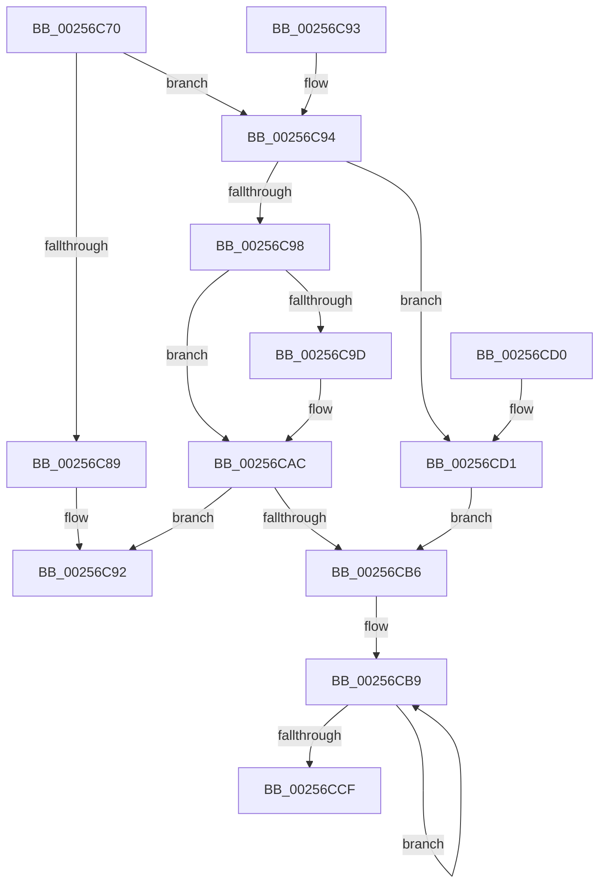

# KiIsIsolationUnitIdleByHandle

- RVA: `0x00256C70`–`0x00256CE0` (길이 `112` bytes)
- VA: `0x0000000140256C70`
- 실행 섹션: `.text`
- PDB 이름 있음: `예`; PDB Function 태그: `아니요`
- unwind 정보 RVA: `0x000DB714`
- 디코드: `37`개 명령, `112/112` bytes 표시
- 미해석 바이트: `0` (있으면 어셈블리에 `.byte`로 보존)

> 이 문서는 커널 이미지의 기계어와 PDB 기호를 분석해 생성했습니다. 4번과 5번은 함수 원형과 자료형을 바이너리 사용 방식에서 추정한 C 해석이며 원본 소스 복구 결과는 아닙니다.

## 1. Dependencies

- 직접 호출 지점: **0**; 고유 호출 대상: **0**
- 직접 호출자로 확인된 함수: **5**
- RIP 상대 이미지 참조: **0**

### Outgoing calls
- 직접 디코드된 call 명령이 없습니다.

### Direct callers
- [sub_0025308F](Unknown_function_0025308F.md) at `0x0025389C`
- [sub_0025308F](Unknown_function_0025308F.md) at `0x00254184`
- [KiChooseTargetProcessor](KiChooseTargetProcessor_function_002556D8.md) at `0x002557A4`
- [KiChooseTargetProcessor](KiChooseTargetProcessor_function_002556D8.md) at `0x00255ABE`
- [KiChooseTargetProcessor](KiChooseTargetProcessor_function_002556D8.md) at `0x0025606A`
- [KiChooseTargetProcessor](KiChooseTargetProcessor_function_002556D8.md) at `0x002560A9`
- [KiHeteroSelectProcessorToPreempt](KiHeteroSelectProcessorToPreempt_function_002560D0.md) at `0x002563B3`
- [KiHeteroSelectProcessorToPreempt](KiHeteroSelectProcessorToPreempt_function_002560D0.md) at `0x0025658A`
- [KiAttemptToStealStandbyThread](../30/KiAttemptToStealStandbyThread_function_0030D790.md) at `0x0030D915`
- [KiSearchForNewThreadsOnTarget](../30/KiSearchForNewThreadsOnTarget_function_0030F500.md) at `0x0030FFCD`
- [KiSearchForNewThreadsOnTarget](../30/KiSearchForNewThreadsOnTarget_function_0030F500.md) at `0x003103BD`
- [KiSearchForNewThreadsOnTarget](../30/KiSearchForNewThreadsOnTarget_function_0030F500.md) at `0x00310B49`

### Static image references
- 디코드된 RIP-relative 메모리 참조가 없습니다.

## 2. Other-region calls and transfers

- 다른 실행 섹션으로 향하는 call: **0**
- 별도 외부 분기/꼬리 이동을 확인하지 못했습니다.

## 3. Assembly (complete function range)

```asm
00256C70  48 8B 01                        mov rax, qword ptr [rcx]
00256C73  45 33 C0                        xor r8d, r8d
00256C76  8B 11                           mov edx, dword ptr [rcx]
00256C78  48 83 E0 FE                     and rax, 0xfffffffffffffffe
00256C7C  48 89 44 24 08                  mov qword ptr [rsp + 8], rax
00256C81  45 8B C8                        mov r9d, r8d
00256C84  83 E2 01                        and edx, 1
00256C87  75 0B                           jne 0x140256c94
00256C89  0F B6 40 23                     movzx eax, byte ptr [rax + 0x23]
00256C8D  F6 D0                           not al
00256C8F  83 E0 01                        and eax, 1
00256C92  C3                              ret
00256C93  CC                              int3
00256C94  85 D2                           test edx, edx
00256C96  74 39                           je 0x140256cd1
00256C98  83 FA 01                        cmp edx, 1
00256C9B  75 0F                           jne 0x140256cac
00256C9D  48 8B 88 58 8E 00 00            mov rcx, qword ptr [rax + 0x8e58]
00256CA4  44 0F B6 09                     movzx r9d, byte ptr [rcx]
00256CA8  4C 8D 41 08                     lea r8, [rcx + 8]
00256CAC  B8 01 00 00 00                  mov eax, 1
00256CB1  45 85 C9                        test r9d, r9d
00256CB4  74 DC                           je 0x140256c92
00256CB6  45 8B D1                        mov r10d, r9d
00256CB9  49 8B 08                        mov rcx, qword ptr [r8]
00256CBC  4D 8D 40 08                     lea r8, [r8 + 8]
00256CC0  0F B6 51 23                     movzx edx, byte ptr [rcx + 0x23]
00256CC4  83 F2 01                        xor edx, 1
00256CC7  23 C2                           and eax, edx
00256CC9  49 83 EA 01                     sub r10, 1
00256CCD  75 EA                           jne 0x140256cb9
00256CCF  C3                              ret
00256CD0  CC                              int3
00256CD1  B8 01 00 00 00                  mov eax, 1
00256CD6  4C 8D 44 24 08                  lea r8, [rsp + 8]
00256CDB  44 8B C8                        mov r9d, eax
00256CDE  EB D6                           jmp 0x140256cb6
```

## 4. C-style interpretation (structured pseudocode)

```c
__int64 __fastcall KiIsIsolationUnitIdleByHandle(__int64 a1, __int64 a2, int a3)
{
    __int64 result;
    __int64 v_r10;
    unsigned __int64 v_stack_p8;

    a3 = 0;
    result = (*(unsigned __int64 *)(a1)) & (-2);
    v_stack_p8 = result;
    a2 = (unsigned int)(((unsigned int)(*(unsigned int *)(a1))) & (1));
    if (condition_is_not_equal) goto loc_00256C94;
    result = (unsigned __int8)(~(*(unsigned __int8 *)(result + 35)));
    result = (unsigned int)((result) & (1));
loc_00256C92:
    return result;
loc_00256C94:
    if ((unsigned int)(a2) == 0) goto loc_00256CD1;
    if (((unsigned int)(a2)) == 1) {
        a1 = *(unsigned __int64 *)(result + 36440);
        a4 = *(unsigned __int8 *)(a1);
        a3 = a1 + 8;
    }
    if ((unsigned int)(a4) == 0) goto loc_00256C92;
loc_00256CB6:
loc_00256CB9:
    a2 = (unsigned int)((*(unsigned __int8 *)(*(unsigned __int64 *)(a3) + 35)) ^ (1));
    result = (unsigned int)((1) & ((unsigned int)(a2)));
    v_r10 = ((unsigned int)((unsigned int)(a4))) - (1);
    if (condition_is_not_equal) goto loc_00256CB9;
    return result;
loc_00256CD1:
    goto loc_00256CB6;
}
```

## 5. (Beta) C Style

```c
int64_t KiIsIsolationUnitIdleByHandle(void *Arg1, int64_t Arg2, int32_t Arg3)
{
    uint8_t *arg1 = (uint8_t *)Arg1;

    int64_t result;
    int64_t local_r10;
    uint64_t v_stack_p8;

    Arg3 = 0;
    result = (*(uint64_t *)(arg1)) & (-2);
    v_stack_p8 = result;
    Arg2 = (uint32_t)(((uint32_t)(*(uint32_t *)(arg1))) & (1));
    if (condition_is_not_equal) goto loc_00256C94;
    result = (uint8_t)(~(*(uint8_t *)(result + 0x23)));
    result = (uint32_t)((result) & (1));
loc_00256C92:
    return result;
loc_00256C94:
    if ((uint32_t)(Arg2) == 0) goto loc_00256CD1;
    if (((uint32_t)(Arg2)) == 1) {
        Arg1 = *(uint64_t *)(result + 0x8E58);
        a4 = *(uint8_t *)(arg1);
        Arg3 = Arg1 + 8;
    }
    if ((uint32_t)(a4) == 0) goto loc_00256C92;
loc_00256CB6:
loc_00256CB9:
    Arg2 = (uint32_t)((*(uint8_t *)(*(uint64_t *)(Arg3) + 0x23)) ^ (1));
    result = (uint32_t)((1) & ((uint32_t)(Arg2)));
    local_r10 = ((uint32_t)((uint32_t)(a4))) - (1);
    if (condition_is_not_equal) goto loc_00256CB9;
    return result;
loc_00256CD1:
    goto loc_00256CB6;
}
```

### 관측된 메모리 오프셋

구조체 형식이 확인되지 않은 접근은 인자 기준의 오프셋으로만 기록했습니다.

| 기준 인자 | 오프셋 표현 | 폭 (bit) | 접근 |
|---|---:|---:|---|
| `Arg1` | `+ 0x0` | `32` | `R` |
| `Arg1` | `+ 0x0` | `64` | `R` |

## 6. Execution-region graph

[열기: 2D/3D 그래프와 함수 탐색 컨트롤 패널](../../../control-panel.html?section=text&rva=0x00256C70&view=graph)

- 2D 그래프는 위에서 아래로 흐르고, 3D 그래프는 빈 공간을 드래그해 회전합니다. Shift+드래그는 이동, 휠은 확대·축소, 함수 노드 선택은 대상 보고서 이동입니다.

### Static fallback


