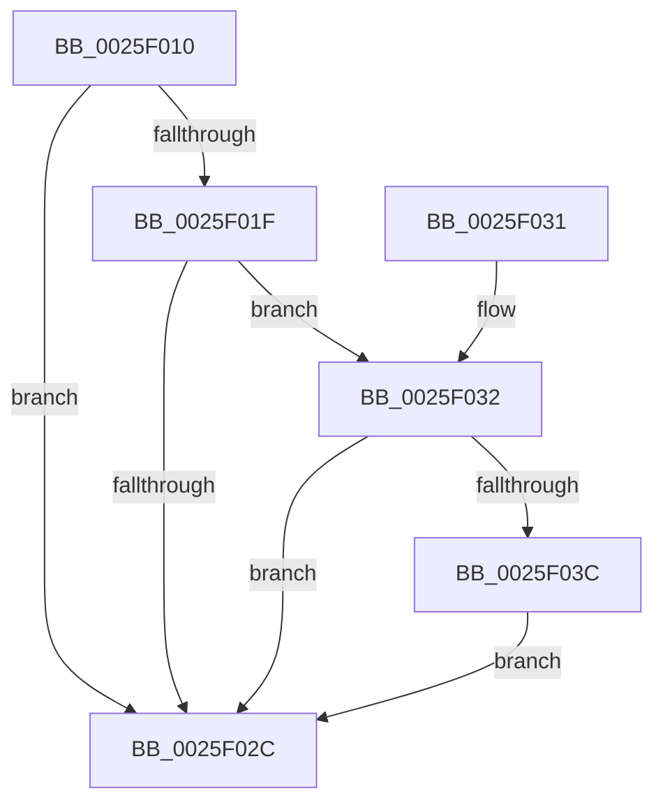

# KiLeaveCriticalRegionUnsafe

- RVA: `0x0025F010`–`0x0025F043` (길이 `51` bytes)
- VA: `0x000000014025F010`
- 실행 섹션: `.text`
- PDB 이름 있음: `예`; PDB Function 태그: `아니요`
- unwind 정보 RVA: `0x00063CEC`
- 디코드: `15`개 명령, `51/51` bytes 표시
- 미해석 바이트: `0` (있으면 어셈블리에 `.byte`로 보존)

> 이 문서는 커널 이미지의 기계어와 PDB 기호를 분석해 생성했습니다. 4번과 5번은 함수 원형과 자료형을 바이너리 사용 방식에서 추정한 C 해석이며 원본 소스 복구 결과는 아닙니다.

## 1. Dependencies

- 직접 호출 지점: **1**; 고유 호출 대상: **1**
- 직접 호출자로 확인된 함수: **83**
- RIP 상대 이미지 참조: **0**

### Outgoing calls
- `0x0025F03C` → [KiCheckForKernelApcDelivery](../2E/KiCheckForKernelApcDelivery_function_002E2C80.md) (function, `0x002E2C80`)

### Direct callers
- [EtwpEventWriteFull](../22/EtwpEventWriteFull_function_00225C10.md) at `0x0022779E`
- [ExpDeleteTimer](../23/ExpDeleteTimer_function_00230C40.md) at `0x00230D60`
- [ExpSetTimerObject](../23/ExpSetTimerObject_function_00231730.md) at `0x00232539`
- [KeLeaveCriticalRegionThread](KeLeaveCriticalRegionThread_function_0025EFF0.md) at `0x0025EFF4`
- [MiSharePages](../31/MiSharePages_function_00315110.md) at `0x003159D3`
- [MiSharePages](../31/MiSharePages_function_00315110.md) at `0x00315CF5`
- [KeDeleteMutant](../35/KeDeleteMutant_function_00351788.md) at `0x00351857`
- [KeReleaseMutantEx](../39/KeReleaseMutantEx_function_00396850.md) at `0x00396A6C`
- [PspUnlockThreadSecurityShared](../3C/PspUnlockThreadSecurityShared_function_003C2E40.md) at `0x003C2EA7`
- [PspLockUnlockProcessExclusive](../41/PspLockUnlockProcessExclusive_function_00419B48.md) at `0x00419B74`
- [PsWatchWorkingSet](../45/PsWatchWorkingSet_function_00452910.md) at `0x004529F3`
- [PsMultiResumeProcess](../4A/PsMultiResumeProcess_function_004A2B3C.md) at `0x004A2B84`
- [PspUnlockQuotaListShared](../4A/PspUnlockQuotaListShared_function_004A5234.md) at `0x004A5263`
- [PspUnlockThreadSecurityExclusive](../4E/PspUnlockThreadSecurityExclusive_function_004E97C0.md) at `0x004E982B`
- [PspLockUnlockTebAccessExclusive](../4E/PspLockUnlockTebAccessExclusive_function_004E9A2C.md) at `0x004E9A89`
- [IoConfigureCrashDump](../59/IoConfigureCrashDump_function_00591CB4.md) at `0x00591E66`
- [IoUnregisterPriorityCallback](../59/IoUnregisterPriorityCallback_function_00597D40.md) at `0x00597DCD`
- [IoUnregisterPriorityCallback](../59/IoUnregisterPriorityCallback_function_00597D40.md) at `0x00597DF8`
- [KeQueryDpcWatchdogConfiguration](../5B/KeQueryDpcWatchdogConfiguration_function_005B5800.md) at `0x005B598A`
- [KeUpdateDpcWatchdogConfiguration](../5B/KeUpdateDpcWatchdogConfiguration_function_005B5A34.md) at `0x005B5C14`
- [PspRefreshProcessUserPresencePpmPolicyCallback](../5E/PspRefreshProcessUserPresencePpmPolicyCallback_function_005E3100.md) at `0x005E31BF`
- [ExReleaseResourceAndLeavePriorityRegion](../65/ExReleaseResourceAndLeavePriorityRegion_function_00658DA0.md) at `0x00658DC7`
- [ExpShareAddressSpaceWithDevice](../65/ExpShareAddressSpaceWithDevice_function_0065B528.md) at `0x0065BAF9`
- [sub_006D7372](../6D/Unknown_function_006D7372.md) at `0x006D73BF`
- [IoInitializeCrashDump](../../page/71/IoInitializeCrashDump_function_00719D88.md) at `0x00719E0F`
- [IopCopyBootLogRegistryToFile](../../page/71/IopCopyBootLogRegistryToFile_function_0071B19C.md) at `0x0071B418`
- [PoUnregisterCoalescingCallback](../../page/75/PoUnregisterCoalescingCallback_function_0075C000.md) at `0x0075C056`
- [PoUnregisterCoalescingCallback](../../page/75/PoUnregisterCoalescingCallback_function_0075C000.md) at `0x0075C0B3`
- [PsQueryProcessExceptionFlags](../../page/78/PsQueryProcessExceptionFlags_function_007811E0.md) at `0x007812BC`
- [PsQueryProcessExceptionFlags](../../page/78/PsQueryProcessExceptionFlags_function_007811E0.md) at `0x00781383`
- [PsSwapProcessWorkingSet](../../page/78/PsSwapProcessWorkingSet_function_00781C24.md) at `0x00781D38`
- [PsUpdateActiveProcessAffinity](../../page/78/PsUpdateActiveProcessAffinity_function_00781DA8.md) at `0x00781ECD`
- [PspEnableProcessOptionalXStateFeatures](../../page/78/PspEnableProcessOptionalXStateFeatures_function_00781EF0.md) at `0x007822F9`
- [PspSetProcessAffinityUpdateMode](../../page/78/PspSetProcessAffinityUpdateMode_function_007828D8.md) at `0x00782A20`
- [NtChangeProcessState](../../page/78/NtChangeProcessState_function_00782C00.md) at `0x00782DD6`
- [PspDeleteProcessStateChange](../../page/78/PspDeleteProcessStateChange_function_00784400.md) at `0x00784435`
- [PsShutdownSystem](../../page/78/PsShutdownSystem_function_00785E94.md) at `0x007860E3`
- [PspTerminatePicoProcess](../../page/78/PspTerminatePicoProcess_function_00787710.md) at `0x00787741`
- [PspSuspendThread](../../page/78/PspSuspendThread_function_00787A0C.md) at `0x00787AF4`
- [ExNotifyPlatformBinaryExecuted](../../page/7C/ExNotifyPlatformBinaryExecuted_function_007C3A18.md) at `0x007C3AAA`
- [ExpGetSystemPlatformBinary](../../page/7C/ExpGetSystemPlatformBinary_function_007C3C18.md) at `0x007C3D64`
- [ExpGetSystemPlatformBinary](../../page/7C/ExpGetSystemPlatformBinary_function_007C3C18.md) at `0x007C3F00`
- [ExpGetSystemPlatformBinary](../../page/7C/ExpGetSystemPlatformBinary_function_007C3C18.md) at `0x007C406B`
- [NtSetUuidSeed](../../page/7D/NtSetUuidSeed_function_007D0DD0.md) at `0x007D112A`
- [ObWaitForMultipleObjects](../../page/86/ObWaitForMultipleObjects_function_00868DF0.md) at `0x008690DF`
- [ObWaitForMultipleObjects](../../page/86/ObWaitForMultipleObjects_function_00868DF0.md) at `0x008693A3`
- [IopGetSetSecurityObject](../../page/87/IopGetSetSecurityObject_function_00873A80.md) at `0x00873DD2`
- [IopGetSetSecurityObject](../../page/87/IopGetSetSecurityObject_function_00873A80.md) at `0x00873EB6`
- [IopGetSetSecurityObject](../../page/87/IopGetSetSecurityObject_function_00873A80.md) at `0x00873F39`
- [AlpcpFreeMessageFunction](../../page/88/AlpcpFreeMessageFunction_function_0088A060.md) at `0x0088A0D5`
- [ExpSnapShotHandleTables](../../page/8A/ExpSnapShotHandleTables_function_008A25C0.md) at `0x008A2A35`
- [sub_008CC5C2](../../page/8C/Unknown_function_008CC5C2.md) at `0x008CC7AC`
- [sub_008CC5C2](../../page/8C/Unknown_function_008CC5C2.md) at `0x008CC7C3`
- [PspRemoveProcessFromJobChain](../../page/90/PspRemoveProcessFromJobChain_function_00907288.md) at `0x0090757A`
- [MmPrefetchPagesEx](../../page/93/MmPrefetchPagesEx_function_0093C9A0.md) at `0x0093CB31`
- [ExCreateHandleTable](../../page/94/ExCreateHandleTable_function_0094C7E8.md) at `0x0094C8D8`
- [sub_0094CF53](../../page/94/Unknown_function_0094CF53.md) at `0x0094CF92`
- [NtQueryInformationProcess](../../page/9A/NtQueryInformationProcess_function_009AA250.md) at `0x009AD7A8`
- [UNLOCK_HIVE_LOAD](../../page/9B/UNLOCK_HIVE_LOAD_function_009B2EBC.md) at `0x009B2F14`
- [PspCreateThread](../../page/9E/PspCreateThread_function_009EF034.md) at `0x009EF32B`
- [PspCreateThread](../../page/9E/PspCreateThread_function_009EF034.md) at `0x009EF361`
- [PspCreateThread](../../page/9E/PspCreateThread_function_009EF034.md) at `0x009EF477`
- [PspCreatePicoThread](../../page/9F/PspCreatePicoThread_function_009F0D70.md) at `0x009F112F`
- [PspSetProcessPriorityClass](../../page/9F/PspSetProcessPriorityClass_function_009F61E4.md) at `0x009F6251`
- [PspSetJobIoRateControl](../../page/9F/PspSetJobIoRateControl_function_009F78EC.md) at `0x009F7AA6`
- [ObSetHandleAttributes](../../page/A0/ObSetHandleAttributes_function_00A03730.md) at `0x00A0385F`
- [PsCallEnclave](../../page/A0/PsCallEnclave_function_00A0CF50.md) at `0x00A0D14B`
- [PsCallEnclave](../../page/A0/PsCallEnclave_function_00A0CF50.md) at `0x00A0D386`
- [PsCallEnclave](../../page/A0/PsCallEnclave_function_00A0CF50.md) at `0x00A0D42E`
- [PsSuspendProcess](../../page/A1/PsSuspendProcess_function_00A10F30.md) at `0x00A10F84`
- [PsSuspendThread](../../page/A1/PsSuspendThread_function_00A110D0.md) at `0x00A111C0`
- [PsSynchronizeWithThreadInsertion](../../page/A1/PsSynchronizeWithThreadInsertion_function_00A111DC.md) at `0x00A11239`
- [PspQueryWorkingSetWatch](../../page/A2/PspQueryWorkingSetWatch_function_00A21478.md) at `0x00A2157B`
- [ObQueryObjectAuditingByHandle](../../page/A2/ObQueryObjectAuditingByHandle_function_00A22A20.md) at `0x00A22AD5`
- [PspAssignProcessToJob](../../page/A2/PspAssignProcessToJob_function_00A23370.md) at `0x00A23822`
- [ExpQuerySystemInformation](../../page/A5/ExpQuerySystemInformation_function_00A57858.md) at `0x00A58F61`
- [ExpQuerySystemInformation](../../page/A5/ExpQuerySystemInformation_function_00A57858.md) at `0x00A58FAB`
- [NtReleaseKeyedEvent](../../page/A7/NtReleaseKeyedEvent_function_00A70AF0.md) at `0x00A70CD3`
- [IopSetDeviceSecurityDescriptor](../../page/A7/IopSetDeviceSecurityDescriptor_function_00A7199C.md) at `0x00A71A24`
- [IopSetDeviceSecurityDescriptor](../../page/A7/IopSetDeviceSecurityDescriptor_function_00A7199C.md) at `0x00A71B0C`
- [IopSetDeviceSecurityDescriptor](../../page/A7/IopSetDeviceSecurityDescriptor_function_00A7199C.md) at `0x00A71B20`
- [NtWaitForKeyedEvent](../../page/A7/NtWaitForKeyedEvent_function_00A71D50.md) at `0x00A71EFE`
- [NtWaitForKeyedEvent](../../page/A7/NtWaitForKeyedEvent_function_00A71D50.md) at `0x00A71FEF`
- [NtWaitForKeyedEvent](../../page/A7/NtWaitForKeyedEvent_function_00A71D50.md) at `0x00A720B3`
- [PspThreadDelete](../../page/A7/PspThreadDelete_function_00A79C20.md) at `0x00A79E10`
- [NtAllocateUuids](../../page/A9/NtAllocateUuids_function_00A963E0.md) at `0x00A9652D`
- [NtAllocateUuids](../../page/A9/NtAllocateUuids_function_00A963E0.md) at `0x00A96580`
- [DbgkRegisterErrorPort](../../page/A9/DbgkRegisterErrorPort_function_00A9C39C.md) at `0x00A9C666`
- [PsRemoveCreateThreadNotifyRoutine](../../page/AA/PsRemoveCreateThreadNotifyRoutine_function_00AA3870.md) at `0x00AA3907`
- [PsRemoveCreateThreadNotifyRoutine](../../page/AA/PsRemoveCreateThreadNotifyRoutine_function_00AA3870.md) at `0x00AA394F`
- [PspSetCreateProcessNotifyRoutine](../../page/AA/PspSetCreateProcessNotifyRoutine_function_00AA75EC.md) at `0x00AA767A`
- [MiCombineIdenticalPages](../../page/AB/MiCombineIdenticalPages_function_00AB2324.md) at `0x00AB262B`
- [PsRemoveLoadImageNotifyRoutine](../../page/AC/PsRemoveLoadImageNotifyRoutine_function_00AC30F0.md) at `0x00AC317F`
- [PsRemoveLoadImageNotifyRoutine](../../page/AC/PsRemoveLoadImageNotifyRoutine_function_00AC30F0.md) at `0x00AC319D`
- [PspSetProcessPpmPolicy](../../page/AE/PspSetProcessPpmPolicy_function_00AE34F0.md) at `0x00AE35C9`
- [NtSetInformationProcess](../../page/AE/NtSetInformationProcess_function_00AE5370.md) at `0x00AE6600`
- [NtSetInformationProcess](../../page/AE/NtSetInformationProcess_function_00AE5370.md) at `0x00AE6612`
- [NtChangeThreadState](../../page/AE/NtChangeThreadState_function_00AEA210.md) at `0x00AEA4AF`
- [NtChangeThreadState](../../page/AE/NtChangeThreadState_function_00AEA210.md) at `0x00AEA614`
- [NtCreateUserProcess](../../page/AE/NtCreateUserProcess_function_00AEA680.md) at `0x00AEB653`
- [NtTerminateProcess](../../page/AE/NtTerminateProcess_function_00AEC320.md) at `0x00AEC54D`
- [EtwpWriteUserEvent](../../page/AF/EtwpWriteUserEvent_function_00AF2FEC.md) at `0x00AF4775`
- [sub_00B1BBD6](../../page/B1/Unknown_function_00B1BBD6.md) at `0x00B1BC0C`
- [sub_00B2A59A](../../page/B2/Unknown_function_00B2A59A.md) at `0x00B2A6D2`
- [sub_00B36710](../../page/B3/Unknown_function_00B36710.md) at `0x00B36729`
- [sub_00B36710](../../page/B3/Unknown_function_00B36710.md) at `0x00B368DC`
- [sub_00B36710](../../page/B3/Unknown_function_00B36710.md) at `0x00B36991`
- [sub_00B4018A](../../page/B4/Unknown_function_00B4018A.md) at `0x00B401D9`
- [sub_00B4018A](../../page/B4/Unknown_function_00B4018A.md) at `0x00B402A8`
- [sub_00B49F04](../../page/B4/Unknown_function_00B49F04.md) at `0x00B49F47`

### Static image references
- 디코드된 RIP-relative 메모리 참조가 없습니다.

## 2. Other-region calls and transfers

- 다른 실행 섹션으로 향하는 call: **0**
- 별도 외부 분기/꼬리 이동을 확인하지 못했습니다.

## 3. Assembly (complete function range)

```asm
0025F010  48 83 EC 28                     sub rsp, 0x28
0025F014  90                              nop
0025F015  66 83 81 E4 01 00 00 01         add word ptr [rcx + 0x1e4], 1
0025F01D  75 0D                           jne 0x14025f02c
0025F01F  48 8D 81 98 00 00 00            lea rax, [rcx + 0x98]
0025F026  90                              nop
0025F027  48 39 00                        cmp qword ptr [rax], rax
0025F02A  75 06                           jne 0x14025f032
0025F02C  48 83 C4 28                     add rsp, 0x28
0025F030  C3                              ret
0025F031  CC                              int3
0025F032  66 83 B9 E6 01 00 00 00         cmp word ptr [rcx + 0x1e6], 0
0025F03A  75 F0                           jne 0x14025f02c
0025F03C  E8 3F 3C 08 00                  call 0x1402e2c80
0025F041  EB E9                           jmp 0x14025f02c
```

## 4. C-style interpretation (structured pseudocode)

```c
__int64 __fastcall KiLeaveCriticalRegionUnsafe(__int64 a1)
{
    __int64 result;
    __int64 v_rsp;

    v_rsp = (v_rsp) - (40);
    if (condition_is_not_equal) goto loc_0025F02C;
    if ((*(unsigned __int64 *)(a1 + 152)) != (a1 + 152)) goto loc_0025F032;
loc_0025F02C:
    v_rsp = (v_rsp) + (40);
    return a1 + 152;
loc_0025F032:
    if ((*(unsigned __int16 *)(a1 + 486)) != 0) goto loc_0025F02C;
    result = KiCheckForKernelApcDelivery(a1, a2, a3, a4);
    goto loc_0025F02C;
}
```

## 5. (Beta) C Style

```c
void *KiLeaveCriticalRegionUnsafe(void *Arg1)
{
    uint8_t *arg1 = (uint8_t *)Arg1;

    int64_t result;
    int64_t local_rsp;

    local_rsp = (local_rsp) - (40);
    if (condition_is_not_equal) goto loc_0025F02C;
    if ((*(uint64_t *)(arg1 + 0x98)) != (Arg1 + 152)) goto loc_0025F032;
loc_0025F02C:
    local_rsp = (local_rsp) + (40);
    return Arg1 + 152;
loc_0025F032:
    if ((*(uint16_t *)(arg1 + 0x1E6)) != 0) goto loc_0025F02C;
    result = KiCheckForKernelApcDelivery(Arg1, a2, a3, a4);
    goto loc_0025F02C;
}
```

### 관측된 메모리 오프셋

구조체 형식이 확인되지 않은 접근은 인자 기준의 오프셋으로만 기록했습니다.

| 기준 인자 | 오프셋 표현 | 폭 (bit) | 접근 |
|---|---:|---:|---|
| `Arg1` | `+ 0x0` | `64` | `R` |
| `Arg1` | `+ 0x98` | `64` | `R` |
| `Arg1` | `+ 0x1E4` | `16` | `R/W` |
| `Arg1` | `+ 0x1E6` | `16` | `R` |

## 6. Execution-region graph

[열기: 2D/3D 그래프와 함수 탐색 컨트롤 패널](../../../control-panel.html?section=text&rva=0x0025F010&view=graph)

- 2D 그래프는 위에서 아래로 흐르고, 3D 그래프는 빈 공간을 드래그해 회전합니다. Shift+드래그는 이동, 휠은 확대·축소, 함수 노드 선택은 대상 보고서 이동입니다.

### Static fallback


