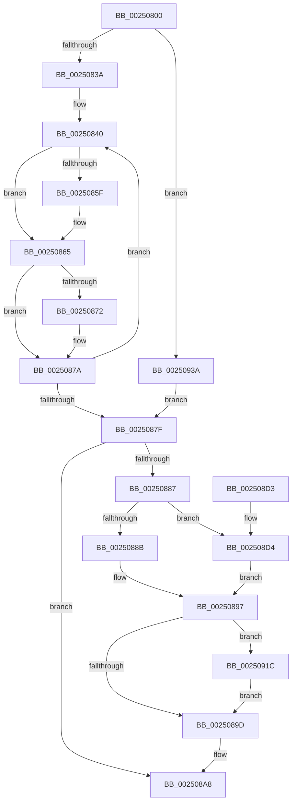

# KiProcessDeferredReadyList

- RVA: `0x00250800`–`0x00250946` (길이 `326` bytes)
- VA: `0x0000000140250800`
- 실행 섹션: `.text`
- PDB 이름 있음: `예`; PDB Function 태그: `아니요`
- unwind 정보 RVA: `0x00063428`
- 디코드: `83`개 명령, `326/326` bytes 표시
- 미해석 바이트: `0` (있으면 어셈블리에 `.byte`로 보존)

> 이 문서는 커널 이미지의 기계어와 PDB 기호를 분석해 생성했습니다. 4번과 5번은 함수 원형과 자료형을 바이너리 사용 방식에서 추정한 C 해석이며 원본 소스 복구 결과는 아닙니다.

## 1. Dependencies

- 직접 호출 지점: **6**; 고유 호출 대상: **6**
- 직접 호출자로 확인된 함수: **50**
- RIP 상대 이미지 참조: **0**

### Outgoing calls
- `0x00250850` → [KiDeferredReadySingleThread](KiDeferredReadySingleThread_function_00252FE0.md) (function, `0x00252FE0`)
- `0x00250875` → [KiFlushSoftwareInterruptBatch](KiFlushSoftwareInterruptBatch_function_00252200.md) (function, `0x00252200`)
- `0x00250892` → [KiSendSoftwareInterruptAffinity](../30/KiSendSoftwareInterruptAffinity_function_0030E834.md) (function, `0x0030E834`)
- `0x002508AF` → [KiCheckForThreadDispatch](KiCheckForThreadDispatch_function_00250648.md) (function, `0x00250648`)
- `0x00250912` → [HalpInterruptSendIpi](HalpInterruptSendIpi_function_00252310.md) (function, `0x00252310`)
- `0x00250930` → [memset](../6C/memset_function_006C6C40.md) (function, `0x006C6C40`)

### Direct callers
- [sub_002099FA](../20/Unknown_function_002099FA.md) at `0x00209C64`
- [sub_002099FA](../20/Unknown_function_002099FA.md) at `0x00209C85`
- [sub_002099FA](../20/Unknown_function_002099FA.md) at `0x00209CC0`
- [sub_0020C2D4](../20/Unknown_function_0020C2D4.md) at `0x0020C888`
- [sub_0020C2D4](../20/Unknown_function_0020C2D4.md) at `0x0020CB6B`
- [sub_0020C2D4](../20/Unknown_function_0020C2D4.md) at `0x0020CBE3`
- [sub_0020D8DF](../20/Unknown_function_0020D8DF.md) at `0x0020DAD5`
- [KeWaitForSingleObject](../20/KeWaitForSingleObject_function_0020E6B0.md) at `0x0020F0CC`
- [KeWaitForSingleObject](../20/KeWaitForSingleObject_function_0020E6B0.md) at `0x0020F1C0`
- [KeWaitForSingleObject](../20/KeWaitForSingleObject_function_0020E6B0.md) at `0x0020F226`
- [KeWaitForSingleObject](../20/KeWaitForSingleObject_function_0020E6B0.md) at `0x0020F4BF`
- [KeWaitForSingleObject](../20/KeWaitForSingleObject_function_0020E6B0.md) at `0x0020F5A0`
- [KiAbConvertWaiterToOwnerEntry](../21/KiAbConvertWaiterToOwnerEntry_function_00219430.md) at `0x00219B08`
- [sub_002203EB](../22/Unknown_function_002203EB.md) at `0x002203F7`
- [sub_002203EB](../22/Unknown_function_002203EB.md) at `0x00220436`
- [KiFastExitThreadWait](../22/KiFastExitThreadWait_function_00220BB0.md) at `0x00220E0E`
- [KiFastExitThreadWait](../22/KiFastExitThreadWait_function_00220BB0.md) at `0x00220E39`
- [KiClearSystemPriority](../2C/KiClearSystemPriority_function_002C05A8.md) at `0x002C060B`
- [KeSetPriorityThread](../2C/KeSetPriorityThread_function_002C76E0.md) at `0x002C7839`
- [KiBeginThreadWait](../2C/KiBeginThreadWait_function_002CA8E0.md) at `0x002CAAFB`
- [KeSetUserGroupAffinityThread](../2C/KeSetUserGroupAffinityThread_function_002CD1C4.md) at `0x002CD28D`
- [KiSetLegacyAffinityThread](../2C/KiSetLegacyAffinityThread_function_002CDD94.md) at `0x002CDEFE`
- [KeSetUserAffinityThread](../2C/KeSetUserAffinityThread_function_002CFA2C.md) at `0x002CFAC5`
- [PopFxActivateComponent](../2D/PopFxActivateComponent_function_002D9DBC.md) at `0x002D9F00`
- [KiSetSystemPriorityThread](../2D/KiSetSystemPriorityThread_function_002D9FF8.md) at `0x002DA0A0`
- [PpmReleaseLock](../2D/PpmReleaseLock_function_002DA428.md) at `0x002DA49A`
- [KeUpdateThreadCpuSets](../30/KeUpdateThreadCpuSets_function_0030305C.md) at `0x003030AA`
- [KeSetSelectedCpuSetsThread](../30/KeSetSelectedCpuSetsThread_function_003033D0.md) at `0x003034B9`
- [KiUpdateVpBackingThreadPriorityDpcRoutine](../30/KiUpdateVpBackingThreadPriorityDpcRoutine_function_00303790.md) at `0x00303821`
- [KeSetThreadSchedulerAssist](../30/KeSetThreadSchedulerAssist_function_003038F8.md) at `0x00303982`
- [KeCpuSetReportParkedProcessors](../30/KeCpuSetReportParkedProcessors_function_003052B0.md) at `0x0030545B`
- [sub_00352D10](../35/Unknown_function_00352D10.md) at `0x00352E5C`
- [sub_00352D10](../35/Unknown_function_00352D10.md) at `0x00352E87`
- [KiExitThreadWaitReschedule](../35/KiExitThreadWaitReschedule_function_00352EC8.md) at `0x00352FB6`
- [KiParkCurrentProcessor](../35/KiParkCurrentProcessor_function_003533A4.md) at `0x003534EF`
- [KeAdjustWobPriority](../39/KeAdjustWobPriority_function_00393570.md) at `0x0039379C`
- [sub_00395304](../39/Unknown_function_00395304.md) at `0x00395352`
- [KeSetAffinityProcess](../3C/KeSetAffinityProcess_function_003C0A60.md) at `0x003C0C38`
- [KeSetDisableBoostProcess](../3C/KeSetDisableBoostProcess_function_003C18B4.md) at `0x003C1994`
- [KeSetDisableBoostThread](../3C/KeSetDisableBoostThread_function_003C19BC.md) at `0x003C1A4D`
- [KeSetPriorityAndQuantumProcess](../3C/KeSetPriorityAndQuantumProcess_function_003C2EC0.md) at `0x003C31A8`
- [KeAdjustPriorityFloor](../3C/KeAdjustPriorityFloor_function_003C3574.md) at `0x003C36FD`
- [KeSetActualBasePriorityThread](../3C/KeSetActualBasePriorityThread_function_003C4370.md) at `0x003C4527`
- [KeWaitForAlertByThreadId](../3C/KeWaitForAlertByThreadId_function_003C4B14.md) at `0x003C4F3F`
- [KeRemovePriQueue](../3C/KeRemovePriQueue_function_003C5090.md) at `0x003C576D`
- [KiWaitForAllObjects](../3C/KiWaitForAllObjects_function_003C5800.md) at `0x003C5F3A`
- [KeSetBasePriorityThread](../3C/KeSetBasePriorityThread_function_003C6EB0.md) at `0x003C70C8`
- [KiAbForceProcessLockEntry](../41/KiAbForceProcessLockEntry_function_00419078.md) at `0x004191F4`
- [KiSoftParkElectionDpcRoutine](../45/KiSoftParkElectionDpcRoutine_function_004508F0.md) at `0x00450A77`
- [KeSetSchedulingGroupRankBias](../46/KeSetSchedulingGroupRankBias_function_0046DB74.md) at `0x0046DCAC`
- [KiUpdateVpBackingThreadPriorityOnPriorityQuery](../4B/KiUpdateVpBackingThreadPriorityOnPriorityQuery_function_004BF550.md) at `0x004BF592`
- [KeSetSystemMultipleGroupAffinityThread](../4D/KeSetSystemMultipleGroupAffinityThread_function_004D0C88.md) at `0x004D0EDB`
- [KeBoostPriorityThread](../4D/KeBoostPriorityThread_function_004D37F8.md) at `0x004D39C5`
- [KeRevertToUserMultipleGroupAffinityThread](../4D/KeRevertToUserMultipleGroupAffinityThread_function_004D8A90.md) at `0x004D8C61`
- [KiVpBackingThreadYieldExecution](../4D/KiVpBackingThreadYieldExecution_function_004DF1A4.md) at `0x004DF322`
- [KiFinalizeCoreControlBlockAssignment](../5B/KiFinalizeCoreControlBlockAssignment_function_005B7D0C.md) at `0x005B7E69`
- [KeRecomputeCpuSetAffinityProcess](../5C/KeRecomputeCpuSetAffinityProcess_function_005C1078.md) at `0x005C10BF`
- [KeSetCpuSetsProcess](../5C/KeSetCpuSetsProcess_function_005C10D4.md) at `0x005C1197`
- [KeEnableCoreIsolationMitigationPolicyThread](../5C/KeEnableCoreIsolationMitigationPolicyThread_function_005C35B4.md) at `0x005C3628`
- [KiForceParkDutyCycleDpcCallback](../5C/KiForceParkDutyCycleDpcCallback_function_005C97D0.md) at `0x005C9927`
- [sub_006E0538](../6E/Unknown_function_006E0538.md) at `0x006E05E0`

### Static image references
- 디코드된 RIP-relative 메모리 참조가 없습니다.

## 2. Other-region calls and transfers

- 다른 실행 섹션으로 향하는 call: **0**
- 별도 외부 분기/꼬리 이동을 확인하지 못했습니다.

## 3. Assembly (complete function range)

```asm
00250800  48 89 5C 24 08                  mov qword ptr [rsp + 8], rbx
00250805  48 89 6C 24 10                  mov qword ptr [rsp + 0x10], rbp
0025080A  48 89 74 24 18                  mov qword ptr [rsp + 0x18], rsi
0025080F  48 89 7C 24 20                  mov qword ptr [rsp + 0x20], rdi
00250814  41 54                           push r12
00250816  41 56                           push r14
00250818  41 57                           push r15
0025081A  48 83 EC 40                     sub rsp, 0x40
0025081E  48 8B 1A                        mov rbx, qword ptr [rdx]
00250821  45 33 E4                        xor r12d, r12d
00250824  45 0F B6 F8                     movzx r15d, r8b
00250828  48 8B F2                        mov rsi, rdx
0025082B  4C 8B F1                        mov r14, rcx
0025082E  41 8B EC                        mov ebp, r12d
00250831  48 85 DB                        test rbx, rbx
00250834  0F 84 00 01 00 00               je 0x14025093a
0025083A  48 8B 03                        mov rax, qword ptr [rbx]
0025083D  48 89 02                        mov qword ptr [rdx], rax
00250840  48 8D 93 28 FF FF FF            lea rdx, [rbx - 0xd8]
00250847  45 33 C9                        xor r9d, r9d
0025084A  4C 8B C6                        mov r8, rsi
0025084D  49 8B CE                        mov rcx, r14
00250850  E8 8B 27 00 00                  call 0x140252fe0
00250855  48 8B 1E                        mov rbx, qword ptr [rsi]
00250858  FF C5                           inc ebp
0025085A  48 85 DB                        test rbx, rbx
0025085D  74 06                           je 0x140250865
0025085F  48 8B 03                        mov rax, qword ptr [rbx]
00250862  48 89 06                        mov qword ptr [rsi], rax
00250865  49 8D BE D8 35 00 00            lea rdi, [r14 + 0x35d8]
0025086C  40 F6 C5 0F                     test bpl, 0xf
00250870  75 08                           jne 0x14025087a
00250872  48 8B CF                        mov rcx, rdi
00250875  E8 86 19 00 00                  call 0x140252200
0025087A  48 85 DB                        test rbx, rbx
0025087D  75 C1                           jne 0x140250840
0025087F  0F B6 47 01                     movzx eax, byte ptr [rdi + 1]
00250883  84 C0                           test al, al
00250885  74 21                           je 0x1402508a8
00250887  3C 01                           cmp al, 1
00250889  74 49                           je 0x1402508d4
0025088B  0F B6 17                        movzx edx, byte ptr [rdi]
0025088E  48 8D 4F 08                     lea rcx, [rdi + 8]
00250892  E8 9D DF 0B 00                  call 0x14030e834
00250897  80 7F 01 02                     cmp byte ptr [rdi + 1], 2
0025089B  74 7F                           je 0x14025091c
0025089D  44 88 67 01                     mov byte ptr [rdi + 1], r12b
002508A1  C7 47 04 FF FF 00 00            mov dword ptr [rdi + 4], 0xffff
002508A8  41 0F B6 D7                     movzx edx, r15b
002508AC  49 8B CE                        mov rcx, r14
002508AF  E8 94 FD FF FF                  call 0x140250648
002508B4  48 8B 5C 24 60                  mov rbx, qword ptr [rsp + 0x60]
002508B9  48 8B 6C 24 68                  mov rbp, qword ptr [rsp + 0x68]
002508BE  48 8B 74 24 70                  mov rsi, qword ptr [rsp + 0x70]
002508C3  48 8B 7C 24 78                  mov rdi, qword ptr [rsp + 0x78]
002508C8  48 83 C4 40                     add rsp, 0x40
002508CC  41 5F                           pop r15
002508CE  41 5E                           pop r14
002508D0  41 5C                           pop r12
002508D2  C3                              ret
002508D3  CC                              int3
002508D4  65 48 8B 04 25 20 00 00 00      mov rax, qword ptr gs:[0x20]
002508DD  BA 1F 00 00 00                  mov edx, 0x1f
002508E2  8B 4F 04                        mov ecx, dword ptr [rdi + 4]
002508E5  44 0F B6 07                     movzx r8d, byte ptr [rdi]
002508E9  89 4C 24 28                     mov dword ptr [rsp + 0x28], ecx
002508ED  48 8D 4C 24 20                  lea rcx, [rsp + 0x20]
002508F2  FF 80 D4 8E 00 00               inc dword ptr [rax + 0x8ed4]
002508F8  B8 2F 00 00 00                  mov eax, 0x2f
002508FD  41 80 F8 01                     cmp r8b, 1
00250901  48 C7 44 24 20 06 00 00 00      mov qword ptr [rsp + 0x20], 6
0025090A  4C 89 64 24 2C                  mov qword ptr [rsp + 0x2c], r12
0025090F  0F 45 D0                        cmovne edx, eax
00250912  E8 F9 19 00 00                  call 0x140252310
00250917  E9 7B FF FF FF                  jmp 0x140250897
0025091C  48 8D 4F 10                     lea rcx, [rdi + 0x10]
00250920  48 C7 47 08 01 00 20 00         mov qword ptr [rdi + 8], 0x200001
00250928  33 D2                           xor edx, edx
0025092A  41 B8 00 01 00 00               mov r8d, 0x100
00250930  E8 0B 63 47 00                  call 0x1406c6c40
00250935  E9 63 FF FF FF                  jmp 0x14025089d
0025093A  48 8D B9 D8 35 00 00            lea rdi, [rcx + 0x35d8]
00250941  E9 39 FF FF FF                  jmp 0x14025087f
```

## 4. C-style interpretation (structured pseudocode)

```c
__int64 __fastcall KiProcessDeferredReadyList(__int64 a1, __int64 a2, unsigned __int8 a3, int a4)
{
    __int64 result;
    __int64 v_r12;
    __int64 v_rbp;
    __int64 v_rsp;
    unsigned __int64 v_stack_p10;
    unsigned __int64 v_stack_p18;
    unsigned __int64 v_stack_p20;
    unsigned int v_stack_p28;
    unsigned __int64 v_stack_p2C;
    unsigned __int64 v_stack_p8;

    v_stack_p8 = v_rbx;
    v_stack_p10 = v_rbp;
    v_stack_p18 = v_rsi;
    v_stack_p20 = v_rdi;
    v_rsp = (v_rsp) - (64);
    v_r12 = 0;
    if (*(unsigned __int64 *)(a2) == 0) goto loc_0025093A;
    *(unsigned __int64 *)(a2) = *(unsigned __int64 *)(*(unsigned __int64 *)(a2));
loc_00250840:
    a4 = 0;
    result = KiDeferredReadySingleThread(a1, *(unsigned __int64 *)(a2) - 216, a2, a4);
    v_rbp = (unsigned int)((0) + 1);
    if (*(unsigned __int64 *)(a2) != 0) {
        result = *(unsigned __int64 *)(*(unsigned __int64 *)(a2));
        *(unsigned __int64 *)(a2) = result;
    }
    if ((((unsigned __int8)(v_rbp)) & (15)) == 0) {
        a1 = a1 + 13784;
        result = KiFlushSoftwareInterruptBatch(a1, *(unsigned __int64 *)(a2) - 216, a2, a4);
    }
    if (*(unsigned __int64 *)(a2) != 0) goto loc_00250840;
loc_0025087F:
    if ((unsigned __int8)(*(unsigned __int8 *)(a1 + 13784 + 1)) == 0) goto loc_002508A8;
    if (((unsigned __int8)(*(unsigned __int8 *)(a1 + 13784 + 1))) == 1) goto loc_002508D4;
    result = KiSendSoftwareInterruptAffinity(a1 + 13784 + 8, *(unsigned __int8 *)(a1 + 13784), a2, a4);
loc_00250897:
    if ((*(unsigned __int8 *)(a1 + 13784 + 1)) == 2) goto loc_0025091C;
loc_0025089D:
    *(unsigned __int8 *)(a1 + 13784 + 1) = 0;
    *(unsigned int *)(a1 + 13784 + 4) = 0xFFFFULL;
loc_002508A8:
    result = KiCheckForThreadDispatch(a1, a3, a2, a4);
    v_rsp = (v_rsp) + (64);
    return result;
loc_002508D4:
    v_stack_p28 = (unsigned int)((unsigned int)(*(unsigned int *)(v_stack_p20 + 4)));
    v_stack_p20 = 6;
    v_stack_p2C = 0;
    a2 = 31;
    if (((unsigned __int8)(*(unsigned __int8 *)(v_stack_p20))) != 1) { a2 = 47; }
    result = HalpInterruptSendIpi(v_stack_p20, a2, *(unsigned __int8 *)(v_stack_p20), a4);
    goto loc_00250897;
loc_0025091C:
    *(unsigned __int64 *)(v_stack_p20 + 8) = 0x200001ULL;
    a2 = 0;
    result = memset(v_stack_p20 + 16, a2, 256, a4);
    goto loc_0025089D;
loc_0025093A:
    goto loc_0025087F;
}
```

## 5. (Beta) C Style

```c
int64_t KiProcessDeferredReadyList(void *Arg1, void *Arg2, uint8_t Arg3, int32_t Arg4)
{
    uint8_t *arg1 = (uint8_t *)Arg1;
    uint8_t *arg2 = (uint8_t *)Arg2;

    int64_t result;
    int64_t local_r12;
    int64_t local_rbp;
    int64_t local_rsp;
    uint64_t v_stack_p10;
    uint64_t v_stack_p18;
    uint64_t v_stack_p20;
    uint32_t v_stack_p28;
    uint64_t v_stack_p2C;
    uint64_t v_stack_p8;

    v_stack_p8 = local_rbx;
    v_stack_p10 = local_rbp;
    v_stack_p18 = local_rsi;
    v_stack_p20 = local_rdi;
    local_rsp = (local_rsp) - (64);
    local_r12 = 0;
    if (*(uint64_t *)(arg2) == 0) goto loc_0025093A;
    *(uint64_t *)(arg2) = *(uint64_t *)(*(uint64_t *)(arg2));
loc_00250840:
    Arg4 = 0;
    result = KiDeferredReadySingleThread(Arg1, *(uint64_t *)(arg2) - 216, Arg2, Arg4);
    local_rbp = (uint32_t)((0) + 1);
    if (*(uint64_t *)(arg2) != 0) {
        result = *(uint64_t *)(*(uint64_t *)(arg2));
        *(uint64_t *)(arg2) = result;
    }
    if ((((uint8_t)(local_rbp)) & (15)) == 0) {
        Arg1 = Arg1 + 13784;
        result = KiFlushSoftwareInterruptBatch(Arg1, *(uint64_t *)(arg2) - 216, Arg2, Arg4);
    }
    if (*(uint64_t *)(arg2) != 0) goto loc_00250840;
loc_0025087F:
    if ((uint8_t)(*(uint8_t *)(arg1 + 0x35D8 + 0x1)) == 0) goto loc_002508A8;
    if (((uint8_t)(*(uint8_t *)(arg1 + 0x35D8 + 0x1))) == 1) goto loc_002508D4;
    result = KiSendSoftwareInterruptAffinity(Arg1 + 13784 + 8, *(uint8_t *)(arg1 + 0x35D8), Arg2, Arg4);
loc_00250897:
    if ((*(uint8_t *)(arg1 + 0x35D8 + 0x1)) == 2) goto loc_0025091C;
loc_0025089D:
    *(uint8_t *)(arg1 + 0x35D8 + 0x1) = 0;
    *(uint32_t *)(arg1 + 0x35D8 + 0x4) = 0xFFFFULL;
loc_002508A8:
    result = KiCheckForThreadDispatch(Arg1, Arg3, Arg2, Arg4);
    local_rsp = (local_rsp) + (64);
    return result;
loc_002508D4:
    v_stack_p28 = (uint32_t)((uint32_t)(*(uint32_t *)(v_stack_p20 + 0x4)));
    v_stack_p20 = 6;
    v_stack_p2C = 0;
    Arg2 = 31;
    if (((uint8_t)(*(uint8_t *)(v_stack_p20))) != 1) { Arg2 = 47; }
    result = HalpInterruptSendIpi(v_stack_p20, Arg2, *(uint8_t *)(v_stack_p20), Arg4);
    goto loc_00250897;
loc_0025091C:
    *(uint64_t *)(v_stack_p20 + 0x8) = 0x200001ULL;
    Arg2 = 0;
    result = memset(v_stack_p20 + 16, Arg2, 256, Arg4);
    goto loc_0025089D;
loc_0025093A:
    goto loc_0025087F;
}
```

### 관측된 메모리 오프셋

구조체 형식이 확인되지 않은 접근은 인자 기준의 오프셋으로만 기록했습니다.

| 기준 인자 | 오프셋 표현 | 폭 (bit) | 접근 |
|---|---:|---:|---|
| `Arg1` | `+ 0x0` | `8` | `R` |
| `Arg1` | `+ 0x1` | `8` | `R` |
| `Arg1` | `+ 0x1` | `8` | `W` |
| `Arg1` | `+ 0x4` | `32` | `R` |
| `Arg1` | `+ 0x4` | `32` | `W` |
| `Arg1` | `+ 0x8` | `64` | `R` |
| `Arg1` | `+ 0x8` | `64` | `W` |
| `Arg1` | `+ 0x10` | `64` | `R` |
| `Arg1` | `+ 0x35D8` | `64` | `R` |
| `Arg2` | `+ 0x0` | `64` | `R` |
| `Arg2` | `+ 0x0` | `64` | `W` |

## 6. Execution-region graph

[열기: 2D/3D 그래프와 함수 탐색 컨트롤 패널](../../../control-panel.html?section=text&rva=0x00250800&view=graph)

- 2D 그래프는 위에서 아래로 흐르고, 3D 그래프는 빈 공간을 드래그해 회전합니다. Shift+드래그는 이동, 휠은 확대·축소, 함수 노드 선택은 대상 보고서 이동입니다.

### Static fallback


