# KiProcessThreadWaitList

- RVA: `0x00252CC0`–`0x00252FD3` (길이 `787` bytes)
- VA: `0x0000000140252CC0`
- 실행 섹션: `.text`
- PDB 이름 있음: `예`; PDB Function 태그: `아니요`
- unwind 정보 RVA: `0x000636E8`
- 디코드: `186`개 명령, `787/787` bytes 표시
- 미해석 바이트: `0` (있으면 어셈블리에 `.byte`로 보존)

> 이 문서는 커널 이미지의 기계어와 PDB 기호를 분석해 생성했습니다. 4번과 5번은 함수 원형과 자료형을 바이너리 사용 방식에서 추정한 C 해석이며 원본 소스 복구 결과는 아닙니다.

## 1. Dependencies

- 직접 호출 지점: **9**; 고유 호출 대상: **9**
- 직접 호출자로 확인된 함수: **10**
- RIP 상대 이미지 참조: **3**

### Outgoing calls
- `0x00252D7D` → [EtwTraceReadyThread](EtwTraceReadyThread_function_00251F70.md) (function, `0x00251F70`)
- `0x00252DC1` → [KiDeferredReadySingleThread](KiDeferredReadySingleThread_function_00252FE0.md) (function, `0x00252FE0`)
- `0x00252DE8` → [KiFlushSoftwareInterruptBatch](KiFlushSoftwareInterruptBatch_function_00252200.md) (function, `0x00252200`)
- `0x00252E89` → [KeIsEmptyAffinityEx](../2D/KeIsEmptyAffinityEx_function_002D1580.md) (function, `0x002D1580`)
- `0x00252EDF` → [HalpInterruptSendIpi](HalpInterruptSendIpi_function_00252310.md) (function, `0x00252310`)
- `0x00252F70` → [memset](../6C/memset_function_006C6C40.md) (function, `0x006C6C40`)
- `0x00252F84` → [KiCheckVpBackingLongSpinWaitHypercall](../30/KiCheckVpBackingLongSpinWaitHypercall_function_0030F490.md) (function, `0x0030F490`)
- `0x00252F90` → [HvlNotifyLongSpinWait](../30/HvlNotifyLongSpinWait_function_0030F460.md) (function, `0x0030F460`)
- `0x00252FC3` → [KiInswapAndReadyThread](../39/KiInswapAndReadyThread_function_00398318.md) (function, `0x00398318`)

### Direct callers
- [sub_0020C2D4](../20/Unknown_function_0020C2D4.md) at `0x0020C81C`
- [KiCommitThreadWait](../20/KiCommitThreadWait_function_0020DFE0.md) at `0x0020E54A`
- [KiProcessExpiredTimerList](../23/KiProcessExpiredTimerList_function_00234200.md) at `0x002342FC`
- [KiProcessExpiredTimerList](../23/KiProcessExpiredTimerList_function_00234200.md) at `0x00234343`
- [KiExitDispatcher](KiExitDispatcher_function_00251CF0.md) at `0x00251D31`
- [KeTerminateThread](../35/KeTerminateThread_function_00355138.md) at `0x00355306`
- [KiSwapThread](../35/KiSwapThread_function_00355640.md) at `0x00355B56`
- [sub_003A18D4](../3A/Unknown_function_003A18D4.md) at `0x003A1988`
- [KiExpireTimer2](../3A/KiExpireTimer2_function_003A24E0.md) at `0x003A26AC`
- [KiPriQueueThreadPriorityChanged](../3C/KiPriQueueThreadPriorityChanged_function_003C4640.md) at `0x003C46D4`
- [KeRemovePriQueue](../3C/KeRemovePriQueue_function_003C5090.md) at `0x003C57EE`

### Static image references
- `0x00252D66` → RVA `0x00FC6B04` (`ALMOSTRO`; read)
- `0x00252F33` → RVA `0x00FC52AC` (`ALMOSTRO`; reference)
- `0x00252F7A` → RVA `0x00FC6AB8` (`ALMOSTRO`; read)

## 2. Other-region calls and transfers

- 다른 실행 섹션으로 향하는 call: **0**
- 별도 외부 분기/꼬리 이동을 확인하지 못했습니다.

## 3. Assembly (complete function range)

```asm
00252CC0  44 89 4C 24 20                  mov dword ptr [rsp + 0x20], r9d
00252CC5  44 89 44 24 18                  mov dword ptr [rsp + 0x18], r8d
00252CCA  89 54 24 10                     mov dword ptr [rsp + 0x10], edx
00252CCE  53                              push rbx
00252CCF  55                              push rbp
00252CD0  56                              push rsi
00252CD1  57                              push rdi
00252CD2  41 54                           push r12
00252CD4  41 55                           push r13
00252CD6  41 56                           push r14
00252CD8  41 57                           push r15
00252CDA  48 83 EC 58                     sub rsp, 0x58
00252CDE  48 8B 99 08 2D 00 00            mov rbx, qword ptr [rcx + 0x2d08]
00252CE5  33 D2                           xor edx, edx
00252CE7  89 94 24 A0 00 00 00            mov dword ptr [rsp + 0xa0], edx
00252CEE  8B FA                           mov edi, edx
00252CF0  48 89 54 24 28                  mov qword ptr [rsp + 0x28], rdx
00252CF5  48 8B E9                        mov rbp, rcx
00252CF8  48 89 91 08 2D 00 00            mov qword ptr [rcx + 0x2d08], rdx
00252CFF  48 85 DB                        test rbx, rbx
00252D02  0F 84 34 01 00 00               je 0x140252e3c
00252D08  4C 8B EB                        mov r13, rbx
00252D0B  48 89 5C 24 30                  mov qword ptr [rsp + 0x30], rbx
00252D10  48 8B 1B                        mov rbx, qword ptr [rbx]
00252D13  49 81 C5 28 FF FF FF            add r13, -0xd8
00252D1A  41 0F B6 85 4B 02 00 00         movzx eax, byte ptr [r13 + 0x24b]
00252D22  49 8B B5 D0 00 00 00            mov rsi, qword ptr [r13 + 0xd0]
00252D29  4C 8D 34 40                     lea r14, [rax + rax*2]
00252D2D  49 C1 E6 04                     shl r14, 4
00252D31  4C 03 F6                        add r14, rsi
00252D34  0F B6 46 11                     movzx eax, byte ptr [rsi + 0x11]
00252D38  3C 05                           cmp al, 5
00252D3A  0F 82 C1 00 00 00               jb 0x140252e01
00252D40  48 83 C6 30                     add rsi, 0x30
00252D44  49 3B F6                        cmp rsi, r14
00252D47  75 EB                           jne 0x140252d34
00252D49  8B 94 24 A8 00 00 00            mov edx, dword ptr [rsp + 0xa8]
00252D50  44 8B 84 24 B0 00 00 00         mov r8d, dword ptr [rsp + 0xb0]
00252D58  41 88 95 36 02 00 00            mov byte ptr [r13 + 0x236], dl
00252D5F  45 88 85 37 02 00 00            mov byte ptr [r13 + 0x237], r8b
00252D66  F7 05 94 3D D7 00 00 02 00 00   test dword ptr [rip + 0xd73d94], 0x200
00252D70  74 10                           je 0x140252d82
00252D72  44 8B 8C 24 B8 00 00 00         mov r9d, dword ptr [rsp + 0xb8]
00252D7A  49 8B CD                        mov rcx, r13
00252D7D  E8 EE F1 FF FF                  call 0x140251f70
00252D82  41 8B 45 78                     mov eax, dword ptr [r13 + 0x78]
00252D86  0F BA E0 11                     bt eax, 0x11
00252D8A  0F 83 07 02 00 00               jae 0x140252f97
00252D90  0F BA E0 14                     bt eax, 0x14
00252D94  0F 82 FD 01 00 00               jb 0x140252f97
00252D9A  4C 8B 7C 24 30                  mov r15, qword ptr [rsp + 0x30]
00252D9F  48 8B 44 24 28                  mov rax, qword ptr [rsp + 0x28]
00252DA4  44 8B A4 24 A0 00 00 00         mov r12d, dword ptr [rsp + 0xa0]
00252DAC  49 89 07                        mov qword ptr [r15], rax
00252DAF  49 8D 97 28 FF FF FF            lea rdx, [r15 - 0xd8]
00252DB6  45 33 C9                        xor r9d, r9d
00252DB9  4C 8D 44 24 28                  lea r8, [rsp + 0x28]
00252DBE  48 8B CD                        mov rcx, rbp
00252DC1  E8 1A 02 00 00                  call 0x140252fe0
00252DC6  4C 8B 7C 24 28                  mov r15, qword ptr [rsp + 0x28]
00252DCB  41 FF C4                        inc r12d
00252DCE  4D 85 FF                        test r15, r15
00252DD1  74 08                           je 0x140252ddb
00252DD3  49 8B 07                        mov rax, qword ptr [r15]
00252DD6  48 89 44 24 28                  mov qword ptr [rsp + 0x28], rax
00252DDB  41 F6 C4 0F                     test r12b, 0xf
00252DDF  75 0C                           jne 0x140252ded
00252DE1  48 8D 8D D8 35 00 00            lea rcx, [rbp + 0x35d8]
00252DE8  E8 13 F4 FF FF                  call 0x140252200
00252DED  4D 85 FF                        test r15, r15
00252DF0  75 BD                           jne 0x140252daf
00252DF2  44 89 A4 24 A0 00 00 00         mov dword ptr [rsp + 0xa0], r12d
00252DFA  33 D2                           xor edx, edx
00252DFC  E9 FE FE FF FF                  jmp 0x140252cff
00252E01  4C 8B 66 20                     mov r12, qword ptr [rsi + 0x20]
00252E05  44 8B FA                        mov r15d, edx
00252E08  F0 41 0F BA 2C 24 07            lock bts dword ptr [r12], 7
00252E0F  0F 82 1B 01 00 00               jb 0x140252f30
00252E15  80 7E 11 04                     cmp byte ptr [rsi + 0x11], 4
00252E19  0F 85 01 01 00 00               jne 0x140252f20
00252E1F  48 8B 0E                        mov rcx, qword ptr [rsi]
00252E22  48 8B 46 08                     mov rax, qword ptr [rsi + 8]
00252E26  48 39 71 08                     cmp qword ptr [rcx + 8], rsi
00252E2A  75 09                           jne 0x140252e35
00252E2C  48 39 30                        cmp qword ptr [rax], rsi
00252E2F  0F 84 E4 00 00 00               je 0x140252f19
00252E35  B9 03 00 00 00                  mov ecx, 3
00252E3A  CD 29                           int 0x29
00252E3C  0F B6 85 D9 35 00 00            movzx eax, byte ptr [rbp + 0x35d9]
00252E43  84 C0                           test al, al
00252E45  0F 84 B3 00 00 00               je 0x140252efe
00252E4B  3C 01                           cmp al, 1
00252E4D  65 48 8B 04 25 20 00 00 00      mov rax, qword ptr gs:[0x20]
00252E56  74 4B                           je 0x140252ea3
00252E58  80 BD D8 35 00 00 01            cmp byte ptr [rbp + 0x35d8], 1
00252E5F  48 8D B5 E0 35 00 00            lea rsi, [rbp + 0x35e0]
00252E66  BB 1F 00 00 00                  mov ebx, 0x1f
00252E6B  89 54 24 3C                     mov dword ptr [rsp + 0x3c], edx
00252E6F  B9 2F 00 00 00                  mov ecx, 0x2f
00252E74  89 54 24 48                     mov dword ptr [rsp + 0x48], edx
00252E78  0F 45 D9                        cmovne ebx, ecx
00252E7B  FF 80 D4 8E 00 00               inc dword ptr [rax + 0x8ed4]
00252E81  48 85 F6                        test rsi, rsi
00252E84  74 5E                           je 0x140252ee4
00252E86  48 8B CE                        mov rcx, rsi
00252E89  E8 F2 E6 07 00                  call 0x1402d1580
00252E8E  85 C0                           test eax, eax
00252E90  75 52                           jne 0x140252ee4
00252E92  C7 44 24 38 02 00 00 00         mov dword ptr [rsp + 0x38], 2
00252E9A  8B D3                           mov edx, ebx
00252E9C  48 89 74 24 40                  mov qword ptr [rsp + 0x40], rsi
00252EA1  EB 37                           jmp 0x140252eda
00252EA3  8B 8D DC 35 00 00               mov ecx, dword ptr [rbp + 0x35dc]
00252EA9  44 0F B6 85 D8 35 00 00         movzx r8d, byte ptr [rbp + 0x35d8]
00252EB1  FF 80 D4 8E 00 00               inc dword ptr [rax + 0x8ed4]
00252EB7  48 89 54 24 44                  mov qword ptr [rsp + 0x44], rdx
00252EBC  41 80 F8 01                     cmp r8b, 1
00252EC0  89 4C 24 40                     mov dword ptr [rsp + 0x40], ecx
00252EC4  BA 1F 00 00 00                  mov edx, 0x1f
00252EC9  B9 2F 00 00 00                  mov ecx, 0x2f
00252ECE  48 C7 44 24 38 06 00 00 00      mov qword ptr [rsp + 0x38], 6
00252ED7  0F 45 D1                        cmovne edx, ecx
00252EDA  48 8D 4C 24 38                  lea rcx, [rsp + 0x38]
00252EDF  E8 2C F4 FF FF                  call 0x140252310
00252EE4  80 BD D9 35 00 00 02            cmp byte ptr [rbp + 0x35d9], 2
00252EEB  74 69                           je 0x140252f56
00252EED  C6 85 D9 35 00 00 00            mov byte ptr [rbp + 0x35d9], 0
00252EF4  C7 85 DC 35 00 00 FF FF 00 00   mov dword ptr [rbp + 0x35dc], 0xffff
00252EFE  48 85 FF                        test rdi, rdi
00252F01  0F 85 A9 00 00 00               jne 0x140252fb0
00252F07  48 83 C4 58                     add rsp, 0x58
00252F0B  41 5F                           pop r15
00252F0D  41 5E                           pop r14
00252F0F  41 5D                           pop r13
00252F11  41 5C                           pop r12
00252F13  5F                              pop rdi
00252F14  5E                              pop rsi
00252F15  5D                              pop rbp
00252F16  5B                              pop rbx
00252F17  C3                              ret
00252F18  CC                              int3
00252F19  48 89 08                        mov qword ptr [rax], rcx
00252F1C  48 89 41 08                     mov qword ptr [rcx + 8], rax
00252F20  F0 41 81 24 24 7F FF FF FF      lock and dword ptr [r12], 0xffffff7f
00252F29  E9 12 FE FF FF                  jmp 0x140252d40
00252F2E  66 90                           nop
00252F30  41 FF C7                        inc r15d
00252F33  44 85 3D 72 23 D7 00            test dword ptr [rip + 0xd72372], r15d
00252F3A  74 3E                           je 0x140252f7a
00252F3C  F3 90                           pause
00252F3E  41 8B 04 24                     mov eax, dword ptr [r12]
00252F42  84 C0                           test al, al
00252F44  78 EA                           js 0x140252f30
00252F46  F0 41 0F BA 2C 24 07            lock bts dword ptr [r12], 7
00252F4D  72 E1                           jb 0x140252f30
00252F4F  33 D2                           xor edx, edx
00252F51  E9 BF FE FF FF                  jmp 0x140252e15
00252F56  48 8D 8D E8 35 00 00            lea rcx, [rbp + 0x35e8]
00252F5D  48 C7 85 E0 35 00 00 01 00 20 00  mov qword ptr [rbp + 0x35e0], 0x200001
00252F68  33 D2                           xor edx, edx
00252F6A  41 B8 00 01 00 00               mov r8d, 0x100
00252F70  E8 CB 3C 47 00                  call 0x1406c6c40
00252F75  E9 73 FF FF FF                  jmp 0x140252eed
00252F7A  8B 05 38 3B D7 00               mov eax, dword ptr [rip + 0xd73b38]
00252F80  A8 40                           test al, 0x40
00252F82  74 B8                           je 0x140252f3c
00252F84  E8 07 C5 0B 00                  call 0x14030f490
00252F89  84 C0                           test al, al
00252F8B  74 AF                           je 0x140252f3c
00252F8D  41 8B CF                        mov ecx, r15d
00252F90  E8 CB C4 0B 00                  call 0x14030f460
00252F95  EB A7                           jmp 0x140252f3e
00252F97  48 8B 44 24 30                  mov rax, qword ptr [rsp + 0x30]
00252F9C  48 89 38                        mov qword ptr [rax], rdi
00252F9F  48 8B F8                        mov rdi, rax
00252FA2  E9 53 FE FF FF                  jmp 0x140252dfa
00252FA7  66 0F 1F 84 00 00 00 00 00      nop word ptr [rax + rax]
00252FB0  48 8B D7                        mov rdx, rdi
00252FB3  45 33 C0                        xor r8d, r8d
00252FB6  48 8B 3F                        mov rdi, qword ptr [rdi]
00252FB9  48 81 C2 28 FF FF FF            add rdx, -0xd8
00252FC0  48 8B CD                        mov rcx, rbp
00252FC3  E8 50 53 14 00                  call 0x140398318
00252FC8  48 85 FF                        test rdi, rdi
00252FCB  0F 84 36 FF FF FF               je 0x140252f07
00252FD1  EB DD                           jmp 0x140252fb0
```

## 4. C-style interpretation (structured pseudocode)

```c
__int64 __fastcall KiProcessThreadWaitList(__int64 a1, int a2, int a3, int a4)
{
    __int64 result;
    __int64 v_r12;
    __int64 v_r13;
    __int64 v_r14;
    __int64 v_r15;
    __int64 v_rbx;
    __int64 v_rsi;
    __int64 v_rsp;
    unsigned int v_stack_m50;
    unsigned __int64 v_stack_m54;
    unsigned __int64 v_stack_m58;
    unsigned int v_stack_m5C;
    unsigned int v_stack_m60;
    unsigned __int64 v_stack_m68;
    unsigned __int64 v_stack_m70;
    unsigned int v_stack_p10;
    unsigned int v_stack_p18;
    unsigned int v_stack_p20;
    unsigned __int64 v_stack_p30;
    unsigned int v_stack_p8;

    v_stack_p20 = a4;
    v_stack_p18 = a3;
    v_stack_p10 = a2;
    v_rsp = (v_rsp) - (88);
    a2 = 0;
    v_stack_p8 = 0;
    v_stack_m70 = 0;
    *(unsigned __int64 *)(a1 + 11528) = 0;
loc_00252CFF:
    if (*(unsigned __int64 *)(a1 + 11528) == 0) goto loc_00252E3C;
    v_stack_m68 = *(unsigned __int64 *)(a1 + 11528);
    v_r13 = (*(unsigned __int64 *)(a1 + 11528)) + (-216);
    v_r14 = (*(unsigned __int8 *)(v_r13 + 587) + *(unsigned __int8 *)(v_r13 + 587) * 2) << (4);
    v_r14 = (v_r14) + (*(unsigned __int64 *)(v_r13 + 208));
loc_00252D34:
    if (((unsigned __int8)(*(unsigned __int8 *)(*(unsigned __int64 *)(v_r13 + 208) + 17))) < 5) goto loc_00252E01;
loc_00252D40:
    v_rsi = (*(unsigned __int64 *)(v_r13 + 208)) + (48);
    if (v_rsi != v_r14) goto loc_00252D34;
    *(unsigned __int8 *)(v_r13 + 566) = (unsigned __int8)((unsigned int)(v_stack_p10));
    *(unsigned __int8 *)(v_r13 + 567) = (unsigned __int8)((unsigned int)(v_stack_p18));
    result = *(unsigned __int8 *)(*(unsigned __int64 *)(v_r13 + 208) + 17);
    if (((*(unsigned int *)(v_rip + 14106004)) & (512)) != 0) {
        a4 = v_stack_p20;
        a1 = v_r13;
        result = EtwTraceReadyThread(a1, (unsigned int)(v_stack_p10), (unsigned int)(v_stack_p18), a4);
    }
    if (condition_is_above_or_equal) goto loc_00252F97;
    if (condition_is_below) goto loc_00252F97;
    *(unsigned __int64 *)(v_stack_m68) = v_stack_m70;
loc_00252DAF:
    a4 = 0;
    result = KiDeferredReadySingleThread(a1, v_stack_m68 - 216, v_stack_m70, a4);
    v_r12 = (unsigned int)(((unsigned int)(v_stack_p8)) + 1);
    if (v_stack_m70 != 0) {
        result = *(unsigned __int64 *)(v_stack_m70);
        v_stack_m70 = result;
    }
    if ((((unsigned __int8)(v_r12)) & (15)) == 0) {
        a1 = a1 + 13784;
        result = KiFlushSoftwareInterruptBatch(a1, v_stack_m68 - 216, v_stack_m70, a4);
    }
    if (v_stack_m70 != 0) goto loc_00252DAF;
    v_stack_p8 = (unsigned int)(v_r12);
loc_00252DFA:
    a2 = 0;
    goto loc_00252CFF;
loc_00252E01:
    if (condition_is_below) goto loc_00252F30;
loc_00252E15:
    if ((*(unsigned __int8 *)(v_rsi + 17)) != 4) goto loc_00252F20;
    if ((*(unsigned __int64 *)(*(unsigned __int64 *)(v_rsi) + 8)) != v_rsi) goto loc_00252E35;
    if ((*(unsigned __int64 *)(*(unsigned __int64 *)(v_rsi + 8))) == v_rsi) goto loc_00252F19;
loc_00252E35:
loc_00252E3C:
    if ((unsigned __int8)(*(unsigned __int8 *)(a1 + 13785)) == 0) goto loc_00252EFE;
    if (((unsigned __int8)(*(unsigned __int8 *)(a1 + 13785))) == 1) goto loc_00252EA3;
    v_stack_m5C = 0;
    v_stack_m50 = 0;
    v_rbx = 31;
    if ((*(unsigned __int8 *)(a1 + 13784)) != 1) { v_rbx = 47; }
    if (a1 + 13792 == 0) goto loc_00252EE4;
    result = KeIsEmptyAffinityEx(a1 + 13792, a2, v_stack_m70, a4);
    if ((unsigned int)(result) != 0) goto loc_00252EE4;
    v_stack_m60 = 2;
    v_stack_m58 = a1 + 13792;
    goto loc_00252EDA;
loc_00252EA3:
    v_stack_m54 = (unsigned int)((unsigned int)(v_rbx));
    v_stack_m58 = (unsigned int)((unsigned int)(*(unsigned int *)(a1 + 13788)));
    v_stack_m60 = 6;
    a2 = 31;
    if (((unsigned __int8)(*(unsigned __int8 *)(a1 + 13784))) != 1) { a2 = 47; }
loc_00252EDA:
    result = HalpInterruptSendIpi(v_stack_m60, a2, *(unsigned __int8 *)(a1 + 13784), a4);
loc_00252EE4:
    if ((*(unsigned __int8 *)(a1 + 13785)) == 2) goto loc_00252F56;
loc_00252EED:
    *(unsigned __int8 *)(a1 + 13785) = 0;
    *(unsigned int *)(a1 + 13788) = 0xFFFFULL;
loc_00252EFE:
    if (0 != 0) goto loc_00252FB0;
loc_00252F07:
    v_rsp = (v_rsp) + (88);
    return result;
loc_00252F19:
    *(unsigned __int64 *)(result) = v_stack_m60;
    *(unsigned __int64 *)(v_stack_m60 + 8) = result;
loc_00252F20:
    goto loc_00252D40;
loc_00252F30:
    v_r15 = (unsigned int)((0) + 1);
    if (((*(unsigned int *)(v_rip + 14099314)) & ((unsigned int)(v_r15))) == 0) goto loc_00252F7A;
loc_00252F3C:
loc_00252F3E:
    if (sign_flag) goto loc_00252F30;
    if (condition_is_below) goto loc_00252F30;
    a2 = 0;
    goto loc_00252E15;
loc_00252F56:
    *(unsigned __int64 *)(a1 + 13792) = 0x200001ULL;
    a2 = 0;
    result = memset(a1 + 13800, a2, 256, a4);
    goto loc_00252EED;
loc_00252F7A:
    if ((((unsigned __int8)((unsigned int)(*(unsigned int *)(v_rip + 14105400)))) & (64)) == 0) goto loc_00252F3C;
    result = KiCheckVpBackingLongSpinWaitHypercall(a1 + 13800, a2, 256, a4);
    if ((unsigned __int8)(result) == 0) goto loc_00252F3C;
    result = HvlNotifyLongSpinWait((unsigned int)((unsigned int)(v_r15)), a2, 256, a4);
    goto loc_00252F3E;
loc_00252F97:
    *(unsigned __int64 *)(v_stack_p30) = 0;
    goto loc_00252DFA;
loc_00252FB0:
    a3 = 0;
    a2 = (v_stack_p30) + (-216);
    result = KiInswapAndReadyThread(a1, a2, a3, a4);
    if (*(unsigned __int64 *)(v_stack_p30) == 0) goto loc_00252F07;
    goto loc_00252FB0;
}
```

## 5. (Beta) C Style

```c
int64_t KiProcessThreadWaitList(void *Arg1, int32_t Arg2, int32_t Arg3, int32_t Arg4)
{
    uint8_t *arg1 = (uint8_t *)Arg1;

    int64_t result;
    int64_t local_r12;
    int64_t local_r13;
    int64_t local_r14;
    int64_t local_r15;
    int64_t local_rbx;
    int64_t local_rsi;
    int64_t local_rsp;
    uint32_t v_stack_m50;
    uint64_t v_stack_m54;
    uint64_t v_stack_m58;
    uint32_t v_stack_m5C;
    uint32_t v_stack_m60;
    uint64_t v_stack_m68;
    uint64_t v_stack_m70;
    uint32_t v_stack_p10;
    uint32_t v_stack_p18;
    uint32_t v_stack_p20;
    uint64_t v_stack_p30;
    uint32_t v_stack_p8;

    v_stack_p20 = Arg4;
    v_stack_p18 = Arg3;
    v_stack_p10 = Arg2;
    local_rsp = (local_rsp) - (88);
    Arg2 = 0;
    v_stack_p8 = 0;
    v_stack_m70 = 0;
    *(uint64_t *)(arg1 + 0x2D08) = 0;
loc_00252CFF:
    if (*(uint64_t *)(arg1 + 0x2D08) == 0) goto loc_00252E3C;
    v_stack_m68 = *(uint64_t *)(arg1 + 0x2D08);
    local_r13 = (*(uint64_t *)(arg1 + 0x2D08)) + (-216);
    local_r14 = (*(uint8_t *)(local_r13 + 0x24B) + *(uint8_t *)(local_r13 + 0x24B) * 2) << (4);
    local_r14 = (local_r14) + (*(uint64_t *)(local_r13 + 0xD0));
loc_00252D34:
    if (((uint8_t)(*(uint8_t *)(*(uint64_t *)(local_r13 + 0xD0) + 0x11))) < 5) goto loc_00252E01;
loc_00252D40:
    local_rsi = (*(uint64_t *)(local_r13 + 0xD0)) + (48);
    if (local_rsi != local_r14) goto loc_00252D34;
    *(uint8_t *)(local_r13 + 0x236) = (uint8_t)((uint32_t)(v_stack_p10));
    *(uint8_t *)(local_r13 + 0x237) = (uint8_t)((uint32_t)(v_stack_p18));
    result = *(uint8_t *)(*(uint64_t *)(local_r13 + 0xD0) + 0x11);
    if (((*(uint32_t *)(v_rip + 0xD73D94)) & (512)) != 0) {
        Arg4 = v_stack_p20;
        Arg1 = local_r13;
        result = EtwTraceReadyThread(Arg1, (uint32_t)(v_stack_p10), (uint32_t)(v_stack_p18), Arg4);
    }
    if (condition_is_above_or_equal) goto loc_00252F97;
    if (condition_is_below) goto loc_00252F97;
    *(uint64_t *)(v_stack_m68) = v_stack_m70;
loc_00252DAF:
    Arg4 = 0;
    result = KiDeferredReadySingleThread(Arg1, v_stack_m68 - 216, v_stack_m70, Arg4);
    local_r12 = (uint32_t)(((uint32_t)(v_stack_p8)) + 1);
    if (v_stack_m70 != 0) {
        result = *(uint64_t *)(v_stack_m70);
        v_stack_m70 = result;
    }
    if ((((uint8_t)(local_r12)) & (15)) == 0) {
        Arg1 = Arg1 + 13784;
        result = KiFlushSoftwareInterruptBatch(Arg1, v_stack_m68 - 216, v_stack_m70, Arg4);
    }
    if (v_stack_m70 != 0) goto loc_00252DAF;
    v_stack_p8 = (uint32_t)(local_r12);
loc_00252DFA:
    Arg2 = 0;
    goto loc_00252CFF;
loc_00252E01:
    if (condition_is_below) goto loc_00252F30;
loc_00252E15:
    if ((*(uint8_t *)(local_rsi + 0x11)) != 4) goto loc_00252F20;
    if ((*(uint64_t *)(*(uint64_t *)(local_rsi) + 0x8)) != local_rsi) goto loc_00252E35;
    if ((*(uint64_t *)(*(uint64_t *)(local_rsi + 0x8))) == local_rsi) goto loc_00252F19;
loc_00252E35:
loc_00252E3C:
    if ((uint8_t)(*(uint8_t *)(arg1 + 0x35D9)) == 0) goto loc_00252EFE;
    if (((uint8_t)(*(uint8_t *)(arg1 + 0x35D9))) == 1) goto loc_00252EA3;
    v_stack_m5C = 0;
    v_stack_m50 = 0;
    local_rbx = 31;
    if ((*(uint8_t *)(arg1 + 0x35D8)) != 1) { local_rbx = 47; }
    if (Arg1 + 13792 == 0) goto loc_00252EE4;
    result = KeIsEmptyAffinityEx(Arg1 + 13792, Arg2, v_stack_m70, Arg4);
    if ((uint32_t)(result) != 0) goto loc_00252EE4;
    v_stack_m60 = 2;
    v_stack_m58 = Arg1 + 13792;
    goto loc_00252EDA;
loc_00252EA3:
    v_stack_m54 = (uint32_t)((uint32_t)(local_rbx));
    v_stack_m58 = (uint32_t)((uint32_t)(*(uint32_t *)(arg1 + 0x35DC)));
    v_stack_m60 = 6;
    Arg2 = 31;
    if (((uint8_t)(*(uint8_t *)(arg1 + 0x35D8))) != 1) { Arg2 = 47; }
loc_00252EDA:
    result = HalpInterruptSendIpi(v_stack_m60, Arg2, *(uint8_t *)(arg1 + 0x35D8), Arg4);
loc_00252EE4:
    if ((*(uint8_t *)(arg1 + 0x35D9)) == 2) goto loc_00252F56;
loc_00252EED:
    *(uint8_t *)(arg1 + 0x35D9) = 0;
    *(uint32_t *)(arg1 + 0x35DC) = 0xFFFFULL;
loc_00252EFE:
    if (0 != 0) goto loc_00252FB0;
loc_00252F07:
    local_rsp = (local_rsp) + (88);
    return result;
loc_00252F19:
    *(uint64_t *)(result) = v_stack_m60;
    *(uint64_t *)(v_stack_m60 + 0x8) = result;
loc_00252F20:
    goto loc_00252D40;
loc_00252F30:
    local_r15 = (uint32_t)((0) + 1);
    if (((*(uint32_t *)(v_rip + 0xD72372)) & ((uint32_t)(local_r15))) == 0) goto loc_00252F7A;
loc_00252F3C:
loc_00252F3E:
    if (sign_flag) goto loc_00252F30;
    if (condition_is_below) goto loc_00252F30;
    Arg2 = 0;
    goto loc_00252E15;
loc_00252F56:
    *(uint64_t *)(arg1 + 0x35E0) = 0x200001ULL;
    Arg2 = 0;
    result = memset(Arg1 + 13800, Arg2, 256, Arg4);
    goto loc_00252EED;
loc_00252F7A:
    if ((((uint8_t)((uint32_t)(*(uint32_t *)(v_rip + 0xD73B38)))) & (64)) == 0) goto loc_00252F3C;
    result = KiCheckVpBackingLongSpinWaitHypercall(Arg1 + 13800, Arg2, 256, Arg4);
    if ((uint8_t)(result) == 0) goto loc_00252F3C;
    result = HvlNotifyLongSpinWait((uint32_t)((uint32_t)(local_r15)), Arg2, 256, Arg4);
    goto loc_00252F3E;
loc_00252F97:
    *(uint64_t *)(v_stack_p30) = 0;
    goto loc_00252DFA;
loc_00252FB0:
    Arg3 = 0;
    Arg2 = (v_stack_p30) + (-216);
    result = KiInswapAndReadyThread(Arg1, Arg2, Arg3, Arg4);
    if (*(uint64_t *)(v_stack_p30) == 0) goto loc_00252F07;
    goto loc_00252FB0;
}
```

### 관측된 메모리 오프셋

구조체 형식이 확인되지 않은 접근은 인자 기준의 오프셋으로만 기록했습니다.

| 기준 인자 | 오프셋 표현 | 폭 (bit) | 접근 |
|---|---:|---:|---|
| `Arg1` | `+ 0x2D08` | `64` | `R` |
| `Arg1` | `+ 0x2D08` | `64` | `W` |
| `Arg1` | `+ 0x35D8` | `8` | `R` |
| `Arg1` | `+ 0x35D8` | `64` | `R` |
| `Arg1` | `+ 0x35D9` | `8` | `R` |
| `Arg1` | `+ 0x35D9` | `8` | `W` |
| `Arg1` | `+ 0x35DC` | `32` | `R` |
| `Arg1` | `+ 0x35DC` | `32` | `W` |
| `Arg1` | `+ 0x35E0` | `64` | `R` |
| `Arg1` | `+ 0x35E0` | `64` | `W` |
| `Arg1` | `+ 0x35E8` | `64` | `R` |

## 6. Execution-region graph

[열기: 2D/3D 그래프와 함수 탐색 컨트롤 패널](../../../control-panel.html?section=text&rva=0x00252CC0&view=graph)

- 2D 그래프는 위에서 아래로 흐르고, 3D 그래프는 빈 공간을 드래그해 회전합니다. Shift+드래그는 이동, 휠은 확대·축소, 함수 노드 선택은 대상 보고서 이동입니다.

### Static fallback

```mermaid
flowchart TD
  bb_00252CC0[BB_00252CC0]
  bb_00252CFF[BB_00252CFF]
  bb_00252D08[BB_00252D08]
  bb_00252D34[BB_00252D34]
  bb_00252D40[BB_00252D40]
  bb_00252D49[BB_00252D49]
  bb_00252D72[BB_00252D72]
  bb_00252D82[BB_00252D82]
  bb_00252D90[BB_00252D90]
  bb_00252D9A[BB_00252D9A]
  bb_00252DAF[BB_00252DAF]
  bb_00252DD3[BB_00252DD3]
  bb_00252DDB[BB_00252DDB]
  bb_00252DE1[BB_00252DE1]
  bb_00252DED[BB_00252DED]
  bb_00252DF2[BB_00252DF2]
  bb_00252DFA[BB_00252DFA]
  bb_00252E01[BB_00252E01]
  bb_00252E15[BB_00252E15]
  bb_00252E1F[BB_00252E1F]
  bb_00252E2C[BB_00252E2C]
  bb_00252E35[BB_00252E35]
  bb_00252E3C[BB_00252E3C]
  bb_00252E4B[BB_00252E4B]
  bb_00252E58[BB_00252E58]
  bb_00252E86[BB_00252E86]
  bb_00252E92[BB_00252E92]
  bb_00252EA3[BB_00252EA3]
  bb_00252EDA[BB_00252EDA]
  bb_00252EE4[BB_00252EE4]
  bb_00252EED[BB_00252EED]
  bb_00252EFE[BB_00252EFE]
  bb_00252F07[BB_00252F07]
  bb_00252F18[BB_00252F18]
  bb_00252F19[BB_00252F19]
  bb_00252F20[BB_00252F20]
  bb_00252F2E[BB_00252F2E]
  bb_00252F30[BB_00252F30]
  bb_00252F3C[BB_00252F3C]
  bb_00252F3E[BB_00252F3E]
  bb_00252F46[BB_00252F46]
  bb_00252F4F[BB_00252F4F]
  bb_00252F56[BB_00252F56]
  bb_00252F7A[BB_00252F7A]
  bb_00252F84[BB_00252F84]
  bb_00252F8D[BB_00252F8D]
  bb_00252F97[BB_00252F97]
  bb_00252FA7[BB_00252FA7]
  bb_00252FB0[BB_00252FB0]
  bb_00252FD1[BB_00252FD1]
  bb_00252CC0 -->|flow| bb_00252CFF
  bb_00252CFF -->|branch| bb_00252E3C
  bb_00252CFF -->|fallthrough| bb_00252D08
  bb_00252D08 -->|flow| bb_00252D34
  bb_00252D34 -->|branch| bb_00252E01
  bb_00252D34 -->|fallthrough| bb_00252D40
  bb_00252D40 -->|branch| bb_00252D34
  bb_00252D40 -->|fallthrough| bb_00252D49
  bb_00252D49 -->|branch| bb_00252D82
  bb_00252D49 -->|fallthrough| bb_00252D72
  bb_00252D72 -->|flow| bb_00252D82
  bb_00252D82 -->|branch| bb_00252F97
  bb_00252D82 -->|fallthrough| bb_00252D90
  bb_00252D90 -->|branch| bb_00252F97
  bb_00252D90 -->|fallthrough| bb_00252D9A
  bb_00252D9A -->|flow| bb_00252DAF
  bb_00252DAF -->|branch| bb_00252DDB
  bb_00252DAF -->|fallthrough| bb_00252DD3
  bb_00252DD3 -->|flow| bb_00252DDB
  bb_00252DDB -->|branch| bb_00252DED
  bb_00252DDB -->|fallthrough| bb_00252DE1
  bb_00252DE1 -->|flow| bb_00252DED
  bb_00252DED -->|branch| bb_00252DAF
  bb_00252DED -->|fallthrough| bb_00252DF2
  bb_00252DF2 -->|flow| bb_00252DFA
  bb_00252DFA -->|branch| bb_00252CFF
  bb_00252E01 -->|branch| bb_00252F30
  bb_00252E01 -->|fallthrough| bb_00252E15
  bb_00252E15 -->|branch| bb_00252F20
  bb_00252E15 -->|fallthrough| bb_00252E1F
  bb_00252E1F -->|branch| bb_00252E35
  bb_00252E1F -->|fallthrough| bb_00252E2C
  bb_00252E2C -->|branch| bb_00252F19
  bb_00252E2C -->|fallthrough| bb_00252E35
  bb_00252E35 -->|flow| bb_00252E3C
  bb_00252E3C -->|branch| bb_00252EFE
  bb_00252E3C -->|fallthrough| bb_00252E4B
  bb_00252E4B -->|branch| bb_00252EA3
  bb_00252E4B -->|fallthrough| bb_00252E58
  bb_00252E58 -->|branch| bb_00252EE4
  bb_00252E58 -->|fallthrough| bb_00252E86
  bb_00252E86 -->|branch| bb_00252EE4
  bb_00252E86 -->|fallthrough| bb_00252E92
  bb_00252E92 -->|branch| bb_00252EDA
  bb_00252EA3 -->|flow| bb_00252EDA
  bb_00252EDA -->|flow| bb_00252EE4
  bb_00252EE4 -->|branch| bb_00252F56
  bb_00252EE4 -->|fallthrough| bb_00252EED
  bb_00252EED -->|flow| bb_00252EFE
  bb_00252EFE -->|branch| bb_00252FB0
  bb_00252EFE -->|fallthrough| bb_00252F07
  bb_00252F18 -->|flow| bb_00252F19
  bb_00252F19 -->|flow| bb_00252F20
  bb_00252F20 -->|branch| bb_00252D40
  bb_00252F2E -->|flow| bb_00252F30
  bb_00252F30 -->|branch| bb_00252F7A
  bb_00252F30 -->|fallthrough| bb_00252F3C
  bb_00252F3C -->|flow| bb_00252F3E
  bb_00252F3E -->|branch| bb_00252F30
  bb_00252F3E -->|fallthrough| bb_00252F46
  bb_00252F46 -->|branch| bb_00252F30
  bb_00252F46 -->|fallthrough| bb_00252F4F
  bb_00252F4F -->|branch| bb_00252E15
  bb_00252F56 -->|branch| bb_00252EED
  bb_00252F7A -->|branch| bb_00252F3C
  bb_00252F7A -->|fallthrough| bb_00252F84
  bb_00252F84 -->|branch| bb_00252F3C
  bb_00252F84 -->|fallthrough| bb_00252F8D
  bb_00252F8D -->|branch| bb_00252F3E
  bb_00252F97 -->|branch| bb_00252DFA
  bb_00252FA7 -->|flow| bb_00252FB0
  bb_00252FB0 -->|branch| bb_00252F07
  bb_00252FB0 -->|fallthrough| bb_00252FD1
  bb_00252FD1 -->|branch| bb_00252FB0
```


