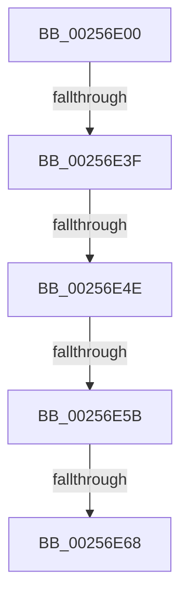

# KiReduceByEffectiveIdleSmtSet

- RVA: `0x00256E00`–`0x00256E6C` (길이 `108` bytes)
- VA: `0x0000000140256E00`
- 실행 섹션: `.text`
- PDB 이름 있음: `예`; PDB Function 태그: `아니요`
- unwind 정보 RVA: `0x00063918`
- 디코드: `24`개 명령, `108/108` bytes 표시
- 미해석 바이트: `0` (있으면 어셈블리에 `.byte`로 보존)

> 이 문서는 커널 이미지의 기계어와 PDB 기호를 분석해 생성했습니다. 4번과 5번은 함수 원형과 자료형을 바이너리 사용 방식에서 추정한 C 해석이며 원본 소스 복구 결과는 아닙니다.

## 1. Dependencies

- 직접 호출 지점: **0**; 고유 호출 대상: **0**
- 직접 호출자로 확인된 함수: **4**
- RIP 상대 이미지 참조: **0**

### Outgoing calls
- 직접 디코드된 call 명령이 없습니다.

### Direct callers
- [KiChooseTargetProcessor](KiChooseTargetProcessor_function_002556D8.md) at `0x00255C6B`
- [KiChooseTargetProcessor](KiChooseTargetProcessor_function_002556D8.md) at `0x00255DE3`
- [KiTryLocalThreadSchedule](../3F/KiTryLocalThreadSchedule_function_003FDDA0.md) at `0x003FDEA6`
- [KiSelectIdleProcessor](../3F/KiSelectIdleProcessor_function_003FE160.md) at `0x003FE3AD`
- [sub_006D831E](../6D/Unknown_function_006D831E.md) at `0x006D84BF`
- [sub_006D831E](../6D/Unknown_function_006D831E.md) at `0x006D88D4`

### Static image references
- 디코드된 RIP-relative 메모리 참조가 없습니다.

## 2. Other-region calls and transfers

- 다른 실행 섹션으로 향하는 call: **0**
- call이 아닌 외부 분기/꼬리 이동: **4**
  - `0x00256E39` → [sub_002573C9 + 0x11](Unknown_function_002573C9.md) (`tail-transfer`)
  - `0x00256E48` → [sub_002573C9 + 0x11](Unknown_function_002573C9.md) (`tail-transfer`)
  - `0x00256E55` → [sub_002573C9 + 0x11](Unknown_function_002573C9.md) (`tail-transfer`)
  - `0x00256E62` → [sub_002573C9 + 0x11](Unknown_function_002573C9.md) (`tail-transfer`)

## 3. Assembly (complete function range)

```asm
00256E00  4C 8B DC                        mov r11, rsp
00256E03  49 89 53 10                     mov qword ptr [r11 + 0x10], rdx
00256E07  53                              push rbx
00256E08  41 57                           push r15
00256E0A  48 81 EC 88 00 00 00            sub rsp, 0x88
00256E11  48 8B 81 C0 00 00 00            mov rax, qword ptr [rcx + 0xc0]
00256E18  48 8B D9                        mov rbx, rcx
00256E1B  48 8B 48 10                     mov rcx, qword ptr [rax + 0x10]
00256E1F  48 8B 02                        mov rax, qword ptr [rdx]
00256E22  4C 8B BB C8 00 00 00            mov r15, qword ptr [rbx + 0xc8]
00256E29  48 23 C8                        and rcx, rax
00256E2C  49 F7 D7                        not r15
00256E2F  4C 23 BB 60 8E 00 00            and r15, qword ptr [rbx + 0x8e60]
00256E36  49 85 C7                        test r15, rax
00256E39  0F 84 9B 05 00 00               je 0x1402573da
00256E3F  49 8B C7                        mov rax, r15
00256E42  48 23 C1                        and rax, rcx
00256E45  49 3B C7                        cmp rax, r15
00256E48  0F 85 8C 05 00 00               jne 0x1402573da
00256E4E  F6 83 BC 38 00 00 01            test byte ptr [rbx + 0x38bc], 1
00256E55  0F 85 7F 05 00 00               jne 0x1402573da
00256E5B  83 BB D8 83 00 00 00            cmp dword ptr [rbx + 0x83d8], 0
00256E62  0F 85 72 05 00 00               jne 0x1402573da
00256E68  80 7B 20 00                     cmp byte ptr [rbx + 0x20], 0
```

## 4. C-style interpretation (structured pseudocode)

```c
__int64 __fastcall KiReduceByEffectiveIdleSmtSet(__int64 a1, __int64 a2)
{
    __int64 result;
    __int64 v_r15;
    __int64 v_rsp;

    *(unsigned __int64 *)(v_rsp + 16) = a2;
    v_rsp = (v_rsp) - (136);
    a1 = (*(unsigned __int64 *)(*(unsigned __int64 *)(a1 + 192) + 16)) & (*(unsigned __int64 *)(a2));
    v_r15 = ~(*(unsigned __int64 *)(a1 + 200));
    v_r15 = (v_r15) & (*(unsigned __int64 *)(a1 + 36448));
    result = (v_r15) & (a1);
    return result;
}
```

## 5. (Beta) C Style

```c
int64_t KiReduceByEffectiveIdleSmtSet(void *Arg1, void *Arg2)
{
    uint8_t *arg1 = (uint8_t *)Arg1;
    uint8_t *arg2 = (uint8_t *)Arg2;

    int64_t result;
    int64_t local_r15;
    int64_t local_rsp;

    *(void **)(local_rsp + 0x10) = Arg2;
    local_rsp = (local_rsp) - (136);
    Arg1 = (*(uint64_t *)(*(uint64_t *)(arg1 + 0xC0) + 0x10)) & (*(uint64_t *)(arg2));
    local_r15 = ~(*(uint64_t *)(arg1 + 0xC8));
    local_r15 = (local_r15) & (*(uint64_t *)(arg1 + 0x8E60));
    result = (local_r15) & (Arg1);
    return result;
}
```

### 관측된 메모리 오프셋

구조체 형식이 확인되지 않은 접근은 인자 기준의 오프셋으로만 기록했습니다.

| 기준 인자 | 오프셋 표현 | 폭 (bit) | 접근 |
|---|---:|---:|---|
| `Arg1` | `+ 0x20` | `8` | `R` |
| `Arg1` | `+ 0xC0` | `64` | `R` |
| `Arg1` | `+ 0xC8` | `64` | `R` |
| `Arg1` | `+ 0x38BC` | `8` | `R` |
| `Arg1` | `+ 0x83D8` | `32` | `R` |
| `Arg1` | `+ 0x8E60` | `64` | `R` |
| `Arg2` | `+ 0x0` | `64` | `R` |

## 6. Execution-region graph

[열기: 2D/3D 그래프와 함수 탐색 컨트롤 패널](../../../control-panel.html?section=text&rva=0x00256E00&view=graph)

- 2D 그래프는 위에서 아래로 흐르고, 3D 그래프는 빈 공간을 드래그해 회전합니다. Shift+드래그는 이동, 휠은 확대·축소, 함수 노드 선택은 대상 보고서 이동입니다.

### Static fallback


