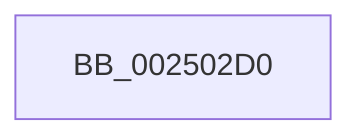

# KiRemovePrcbWaitEntry

- RVA: `0x002502D0`–`0x002502E9` (길이 `25` bytes)
- VA: `0x00000001402502D0`
- 실행 섹션: `.text`
- PDB 이름 있음: `예`; PDB Function 태그: `아니요`
- unwind 정보 RVA: `0x000633AC`
- 디코드: `7`개 명령, `25/25` bytes 표시
- 미해석 바이트: `0` (있으면 어셈블리에 `.byte`로 보존)

> 이 문서는 커널 이미지의 기계어와 PDB 기호를 분석해 생성했습니다. 4번과 5번은 함수 원형과 자료형을 바이너리 사용 방식에서 추정한 C 해석이며 원본 소스 복구 결과는 아닙니다.

## 1. Dependencies

- 직접 호출 지점: **0**; 고유 호출 대상: **0**
- 직접 호출자로 확인된 함수: **14**
- RIP 상대 이미지 참조: **0**

### Outgoing calls
- 직접 디코드된 call 명령이 없습니다.

### Direct callers
- [KiInsertQueueInternal](../21/KiInsertQueueInternal_function_00219B30.md) at `0x00219C2E`
- [IoSetIoCompletionEx3](../24/IoSetIoCompletionEx3_function_0024EEE0.md) at `0x0024F06B`
- [IopCompleteIrpInFileObjectList](../24/IopCompleteIrpInFileObjectList_function_0024F330.md) at `0x0024F4EB`
- [IoSetIoCompletionEx](../24/IoSetIoCompletionEx_function_0024FA80.md) at `0x0024FC25`
- [sub_0024FEBE](../24/Unknown_function_0024FEBE.md) at `0x0024FFAB`
- [KeReleaseSemaphoreEx](../34/KeReleaseSemaphoreEx_function_003468C0.md) at `0x003469B0`
- [AlpcpSignal](../39/AlpcpSignal_function_003955E0.md) at `0x00395B0A`
- [AlpcpSignal](../39/AlpcpSignal_function_003955E0.md) at `0x00395D87`
- [AlpcpSignal](../39/AlpcpSignal_function_003955E0.md) at `0x00395E81`
- [KiWakeOtherQueueWaiters](../39/KiWakeOtherQueueWaiters_function_003964D0.md) at `0x0039656D`
- [KeReleaseMutantEx](../39/KeReleaseMutantEx_function_00396850.md) at `0x00396B27`
- [sub_003970FA](../39/Unknown_function_003970FA.md) at `0x00397181`
- [AlpcpQueueIoCompletion](../39/AlpcpQueueIoCompletion_function_00397480.md) at `0x0039761B`
- [sub_00397982](../39/Unknown_function_00397982.md) at `0x00397A3B`
- [KiAlertSingleThreadByThreadId](../39/KiAlertSingleThreadByThreadId_function_00397D8C.md) at `0x00397E36`
- [AlpcpQueueIoCompletionPort](../3F/AlpcpQueueIoCompletionPort_function_003FF760.md) at `0x003FFB01`

### Static image references
- 디코드된 RIP-relative 메모리 참조가 없습니다.

## 2. Other-region calls and transfers

- 다른 실행 섹션으로 향하는 call: **0**
- call이 아닌 외부 분기/꼬리 이동: **1**
  - `0x002502E7` → [sub_00250327 + 0x3B](Unknown_function_00250327.md) (`tail-transfer`)

## 3. Assembly (complete function range)

```asm
002502D0  48 89 5C 24 10                  mov qword ptr [rsp + 0x10], rbx
002502D5  57                              push rdi
002502D6  48 83 EC 20                     sub rsp, 0x20
002502DA  48 8B 99 C8 02 00 00            mov rbx, qword ptr [rcx + 0x2c8]
002502E1  48 8B F9                        mov rdi, rcx
002502E4  48 85 DB                        test rbx, rbx
002502E7  74 79                           je 0x140250362
```

## 4. C-style interpretation (structured pseudocode)

```c
void __fastcall KiRemovePrcbWaitEntry(__int64 a1)
{
    __int64 v_rsp;
    unsigned __int64 v_stack_p10;

    v_stack_p10 = v_rbx;
    v_rsp = (v_rsp) - (32);
}
```

## 5. (Beta) C Style

```c
void KiRemovePrcbWaitEntry(void *Arg1)
{
    uint8_t *arg1 = (uint8_t *)Arg1;

    int64_t local_rsp;
    uint64_t v_stack_p10;

    v_stack_p10 = local_rbx;
    local_rsp = (local_rsp) - (32);
}
```

### 관측된 메모리 오프셋

구조체 형식이 확인되지 않은 접근은 인자 기준의 오프셋으로만 기록했습니다.

| 기준 인자 | 오프셋 표현 | 폭 (bit) | 접근 |
|---|---:|---:|---|
| `Arg1` | `+ 0x2C8` | `64` | `R` |

## 6. Execution-region graph

[열기: 2D/3D 그래프와 함수 탐색 컨트롤 패널](../../../control-panel.html?section=text&rva=0x002502D0&view=graph)

- 2D 그래프는 위에서 아래로 흐르고, 3D 그래프는 빈 공간을 드래그해 회전합니다. Shift+드래그는 이동, 휠은 확대·축소, 함수 노드 선택은 대상 보고서 이동입니다.

### Static fallback


