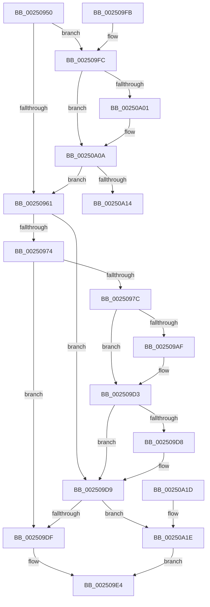

# KiRequestSoftwareInterrupt

- RVA: `0x00250950`–`0x00250A25` (길이 `213` bytes)
- VA: `0x0000000140250950`
- 실행 섹션: `.text`
- PDB 이름 있음: `예`; PDB Function 태그: `아니요`
- unwind 정보 RVA: `0x00063448`
- 디코드: `55`개 명령, `213/213` bytes 표시
- 미해석 바이트: `0` (있으면 어셈블리에 `.byte`로 보존)

> 이 문서는 커널 이미지의 기계어와 PDB 기호를 분석해 생성했습니다. 4번과 5번은 함수 원형과 자료형을 바이너리 사용 방식에서 추정한 C 해석이며 원본 소스 복구 결과는 아닙니다.

## 1. Dependencies

- 직접 호출 지점: **2**; 고유 호출 대상: **2**
- 직접 호출자로 확인된 함수: **5**
- RIP 상대 이미지 참조: **1**

### Outgoing calls
- `0x00250985` → [HalpDisableInterrupts](HalpDisableInterrupts_function_002521A0.md) (function, `0x002521A0`)
- `0x002509F1` → [HalpInterruptSendIpi](HalpInterruptSendIpi_function_00252310.md) (function, `0x00252310`)

### Direct callers
- [sub_0037D8C1](../37/Unknown_function_0037D8C1.md) at `0x0037D98B`
- [KiUpdateRunTime](../39/KiUpdateRunTime_function_0039BB70.md) at `0x0039C0D1`
- [KeAccumulateTicks](../39/KeAccumulateTicks_function_0039C140.md) at `0x0039C2B1`
- [KiFlushQueuedDpcsWorker](../48/KiFlushQueuedDpcsWorker_function_00482100.md) at `0x0048214F`
- [KiRequestApcInterruptSynchronouslyWorker](../5C/KiRequestApcInterruptSynchronouslyWorker_function_005C47B0.md) at `0x005C47B8`

### Static image references
- `0x00250966` → RVA `0x00FC6BC5` (`ALMOSTRO`; read)

## 2. Other-region calls and transfers

- 다른 실행 섹션으로 향하는 call: **0**
- 별도 외부 분기/꼬리 이동을 확인하지 못했습니다.

## 3. Assembly (complete function range)

```asm
00250950  48 83 EC 48                     sub rsp, 0x48
00250954  44 0F B6 C2                     movzx r8d, dl
00250958  80 FA 02                        cmp dl, 2
0025095B  0F 84 9B 00 00 00               je 0x1402509fc
00250961  33 C0                           xor eax, eax
00250963  0F 57 C0                        xorps xmm0, xmm0
00250966  38 05 59 62 D7 00               cmp byte ptr [rip + 0xd76259], al
0025096C  F3 0F 7F 44 24 24               movdqu xmmword ptr [rsp + 0x24], xmm0
00250972  74 65                           je 0x1402509d9
00250974  41 8D 40 FF                     lea eax, [r8 - 1]
00250978  3C 01                           cmp al, 1
0025097A  77 63                           ja 0x1402509df
0025097C  65 4C 8B 14 25 20 00 00 00      mov r10, qword ptr gs:[0x20]
00250985  E8 16 18 00 00                  call 0x1402521a0
0025098A  45 8B 8A A8 00 00 00            mov r9d, dword ptr [r10 + 0xa8]
00250991  41 0F B6 C8                     movzx ecx, r8b
00250995  BA 01 00 00 00                  mov edx, 1
0025099A  44 0F B6 D8                     movzx r11d, al
0025099E  D3 E2                           shl edx, cl
002509A0  41 0B D1                        or edx, r9d
002509A3  41 89 92 A8 00 00 00            mov dword ptr [r10 + 0xa8], edx
002509AA  45 85 C9                        test r9d, r9d
002509AD  75 24                           jne 0x1402509d3
002509AF  B9 15 00 01 C0                  mov ecx, 0xc0010015
002509B4  0F 32                           rdmsr
002509B6  48 C1 E2 20                     shl rdx, 0x20
002509BA  48 0B C2                        or rax, rdx
002509BD  48 BA 00 00 00 00 01 00 00 00   movabs rdx, 0x100000000
002509C7  48 0B C2                        or rax, rdx
002509CA  48 8B D0                        mov rdx, rax
002509CD  48 C1 EA 20                     shr rdx, 0x20
002509D1  0F 30                           wrmsr
002509D3  45 84 DB                        test r11b, r11b
002509D6  74 01                           je 0x1402509d9
002509D8  FB                              sti
002509D9  41 80 F8 01                     cmp r8b, 1
002509DD  74 3F                           je 0x140250a1e
002509DF  BA 2F 00 00 00                  mov edx, 0x2f
002509E4  48 8D 4C 24 20                  lea rcx, [rsp + 0x20]
002509E9  C7 44 24 20 05 00 00 00         mov dword ptr [rsp + 0x20], 5
002509F1  E8 1A 19 00 00                  call 0x140252310
002509F6  48 83 C4 48                     add rsp, 0x48
002509FA  C3                              ret
002509FB  CC                              int3
002509FC  48 85 C9                        test rcx, rcx
002509FF  75 09                           jne 0x140250a0a
00250A01  65 48 8B 0C 25 20 00 00 00      mov rcx, qword ptr gs:[0x20]
00250A0A  80 79 20 00                     cmp byte ptr [rcx + 0x20], 0
00250A0E  0F 84 4D FF FF FF               je 0x140250961
00250A14  C6 41 06 01                     mov byte ptr [rcx + 6], 1
00250A18  48 83 C4 48                     add rsp, 0x48
00250A1C  C3                              ret
00250A1D  CC                              int3
00250A1E  BA 1F 00 00 00                  mov edx, 0x1f
00250A23  EB BF                           jmp 0x1402509e4
```

## 4. C-style interpretation (structured pseudocode)

```c
__int64 __fastcall KiRequestSoftwareInterrupt(__int64 a1, unsigned __int8 a2)
{
    __int64 result;
    __int64 v_rsp;
    unsigned __int64 v_stack_m24;
    unsigned __int64 v_stack_m28;

    v_rsp = (v_rsp) - (72);
    if (a2 == 2) goto loc_002509FC;
loc_00250961:
    result = 0;
    v_stack_m24 = v_xmm0;
    if ((*(unsigned __int8 *)(v_rip + 14115417)) == 0) goto loc_002509D9;
    if (((unsigned __int8)(a2 - 1)) > 1) goto loc_002509DF;
    result = HalpDisableInterrupts(a1, a2, a2, a4);
    a2 = (unsigned int)((1) << (a2));
    a2 = (unsigned int)((a2) | ((unsigned int)((unsigned int)(*(unsigned int *)(*(unsigned __int64 *)(gs_base + (0 + 32)) + 168)))));
    *(unsigned int *)(*(unsigned __int64 *)(gs_base + (0 + 32)) + 168) = a2;
    if ((unsigned int)((unsigned int)(*(unsigned int *)(*(unsigned __int64 *)(gs_base + (0 + 32)) + 168))) == 0) {
        a1 = 0xC0010015ULL;
        a2 = (a2) << (32);
        result = (result) | (a2);
        result = (result) | (a2);
        a2 = result;
        a2 = (a2) >> (32);
    }
    if ((unsigned __int8)((unsigned __int8)(result)) != 0) {
    }
    if (a2 == 1) goto loc_00250A1E;
loc_002509DF:
loc_002509E4:
    v_stack_m28 = 5;
    result = HalpInterruptSendIpi(v_stack_m28, 47, a2, (unsigned int)(*(unsigned int *)(*(unsigned __int64 *)(gs_base + (0 + 32)) + 168)));
    v_rsp = (v_rsp) + (72);
    return result;
loc_002509FC:
    if (v_stack_m28 == 0) {
        a1 = *(unsigned __int64 *)(gs_base + (0 + 32));
    }
    if ((*(unsigned __int8 *)(a1 + 32)) == 0) goto loc_00250961;
    *(unsigned __int8 *)(a1 + 6) = 1;
    v_rsp = (v_rsp) + (72);
    return result;
loc_00250A1E:
    goto loc_002509E4;
}
```

## 5. (Beta) C Style

```c
int64_t KiRequestSoftwareInterrupt(int64_t Arg1, void *Arg2)
{
    uint8_t *arg2 = (uint8_t *)Arg2;

    int64_t result;
    int64_t local_rsp;
    uint64_t v_stack_m24;
    uint64_t v_stack_m28;

    local_rsp = (local_rsp) - (72);
    if (Arg2 == 2) goto loc_002509FC;
loc_00250961:
    result = 0;
    v_stack_m24 = v_xmm0;
    if ((*(uint8_t *)(v_rip + 0xD76259)) == 0) goto loc_002509D9;
    if (((uint8_t)(Arg2 - 1)) > 1) goto loc_002509DF;
    result = HalpDisableInterrupts(Arg1, Arg2, Arg2, a4);
    Arg2 = (uint32_t)((1) << (Arg2));
    Arg2 = (uint32_t)((Arg2) | ((uint32_t)((uint32_t)(*(uint32_t *)(*(uint64_t *)(gs_base + (0 + 0x20)) + 0xA8)))));
    *(uint32_t *)(*(uint64_t *)(gs_base + (0 + 0x20)) + 0xA8) = Arg2;
    if ((uint32_t)((uint32_t)(*(uint32_t *)(*(uint64_t *)(gs_base + (0 + 0x20)) + 0xA8))) == 0) {
        Arg1 = 0xC0010015ULL;
        Arg2 = (Arg2) << (32);
        result = (result) | (Arg2);
        result = (result) | (Arg2);
        Arg2 = result;
        Arg2 = (Arg2) >> (32);
    }
    if ((uint8_t)((uint8_t)(result)) != 0) {
    }
    if (Arg2 == 1) goto loc_00250A1E;
loc_002509DF:
loc_002509E4:
    v_stack_m28 = 5;
    result = HalpInterruptSendIpi(v_stack_m28, 47, Arg2, (uint32_t)(*(uint32_t *)(*(uint64_t *)(gs_base + (0 + 0x20)) + 0xA8)));
    local_rsp = (local_rsp) + (72);
    return result;
loc_002509FC:
    if (v_stack_m28 == 0) {
        Arg1 = *(uint64_t *)(gs_base + (0 + 0x20));
    }
    if ((*(uint8_t *)(Arg1 + 0x20)) == 0) goto loc_00250961;
    *(uint8_t *)(Arg1 + 0x6) = 1;
    local_rsp = (local_rsp) + (72);
    return result;
loc_00250A1E:
    goto loc_002509E4;
}
```

### 관측된 메모리 오프셋

구조체 형식이 확인되지 않은 접근은 인자 기준의 오프셋으로만 기록했습니다.

| 기준 인자 | 오프셋 표현 | 폭 (bit) | 접근 |
|---|---:|---:|---|
| `Arg2` | `- 0x1` | `32` | `R` |

## 6. Execution-region graph

[열기: 2D/3D 그래프와 함수 탐색 컨트롤 패널](../../../control-panel.html?section=text&rva=0x00250950&view=graph)

- 2D 그래프는 위에서 아래로 흐르고, 3D 그래프는 빈 공간을 드래그해 회전합니다. Shift+드래그는 이동, 휠은 확대·축소, 함수 노드 선택은 대상 보고서 이동입니다.

### Static fallback


