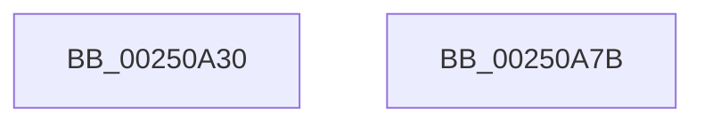

# KiSendSoftwareInterrupt

- RVA: `0x00250A30`–`0x00250A7C` (길이 `76` bytes)
- VA: `0x0000000140250A30`
- 실행 섹션: `.text`
- PDB 이름 있음: `예`; PDB Function 태그: `아니요`
- unwind 정보 RVA: `0x00063458`
- 디코드: `17`개 명령, `76/76` bytes 표시
- 미해석 바이트: `0` (있으면 어셈블리에 `.byte`로 보존)

> 이 문서는 커널 이미지의 기계어와 PDB 기호를 분석해 생성했습니다. 4번과 5번은 함수 원형과 자료형을 바이너리 사용 방식에서 추정한 C 해석이며 원본 소스 복구 결과는 아닙니다.

## 1. Dependencies

- 직접 호출 지점: **1**; 고유 호출 대상: **1**
- 직접 호출자로 확인된 함수: **5**
- RIP 상대 이미지 참조: **0**

### Outgoing calls
- `0x00250A71` → [HalpInterruptSendIpi](HalpInterruptSendIpi_function_00252310.md) (function, `0x00252310`)

### Direct callers
- [KiRequestTimer2Expiration](../39/KiRequestTimer2Expiration_function_0039F118.md) at `0x0039F15A`
- [KeUpdateThreadTag](../47/KeUpdateThreadTag_function_00475770.md) at `0x00475AD2`
- [KeUpdateThreadTag](../47/KeUpdateThreadTag_function_00475770.md) at `0x00475D09`
- [KiForceIdleUpdateSchedulerParkState](../48/KiForceIdleUpdateSchedulerParkState_function_0048D874.md) at `0x0048DC72`
- [KiSynchronizeIdleIsolationDomainExit](../5C/KiSynchronizeIdleIsolationDomainExit_function_005C0544.md) at `0x005C0615`
- [sub_006ED6E6](../6E/Unknown_function_006ED6E6.md) at `0x006ED761`

### Static image references
- 디코드된 RIP-relative 메모리 참조가 없습니다.

## 2. Other-region calls and transfers

- 다른 실행 섹션으로 향하는 call: **0**
- 별도 외부 분기/꼬리 이동을 확인하지 못했습니다.

## 3. Assembly (complete function range)

```asm
00250A30  48 83 EC 48                     sub rsp, 0x48
00250A34  65 48 8B 04 25 20 00 00 00      mov rax, qword ptr gs:[0x20]
00250A3D  44 0F B6 C2                     movzx r8d, dl
00250A41  BA 1F 00 00 00                  mov edx, 0x1f
00250A46  89 4C 24 28                     mov dword ptr [rsp + 0x28], ecx
00250A4A  48 8D 4C 24 20                  lea rcx, [rsp + 0x20]
00250A4F  48 C7 44 24 20 06 00 00 00      mov qword ptr [rsp + 0x20], 6
00250A58  FF 80 D4 8E 00 00               inc dword ptr [rax + 0x8ed4]
00250A5E  33 C0                           xor eax, eax
00250A60  48 89 44 24 2C                  mov qword ptr [rsp + 0x2c], rax
00250A65  41 80 F8 01                     cmp r8b, 1
00250A69  B8 2F 00 00 00                  mov eax, 0x2f
00250A6E  0F 45 D0                        cmovne edx, eax
00250A71  E8 9A 18 00 00                  call 0x140252310
00250A76  48 83 C4 48                     add rsp, 0x48
00250A7A  C3                              ret
00250A7B  CC                              int3
```

## 4. C-style interpretation (structured pseudocode)

```c
__int64 __fastcall KiSendSoftwareInterrupt(int a1, unsigned __int8 a2)
{
    __int64 result;
    __int64 v_rsp;
    unsigned __int64 v_stack_m1C;
    unsigned int v_stack_m20;
    unsigned __int64 v_stack_m28;

    v_rsp = (v_rsp) - (72);
    v_stack_m20 = a1;
    v_stack_m28 = 6;
    result = 0;
    v_stack_m1C = 0;
    a2 = 31;
    if (a2 != 1) { a2 = 47; }
    result = HalpInterruptSendIpi(v_stack_m28, a2, a2, a4);
    v_rsp = (v_rsp) + (72);
    return result;
}
```

## 5. (Beta) C Style

```c
int64_t KiSendSoftwareInterrupt(int32_t Arg1, uint8_t Arg2)
{
    int64_t result;
    int64_t local_rsp;
    uint64_t v_stack_m1C;
    uint32_t v_stack_m20;
    uint64_t v_stack_m28;

    local_rsp = (local_rsp) - (72);
    v_stack_m20 = Arg1;
    v_stack_m28 = 6;
    result = 0;
    v_stack_m1C = 0;
    Arg2 = 31;
    if (Arg2 != 1) { Arg2 = 47; }
    result = HalpInterruptSendIpi(v_stack_m28, Arg2, Arg2, a4);
    local_rsp = (local_rsp) + (72);
    return result;
}
```

## 6. Execution-region graph

[열기: 2D/3D 그래프와 함수 탐색 컨트롤 패널](../../../control-panel.html?section=text&rva=0x00250A30&view=graph)

- 2D 그래프는 위에서 아래로 흐르고, 3D 그래프는 빈 공간을 드래그해 회전합니다. Shift+드래그는 이동, 휠은 확대·축소, 함수 노드 선택은 대상 보고서 이동입니다.

### Static fallback


