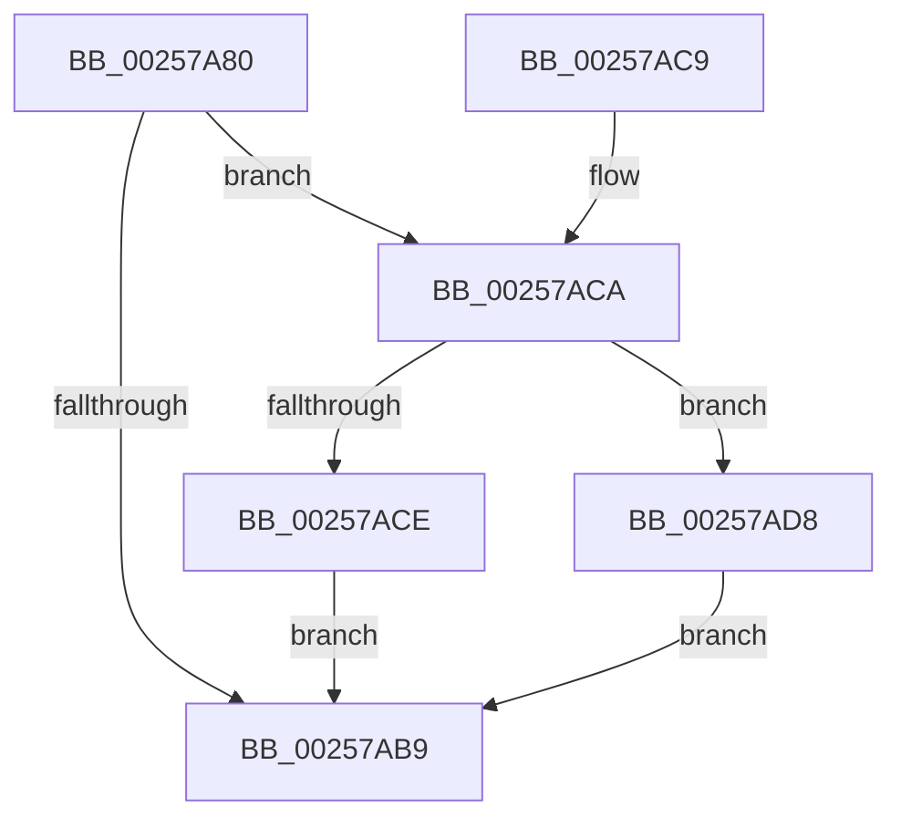

# KiUpdateStandbyStealSummaryForStandbyChange

- RVA: `0x00257A80`–`0x00257AE5` (길이 `101` bytes)
- VA: `0x0000000140257A80`
- 실행 섹션: `.text`
- PDB 이름 있음: `예`; PDB Function 태그: `아니요`
- unwind 정보 RVA: `0x00063C10`
- 디코드: `27`개 명령, `101/101` bytes 표시
- 미해석 바이트: `0` (있으면 어셈블리에 `.byte`로 보존)

> 이 문서는 커널 이미지의 기계어와 PDB 기호를 분석해 생성했습니다. 4번과 5번은 함수 원형과 자료형을 바이너리 사용 방식에서 추정한 C 해석이며 원본 소스 복구 결과는 아닙니다.

## 1. Dependencies

- 직접 호출 지점: **1**; 고유 호출 대상: **1**
- 직접 호출자로 확인된 함수: **4**
- RIP 상대 이미지 참조: **0**

### Outgoing calls
- `0x00257AAA` → [KiMayStealStandbyThread](../30/KiMayStealStandbyThread_function_0030D704.md) (function, `0x0030D704`)

### Direct callers
- [sub_002578AE](Unknown_function_002578AE.md) at `0x00257978`
- [KiCommitRescheduleContextEntry](../30/KiCommitRescheduleContextEntry_function_0030CFD0.md) at `0x0030D190`
- [KiUpdateThreadSchedulingProperties](../46/KiUpdateThreadSchedulingProperties_function_0046E5DC.md) at `0x0046E6D2`
- [sub_006E0CEA](../6E/Unknown_function_006E0CEA.md) at `0x006E0D7E`

### Static image references
- 디코드된 RIP-relative 메모리 참조가 없습니다.

## 2. Other-region calls and transfers

- 다른 실행 섹션으로 향하는 call: **0**
- 별도 외부 분기/꼬리 이동을 확인하지 못했습니다.

## 3. Assembly (complete function range)

```asm
00257A80  48 89 5C 24 08                  mov qword ptr [rsp + 8], rbx
00257A85  48 89 74 24 10                  mov qword ptr [rsp + 0x10], rsi
00257A8A  57                              push rdi
00257A8B  48 83 EC 20                     sub rsp, 0x20
00257A8F  48 8B B9 C0 00 00 00            mov rdi, qword ptr [rcx + 0xc0]
00257A96  33 D2                           xor edx, edx
00257A98  48 8B B1 C8 00 00 00            mov rsi, qword ptr [rcx + 0xc8]
00257A9F  48 8B 9F 90 01 00 00            mov rbx, qword ptr [rdi + 0x190]
00257AA6  44 8D 42 01                     lea r8d, [rdx + 1]
00257AAA  E8 55 5C 0B 00                  call 0x14030d704
00257AAF  48 85 DE                        test rsi, rbx
00257AB2  0F 95 C1                        setne cl
00257AB5  3A C8                           cmp cl, al
00257AB7  75 11                           jne 0x140257aca
00257AB9  48 8B 5C 24 30                  mov rbx, qword ptr [rsp + 0x30]
00257ABE  48 8B 74 24 38                  mov rsi, qword ptr [rsp + 0x38]
00257AC3  48 83 C4 20                     add rsp, 0x20
00257AC7  5F                              pop rdi
00257AC8  C3                              ret
00257AC9  CC                              int3
00257ACA  84 C0                           test al, al
00257ACC  74 0A                           je 0x140257ad8
00257ACE  F0 48 09 B7 90 01 00 00         lock or qword ptr [rdi + 0x190], rsi
00257AD6  EB E1                           jmp 0x140257ab9
00257AD8  48 F7 D6                        not rsi
00257ADB  F0 48 21 B7 90 01 00 00         lock and qword ptr [rdi + 0x190], rsi
00257AE3  EB D4                           jmp 0x140257ab9
```

## 4. C-style interpretation (structured pseudocode)

```c
__int64 __fastcall KiUpdateStandbyStealSummaryForStandbyChange(__int64 a1, int a2)
{
    __int64 result;
    __int64 v_rsi;
    __int64 v_rsp;
    unsigned __int64 v_stack_p10;
    unsigned __int64 v_stack_p8;

    v_stack_p8 = v_rbx;
    v_stack_p10 = v_rsi;
    v_rsp = (v_rsp) - (32);
    a2 = 0;
    result = KiMayStealStandbyThread(a1, a2, a2 + 1, a4);
    a1 = (((*(unsigned __int64 *)(a1 + 200)) & (*(unsigned __int64 *)(*(unsigned __int64 *)(a1 + 192) + 400))) != 0) ? 1 : 0;
    if (((unsigned __int8)(a1)) != ((unsigned __int8)(result))) goto loc_00257ACA;
loc_00257AB9:
    v_rsp = (v_rsp) + (32);
    return result;
loc_00257ACA:
    if ((unsigned __int8)(result) == 0) goto loc_00257AD8;
    goto loc_00257AB9;
loc_00257AD8:
    v_rsi = ~(v_stack_p10);
    goto loc_00257AB9;
}
```

## 5. (Beta) C Style

```c
int64_t KiUpdateStandbyStealSummaryForStandbyChange(void *Arg1, int32_t Arg2)
{
    uint8_t *arg1 = (uint8_t *)Arg1;

    int64_t result;
    int64_t local_rsi;
    int64_t local_rsp;
    uint64_t v_stack_p10;
    uint64_t v_stack_p8;

    v_stack_p8 = local_rbx;
    v_stack_p10 = local_rsi;
    local_rsp = (local_rsp) - (32);
    Arg2 = 0;
    result = KiMayStealStandbyThread(Arg1, Arg2, Arg2 + 1, a4);
    Arg1 = (((*(uint64_t *)(arg1 + 0xC8)) & (*(uint64_t *)(*(uint64_t *)(arg1 + 0xC0) + 0x190))) != 0) ? 1 : 0;
    if (((uint8_t)(Arg1)) != ((uint8_t)(result))) goto loc_00257ACA;
loc_00257AB9:
    local_rsp = (local_rsp) + (32);
    return result;
loc_00257ACA:
    if ((uint8_t)(result) == 0) goto loc_00257AD8;
    goto loc_00257AB9;
loc_00257AD8:
    local_rsi = ~(v_stack_p10);
    goto loc_00257AB9;
}
```

### 관측된 메모리 오프셋

구조체 형식이 확인되지 않은 접근은 인자 기준의 오프셋으로만 기록했습니다.

| 기준 인자 | 오프셋 표현 | 폭 (bit) | 접근 |
|---|---:|---:|---|
| `Arg1` | `+ 0xC0` | `64` | `R` |
| `Arg1` | `+ 0xC8` | `64` | `R` |

## 6. Execution-region graph

[열기: 2D/3D 그래프와 함수 탐색 컨트롤 패널](../../../control-panel.html?section=text&rva=0x00257A80&view=graph)

- 2D 그래프는 위에서 아래로 흐르고, 3D 그래프는 빈 공간을 드래그해 회전합니다. Shift+드래그는 이동, 휠은 확대·축소, 함수 노드 선택은 대상 보고서 이동입니다.

### Static fallback


