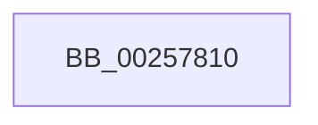

# KiUpdateThreadPriority

- RVA: `0x00257810`–`0x00257816` (길이 `6` bytes)
- VA: `0x0000000140257810`
- 실행 섹션: `.text`
- PDB 이름 있음: `예`; PDB Function 태그: `아니요`
- unwind 정보 RVA: `0x00063AE8`
- 디코드: `2`개 명령, `6/6` bytes 표시
- 미해석 바이트: `0` (있으면 어셈블리에 `.byte`로 보존)

> 이 문서는 커널 이미지의 기계어와 PDB 기호를 분석해 생성했습니다. 4번과 5번은 함수 원형과 자료형을 바이너리 사용 방식에서 추정한 C 해석이며 원본 소스 복구 결과는 아닙니다.

## 1. Dependencies

- 직접 호출 지점: **0**; 고유 호출 대상: **0**
- 직접 호출자로 확인된 함수: **15**
- RIP 상대 이미지 참조: **0**

### Outgoing calls
- 직접 디코드된 call 명령이 없습니다.

### Direct callers
- [KeYieldExecution](../20/KeYieldExecution_function_00209FA0.md) at `0x0020A222`
- [KiRemoveBoostThread](../21/KiRemoveBoostThread_function_00219128.md) at `0x00219206`
- [sub_0021C0DA](../21/Unknown_function_0021C0DA.md) at `0x0021C203`
- [KiQueueReadyThread](../21/KiQueueReadyThread_function_0021C7B0.md) at `0x0021CEF1`
- [sub_0021D7F8](../21/Unknown_function_0021D7F8.md) at `0x0021EB34`
- [KiSetPriorityThread](../22/KiSetPriorityThread_function_00220E78.md) at `0x00221006`
- [KiSetPriorityThread](../22/KiSetPriorityThread_function_00220E78.md) at `0x002210CB`
- [KiSetPriorityThread](../22/KiSetPriorityThread_function_00220E78.md) at `0x0022115F`
- [KiSetPriorityThread](../22/KiSetPriorityThread_function_00220E78.md) at `0x0022134B`
- [sub_002546EC](Unknown_function_002546EC.md) at `0x00254DDD`
- [sub_002546EC](Unknown_function_002546EC.md) at `0x0025524B`
- [KiUpdateVPBackingThreadPriority](../30/KiUpdateVPBackingThreadPriority_function_00306040.md) at `0x003061C4`
- [KiSoftParkElectionUnparkProcessor](../30/KiSoftParkElectionUnparkProcessor_function_0030B818.md) at `0x0030B90E`
- [KiUnparkCurrentProcessor](../35/KiUnparkCurrentProcessor_function_00352214.md) at `0x003522A2`
- [KiParkCurrentProcessor](../35/KiParkCurrentProcessor_function_003533A4.md) at `0x0035357A`
- [KiSetPriorityBoost](../39/KiSetPriorityBoost_function_00398A40.md) at `0x00398AA4`
- [KiInitializeForegroundBoostThread](../3C/KiInitializeForegroundBoostThread_function_003C28D8.md) at `0x003C2935`
- [KiApplyForegroundBoostThread](../4F/KiApplyForegroundBoostThread_function_004F7DC0.md) at `0x004F7E9C`
- [KiApplyForegroundBoostThread](../4F/KiApplyForegroundBoostThread_function_004F7DC0.md) at `0x004F7EB3`
- [KiApplyForegroundBoostThread](../4F/KiApplyForegroundBoostThread_function_004F7DC0.md) at `0x004F7EDA`
- [KiApplyForegroundBoostThread](../4F/KiApplyForegroundBoostThread_function_004F7DC0.md) at `0x004F7F18`
- [KiCompleteKernelInit](../../pagelk/B6/KiCompleteKernelInit_function_00B66090.md) at `0x00B6639B`

### Static image references
- 디코드된 RIP-relative 메모리 참조가 없습니다.

## 2. Other-region calls and transfers

- 다른 실행 섹션으로 향하는 call: **0**
- 별도 외부 분기/꼬리 이동을 확인하지 못했습니다.

## 3. Assembly (complete function range)

```asm
00257810  40 57                           push rdi
00257812  48 83 EC 40                     sub rsp, 0x40
```

## 4. C-style interpretation (structured pseudocode)

```c
void __fastcall KiUpdateThreadPriority(void)
{
    __int64 v_rsp;

    v_rsp = (v_rsp) - (64);
    return;
}
```

## 5. (Beta) C Style

```c
void KiUpdateThreadPriority(void)
{
    int64_t local_rsp;

    local_rsp = (local_rsp) - (64);
    return;
}
```

## 6. Execution-region graph

[열기: 2D/3D 그래프와 함수 탐색 컨트롤 패널](../../../control-panel.html?section=text&rva=0x00257810&view=graph)

- 2D 그래프는 위에서 아래로 흐르고, 3D 그래프는 빈 공간을 드래그해 회전합니다. Shift+드래그는 이동, 휠은 확대·축소, 함수 노드 선택은 대상 보고서 이동입니다.

### Static fallback


