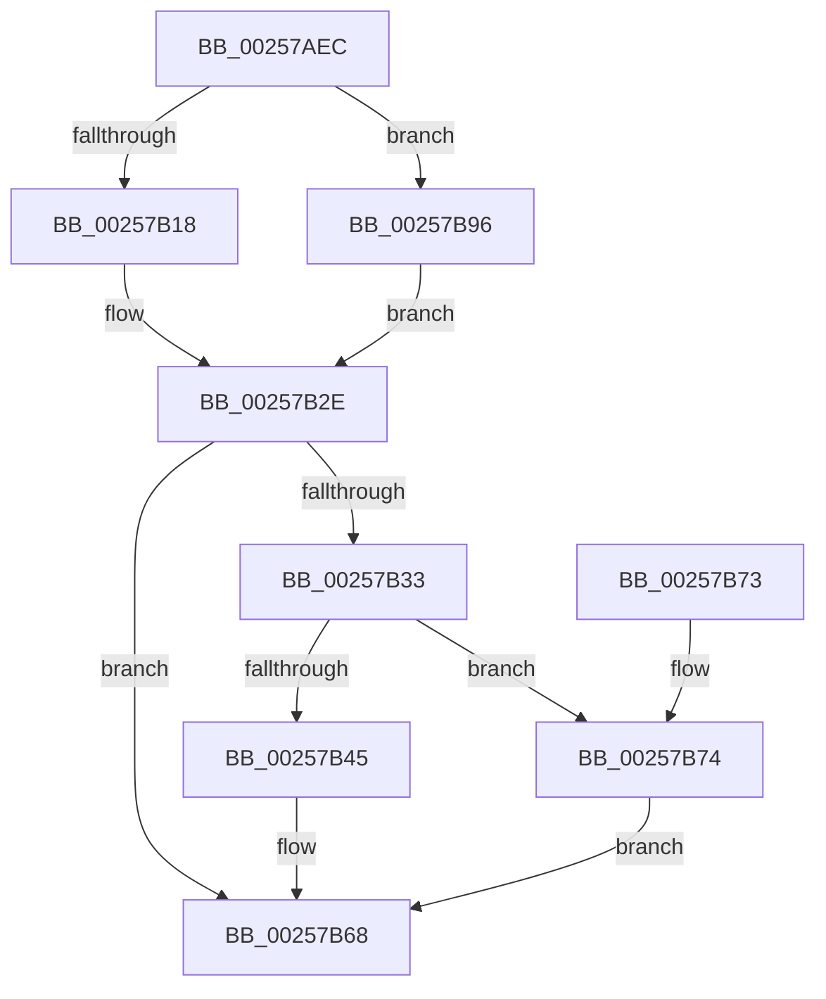

# KiUpdateThreadQosGroupingSummaries

- RVA: `0x00257AEC`–`0x00257B9A` (길이 `174` bytes)
- VA: `0x0000000140257AEC`
- 실행 섹션: `.text`
- PDB 이름 있음: `예`; PDB Function 태그: `아니요`
- unwind 정보 RVA: `0x00063C24`
- 디코드: `44`개 명령, `174/174` bytes 표시
- 미해석 바이트: `0` (있으면 어셈블리에 `.byte`로 보존)

> 이 문서는 커널 이미지의 기계어와 PDB 기호를 분석해 생성했습니다. 4번과 5번은 함수 원형과 자료형을 바이너리 사용 방식에서 추정한 C 해석이며 원본 소스 복구 결과는 아닙니다.

## 1. Dependencies

- 직접 호출 지점: **4**; 고유 호출 대상: **2**
- 직접 호출자로 확인된 함수: **14**
- RIP 상대 이미지 참조: **0**

### Outgoing calls
- `0x00257B54` → [KiInterlockedDecrementRankListMembersNoFence](../41/KiInterlockedDecrementRankListMembersNoFence_function_00416C30.md) (function, `0x00416C30`)
- `0x00257B63` → [KiInterlockedDecrementRankListMembersNoFence](../41/KiInterlockedDecrementRankListMembersNoFence_function_00416C30.md) (function, `0x00416C30`)
- `0x00257B80` → [KiInterlockedIncrementRankListMembersNoFence](../41/KiInterlockedIncrementRankListMembersNoFence_function_00416BC0.md) (function, `0x00416BC0`)
- `0x00257B8F` → [KiInterlockedIncrementRankListMembersNoFence](../41/KiInterlockedIncrementRankListMembersNoFence_function_00416BC0.md) (function, `0x00416BC0`)

### Direct callers
- [KzRefreshWorkloadProperties](KzRefreshWorkloadProperties_function_002576D4.md) at `0x00257790`
- [sub_002578AE](Unknown_function_002578AE.md) at `0x00257970`
- [KeSetThreadSchedulerAssist](../30/KeSetThreadSchedulerAssist_function_003038F8.md) at `0x00303A58`
- [KiUpdateVpBackingThreadPriorityFromTopLevel](../30/KiUpdateVpBackingThreadPriorityFromTopLevel_function_00303BA0.md) at `0x00303DC9`
- [KiUpdateVpBackingThreadPriorityFromTopLevel](../30/KiUpdateVpBackingThreadPriorityFromTopLevel_function_00303BA0.md) at `0x00303E33`
- [KiCommitRescheduleContextEntry](../30/KiCommitRescheduleContextEntry_function_0030CFD0.md) at `0x0030D188`
- [KeApplyWobBamQos](../39/KeApplyWobBamQos_function_003937AC.md) at `0x00393A02`
- [KeSetProcessPpmPolicy](../3C/KeSetProcessPpmPolicy_function_003C1CCC.md) at `0x003C1E23`
- [KeSetProcessPpmPolicy](../3C/KeSetProcessPpmPolicy_function_003C1CCC.md) at `0x003C1ED6`
- [KeSetThreadPpmPolicy](../3C/KeSetThreadPpmPolicy_function_003C6C30.md) at `0x003C6D06`
- [KeSetThreadPpmPolicy](../3C/KeSetThreadPpmPolicy_function_003C6C30.md) at `0x003C6DA4`
- [KiUpdateThreadSchedulingProperties](../46/KiUpdateThreadSchedulingProperties_function_0046E5DC.md) at `0x0046E6CA`
- [KeUpdateThreadTag](../47/KeUpdateThreadTag_function_00475770.md) at `0x004758E9`
- [KeUpdateThreadTag](../47/KeUpdateThreadTag_function_00475770.md) at `0x00475A73`
- [KeUpdateThreadTag](../47/KeUpdateThreadTag_function_00475770.md) at `0x00475CB1`
- [sub_006D8CA4](../6D/Unknown_function_006D8CA4.md) at `0x006D8CF3`
- [sub_006E0886](../6E/Unknown_function_006E0886.md) at `0x006E0913`
- [sub_006E0CEA](../6E/Unknown_function_006E0CEA.md) at `0x006E0D76`
- [KiCompleteKernelInit](../../pagelk/B6/KiCompleteKernelInit_function_00B66090.md) at `0x00B66388`

### Static image references
- 디코드된 RIP-relative 메모리 참조가 없습니다.

## 2. Other-region calls and transfers

- 다른 실행 섹션으로 향하는 call: **0**
- 별도 외부 분기/꼬리 이동을 확인하지 못했습니다.

## 3. Assembly (complete function range)

```asm
00257AEC  48 89 5C 24 08                  mov qword ptr [rsp + 8], rbx
00257AF1  57                              push rdi
00257AF2  48 83 EC 20                     sub rsp, 0x20
00257AF6  48 8B 91 C0 00 00 00            mov rdx, qword ptr [rcx + 0xc0]
00257AFD  48 8B D9                        mov rbx, rcx
00257B00  4C 8B 81 C8 00 00 00            mov r8, qword ptr [rcx + 0xc8]
00257B07  48 8B 42 20                     mov rax, qword ptr [rdx + 0x20]
00257B0B  49 85 C0                        test r8, rax
00257B0E  41 0F 95 C1                     setne r9b
00257B12  F6 41 23 01                     test byte ptr [rcx + 0x23], 1
00257B16  74 7E                           je 0x140257b96
00257B18  48 8B 41 38                     mov rax, qword ptr [rcx + 0x38]
00257B1C  0F B6 48 40                     movzx ecx, byte ptr [rax + 0x40]
00257B20  83 E1 07                        and ecx, 7
00257B23  FF C9                           dec ecx
00257B25  F7 C1 FA FF FF FF               test ecx, 0xfffffffa
00257B2B  0F 94 C0                        sete al
00257B2E  44 3A C8                        cmp r9b, al
00257B31  74 35                           je 0x140257b68
00257B33  48 8D 8A 80 02 00 00            lea rcx, [rdx + 0x280]
00257B3A  48 8D BA C0 02 00 00            lea rdi, [rdx + 0x2c0]
00257B41  84 C0                           test al, al
00257B43  75 2F                           jne 0x140257b74
00257B45  49 F7 D0                        not r8
00257B48  F0 4C 21 42 20                  lock and qword ptr [rdx + 0x20], r8
00257B4D  48 8B 93 60 8E 00 00            mov rdx, qword ptr [rbx + 0x8e60]
00257B54  E8 D7 F0 1B 00                  call 0x140416c30
00257B59  48 8B 93 78 8E 00 00            mov rdx, qword ptr [rbx + 0x8e78]
00257B60  48 8B CF                        mov rcx, rdi
00257B63  E8 C8 F0 1B 00                  call 0x140416c30
00257B68  48 8B 5C 24 30                  mov rbx, qword ptr [rsp + 0x30]
00257B6D  48 83 C4 20                     add rsp, 0x20
00257B71  5F                              pop rdi
00257B72  C3                              ret
00257B73  CC                              int3
00257B74  F0 4C 09 42 20                  lock or qword ptr [rdx + 0x20], r8
00257B79  48 8B 93 60 8E 00 00            mov rdx, qword ptr [rbx + 0x8e60]
00257B80  E8 3B F0 1B 00                  call 0x140416bc0
00257B85  48 8B 93 78 8E 00 00            mov rdx, qword ptr [rbx + 0x8e78]
00257B8C  48 8B CF                        mov rcx, rdi
00257B8F  E8 2C F0 1B 00                  call 0x140416bc0
00257B94  EB D2                           jmp 0x140257b68
00257B96  32 C0                           xor al, al
00257B98  EB 94                           jmp 0x140257b2e
```

## 4. C-style interpretation (structured pseudocode)

```c
__int64 __fastcall KiUpdateThreadQosGroupingSummaries(__int64 a1)
{
    __int64 result;
    __int64 v_rsp;
    unsigned __int64 v_stack_p8;

    v_stack_p8 = v_rbx;
    v_rsp = (v_rsp) - (32);
    a4 = (((*(unsigned __int64 *)(a1 + 200)) & (*(unsigned __int64 *)(*(unsigned __int64 *)(a1 + 192) + 32))) != 0) ? 1 : 0;
    if (((*(unsigned __int8 *)(a1 + 35)) & (1)) == 0) goto loc_00257B96;
    a1 = (unsigned int)((*(unsigned __int8 *)(*(unsigned __int64 *)(a1 + 56) + 64)) & (7));
    a1 = (unsigned int)((a1) - 1);
    result = ((((unsigned int)(a1)) & (0xFFFFFFFAULL)) == 0) ? 1 : 0;
loc_00257B2E:
    if (((unsigned __int8)(a4)) == ((unsigned __int8)(result))) goto loc_00257B68;
    if ((unsigned __int8)(result) != 0) goto loc_00257B74;
    a3 = ~(*(unsigned __int64 *)(a1 + 200));
    result = KiInterlockedDecrementRankListMembersNoFence(*(unsigned __int64 *)(a1 + 192) + 640, *(unsigned __int64 *)(a1 + 36448), a3, a4);
    result = KiInterlockedDecrementRankListMembersNoFence(*(unsigned __int64 *)(a1 + 192) + 704, *(unsigned __int64 *)(a1 + 36472), a3, a4);
loc_00257B68:
    v_rsp = (v_rsp) + (32);
    return result;
loc_00257B74:
    result = KiInterlockedIncrementRankListMembersNoFence(*(unsigned __int64 *)(a1 + 192) + 704, *(unsigned __int64 *)(v_stack_p8 + 36448), a3, a4);
    result = KiInterlockedIncrementRankListMembersNoFence(*(unsigned __int64 *)(a1 + 192) + 704, *(unsigned __int64 *)(v_stack_p8 + 36472), a3, a4);
    goto loc_00257B68;
loc_00257B96:
    result = 0;
    goto loc_00257B2E;
}
```

## 5. (Beta) C Style

```c
int64_t KiUpdateThreadQosGroupingSummaries(void *Arg1)
{
    uint8_t *arg1 = (uint8_t *)Arg1;

    int64_t result;
    int64_t local_rsp;
    uint64_t v_stack_p8;

    v_stack_p8 = local_rbx;
    local_rsp = (local_rsp) - (32);
    a4 = (((*(uint64_t *)(arg1 + 0xC8)) & (*(uint64_t *)(*(uint64_t *)(arg1 + 0xC0) + 0x20))) != 0) ? 1 : 0;
    if (((*(uint8_t *)(arg1 + 0x23)) & (1)) == 0) goto loc_00257B96;
    Arg1 = (uint32_t)((*(uint8_t *)(*(uint64_t *)(arg1 + 0x38) + 0x40)) & (7));
    Arg1 = (uint32_t)((Arg1) - 1);
    result = ((((uint32_t)(Arg1)) & (0xFFFFFFFAULL)) == 0) ? 1 : 0;
loc_00257B2E:
    if (((uint8_t)(a4)) == ((uint8_t)(result))) goto loc_00257B68;
    if ((uint8_t)(result) != 0) goto loc_00257B74;
    a3 = ~(*(uint64_t *)(arg1 + 0xC8));
    result = KiInterlockedDecrementRankListMembersNoFence(*(uint64_t *)(arg1 + 0xC0) + 640, *(uint64_t *)(arg1 + 0x8E60), a3, a4);
    result = KiInterlockedDecrementRankListMembersNoFence(*(uint64_t *)(arg1 + 0xC0) + 704, *(uint64_t *)(arg1 + 0x8E78), a3, a4);
loc_00257B68:
    local_rsp = (local_rsp) + (32);
    return result;
loc_00257B74:
    result = KiInterlockedIncrementRankListMembersNoFence(*(uint64_t *)(arg1 + 0xC0) + 704, *(uint64_t *)(v_stack_p8 + 0x8E60), a3, a4);
    result = KiInterlockedIncrementRankListMembersNoFence(*(uint64_t *)(arg1 + 0xC0) + 704, *(uint64_t *)(v_stack_p8 + 0x8E78), a3, a4);
    goto loc_00257B68;
loc_00257B96:
    result = 0;
    goto loc_00257B2E;
}
```

### 관측된 메모리 오프셋

구조체 형식이 확인되지 않은 접근은 인자 기준의 오프셋으로만 기록했습니다.

| 기준 인자 | 오프셋 표현 | 폭 (bit) | 접근 |
|---|---:|---:|---|
| `Arg1` | `+ 0x23` | `8` | `R` |
| `Arg1` | `+ 0x38` | `64` | `R` |
| `Arg1` | `+ 0xC0` | `64` | `R` |
| `Arg1` | `+ 0xC8` | `64` | `R` |
| `Arg1` | `+ 0x8E60` | `64` | `R` |
| `Arg1` | `+ 0x8E78` | `64` | `R` |

## 6. Execution-region graph

[열기: 2D/3D 그래프와 함수 탐색 컨트롤 패널](../../../control-panel.html?section=text&rva=0x00257AEC&view=graph)

- 2D 그래프는 위에서 아래로 흐르고, 3D 그래프는 빈 공간을 드래그해 회전합니다. Shift+드래그는 이동, 휠은 확대·축소, 함수 노드 선택은 대상 보고서 이동입니다.

### Static fallback


