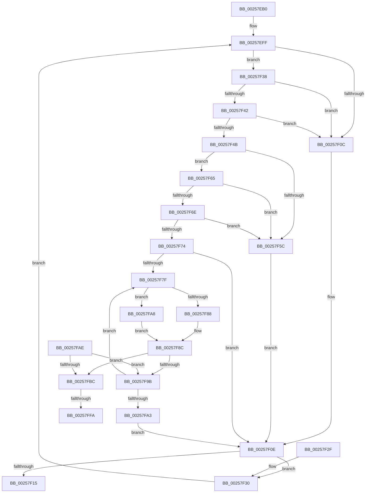

# KxWaitForLockOwnerShip

- RVA: `0x00257EB0`–`0x00258008` (길이 `344` bytes)
- VA: `0x0000000140257EB0`
- 실행 섹션: `.text`
- PDB 이름 있음: `예`; PDB Function 태그: `예`
- unwind 정보 RVA: `0x00063CF8`
- 디코드: `100`개 명령, `344/344` bytes 표시
- 미해석 바이트: `0` (있으면 어셈블리에 `.byte`로 보존)

> 이 문서는 커널 이미지의 기계어와 PDB 기호를 분석해 생성했습니다. 4번과 5번은 함수 원형과 자료형을 바이너리 사용 방식에서 추정한 C 해석이며 원본 소스 복구 결과는 아닙니다.

## 1. Dependencies

- 직접 호출 지점: **5**; 고유 호출 대상: **5**
- 직접 호출자로 확인된 함수: **107**
- RIP 상대 이미지 참조: **4**

### Outgoing calls
- `0x00257F42` → [KiCheckVpBackingLongSpinWaitHypercall](../30/KiCheckVpBackingLongSpinWaitHypercall_function_0030F490.md) (function, `0x0030F490`)
- `0x00257F5E` → [HvlNotifyLongSpinWait](../30/HvlNotifyLongSpinWait_function_0030F460.md) (function, `0x0030F460`)
- `0x00257F65` → [KeCanUseHaltOnAddress](../4F/KeCanUseHaltOnAddress_function_004FC22C.md) (function, `0x004FC22C`)
- `0x00257FE8` → [KiAddHaltBlockToWaitList](../5B/KiAddHaltBlockToWaitList_function_005BB948.md) (function, `0x005BB948`)
- `0x00257FFD` → [KiWakeAddressAll](../45/KiWakeAddressAll_function_0045B334.md) (function, `0x0045B334`)

### Direct callers
- [ExpAcquireFastResourceSharedSlow](../21/ExpAcquireFastResourceSharedSlow_function_00211260.md) at `0x00211632`
- [ExpAcquireResourceSharedLite](../21/ExpAcquireResourceSharedLite_function_00212040.md) at `0x00212C11`
- [ExpAcquireResourceSharedLite](../21/ExpAcquireResourceSharedLite_function_00212040.md) at `0x002131AD`
- [sub_002142F9](../21/Unknown_function_002142F9.md) at `0x00214901`
- [sub_002142F9](../21/Unknown_function_002142F9.md) at `0x00214983`
- [sub_002142F9](../21/Unknown_function_002142F9.md) at `0x002149E0`
- [sub_002150DC](../21/Unknown_function_002150DC.md) at `0x0021511A`
- [sub_00215166](../21/Unknown_function_00215166.md) at `0x00215720`
- [sub_00215F5C](../21/Unknown_function_00215F5C.md) at `0x00216027`
- [sub_00218B2B](../21/Unknown_function_00218B2B.md) at `0x00218DD5`
- [KiQueueReadyThread](../21/KiQueueReadyThread_function_0021C7B0.md) at `0x0021CF52`
- [KiSetPriorityThread](../22/KiSetPriorityThread_function_00220E78.md) at `0x002212DF`
- [sub_002219D9](../22/Unknown_function_002219D9.md) at `0x002219DF`
- [sub_002219E9](../22/Unknown_function_002219E9.md) at `0x00221A68`
- [sub_002219E9](../22/Unknown_function_002219E9.md) at `0x00221A77`
- [sub_002219E9](../22/Unknown_function_002219E9.md) at `0x00221A84`
- [sub_002219E9](../22/Unknown_function_002219E9.md) at `0x00221AB7`
- [MiLockWorkingSetOptimal](../23/MiLockWorkingSetOptimal_function_00238FC0.md) at `0x00239116`
- [MiLockNestedPageTable](../23/MiLockNestedPageTable_function_0023E890.md) at `0x0023E90A`
- [sub_00248B10](../24/Unknown_function_00248B10.md) at `0x00248D0E`
- [IopCompleteIrpInFileObjectList](../24/IopCompleteIrpInFileObjectList_function_0024F330.md) at `0x0024F90B`
- [sub_002546EC](Unknown_function_002546EC.md) at `0x00254902`
- [KiSearchForNewThreadsForRescheduleContext](KiSearchForNewThreadsForRescheduleContext_function_00258620.md) at `0x00258CA9`
- [KiAttemptToScheduleThreadToBusyIsolationUnit](KiAttemptToScheduleThreadToBusyIsolationUnit_function_00259B00.md) at `0x0025A82D`
- [sub_0025D903](Unknown_function_0025D903.md) at `0x0025E153`
- [sub_0026025E](../26/Unknown_function_0026025E.md) at `0x00260290`
- [ExReleaseFastResource](../26/ExReleaseFastResource_function_002613D0.md) at `0x002619AC`
- [sub_00261DFE](../26/Unknown_function_00261DFE.md) at `0x00262117`
- [KiAbEntryRemoveFromTree](../26/KiAbEntryRemoveFromTree_function_00262410.md) at `0x00262AA6`
- [KiAbEntryRemoveFromTree](../26/KiAbEntryRemoveFromTree_function_00262410.md) at `0x00262AC1`
- [sub_002630B7](../26/Unknown_function_002630B7.md) at `0x002630BC`
- [IopCheckVpbMounted](../27/IopCheckVpbMounted_function_00270540.md) at `0x002707FC`
- [IopCheckVpbMounted](../27/IopCheckVpbMounted_function_00270540.md) at `0x00270809`
- [IopDecrementDeviceObjectRef](../27/IopDecrementDeviceObjectRef_function_00270970.md) at `0x00270B4D`
- [CcGetVacbMiss](../27/CcGetVacbMiss_function_00272900.md) at `0x00272E3D`
- [IoAcquireCancelSpinLock](../27/IoAcquireCancelSpinLock_function_00273CF0.md) at `0x00273D73`
- [KeAcquireQueuedSpinLock](../27/KeAcquireQueuedSpinLock_function_00273D80.md) at `0x00273E0D`
- [KxAcquireQueuedSpinLock](../27/KxAcquireQueuedSpinLock_function_00273E20.md) at `0x00273E56`
- [sub_002746AC](../27/Unknown_function_002746AC.md) at `0x002746DE`
- [KeAcquireInStackQueuedSpinLockAtDpcLevel](../27/KeAcquireInStackQueuedSpinLockAtDpcLevel_function_00275740.md) at `0x0027578B`
- [KeAcquireInStackQueuedSpinLock](../27/KeAcquireInStackQueuedSpinLock_function_002757A0.md) at `0x00275837`
- [sub_002759BE](../27/Unknown_function_002759BE.md) at `0x00275B5C`
- [sub_002760C1](../27/Unknown_function_002760C1.md) at `0x00276186`
- [MiFastLockLeafPageTable](../27/MiFastLockLeafPageTable_function_00276340.md) at `0x00276A4B`
- [MiFastLockLeafPageTable](../27/MiFastLockLeafPageTable_function_00276340.md) at `0x00276DC9`
- [MiWalkPageTablesRecursively](../27/MiWalkPageTablesRecursively_function_002796C0.md) at `0x0027AAB7`
- [MiMakeSystemAddressValid](../27/MiMakeSystemAddressValid_function_0027FF70.md) at `0x00280444`
- [MiMakeSystemAddressValid](../27/MiMakeSystemAddressValid_function_0027FF70.md) at `0x00280B2D`
- [MiLockLowestValidPageTableEx](../28/MiLockLowestValidPageTableEx_function_00280D10.md) at `0x00280FB8`
- [MiLockLowestValidPageTableEx](../28/MiLockLowestValidPageTableEx_function_00280D10.md) at `0x00281621`
- [sub_00281A81](../28/Unknown_function_00281A81.md) at `0x00281D1F`
- [sub_00282570](../28/Unknown_function_00282570.md) at `0x00282654`
- [sub_002ADE2A](../2A/Unknown_function_002ADE2A.md) at `0x002ADE2D`
- [ExpInsertPoolTrackerExpansion](../2E/ExpInsertPoolTrackerExpansion_function_002ECCC0.md) at `0x002ECE19`
- [AlpcpSignalAndWait](../2F/AlpcpSignalAndWait_function_002F9620.md) at `0x002F9A2F`
- [sub_0030E8E0](../30/Unknown_function_0030E8E0.md) at `0x0030EC25`
- [sub_0030F26B](../30/Unknown_function_0030F26B.md) at `0x0030F444`
- [KiSearchForNewThreadsOnTarget](../30/KiSearchForNewThreadsOnTarget_function_0030F500.md) at `0x0031100D`
- [ExpAcquireSharedStarveExclusive](../34/ExpAcquireSharedStarveExclusive_function_003411C0.md) at `0x003416BB`
- [sub_00341C71](../34/Unknown_function_00341C71.md) at `0x00341C76`
- [sub_00341DB3](../34/Unknown_function_00341DB3.md) at `0x00341F63`
- [PfpPartitionGetFirst](../34/PfpPartitionGetFirst_function_00342ED0.md) at `0x00343034`
- [sub_00343D25](../34/Unknown_function_00343D25.md) at `0x00343D2A`
- [ExpSetResourceOwnerPointerEx](../34/ExpSetResourceOwnerPointerEx_function_00343E20.md) at `0x00344102`
- [sub_0034465D](../34/Unknown_function_0034465D.md) at `0x00344662`
- [ExpWorkerFactoryCompletionPacketRoutine](../34/ExpWorkerFactoryCompletionPacketRoutine_function_00344810.md) at `0x003448E1`
- [IopRecordIoAttribution](../34/IopRecordIoAttribution_function_00349758.md) at `0x00349965`
- [ExpConvertExclusiveToSharedLite](../34/ExpConvertExclusiveToSharedLite_function_0034F7A8.md) at `0x0034F892`
- [NtSetInformationWorkerFactory](../35/NtSetInformationWorkerFactory_function_00350A30.md) at `0x00350DFB`
- [KiParkCurrentProcessor](../35/KiParkCurrentProcessor_function_003533A4.md) at `0x003536BC`
- [KiJoinCooperativeIdleSearch](../35/KiJoinCooperativeIdleSearch_function_00353D1C.md) at `0x00353F9A`
- [KiSendHeteroRescheduleIntRequestHelper](../35/KiSendHeteroRescheduleIntRequestHelper_function_0035420C.md) at `0x0035486D`
- [KeTerminateThread](../35/KeTerminateThread_function_00355138.md) at `0x00355427`
- [CcCachemapUninitWorkerThread](../35/CcCachemapUninitWorkerThread_function_003569D0.md) at `0x00356B89`
- [CcPostWorkQueueCachemapUninit](../35/CcPostWorkQueueCachemapUninit_function_00356C94.md) at `0x00356D72`
- [CcGetDirtyPagesHelper](../35/CcGetDirtyPagesHelper_function_00358D40.md) at `0x003590A0`
- [CcFlushCachePostProcessOneRange](../35/CcFlushCachePostProcessOneRange_function_00359710.md) at `0x00359A64`
- [sub_0035A838](../35/Unknown_function_0035A838.md) at `0x0035A8AE`
- [ExAllocateHeapPool](../35/ExAllocateHeapPool_function_0035BA30.md) at `0x0035D6CC`
- [ExAllocateHeapPool](../35/ExAllocateHeapPool_function_0035BA30.md) at `0x0035E3EF`
- [ExAllocateHeapPool](../35/ExAllocateHeapPool_function_0035BA30.md) at `0x0035E41E`
- [sub_00360968](../36/Unknown_function_00360968.md) at `0x003609CB`
- [ExpRemovePoolTrackerExpansion](../36/ExpRemovePoolTrackerExpansion_function_00361300.md) at `0x00361458`
- [KeQueryTotalCycleTimeThread](../37/KeQueryTotalCycleTimeThread_function_0037EF20.md) at `0x0037FAF7`
- [CcPurgeCacheSection](../38/CcPurgeCacheSection_function_0038B130.md) at `0x0038B3CE`
- [NtWaitForWorkViaWorkerFactory](../39/NtWaitForWorkViaWorkerFactory_function_00394270.md) at `0x00394CB8`
- [NtWaitForWorkViaWorkerFactory](../39/NtWaitForWorkViaWorkerFactory_function_00394270.md) at `0x00394CE3`
- [AlpcpSignal](../39/AlpcpSignal_function_003955E0.md) at `0x00395F06`
- [ExpAcquireFastResourceExclusiveSlow](../3B/ExpAcquireFastResourceExclusiveSlow_function_003BE2E0.md) at `0x003BE638`
- [KeQueryEffectivePriorityThread](../3C/KeQueryEffectivePriorityThread_function_003C7CA0.md) at `0x003C7F65`
- [CcFindPrivateVolumeCacheMap](../3C/CcFindPrivateVolumeCacheMap_function_003CDC80.md) at `0x003CDDAC`
- [HalpDmaAllocateScatterPagesFromScatterPool](../3D/HalpDmaAllocateScatterPagesFromScatterPool_function_003DC3EC.md) at `0x003DC55D`
- [KeInsertDeviceQueue](../3D/KeInsertDeviceQueue_function_003DD900.md) at `0x003DD9A1`
- [HalpDmaFreeMapRegisters](../3D/HalpDmaFreeMapRegisters_function_003DF5F4.md) at `0x003DF77E`
- [KeRemoveDeviceQueue](../3D/KeRemoveDeviceQueue_function_003DF890.md) at `0x003DF98F`
- [HalpDmaReturnPageToOwner](../3D/HalpDmaReturnPageToOwner_function_003DFB94.md) at `0x003DFCE8`
- [HalpDmaReturnToScatterPool](../3D/HalpDmaReturnToScatterPool_function_003DFD00.md) at `0x003DFDDD`
- [IopCheckDeviceAndDriver](../3F/IopCheckDeviceAndDriver_function_003FCBE0.md) at `0x003FCDA6`
- [AlpcpQueueIoCompletionPort](../3F/AlpcpQueueIoCompletionPort_function_003FF760.md) at `0x003FFA40`
- [sub_0040EC21](../40/Unknown_function_0040EC21.md) at `0x0040EC4D`
- [AlpcpLookasidePacketCallbackRoutine](../41/AlpcpLookasidePacketCallbackRoutine_function_00419D50.md) at `0x00419F31`
- [sub_0041B2EE](../41/Unknown_function_0041B2EE.md) at `0x0041B337`
- [IopVerifyDeviceObjectOnStack](../41/IopVerifyDeviceObjectOnStack_function_0041B3B0.md) at `0x0041B51B`
- [sub_0041DA61](../41/Unknown_function_0041DA61.md) at `0x0041DAAA`
- [IopInterlockedDecrementUlong](../42/IopInterlockedDecrementUlong_function_004282A0.md) at `0x00428366`
- [IopDereferenceVpbAndFree](../43/IopDereferenceVpbAndFree_function_0043F474.md) at `0x0043F536`
- [PoQueryWatchdogTime](../44/PoQueryWatchdogTime_function_004479B0.md) at `0x00447ADB`
- [CcSetParallelFlushFile](../44/CcSetParallelFlushFile_function_0044B900.md) at `0x0044B9DA`
- [HsaIommuSendCommand](../44/HsaIommuSendCommand_function_0044E1DC.md) at `0x0044E390`
- [CcSetLogHandleForFileEx](../44/CcSetLogHandleForFileEx_function_0044EA30.md) at `0x0044EC9D`
- [CcSetLogHandleForFileEx](../44/CcSetLogHandleForFileEx_function_0044EA30.md) at `0x0044ECAC`
- [CcIsThereDirtyLoggedPages](../45/CcIsThereDirtyLoggedPages_function_0045BBF0.md) at `0x0045BD71`
- [CcIsThereDirtyLoggedPages](../45/CcIsThereDirtyLoggedPages_function_0045BBF0.md) at `0x0045BD7F`
- [CcUpdateSharedCacheMapFlag](../45/CcUpdateSharedCacheMapFlag_function_0045EC14.md) at `0x0045ECEB`
- [KeAcquireInStackQueuedSpinLockForDpc](../45/KeAcquireInStackQueuedSpinLockForDpc_function_0045FE50.md) at `0x0045FEA8`
- [KiScanSharedReadyThreads](../46/KiScanSharedReadyThreads_function_0046F120.md) at `0x0046F404`
- [KiScanSharedReadyThreads](../46/KiScanSharedReadyThreads_function_0046F120.md) at `0x0046F419`
- [KiLeaveCooperativeIdleSearch](../47/KiLeaveCooperativeIdleSearch_function_0047A010.md) at `0x0047A2E4`
- [KeTryToFreezeThreadStack](../4B/KeTryToFreezeThreadStack_function_004B5038.md) at `0x004B52FA`
- [KiDisarmForceParkDutyCyclingIfNecessary](../4F/KiDisarmForceParkDutyCyclingIfNecessary_function_004FA9E4.md) at `0x004FAA83`
- [KiArmForceParkDutyCyclingForLocalReadyQueue](../4F/KiArmForceParkDutyCyclingForLocalReadyQueue_function_004FAB54.md) at `0x004FABC3`
- [KiAdjustUserIsolationDomainThread](../5C/KiAdjustUserIsolationDomainThread_function_005C3B54.md) at `0x005C3D60`
- [KeAbCrossThreadDelete](../5C/KeAbCrossThreadDelete_function_005C517C.md) at `0x005C53A1`
- [sub_00B8371E](../../poolcode/B8/Unknown_function_00B8371E.md) at `0x00B83781`

### Static image references
- `0x00257F01` → RVA `0x00FC52AC` (`ALMOSTRO`; reference)
- `0x00257F38` → RVA `0x00FC6AB8` (`ALMOSTRO`; read)
- `0x00257F4D` → RVA `0x00FC6B38` (`ALMOSTRO`; read)
- `0x00257FCC` → RVA `0x00F21B20` (`.data`; read)

## 2. Other-region calls and transfers

- 다른 실행 섹션으로 향하는 call: **0**
- call이 아닌 외부 분기/꼬리 이동: **2**
  - `0x00257FF4` → [sub_006D8D08](../6D/Unknown_function_006D8D08.md) (`tail-transfer`)
  - `0x00258003` → [sub_006D8D08](../6D/Unknown_function_006D8D08.md) (`tail-transfer`)

## 3. Assembly (complete function range)

```asm
00257EB0  48 89 5C 24 08                  mov qword ptr [rsp + 8], rbx
00257EB5  48 89 74 24 10                  mov qword ptr [rsp + 0x10], rsi
00257EBA  48 89 7C 24 18                  mov qword ptr [rsp + 0x18], rdi
00257EBF  55                              push rbp
00257EC0  48 8B EC                        mov rbp, rsp
00257EC3  48 83 EC 70                     sub rsp, 0x70
00257EC7  33 C0                           xor eax, eax
00257EC9  48 8D 59 08                     lea rbx, [rcx + 8]
00257ECD  48 89 45 F0                     mov qword ptr [rbp - 0x10], rax
00257ED1  41 B8 01 00 00 00               mov r8d, 1
00257ED7  48 8B 03                        mov rax, qword ptr [rbx]
00257EDA  0F 57 C0                        xorps xmm0, xmm0
00257EDD  A8 04                           test al, 4
00257EDF  0F B6 45 F1                     movzx eax, byte ptr [rbp - 0xf]
00257EE3  0F 11 45 D0                     movups xmmword ptr [rbp - 0x30], xmm0
00257EE7  41 0F 45 C0                     cmovne eax, r8d
00257EEB  4C 09 03                        or qword ptr [rbx], r8
00257EEE  33 FF                           xor edi, edi
00257EF0  88 45 F1                        mov byte ptr [rbp - 0xf], al
00257EF3  33 F6                           xor esi, esi
00257EF5  0F 11 45 E0                     movups xmmword ptr [rbp - 0x20], xmm0
00257EF9  89 75 D4                        mov dword ptr [rbp - 0x2c], esi
00257EFC  48 89 0A                        mov qword ptr [rdx], rcx
00257EFF  FF C7                           inc edi
00257F01  85 3D A5 D3 D6 00               test dword ptr [rip + 0xd6d3a5], edi
00257F07  89 7D D0                        mov dword ptr [rbp - 0x30], edi
00257F0A  74 2C                           je 0x140257f38
00257F0C  F3 90                           pause
00257F0E  48 8B 03                        mov rax, qword ptr [rbx]
00257F11  A8 01                           test al, 1
00257F13  75 1B                           jne 0x140257f30
00257F15  8B 45 D0                        mov eax, dword ptr [rbp - 0x30]
00257F18  4C 8D 5C 24 70                  lea r11, [rsp + 0x70]
00257F1D  49 8B 5B 10                     mov rbx, qword ptr [r11 + 0x10]
00257F21  90                              nop
00257F22  49 8B 73 18                     mov rsi, qword ptr [r11 + 0x18]
00257F26  49 8B 7B 20                     mov rdi, qword ptr [r11 + 0x20]
00257F2A  49 8B E3                        mov rsp, r11
00257F2D  5D                              pop rbp
00257F2E  C3                              ret
00257F2F  CC                              int3
00257F30  8B 75 D4                        mov esi, dword ptr [rbp - 0x2c]
00257F33  8B 7D D0                        mov edi, dword ptr [rbp - 0x30]
00257F36  EB C7                           jmp 0x140257eff
00257F38  8B 05 7A EB D6 00               mov eax, dword ptr [rip + 0xd6eb7a]
00257F3E  A8 40                           test al, 0x40
00257F40  74 CA                           je 0x140257f0c
00257F42  E8 49 75 0B 00                  call 0x14030f490
00257F47  84 C0                           test al, al
00257F49  74 C1                           je 0x140257f0c
00257F4B  FF C6                           inc esi
00257F4D  F7 05 E1 EB D6 00 00 00 01 00   test dword ptr [rip + 0xd6ebe1], 0x10000
00257F57  89 75 D4                        mov dword ptr [rbp - 0x2c], esi
00257F5A  75 09                           jne 0x140257f65
00257F5C  8B CF                           mov ecx, edi
00257F5E  E8 FD 74 0B 00                  call 0x14030f460
00257F63  EB A9                           jmp 0x140257f0e
00257F65  E8 C2 42 2A 00                  call 0x1404fc22c
00257F6A  84 C0                           test al, al
00257F6C  74 EE                           je 0x140257f5c
00257F6E  40 F6 C6 07                     test sil, 7
00257F72  75 E8                           jne 0x140257f5c
00257F74  48 8B 03                        mov rax, qword ptr [rbx]
00257F77  48 89 45 E8                     mov qword ptr [rbp - 0x18], rax
00257F7B  A8 01                           test al, 1
00257F7D  74 8F                           je 0x140257f0e
00257F7F  80 7D F1 00                     cmp byte ptr [rbp - 0xf], 0
00257F83  48 8B C8                        mov rcx, rax
00257F86  74 20                           je 0x140257fa8
00257F88  48 83 E1 FB                     and rcx, 0xfffffffffffffffb
00257F8C  48 89 4D D8                     mov qword ptr [rbp - 0x28], rcx
00257F90  F0 48 0F B1 0B                  lock cmpxchg qword ptr [rbx], rcx
00257F95  48 89 45 E0                     mov qword ptr [rbp - 0x20], rax
00257F99  74 21                           je 0x140257fbc
00257F9B  48 89 45 E8                     mov qword ptr [rbp - 0x18], rax
00257F9F  A8 01                           test al, 1
00257FA1  75 DC                           jne 0x140257f7f
00257FA3  E9 66 FF FF FF                  jmp 0x140257f0e
00257FA8  48 83 C9 04                     or rcx, 4
00257FAC  EB DE                           jmp 0x140257f8c
00257FAE  FB                              sti
00257FAF  48 8B 03                        mov rax, qword ptr [rbx]
00257FB2  48 89 45 E0                     mov qword ptr [rbp - 0x20], rax
00257FB6  48 3B 45 D8                     cmp rax, qword ptr [rbp - 0x28]
00257FBA  75 DF                           jne 0x140257f9b
00257FBC  48 C7 45 C8 00 00 00 00         mov qword ptr [rbp - 0x38], 0
00257FC4  48 8D 55 B0                     lea rdx, [rbp - 0x50]
00257FC8  48 89 5D B0                     mov qword ptr [rbp - 0x50], rbx
00257FCC  48 8D 0D 4D 9B CC 00            lea rcx, [rip + 0xcc9b4d]
00257FD3  48 C7 45 C0 00 00 00 00         mov qword ptr [rbp - 0x40], 0
00257FDB  65 48 8B 04 25 20 00 00 00      mov rax, qword ptr gs:[0x20]
00257FE4  48 89 45 B8                     mov qword ptr [rbp - 0x48], rax
00257FE8  E8 5B 39 36 00                  call 0x1405bb948
00257FED  48 8B 03                        mov rax, qword ptr [rbx]
00257FF0  48 3B 45 D8                     cmp rax, qword ptr [rbp - 0x28]
00257FF4  0F 84 0E 0D 48 00               je 0x1406d8d08
00257FFA  48 8B CB                        mov rcx, rbx
00257FFD  E8 32 33 20 00                  call 0x14045b334
00258002  90                              nop
00258003  E9 00 0D 48 00                  jmp 0x1406d8d08
```

## 4. C-style interpretation (structured pseudocode)

```c
__int64 __fastcall KxWaitForLockOwnerShip(__int64 a1, __int64 a2)
{
    __int64 result;
    __int64 v_rdi;
    __int64 v_rsi;
    __int64 v_rsp;
    unsigned __int8 v_stack_m17;
    unsigned __int64 v_stack_m18;
    unsigned __int64 v_stack_m20;
    unsigned __int64 v_stack_m28;
    unsigned __int64 v_stack_m30;
    unsigned int v_stack_m34;
    unsigned __int64 v_stack_m38;
    unsigned __int64 v_stack_m40;
    unsigned __int64 v_stack_m48;
    unsigned __int64 v_stack_m50;
    unsigned __int64 v_stack_m58;
    unsigned __int64 v_stack_m8;
    unsigned __int64 v_stack_p10;
    unsigned __int64 v_stack_p18;
    unsigned __int64 v_stack_p8;

    v_stack_p8 = v_rbx;
    v_stack_p10 = v_rsi;
    v_stack_p18 = v_rdi;
    v_rsp = (v_rsp) - (112);
    result = 0;
    v_stack_m18 = 0;
    v_stack_m38 = v_xmm0;
    result = v_stack_m17;
    if ((((unsigned __int8)(*(unsigned __int64 *)(a1 + 8))) & (4)) != 0) { result = 1; }
    v_rdi = 0;
    v_stack_m17 = (unsigned __int8)(result);
    v_rsi = 0;
    v_stack_m28 = v_xmm0;
    v_stack_m34 = 0;
    *(unsigned __int64 *)(a2) = a1;
loc_00257EFF:
    v_rdi = (unsigned int)((v_rdi) + 1);
    v_stack_m38 = (unsigned int)(v_rdi);
    if (((*(unsigned int *)(v_rip + 14078885)) & ((unsigned int)(v_rdi))) == 0) goto loc_00257F38;
loc_00257F0C:
loc_00257F0E:
    if ((((unsigned __int8)(*(unsigned __int64 *)(a1 + 8))) & (1)) != 0) goto loc_00257F30;
    return (unsigned int)(v_stack_m38);
loc_00257F30:
    goto loc_00257EFF;
loc_00257F38:
    if ((((unsigned __int8)((unsigned int)(*(unsigned int *)(v_rip + 14084986)))) & (64)) == 0) goto loc_00257F0C;
    result = KiCheckVpBackingLongSpinWaitHypercall(a1, a2, 1, a4);
    if ((unsigned __int8)(result) == 0) goto loc_00257F0C;
    v_rsi = (unsigned int)(((unsigned int)(v_stack_m34)) + 1);
    v_stack_m34 = (unsigned int)(v_rsi);
    if (((*(unsigned int *)(v_rip + 14085089)) & (0x10000ULL)) != 0) goto loc_00257F65;
loc_00257F5C:
    result = HvlNotifyLongSpinWait((unsigned int)((unsigned int)((unsigned int)(v_stack_m38))), a2, 1, a4);
    goto loc_00257F0E;
loc_00257F65:
    result = KeCanUseHaltOnAddress((unsigned int)((unsigned int)((unsigned int)(v_stack_m38))), a2, 1, a4);
    if ((unsigned __int8)(result) == 0) goto loc_00257F5C;
    if ((((unsigned __int8)(v_rsi)) & (7)) != 0) goto loc_00257F5C;
    v_stack_m20 = *(unsigned __int64 *)(*(unsigned __int64 *)(v_stack_m8 + 16));
    if ((((unsigned __int8)(*(unsigned __int64 *)(*(unsigned __int64 *)(v_stack_m8 + 16)))) & (1)) == 0) goto loc_00257F0E;
loc_00257F7F:
    if (v_stack_m17 == 0) goto loc_00257FA8;
    a1 = (*(unsigned __int64 *)(*(unsigned __int64 *)(v_stack_m8 + 16))) & (-5);
loc_00257F8C:
    v_stack_m30 = a1;
    v_stack_m28 = *(unsigned __int64 *)(*(unsigned __int64 *)(v_stack_m8 + 16));
    if (condition_is_equal) goto loc_00257FBC;
loc_00257F9B:
    v_stack_m20 = *(unsigned __int64 *)(*(unsigned __int64 *)(v_stack_m8 + 16));
    if ((((unsigned __int8)(*(unsigned __int64 *)(*(unsigned __int64 *)(v_stack_m8 + 16)))) & (1)) != 0) goto loc_00257F7F;
    goto loc_00257F0E;
loc_00257FA8:
    a1 = (a1) | (4);
    goto loc_00257F8C;
loc_00257FBC:
    v_stack_m40 = 0;
    v_stack_m58 = *(unsigned __int64 *)(v_stack_m8 + 16);
    v_stack_m48 = 0;
    v_stack_m50 = *(unsigned __int64 *)(gs_base + (0 + 32));
    result = KiAddHaltBlockToWaitList(v_rip + 13409101, v_stack_m58, 1, a4);
    result = KiWakeAddressAll(*(unsigned __int64 *)(v_stack_m8 + 16), v_stack_m58, 1, a4);
}
```

## 5. (Beta) C Style

```c
int64_t KxWaitForLockOwnerShip(void *Arg1, void *Arg2)
{
    uint8_t *arg1 = (uint8_t *)Arg1;
    uint8_t *arg2 = (uint8_t *)Arg2;

    int64_t result;
    int64_t local_rdi;
    int64_t local_rsi;
    int64_t local_rsp;
    uint8_t v_stack_m17;
    uint64_t v_stack_m18;
    uint64_t v_stack_m20;
    uint64_t v_stack_m28;
    uint64_t v_stack_m30;
    uint32_t v_stack_m34;
    uint64_t v_stack_m38;
    uint64_t v_stack_m40;
    uint64_t v_stack_m48;
    uint64_t v_stack_m50;
    uint64_t v_stack_m58;
    uint64_t v_stack_m8;
    uint64_t v_stack_p10;
    uint64_t v_stack_p18;
    uint64_t v_stack_p8;

    v_stack_p8 = local_rbx;
    v_stack_p10 = local_rsi;
    v_stack_p18 = local_rdi;
    local_rsp = (local_rsp) - (112);
    result = 0;
    v_stack_m18 = 0;
    v_stack_m38 = v_xmm0;
    result = v_stack_m17;
    if ((((uint8_t)(*(uint64_t *)(arg1 + 0x8))) & (4)) != 0) { result = 1; }
    local_rdi = 0;
    v_stack_m17 = (uint8_t)(result);
    local_rsi = 0;
    v_stack_m28 = v_xmm0;
    v_stack_m34 = 0;
    *(void **)(arg2) = Arg1;
loc_00257EFF:
    local_rdi = (uint32_t)((local_rdi) + 1);
    v_stack_m38 = (uint32_t)(local_rdi);
    if (((*(uint32_t *)(v_rip + 0xD6D3A5)) & ((uint32_t)(local_rdi))) == 0) goto loc_00257F38;
loc_00257F0C:
loc_00257F0E:
    if ((((uint8_t)(*(uint64_t *)(arg1 + 0x8))) & (1)) != 0) goto loc_00257F30;
    return (uint32_t)(v_stack_m38);
loc_00257F30:
    goto loc_00257EFF;
loc_00257F38:
    if ((((uint8_t)((uint32_t)(*(uint32_t *)(v_rip + 0xD6EB7A)))) & (64)) == 0) goto loc_00257F0C;
    result = KiCheckVpBackingLongSpinWaitHypercall(Arg1, Arg2, 1, a4);
    if ((uint8_t)(result) == 0) goto loc_00257F0C;
    local_rsi = (uint32_t)(((uint32_t)(v_stack_m34)) + 1);
    v_stack_m34 = (uint32_t)(local_rsi);
    if (((*(uint32_t *)(v_rip + 0xD6EBE1)) & (0x10000ULL)) != 0) goto loc_00257F65;
loc_00257F5C:
    result = HvlNotifyLongSpinWait((uint32_t)((uint32_t)((uint32_t)(v_stack_m38))), Arg2, 1, a4);
    goto loc_00257F0E;
loc_00257F65:
    result = KeCanUseHaltOnAddress((uint32_t)((uint32_t)((uint32_t)(v_stack_m38))), Arg2, 1, a4);
    if ((uint8_t)(result) == 0) goto loc_00257F5C;
    if ((((uint8_t)(local_rsi)) & (7)) != 0) goto loc_00257F5C;
    v_stack_m20 = *(uint64_t *)(*(uint64_t *)(v_stack_m8 + 0x10));
    if ((((uint8_t)(*(uint64_t *)(*(uint64_t *)(v_stack_m8 + 0x10)))) & (1)) == 0) goto loc_00257F0E;
loc_00257F7F:
    if (v_stack_m17 == 0) goto loc_00257FA8;
    Arg1 = (*(uint64_t *)(*(uint64_t *)(v_stack_m8 + 0x10))) & (-5);
loc_00257F8C:
    v_stack_m30 = Arg1;
    v_stack_m28 = *(uint64_t *)(*(uint64_t *)(v_stack_m8 + 0x10));
    if (condition_is_equal) goto loc_00257FBC;
loc_00257F9B:
    v_stack_m20 = *(uint64_t *)(*(uint64_t *)(v_stack_m8 + 0x10));
    if ((((uint8_t)(*(uint64_t *)(*(uint64_t *)(v_stack_m8 + 0x10)))) & (1)) != 0) goto loc_00257F7F;
    goto loc_00257F0E;
loc_00257FA8:
    Arg1 = (Arg1) | (4);
    goto loc_00257F8C;
loc_00257FBC:
    v_stack_m40 = 0;
    v_stack_m58 = *(uint64_t *)(v_stack_m8 + 0x10);
    v_stack_m48 = 0;
    v_stack_m50 = *(uint64_t *)(gs_base + (0 + 0x20));
    result = KiAddHaltBlockToWaitList(v_rip + 13409101, v_stack_m58, 1, a4);
    result = KiWakeAddressAll(*(uint64_t *)(v_stack_m8 + 0x10), v_stack_m58, 1, a4);
}
```

### 관측된 메모리 오프셋

구조체 형식이 확인되지 않은 접근은 인자 기준의 오프셋으로만 기록했습니다.

| 기준 인자 | 오프셋 표현 | 폭 (bit) | 접근 |
|---|---:|---:|---|
| `Arg1` | `+ 0x0` | `64` | `R` |
| `Arg1` | `+ 0x0` | `64` | `R/W` |
| `Arg1` | `+ 0x8` | `64` | `R` |
| `Arg2` | `+ 0x0` | `64` | `W` |

## 6. Execution-region graph

[열기: 2D/3D 그래프와 함수 탐색 컨트롤 패널](../../../control-panel.html?section=text&rva=0x00257EB0&view=graph)

- 2D 그래프는 위에서 아래로 흐르고, 3D 그래프는 빈 공간을 드래그해 회전합니다. Shift+드래그는 이동, 휠은 확대·축소, 함수 노드 선택은 대상 보고서 이동입니다.

### Static fallback


