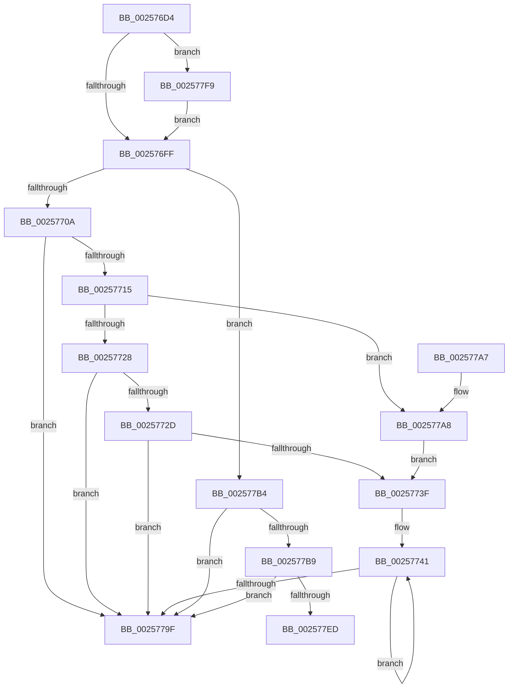

# KzRefreshWorkloadProperties

- RVA: `0x002576D4`–`0x00257804` (길이 `304` bytes)
- VA: `0x00000001402576D4`
- 실행 섹션: `.text`
- PDB 이름 있음: `예`; PDB Function 태그: `예`
- unwind 정보 RVA: `0x00063AC8`
- 디코드: `87`개 명령, `304/304` bytes 표시
- 미해석 바이트: `0` (있으면 어셈블리에 `.byte`로 보존)

> 이 문서는 커널 이미지의 기계어와 PDB 기호를 분석해 생성했습니다. 4번과 5번은 함수 원형과 자료형을 바이너리 사용 방식에서 추정한 C 해석이며 원본 소스 복구 결과는 아닙니다.

## 1. Dependencies

- 직접 호출 지점: **3**; 고유 호출 대상: **3**
- 직접 호출자로 확인된 함수: **1**
- RIP 상대 이미지 참조: **1**

### Outgoing calls
- `0x002576E9` → [KiComputeThreadQos](KiComputeThreadQos_function_00258010.md) (function, `0x00258010`)
- `0x00257790` → [KiUpdateThreadQosGroupingSummaries](KiUpdateThreadQosGroupingSummaries_function_00257AEC.md) (function, `0x00257AEC`)
- `0x002577E0` → [KiPrcbArrayForIsolationWidth](../3F/KiPrcbArrayForIsolationWidth_function_003F5930.md) (function, `0x003F5930`)

### Direct callers
- [sub_0021BAB9](../21/Unknown_function_0021BAB9.md) at `0x0021BB54`

### Static image references
- `0x0025777A` → RVA `0x00FC537C` (`ALMOSTRO`; read)

## 2. Other-region calls and transfers

- 다른 실행 섹션으로 향하는 call: **0**
- call이 아닌 외부 분기/꼬리 이동: **1**
  - `0x002577F4` → [sub_006D8CA4](../6D/Unknown_function_006D8CA4.md) (`tail-transfer`)

## 3. Assembly (complete function range)

```asm
002576D4  4C 89 4C 24 20                  mov qword ptr [rsp + 0x20], r9
002576D9  53                              push rbx
002576DA  56                              push rsi
002576DB  57                              push rdi
002576DC  48 83 EC 30                     sub rsp, 0x30
002576E0  49 8B F8                        mov rdi, r8
002576E3  0F B6 F2                        movzx esi, dl
002576E6  48 8B D9                        mov rbx, rcx
002576E9  E8 22 09 00 00                  call 0x140258010
002576EE  44 0F B6 8B 04 02 00 00         movzx r9d, byte ptr [rbx + 0x204]
002576F6  41 3B C1                        cmp eax, r9d
002576F9  0F 85 FA 00 00 00               jne 0x1402577f9
002576FF  8B D6                           mov edx, esi
00257701  83 EA 02                        sub edx, 2
00257704  0F 85 AA 00 00 00               jne 0x1402577b4
0025770A  48 83 7F 10 00                  cmp qword ptr [rdi + 0x10], 0
0025770F  0F 85 8A 00 00 00               jne 0x14025779f
00257715  8B 4B 78                        mov ecx, dword ptr [rbx + 0x78]
00257718  D1 E9                           shr ecx, 1
0025771A  48 89 7C 24 20                  mov qword ptr [rsp + 0x20], rdi
0025771F  83 E1 01                        and ecx, 1
00257722  0F 84 80 00 00 00               je 0x1402577a8
00257728  83 F9 01                        cmp ecx, 1
0025772B  75 72                           jne 0x14025779f
0025772D  48 8B 87 58 8E 00 00            mov rax, qword ptr [rdi + 0x8e58]
00257734  0F B6 08                        movzx ecx, byte ptr [rax]
00257737  48 8D 78 08                     lea rdi, [rax + 8]
0025773B  85 C9                           test ecx, ecx
0025773D  74 60                           je 0x14025779f
0025773F  8B F1                           mov esi, ecx
00257741  4C 8B 17                        mov r10, qword ptr [rdi]
00257744  8B 53 54                        mov edx, dword ptr [rbx + 0x54]
00257747  44 8B 43 50                     mov r8d, dword ptr [rbx + 0x50]
0025774B  4D 8B 4A 38                     mov r9, qword ptr [r10 + 0x38]
0025774F  41 8A 41 40                     mov al, byte ptr [r9 + 0x40]
00257753  8A C8                           mov cl, al
00257755  32 8B 04 02 00 00               xor cl, byte ptr [rbx + 0x204]
0025775B  80 E1 07                        and cl, 7
0025775E  32 C1                           xor al, cl
00257760  8A 8B 05 02 00 00               mov cl, byte ptr [rbx + 0x205]
00257766  C0 E1 03                        shl cl, 3
00257769  32 C8                           xor cl, al
0025776B  80 E1 38                        and cl, 0x38
0025776E  32 C1                           xor al, cl
00257770  49 8B CA                        mov rcx, r10
00257773  44 3B C2                        cmp r8d, edx
00257776  44 0F 46 C2                     cmovbe r8d, edx
0025777A  44 3B 05 FB DB D6 00            cmp r8d, dword ptr [rip + 0xd6dbfb]
00257781  1A D2                           sbb dl, dl
00257783  24 BF                           and al, 0xbf
00257785  F6 D2                           not dl
00257787  80 E2 40                        and dl, 0x40
0025778A  0A C2                           or al, dl
0025778C  41 88 41 40                     mov byte ptr [r9 + 0x40], al
00257790  E8 57 03 00 00                  call 0x140257aec
00257795  48 8D 7F 08                     lea rdi, [rdi + 8]
00257799  48 83 EE 01                     sub rsi, 1
0025779D  75 A2                           jne 0x140257741
0025779F  48 83 C4 30                     add rsp, 0x30
002577A3  5F                              pop rdi
002577A4  5E                              pop rsi
002577A5  5B                              pop rbx
002577A6  C3                              ret
002577A7  CC                              int3
002577A8  48 8D 7C 24 20                  lea rdi, [rsp + 0x20]
002577AD  B9 01 00 00 00                  mov ecx, 1
002577B2  EB 8B                           jmp 0x14025773f
002577B4  83 FA 01                        cmp edx, 1
002577B7  75 E6                           jne 0x14025779f
002577B9  8B 53 78                        mov edx, dword ptr [rbx + 0x78]
002577BC  4C 8D 4C 24 58                  lea r9, [rsp + 0x58]
002577C1  48 83 64 24 68 00               and qword ptr [rsp + 0x68], 0
002577C7  4C 8D 44 24 68                  lea r8, [rsp + 0x68]
002577CC  83 64 24 58 00                  and dword ptr [rsp + 0x58], 0
002577D1  48 8D 4C 24 50                  lea rcx, [rsp + 0x50]
002577D6  D1 EA                           shr edx, 1
002577D8  83 E2 01                        and edx, 1
002577DB  48 89 7C 24 50                  mov qword ptr [rsp + 0x50], rdi
002577E0  E8 4B E1 19 00                  call 0x1403f5930
002577E5  8B 54 24 58                     mov edx, dword ptr [rsp + 0x58]
002577E9  85 D2                           test edx, edx
002577EB  74 B2                           je 0x14025779f
002577ED  48 8B 7C 24 68                  mov rdi, qword ptr [rsp + 0x68]
002577F2  8B F2                           mov esi, edx
002577F4  E9 AB 14 48 00                  jmp 0x1406d8ca4
002577F9  88 83 04 02 00 00               mov byte ptr [rbx + 0x204], al
002577FF  E9 FB FE FF FF                  jmp 0x1402576ff
```

## 4. C-style interpretation (structured pseudocode)

```c
__int64 __fastcall KzRefreshWorkloadProperties(__int64 a1, unsigned __int8 a2, __int64 a3, __int64 a4)
{
    __int64 result;
    __int64 v_rsi;
    __int64 v_rsp;
    unsigned __int64 v_stack_m28;
    unsigned __int64 v_stack_p20;
    unsigned __int64 v_stack_p50;
    unsigned __int64 v_stack_p58;
    unsigned __int64 v_stack_p68;

    v_stack_p20 = a4;
    v_rsp = (v_rsp) - (48);
    result = KiComputeThreadQos(a1, a2, a3, a4);
    if (((unsigned int)(result)) != ((unsigned int)(*(unsigned __int8 *)(a1 + 516)))) goto loc_002577F9;
loc_002576FF:
    a2 = (unsigned int)(((unsigned int)(a2)) - (2));
    if (condition_is_not_equal) goto loc_002577B4;
    if ((*(unsigned __int64 *)(a3 + 16)) != 0) goto loc_0025779F;
    a1 = (unsigned int)(((unsigned int)(*(unsigned int *)(a1 + 120))) >> (1));
    v_stack_m28 = a3;
    a1 = (unsigned int)((a1) & (1));
    if (condition_is_equal) goto loc_002577A8;
    if (((unsigned int)(a1)) != 1) goto loc_0025779F;
    if ((unsigned int)(*(unsigned __int8 *)(*(unsigned __int64 *)(a3 + 36440))) == 0) goto loc_0025779F;
loc_0025773F:
loc_00257741:
    a1 = (unsigned __int8)(((unsigned __int8)(*(unsigned __int8 *)(*(unsigned __int64 *)(*(unsigned __int64 *)(*(unsigned __int64 *)(a3 + 36440) + 8) + 56) + 64))) ^ (*(unsigned __int8 *)(a1 + 516)));
    a1 = (unsigned __int8)((a1) & (7));
    result = (unsigned __int8)((*(unsigned __int8 *)(*(unsigned __int64 *)(*(unsigned __int64 *)(*(unsigned __int64 *)(a3 + 36440) + 8) + 56) + 64)) ^ ((unsigned __int8)(a1)));
    a1 = (unsigned __int8)((*(unsigned __int8 *)(a1 + 517)) << (3));
    a1 = (unsigned __int8)((a1) ^ ((unsigned __int8)(result)));
    a1 = (unsigned __int8)((a1) & (56));
    result = (unsigned __int8)((result) ^ ((unsigned __int8)(a1)));
    a3 = (unsigned int)(*(unsigned int *)(a1 + 80));
    if (((unsigned int)((unsigned int)(*(unsigned int *)(a1 + 80)))) <= ((unsigned int)((unsigned int)(*(unsigned int *)(a1 + 84))))) { a3 = (unsigned int)((unsigned int)(*(unsigned int *)(a1 + 84))); }
    result = (unsigned __int8)((result) & (191));
    a2 = (unsigned __int8)(~((unsigned int)(*(unsigned int *)(a1 + 84))));
    a2 = (unsigned __int8)((a2) & (64));
    result = (unsigned __int8)((result) | (a2));
    *(unsigned __int8 *)(*(unsigned __int64 *)(*(unsigned __int64 *)(*(unsigned __int64 *)(a3 + 36440) + 8) + 56) + 64) = (unsigned __int8)(result);
    result = KiUpdateThreadQosGroupingSummaries(*(unsigned __int64 *)(*(unsigned __int64 *)(a3 + 36440) + 8), a2, a3, *(unsigned __int64 *)(*(unsigned __int64 *)(*(unsigned __int64 *)(a3 + 36440) + 8) + 56));
    v_rsi = ((unsigned int)((unsigned int)(*(unsigned __int8 *)(*(unsigned __int64 *)(a3 + 36440))))) - (1);
    if (condition_is_not_equal) goto loc_00257741;
loc_0025779F:
    v_rsp = (v_rsp) + (48);
    return result;
loc_002577A8:
    goto loc_0025773F;
loc_002577B4:
    if (a2 != 1) goto loc_0025779F;
    a2 = (unsigned int)(((unsigned int)(*(unsigned int *)(a1 + 120))) >> (1));
    a2 = (unsigned int)((a2) & (1));
    v_stack_p50 = v_stack_p20;
    result = KiPrcbArrayForIsolationWidth(v_stack_p50, a2, v_stack_p68, v_stack_p58);
    if ((unsigned int)((unsigned int)(v_stack_p58)) == 0) goto loc_0025779F;
loc_002577F9:
    *(unsigned __int8 *)(a1 + 516) = (unsigned __int8)(result);
    goto loc_002576FF;
}
```

## 5. (Beta) C Style

```c
int64_t KzRefreshWorkloadProperties(void *Arg1, uint8_t Arg2, void *Arg3, int64_t Arg4)
{
    uint8_t *arg1 = (uint8_t *)Arg1;
    uint8_t *arg3 = (uint8_t *)Arg3;

    int64_t result;
    int64_t local_rsi;
    int64_t local_rsp;
    uint64_t v_stack_m28;
    uint64_t v_stack_p20;
    uint64_t v_stack_p50;
    uint64_t v_stack_p58;
    uint64_t v_stack_p68;

    v_stack_p20 = Arg4;
    local_rsp = (local_rsp) - (48);
    result = KiComputeThreadQos(Arg1, Arg2, Arg3, Arg4);
    if (((uint32_t)(result)) != ((uint32_t)(*(uint8_t *)(arg1 + 0x204)))) goto loc_002577F9;
loc_002576FF:
    Arg2 = (uint32_t)(((uint32_t)(Arg2)) - (2));
    if (condition_is_not_equal) goto loc_002577B4;
    if ((*(uint64_t *)(arg3 + 0x10)) != 0) goto loc_0025779F;
    Arg1 = (uint32_t)(((uint32_t)(*(uint32_t *)(arg1 + 0x78))) >> (1));
    v_stack_m28 = Arg3;
    Arg1 = (uint32_t)((Arg1) & (1));
    if (condition_is_equal) goto loc_002577A8;
    if (((uint32_t)(Arg1)) != 1) goto loc_0025779F;
    if ((uint32_t)(*(uint8_t *)(*(uint64_t *)(arg3 + 0x8E58))) == 0) goto loc_0025779F;
loc_0025773F:
loc_00257741:
    Arg1 = (uint8_t)(((uint8_t)(*(uint8_t *)(*(uint64_t *)(*(uint64_t *)(*(uint64_t *)(arg3 + 0x8E58) + 0x8) + 0x38) + 0x40))) ^ (*(uint8_t *)(arg1 + 0x204)));
    Arg1 = (uint8_t)((Arg1) & (7));
    result = (uint8_t)((*(uint8_t *)(*(uint64_t *)(*(uint64_t *)(*(uint64_t *)(arg3 + 0x8E58) + 0x8) + 0x38) + 0x40)) ^ ((uint8_t)(Arg1)));
    Arg1 = (uint8_t)((*(uint8_t *)(arg1 + 0x205)) << (3));
    Arg1 = (uint8_t)((Arg1) ^ ((uint8_t)(result)));
    Arg1 = (uint8_t)((Arg1) & (56));
    result = (uint8_t)((result) ^ ((uint8_t)(Arg1)));
    Arg3 = (uint32_t)(*(uint32_t *)(arg1 + 0x50));
    if (((uint32_t)((uint32_t)(*(uint32_t *)(arg1 + 0x50)))) <= ((uint32_t)((uint32_t)(*(uint32_t *)(arg1 + 0x54))))) { Arg3 = (uint32_t)((uint32_t)(*(uint32_t *)(arg1 + 0x54))); }
    result = (uint8_t)((result) & (191));
    Arg2 = (uint8_t)(~((uint32_t)(*(uint32_t *)(arg1 + 0x54))));
    Arg2 = (uint8_t)((Arg2) & (64));
    result = (uint8_t)((result) | (Arg2));
    *(uint8_t *)(*(uint64_t *)(*(uint64_t *)(*(uint64_t *)(arg3 + 0x8E58) + 0x8) + 0x38) + 0x40) = (uint8_t)(result);
    result = KiUpdateThreadQosGroupingSummaries(*(uint64_t *)(*(uint64_t *)(arg3 + 0x8E58) + 0x8), Arg2, Arg3, *(uint64_t *)(*(uint64_t *)(*(uint64_t *)(arg3 + 0x8E58) + 0x8) + 0x38));
    local_rsi = ((uint32_t)((uint32_t)(*(uint8_t *)(*(uint64_t *)(arg3 + 0x8E58))))) - (1);
    if (condition_is_not_equal) goto loc_00257741;
loc_0025779F:
    local_rsp = (local_rsp) + (48);
    return result;
loc_002577A8:
    goto loc_0025773F;
loc_002577B4:
    if (Arg2 != 1) goto loc_0025779F;
    Arg2 = (uint32_t)(((uint32_t)(*(uint32_t *)(arg1 + 0x78))) >> (1));
    Arg2 = (uint32_t)((Arg2) & (1));
    v_stack_p50 = v_stack_p20;
    result = KiPrcbArrayForIsolationWidth(v_stack_p50, Arg2, v_stack_p68, v_stack_p58);
    if ((uint32_t)((uint32_t)(v_stack_p58)) == 0) goto loc_0025779F;
loc_002577F9:
    *(uint8_t *)(arg1 + 0x204) = (uint8_t)(result);
    goto loc_002576FF;
}
```

### 관측된 메모리 오프셋

구조체 형식이 확인되지 않은 접근은 인자 기준의 오프셋으로만 기록했습니다.

| 기준 인자 | 오프셋 표현 | 폭 (bit) | 접근 |
|---|---:|---:|---|
| `Arg1` | `+ 0x50` | `32` | `R` |
| `Arg1` | `+ 0x54` | `32` | `R` |
| `Arg1` | `+ 0x78` | `32` | `R` |
| `Arg1` | `+ 0x204` | `8` | `R` |
| `Arg1` | `+ 0x204` | `8` | `W` |
| `Arg1` | `+ 0x205` | `8` | `R` |
| `Arg3` | `+ 0x10` | `64` | `R` |
| `Arg3` | `+ 0x8E58` | `64` | `R` |

## 6. Execution-region graph

[열기: 2D/3D 그래프와 함수 탐색 컨트롤 패널](../../../control-panel.html?section=text&rva=0x002576D4&view=graph)

- 2D 그래프는 위에서 아래로 흐르고, 3D 그래프는 빈 공간을 드래그해 회전합니다. Shift+드래그는 이동, 휠은 확대·축소, 함수 노드 선택은 대상 보고서 이동입니다.

### Static fallback


