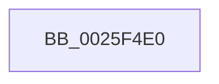

# SepMandatoryIntegrityCheck

- RVA: `0x0025F4E0`–`0x0025F532` (길이 `82` bytes)
- VA: `0x000000014025F4E0`
- 실행 섹션: `.text`
- PDB 이름 있음: `예`; PDB Function 태그: `아니요`
- unwind 정보 RVA: `0x000641D0`
- 디코드: `22`개 명령, `82/82` bytes 표시
- 미해석 바이트: `0` (있으면 어셈블리에 `.byte`로 보존)

> 이 문서는 커널 이미지의 기계어와 PDB 기호를 분석해 생성했습니다. 4번과 5번은 함수 원형과 자료형을 바이너리 사용 방식에서 추정한 C 해석이며 원본 소스 복구 결과는 아닙니다.

## 1. Dependencies

- 직접 호출 지점: **0**; 고유 호출 대상: **0**
- 직접 호출자로 확인된 함수: **4**
- RIP 상대 이미지 참조: **1**

### Outgoing calls
- 직접 디코드된 call 명령이 없습니다.

### Direct callers
- [SeAccessCheckWithHint](../3A/SeAccessCheckWithHint_function_003A6C30.md) at `0x003A6EDE`
- [SeAccessCheckByType](../44/SeAccessCheckByType_function_00440BC8.md) at `0x0044131A`
- [SepCommonAccessCheckEx](../47/SepCommonAccessCheckEx_function_0047602C.md) at `0x004764F6`
- [SepAccessCheckAndAuditAlarm](../../page/A1/SepAccessCheckAndAuditAlarm_function_00A1AF4C.md) at `0x00A1B917`

### Static image references
- `0x0025F4ED` → RVA `0x00E0A740` (`.data`; read)

## 2. Other-region calls and transfers

- 다른 실행 섹션으로 향하는 call: **0**
- call이 아닌 외부 분기/꼬리 이동: **1**
  - `0x0025F52C` → [sub_0025F7EA](Unknown_function_0025F7EA.md) (`tail-transfer`)

## 3. Assembly (complete function range)

```asm
0025F4E0  4C 8B DC                        mov r11, rsp
0025F4E3  53                              push rbx
0025F4E4  55                              push rbp
0025F4E5  56                              push rsi
0025F4E6  57                              push rdi
0025F4E7  41 57                           push r15
0025F4E9  48 83 EC 70                     sub rsp, 0x70
0025F4ED  48 8B 05 4C B2 BA 00            mov rax, qword ptr [rip + 0xbab24c]
0025F4F4  48 33 C4                        xor rax, rsp
0025F4F7  48 89 44 24 60                  mov qword ptr [rsp + 0x60], rax
0025F4FC  41 8B 81 D4 00 00 00            mov eax, dword ptr [r9 + 0xd4]
0025F503  33 F6                           xor esi, esi
0025F505  48 8B 9C 24 C8 00 00 00         mov rbx, qword ptr [rsp + 0xc8]
0025F50D  40 32 ED                        xor bpl, bpl
0025F510  45 32 FF                        xor r15b, r15b
0025F513  4C 89 4C 24 40                  mov qword ptr [rsp + 0x40], r9
0025F518  48 89 4C 24 48                  mov qword ptr [rsp + 0x48], rcx
0025F51D  8B FE                           mov edi, esi
0025F51F  40 88 74 24 30                  mov byte ptr [rsp + 0x30], sil
0025F524  89 43 08                        mov dword ptr [rbx + 8], eax
0025F527  A9 FD FF FF FF                  test eax, 0xfffffffd
0025F52C  0F 84 B8 02 00 00               je 0x14025f7ea
```

## 4. C-style interpretation (structured pseudocode)

```c
__int64 __fastcall SepMandatoryIntegrityCheck(__int64 a1, __int64 a2, __int64 a3, __int64 a4, __int64 a5, __int64 a6)
{
    __int64 result;
    __int64 v_r15;
    __int64 v_rbp;
    __int64 v_rsi;
    __int64 v_rsp;
    unsigned __int64 v_stack_m38;
    unsigned __int64 v_stack_m50;
    unsigned __int64 v_stack_m58;
    unsigned __int8 v_stack_m68;

    v_rsp = (v_rsp) - (112);
    result = (*(unsigned __int64 *)(v_rip + 12235340)) ^ (v_rsp);
    v_stack_m38 = result;
    v_rsi = 0;
    v_rbp = 0;
    v_r15 = 0;
    v_stack_m58 = a4;
    v_stack_m50 = a1;
    v_stack_m68 = 0;
    *(unsigned int *)(a6 + 8) = (unsigned int)((unsigned int)(*(unsigned int *)(a4 + 212)));
}
```

## 5. (Beta) C Style

```c
int64_t SepMandatoryIntegrityCheck(int64_t Arg1, int64_t Arg2, int64_t Arg3, void *Arg4, uint64_t Arg5, void *Arg6)
{
    uint8_t *arg4 = (uint8_t *)Arg4;
    uint8_t *arg6 = (uint8_t *)Arg6;

    int64_t result;
    int64_t local_r15;
    int64_t local_rbp;
    int64_t local_rsi;
    int64_t local_rsp;
    uint64_t v_stack_m38;
    uint64_t v_stack_m50;
    uint64_t v_stack_m58;
    uint8_t v_stack_m68;

    local_rsp = (local_rsp) - (112);
    result = (*(uint64_t *)(v_rip + 0xBAB24C)) ^ (local_rsp);
    v_stack_m38 = result;
    local_rsi = 0;
    local_rbp = 0;
    local_r15 = 0;
    v_stack_m58 = Arg4;
    v_stack_m50 = Arg1;
    v_stack_m68 = 0;
    *(uint32_t *)(arg6 + 0x8) = (uint32_t)((uint32_t)(*(uint32_t *)(arg4 + 0xD4)));
}
```

### 관측된 메모리 오프셋

구조체 형식이 확인되지 않은 접근은 인자 기준의 오프셋으로만 기록했습니다.

| 기준 인자 | 오프셋 표현 | 폭 (bit) | 접근 |
|---|---:|---:|---|
| `Arg4` | `+ 0xD4` | `32` | `R` |
| `Arg6` | `+ 0x8` | `32` | `W` |

## 6. Execution-region graph

[열기: 2D/3D 그래프와 함수 탐색 컨트롤 패널](../../../control-panel.html?section=text&rva=0x0025F4E0&view=graph)

- 2D 그래프는 위에서 아래로 흐르고, 3D 그래프는 빈 공간을 드래그해 회전합니다. Shift+드래그는 이동, 휠은 확대·축소, 함수 노드 선택은 대상 보고서 이동입니다.

### Static fallback


