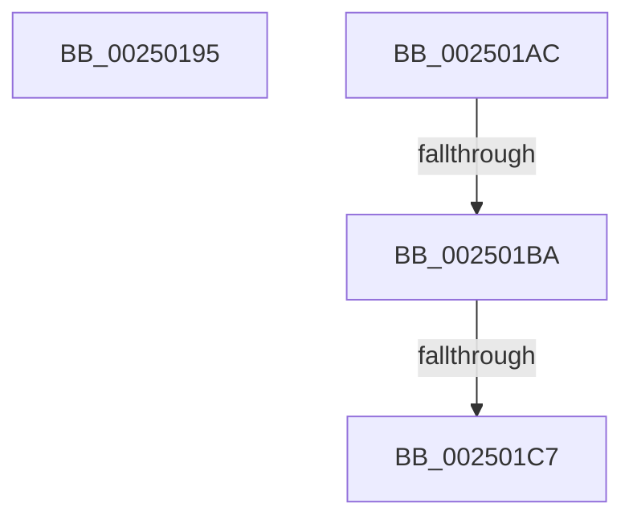

# sub_00250195

- RVA: `0x00250195`–`0x002501D3` (길이 `62` bytes)
- VA: `0x0000000140250195`
- 실행 섹션: `.text`
- PDB 이름 있음: `아니요`; PDB Function 태그: `아니요`
- unwind 정보 RVA: `0x00063374`
- 디코드: `13`개 명령, `62/62` bytes 표시
- 미해석 바이트: `0` (있으면 어셈블리에 `.byte`로 보존)

> 이 문서는 커널 이미지의 기계어와 PDB 기호를 분석해 생성했습니다. 4번과 5번은 함수 원형과 자료형을 바이너리 사용 방식에서 추정한 C 해석이며 원본 소스 복구 결과는 아닙니다.

## 1. Dependencies

- 직접 호출 지점: **2**; 고유 호출 대상: **2**
- 직접 호출자로 확인된 함수: **0**
- RIP 상대 이미지 참조: **1**

### Outgoing calls
- `0x002501BA` → [KiCheckVpBackingLongSpinWaitHypercall](../30/KiCheckVpBackingLongSpinWaitHypercall_function_0030F490.md) (function, `0x0030F490`)
- `0x002501C9` → [HvlNotifyLongSpinWait](../30/HvlNotifyLongSpinWait_function_0030F460.md) (function, `0x0030F460`)

### Direct callers
- 이 함수 시작 RVA로 연결되는 직접 call은 확인되지 않았습니다. 간접 호출은 완전히 역산할 수 없습니다.

### Static image references
- `0x002501AC` → RVA `0x00FC6AB8` (`ALMOSTRO`; read)

## 2. Other-region calls and transfers

- 다른 실행 섹션으로 향하는 call: **0**
- call이 아닌 외부 분기/꼬리 이동: **4**
  - `0x002501A7` → [sub_0024FEBE + 0x24C](../24/Unknown_function_0024FEBE.md) (`tail-transfer`)
  - `0x002501B4` → [sub_0024FEBE + 0x1ED](../24/Unknown_function_0024FEBE.md) (`tail-transfer`)
  - `0x002501C1` → [sub_0024FEBE + 0x1ED](../24/Unknown_function_0024FEBE.md) (`tail-transfer`)
  - `0x002501CE` → [sub_0024FEBE + 0x1EF](../24/Unknown_function_0024FEBE.md) (`tail-transfer`)

## 3. Assembly (complete function range)

```asm
00250195  48 8B 84 24 98 00 00 00         mov rax, qword ptr [rsp + 0x98]
0025019D  8B AC 24 A8 00 00 00            mov ebp, dword ptr [rsp + 0xa8]
002501A4  4C 89 20                        mov qword ptr [rax], r12
002501A7  E9 5E FF FF FF                  jmp 0x14025010a
002501AC  8B 05 06 69 D7 00               mov eax, dword ptr [rip + 0xd76906]
002501B2  A8 40                           test al, 0x40
002501B4  0F 84 F1 FE FF FF               je 0x1402500ab
002501BA  E8 D1 F2 0B 00                  call 0x14030f490
002501BF  84 C0                           test al, al
002501C1  0F 84 E4 FE FF FF               je 0x1402500ab
002501C7  8B CD                           mov ecx, ebp
002501C9  E8 92 F2 0B 00                  call 0x14030f460
002501CE  E9 DA FE FF FF                  jmp 0x1402500ad
```

## 4. C-style interpretation (structured pseudocode)

```c
__int64 __fastcall sub_00250195(__int64 a1, __int64 a2, __int64 a3, __int64 a4, __int64 a5, __int64 a6, __int64 a7, __int64 a8, __int64 a9, __int64 a10, __int64 a11, __int64 a12, __int64 a13, __int64 a14, __int64 a15, __int64 a16, __int64 a17, __int64 a18, __int64 a19, __int64 a20, unsigned int a21)
{
    *(unsigned __int64 *)(a19) = v_r12;
}
```

## 5. (Beta) C Style

```c
int64_t sub_00250195(int64_t Arg1, int64_t Arg2, int64_t Arg3, int64_t Arg4, uint64_t Arg5, uint64_t Arg6, uint64_t Arg7, uint64_t Arg8, uint64_t Arg9, uint64_t Arg10, uint64_t Arg11, uint64_t Arg12, uint64_t Arg13, uint64_t Arg14, uint64_t Arg15, uint64_t Arg16, uint64_t Arg17, uint64_t Arg18, void *Arg19, uint64_t Arg20, uint32_t Arg21)
{
    uint8_t *arg19 = (uint8_t *)Arg19;

    *(uint64_t *)(arg19) = local_r12;
}
```

### 관측된 메모리 오프셋

구조체 형식이 확인되지 않은 접근은 인자 기준의 오프셋으로만 기록했습니다.

| 기준 인자 | 오프셋 표현 | 폭 (bit) | 접근 |
|---|---:|---:|---|
| `Arg19` | `+ 0x0` | `64` | `W` |

## 6. Execution-region graph

[열기: 2D/3D 그래프와 함수 탐색 컨트롤 패널](../../../control-panel.html?section=text&rva=0x00250195&view=graph)

- 2D 그래프는 위에서 아래로 흐르고, 3D 그래프는 빈 공간을 드래그해 회전합니다. Shift+드래그는 이동, 휠은 확대·축소, 함수 노드 선택은 대상 보고서 이동입니다.

### Static fallback


