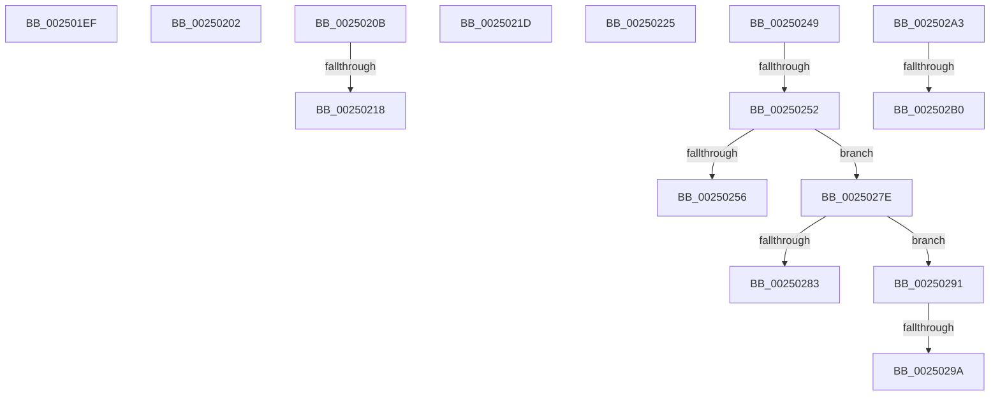

# sub_002501EF

- RVA: `0x002501EF`–`0x002502C3` (길이 `212` bytes)
- VA: `0x00000001402501EF`
- 실행 섹션: `.text`
- PDB 이름 있음: `아니요`; PDB Function 태그: `아니요`
- unwind 정보 RVA: `0x00063398`
- 디코드: `53`개 명령, `212/212` bytes 표시
- 미해석 바이트: `0` (있으면 어셈블리에 `.byte`로 보존)

> 이 문서는 커널 이미지의 기계어와 PDB 기호를 분석해 생성했습니다. 4번과 5번은 함수 원형과 자료형을 바이너리 사용 방식에서 추정한 C 해석이며 원본 소스 복구 결과는 아닙니다.

## 1. Dependencies

- 직접 호출 지점: **1**; 고유 호출 대상: **1**
- 직접 호출자로 확인된 함수: **0**
- RIP 상대 이미지 참조: **0**

### Outgoing calls
- `0x00250231` → [KiCompleteDirectSwitchThread](../3F/KiCompleteDirectSwitchThread_function_003FFE1C.md) (function, `0x003FFE1C`)

### Direct callers
- 이 함수 시작 RVA로 연결되는 직접 call은 확인되지 않았습니다. 간접 호출은 완전히 역산할 수 없습니다.

### Static image references
- 디코드된 RIP-relative 메모리 참조가 없습니다.

## 2. Other-region calls and transfers

- 다른 실행 섹션으로 향하는 call: **0**
- call이 아닌 외부 분기/꼬리 이동: **13**
  - `0x002501FD` → [sub_0024FEBE + 0x268](../24/Unknown_function_0024FEBE.md) (`tail-transfer`)
  - `0x00250206` → [sub_0024FEBE + 0x127](../24/Unknown_function_0024FEBE.md) (`tail-transfer`)
  - `0x00250212` → [sub_0024FEBE + 0x7C](../24/Unknown_function_0024FEBE.md) (`tail-transfer`)
  - `0x00250218` → [sub_0024FEBE + 0x203](../24/Unknown_function_0024FEBE.md) (`tail-transfer`)
  - `0x00250220` → [sub_0024FEBE + 0x41](../24/Unknown_function_0024FEBE.md) (`tail-transfer`)
  - `0x00250244` → [sub_0024FEBE + 0x26D](../24/Unknown_function_0024FEBE.md) (`tail-transfer`)
  - `0x0025024C` → [sub_0024FEBE + 0xCD](../24/Unknown_function_0024FEBE.md) (`tail-transfer`)
  - `0x00250279` → [sub_0024FEBE + 0x161](../24/Unknown_function_0024FEBE.md) (`tail-transfer`)
  - `0x0025028C` → [sub_0024FEBE + 0x164](../24/Unknown_function_0024FEBE.md) (`tail-transfer`)
  - `0x00250294` → [sub_0024FEBE + 0x164](../24/Unknown_function_0024FEBE.md) (`tail-transfer`)
  - `0x0025029E` → [sub_0024FEBE + 0x164](../24/Unknown_function_0024FEBE.md) (`tail-transfer`)
  - `0x002502AA` → [sub_0024FEBE + 0xA5](../24/Unknown_function_0024FEBE.md) (`tail-transfer`)
  - `0x002502BE` → [sub_0024FEBE + 0x237](../24/Unknown_function_0024FEBE.md) (`tail-transfer`)

## 3. Assembly (complete function range)

```asm
002501EF  C1 ED 02                        shr ebp, 2
002501F2  F7 D5                           not ebp
002501F4  83 E5 02                        and ebp, 2
002501F7  83 CD 01                        or ebp, 1
002501FA  44 8B E5                        mov r12d, ebp
002501FD  E9 24 FF FF FF                  jmp 0x140250126
00250202  83 4B 74 02                     or dword ptr [rbx + 0x74], 2
00250206  E9 DA FD FF FF                  jmp 0x14024ffe5
0025020B  80 BB 83 02 00 00 0F            cmp byte ptr [rbx + 0x283], 0xf
00250212  0F 85 22 FD FF FF               jne 0x14024ff3a
00250218  E9 A4 FE FF FF                  jmp 0x1402500c1
0025021D  40 B7 01                        mov dil, 1
00250220  E9 DA FC FF FF                  jmp 0x14024feff
00250225  48 8B 5C 24 30                  mov rbx, qword ptr [rsp + 0x30]
0025022A  48 8B CB                        mov rcx, rbx
0025022D  48 8B 53 08                     mov rdx, qword ptr [rbx + 8]
00250231  E8 E6 FB 1A 00                  call 0x1403ffe1c
00250236  C1 ED 02                        shr ebp, 2
00250239  F7 D5                           not ebp
0025023B  83 E5 02                        and ebp, 2
0025023E  83 CD 04                        or ebp, 4
00250241  44 8B E5                        mov r12d, ebp
00250244  E9 E2 FE FF FF                  jmp 0x14025012b
00250249  83 F8 04                        cmp eax, 4
0025024C  0F 84 39 FD FF FF               je 0x14024ff8b
00250252  85 C0                           test eax, eax
00250254  75 28                           jne 0x14025027e
00250256  48 8B 84 24 98 00 00 00         mov rax, qword ptr [rsp + 0x98]
0025025E  80 E1 FA                        and cl, 0xfa
00250261  80 C9 02                        or cl, 2
00250264  88 4B 70                        mov byte ptr [rbx + 0x70], cl
00250267  48 89 83 C8 00 00 00            mov qword ptr [rbx + 0xc8], rax
0025026E  4C 89 A3 D0 03 00 00            mov qword ptr [rbx + 0x3d0], r12
00250275  C6 47 11 00                     mov byte ptr [rdi + 0x11], 0
00250279  E9 A1 FD FF FF                  jmp 0x14025001f
0025027E  83 F8 05                        cmp eax, 5
00250281  75 0E                           jne 0x140250291
00250283  80 E1 FE                        and cl, 0xfe
00250286  80 C9 06                        or cl, 6
00250289  88 4B 70                        mov byte ptr [rbx + 0x70], cl
0025028C  E9 91 FD FF FF                  jmp 0x140250022
00250291  83 F8 03                        cmp eax, 3
00250294  0F 85 88 FD FF FF               jne 0x140250022
0025029A  C6 47 11 02                     mov byte ptr [rdi + 0x11], 2
0025029E  E9 7F FD FF FF                  jmp 0x140250022
002502A3  48 8B 10                        mov rdx, qword ptr [rax]
002502A6  48 39 42 08                     cmp qword ptr [rdx + 8], rax
002502AA  0F 85 B3 FC FF FF               jne 0x14024ff63
002502B0  49 89 17                        mov qword ptr [r15], rdx
002502B3  49 89 47 08                     mov qword ptr [r15 + 8], rax
002502B7  4C 89 7A 08                     mov qword ptr [rdx + 8], r15
002502BB  4C 89 38                        mov qword ptr [rax], r15
002502BE  E9 32 FE FF FF                  jmp 0x1402500f5
```

## 4. C-style interpretation (structured pseudocode)

```c
__int64 __fastcall sub_002501EF(void)
{
    __int64 v_rbp;
    unsigned __int64 v_stack_p30;
    unsigned __int64 v_stack_p98;

    v_rbp = (unsigned int)((v_rbp) >> (2));
    v_rbp = (unsigned int)(~(v_rbp));
    v_rbp = (unsigned int)((v_rbp) & (2));
    v_rbp = (unsigned int)((v_rbp) | (1));
}
```

## 5. (Beta) C Style

```c
void sub_002501EF(void)
{
    int64_t local_rbp;
    uint64_t v_stack_p30;
    uint64_t v_stack_p98;

    local_rbp = (uint32_t)((local_rbp) >> (2));
    local_rbp = (uint32_t)(~(local_rbp));
    local_rbp = (uint32_t)((local_rbp) & (2));
    local_rbp = (uint32_t)((local_rbp) | (1));
}
```

## 6. Execution-region graph

[열기: 2D/3D 그래프와 함수 탐색 컨트롤 패널](../../../control-panel.html?section=text&rva=0x002501EF&view=graph)

- 2D 그래프는 위에서 아래로 흐르고, 3D 그래프는 빈 공간을 드래그해 회전합니다. Shift+드래그는 이동, 휠은 확대·축소, 함수 노드 선택은 대상 보고서 이동입니다.

### Static fallback


