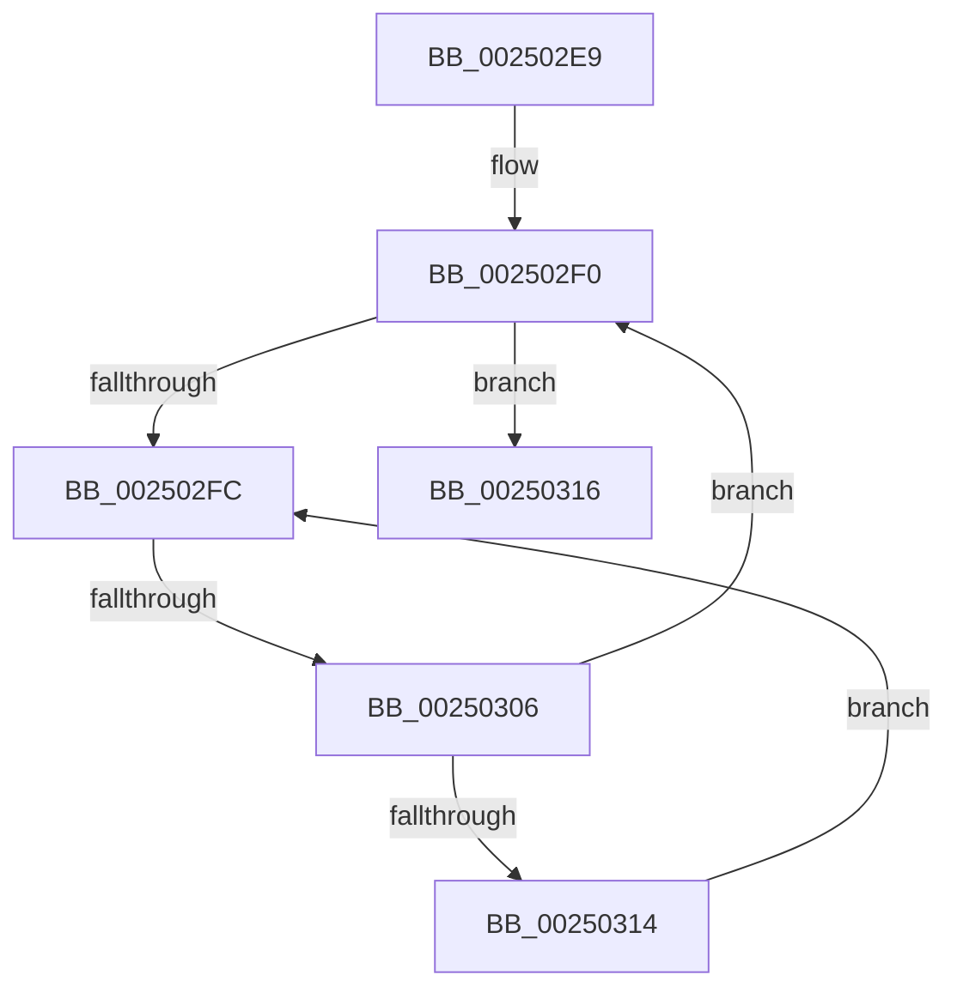

# sub_002502E9

- RVA: `0x002502E9`–`0x00250327` (길이 `62` bytes)
- VA: `0x00000001402502E9`
- 실행 섹션: `.text`
- PDB 이름 있음: `아니요`; PDB Function 태그: `아니요`
- unwind 정보 RVA: `0x000633B8`
- 디코드: `16`개 명령, `62/62` bytes 표시
- 미해석 바이트: `0` (있으면 어셈블리에 `.byte`로 보존)

> 이 문서는 커널 이미지의 기계어와 PDB 기호를 분석해 생성했습니다. 4번과 5번은 함수 원형과 자료형을 바이너리 사용 방식에서 추정한 C 해석이며 원본 소스 복구 결과는 아닙니다.

## 1. Dependencies

- 직접 호출 지점: **0**; 고유 호출 대상: **0**
- 직접 호출자로 확인된 함수: **0**
- RIP 상대 이미지 참조: **1**

### Outgoing calls
- 직접 디코드된 call 명령이 없습니다.

### Direct callers
- 이 함수 시작 RVA로 연결되는 직접 call은 확인되지 않았습니다. 간접 호출은 완전히 역산할 수 없습니다.

### Static image references
- `0x002502FE` → RVA `0x00FC52AC` (`ALMOSTRO`; reference)

## 2. Other-region calls and transfers

- 다른 실행 섹션으로 향하는 call: **0**
- call이 아닌 외부 분기/꼬리 이동: **2**
  - `0x00250304` → [sub_0025036E](Unknown_function_0025036E.md) (`tail-transfer`)
  - `0x00250325` → [sub_00250327 + 0x32](Unknown_function_00250327.md) (`tail-transfer`)

## 3. Assembly (complete function range)

```asm
002502E9  48 89 74 24 30                  mov qword ptr [rsp + 0x30], rsi
002502EE  33 F6                           xor esi, esi
002502F0  F0 48 0F BA AB D0 83 00 00 00   lock bts qword ptr [rbx + 0x83d0], 0
002502FA  73 1A                           jae 0x140250316
002502FC  FF C6                           inc esi
002502FE  85 35 A8 4F D7 00               test dword ptr [rip + 0xd74fa8], esi
00250304  74 68                           je 0x14025036e
00250306  F3 90                           pause
00250308  48 8B 83 D0 83 00 00            mov rax, qword ptr [rbx + 0x83d0]
0025030F  48 85 C0                        test rax, rax
00250312  74 DC                           je 0x1402502f0
00250314  EB E6                           jmp 0x1402502fc
00250316  48 8B 87 C8 02 00 00            mov rax, qword ptr [rdi + 0x2c8]
0025031D  48 8B 74 24 30                  mov rsi, qword ptr [rsp + 0x30]
00250322  48 85 C0                        test rax, rax
00250325  74 32                           je 0x140250359
```

## 4. C-style interpretation (structured pseudocode)

```c
__int64 __fastcall sub_002502E9(__int64 a1, __int64 a2, __int64 a3, __int64 a4, __int64 a5, __int64 a6)
{
    __int64 v_rsi;
    unsigned __int64 v_stack_p30;

    v_stack_p30 = v_rsi;
    v_rsi = 0;
loc_002502F0:
    if (condition_is_above_or_equal) goto loc_00250316;
loc_002502FC:
    v_rsi = (unsigned int)((v_rsi) + 1);
    if (*(unsigned __int64 *)(v_rbx + 33744) == 0) goto loc_002502F0;
    goto loc_002502FC;
loc_00250316:
}
```

## 5. (Beta) C Style

```c
int64_t sub_002502E9(int64_t Arg1, int64_t Arg2, int64_t Arg3, int64_t Arg4, uint64_t Arg5, int64_t Arg6)
{
    int64_t local_rsi;
    uint64_t v_stack_p30;

    v_stack_p30 = local_rsi;
    local_rsi = 0;
loc_002502F0:
    if (condition_is_above_or_equal) goto loc_00250316;
loc_002502FC:
    local_rsi = (uint32_t)((local_rsi) + 1);
    if (*(uint64_t *)(local_rbx + 0x83D0) == 0) goto loc_002502F0;
    goto loc_002502FC;
loc_00250316:
}
```

## 6. Execution-region graph

[열기: 2D/3D 그래프와 함수 탐색 컨트롤 패널](../../../control-panel.html?section=text&rva=0x002502E9&view=graph)

- 2D 그래프는 위에서 아래로 흐르고, 3D 그래프는 빈 공간을 드래그해 회전합니다. Shift+드래그는 이동, 휠은 확대·축소, 함수 노드 선택은 대상 보고서 이동입니다.

### Static fallback


