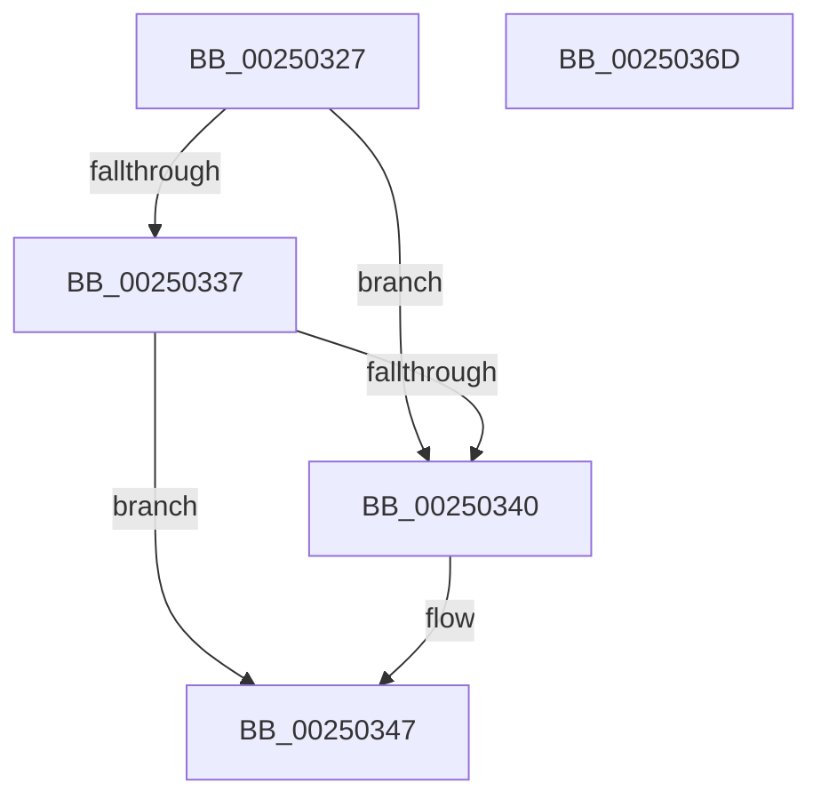

# sub_00250327

- RVA: `0x00250327`–`0x0025036E` (길이 `71` bytes)
- VA: `0x0000000140250327`
- 실행 섹션: `.text`
- PDB 이름 있음: `아니요`; PDB Function 태그: `아니요`
- unwind 정보 RVA: `0x000633CC`
- 디코드: `18`개 명령, `71/71` bytes 표시
- 미해석 바이트: `0` (있으면 어셈블리에 `.byte`로 보존)

> 이 문서는 커널 이미지의 기계어와 PDB 기호를 분석해 생성했습니다. 4번과 5번은 함수 원형과 자료형을 바이너리 사용 방식에서 추정한 C 해석이며 원본 소스 복구 결과는 아닙니다.

## 1. Dependencies

- 직접 호출 지점: **0**; 고유 호출 대상: **0**
- 직접 호출자로 확인된 함수: **0**
- RIP 상대 이미지 참조: **0**

### Outgoing calls
- 직접 디코드된 call 명령이 없습니다.

### Direct callers
- 이 함수 시작 RVA로 연결되는 직접 call은 확인되지 않았습니다. 간접 호출은 완전히 역산할 수 없습니다.

### Static image references
- 디코드된 RIP-relative 메모리 참조가 없습니다.

## 2. Other-region calls and transfers

- 다른 실행 섹션으로 향하는 call: **0**
- 별도 외부 분기/꼬리 이동을 확인하지 못했습니다.

## 3. Assembly (complete function range)

```asm
00250327  48 8D 87 D8 00 00 00            lea rax, [rdi + 0xd8]
0025032E  48 8B 08                        mov rcx, qword ptr [rax]
00250331  48 39 41 08                     cmp qword ptr [rcx + 8], rax
00250335  75 09                           jne 0x140250340
00250337  48 8B 50 08                     mov rdx, qword ptr [rax + 8]
0025033B  48 39 02                        cmp qword ptr [rdx], rax
0025033E  74 07                           je 0x140250347
00250340  B9 03 00 00 00                  mov ecx, 3
00250345  CD 29                           int 0x29
00250347  48 89 0A                        mov qword ptr [rdx], rcx
0025034A  48 89 51 08                     mov qword ptr [rcx + 8], rdx
0025034E  48 C7 87 C8 02 00 00 00 00 00 00  mov qword ptr [rdi + 0x2c8], 0
00250359  F0 48 83 A3 D0 83 00 00 00      lock and qword ptr [rbx + 0x83d0], 0
00250362  48 8B 5C 24 38                  mov rbx, qword ptr [rsp + 0x38]
00250367  48 83 C4 20                     add rsp, 0x20
0025036B  5F                              pop rdi
0025036C  C3                              ret
0025036D  CC                              int3
```

## 4. C-style interpretation (structured pseudocode)

```c
__int64 __fastcall sub_00250327(__int64 a1, __int64 a2, __int64 a3, __int64 a4, __int64 a5, __int64 a6, __int64 a7)
{
    __int64 v_rsp;

    if ((*(unsigned __int64 *)(*(unsigned __int64 *)(v_rdi + 216) + 8)) != (v_rdi + 216)) goto loc_00250340;
    if ((*(unsigned __int64 *)(*(unsigned __int64 *)(v_rdi + 216 + 8))) != (v_rdi + 216)) {
        a1 = 3;
    }
    *(unsigned __int64 *)(*(unsigned __int64 *)(v_rdi + 216 + 8)) = a1;
    *(unsigned __int64 *)(a1 + 8) = *(unsigned __int64 *)(v_rdi + 216 + 8);
    *(unsigned __int64 *)(v_rdi + 712) = 0;
    v_rsp = (v_rsp) + (32);
    return v_rdi + 216;
}
```

## 5. (Beta) C Style

```c
int64_t sub_00250327(int64_t Arg1, int64_t Arg2, int64_t Arg3, int64_t Arg4, uint64_t Arg5, uint64_t Arg6, int64_t Arg7)
{
    int64_t local_rsp;

    if ((*(uint64_t *)(*(uint64_t *)(local_rdi + 0xD8) + 0x8)) != (local_rdi + 216)) goto loc_00250340;
    if ((*(uint64_t *)(*(uint64_t *)(local_rdi + 0xD8 + 0x8))) != (local_rdi + 216)) {
        Arg1 = 3;
    }
    *(uint64_t *)(*(uint64_t *)(local_rdi + 0xD8 + 0x8)) = Arg1;
    *(uint64_t *)(Arg1 + 0x8) = *(uint64_t *)(local_rdi + 0xD8 + 0x8);
    *(uint64_t *)(local_rdi + 0x2C8) = 0;
    local_rsp = (local_rsp) + (32);
    return local_rdi + 216;
}
```

## 6. Execution-region graph

[열기: 2D/3D 그래프와 함수 탐색 컨트롤 패널](../../../control-panel.html?section=text&rva=0x00250327&view=graph)

- 2D 그래프는 위에서 아래로 흐르고, 3D 그래프는 빈 공간을 드래그해 회전합니다. Shift+드래그는 이동, 휠은 확대·축소, 함수 노드 선택은 대상 보고서 이동입니다.

### Static fallback


