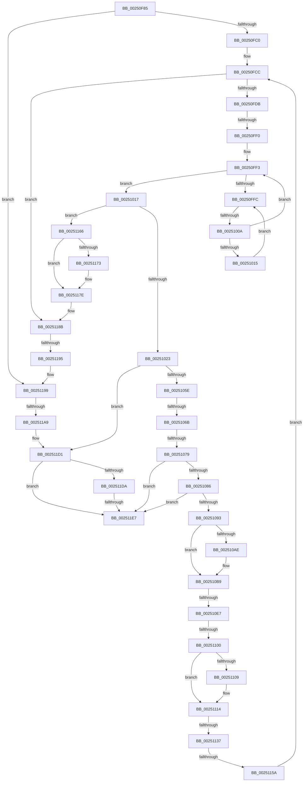

# sub_00250F85

- RVA: `0x00250F85`–`0x002511EE` (길이 `617` bytes)
- VA: `0x0000000140250F85`
- 실행 섹션: `.text`
- PDB 이름 있음: `아니요`; PDB Function 태그: `아니요`
- unwind 정보 RVA: `0x00063494`
- 디코드: `134`개 명령, `617/617` bytes 표시
- 미해석 바이트: `0` (있으면 어셈블리에 `.byte`로 보존)

> 이 문서는 커널 이미지의 기계어와 PDB 기호를 분석해 생성했습니다. 4번과 5번은 함수 원형과 자료형을 바이너리 사용 방식에서 추정한 C 해석이며 원본 소스 복구 결과는 아닙니다.

## 1. Dependencies

- 직접 호출 지점: **6**; 고유 호출 대상: **4**
- 직접 호출자로 확인된 함수: **0**
- RIP 상대 이미지 참조: **4**

### Outgoing calls
- `0x002510B4` → [KiLowerIrqlProcessIrqlFlags](../4F/KiLowerIrqlProcessIrqlFlags_function_004F5698.md) (function, `0x004F5698`)
- `0x002510F0` → [EtwpApcPoolThunk](../2F/EtwpApcPoolThunk_function_002FA090.md) (function, `0x002FA090`)
- `0x0025110F` → [KiLowerIrqlProcessIrqlFlags](../4F/KiLowerIrqlProcessIrqlFlags_function_004F5698.md) (function, `0x004F5698`)
- `0x0025113B` → [KiSchedulerApc](../20/KiSchedulerApc_function_00202BC0.md) (function, `0x00202BC0`)
- `0x00251179` → [KiLowerIrqlProcessIrqlFlags](../4F/KiLowerIrqlProcessIrqlFlags_function_004F5698.md) (function, `0x004F5698`)
- `0x002511CB` → [KeBugCheckEx](../4F/KeBugCheckEx_function_004FD660.md) (function, `0x004FD660`)

### Direct callers
- 이 함수 시작 RVA로 연결되는 직접 call은 확인되지 않았습니다. 간접 호출은 완전히 역산할 수 없습니다.

### Static image references
- `0x00250FE3` → RVA `0x00FC6D20` (`ALMOSTRO`; read)
- `0x00250FFE` → RVA `0x00FC52AC` (`ALMOSTRO`; reference)
- `0x002510CC` → RVA `0x002FA090` (`EtwpApcPoolThunk`; read)
- `0x0025111F` → RVA `0x00202BC0` (`KiSchedulerApc`; read)

## 2. Other-region calls and transfers

- 다른 실행 섹션으로 향하는 call: **0**
- call이 아닌 외부 분기/꼬리 이동: **11**
  - `0x00250FEA` → [sub_00251225 + 0x194](Unknown_function_00251225.md) (`tail-transfer`)
  - `0x00251004` → [sub_002514A5](Unknown_function_002514A5.md) (`tail-transfer`)
  - `0x00251065` → [sub_00251225 + 0x16B](Unknown_function_00251225.md) (`tail-transfer`)
  - `0x00251073` → [sub_00251225 + 0x16B](Unknown_function_00251225.md) (`tail-transfer`)
  - `0x002510E1` → [sub_002514A5 + 0x11D](Unknown_function_002514A5.md) (`tail-transfer`)
  - `0x002510FA` → [sub_002514A5 + 0x1D5](Unknown_function_002514A5.md) (`tail-transfer`)
  - `0x00251131` → [sub_00251225 + 0x235](Unknown_function_00251225.md) (`tail-transfer`)
  - `0x00251154` → [sub_00251225 + 0x253](Unknown_function_00251225.md) (`tail-transfer`)
  - `0x0025118F` → [sub_00251225](Unknown_function_00251225.md) (`tail-transfer`)
  - `0x002511A3` → [sub_00251225 + 0x1A0](Unknown_function_00251225.md) (`tail-transfer`)
  - `0x002511E1` → [sub_00251225 + 0x1C3](Unknown_function_00251225.md) (`tail-transfer`)

## 3. Assembly (complete function range)

```asm
00250F85  48 89 B4 24 A0 00 00 00         mov qword ptr [rsp + 0xa0], rsi
00250F8D  4C 89 74 24 60                  mov qword ptr [rsp + 0x60], r14
00250F92  4C 8B 93 90 00 00 00            mov r10, qword ptr [rbx + 0x90]
00250F99  4C 8B BB B8 00 00 00            mov r15, qword ptr [rbx + 0xb8]
00250FA0  4C 89 55 F0                     mov qword ptr [rbp - 0x10], r10
00250FA4  48 89 BB 90 00 00 00            mov qword ptr [rbx + 0x90], rdi
00250FAB  44 88 A3 C1 00 00 00            mov byte ptr [rbx + 0xc1], r12b
00250FB2  66 44 39 A3 E6 01 00 00         cmp word ptr [rbx + 0x1e6], r12w
00250FBA  0F 85 D9 01 00 00               jne 0x140251199
00250FC0  F0 44 09 24 24                  lock or dword ptr [rsp], r12d
00250FC5  4C 8D B3 98 00 00 00            lea r14, [rbx + 0x98]
00250FCC  41 BA 02 00 00 00               mov r10d, 2
00250FD2  4D 39 36                        cmp qword ptr [r14], r14
00250FD5  0F 84 B0 01 00 00               je 0x14025118b
00250FDB  44 0F 20 C1                     mov rcx, cr8
00250FDF  45 0F 22 C2                     mov cr8, r10
00250FE3  83 3D 36 5D D7 00 00            cmp dword ptr [rip + 0xd75d36], 0
00250FEA  0F 85 C9 03 00 00               jne 0x1402513b9
00250FF0  41 8B F4                        mov esi, r12d
00250FF3  F0 48 0F BA 6B 40 00            lock bts qword ptr [rbx + 0x40], 0
00250FFA  73 1B                           jae 0x140251017
00250FFC  FF C6                           inc esi
00250FFE  85 35 A8 42 D7 00               test dword ptr [rip + 0xd742a8], esi
00251004  0F 84 9B 04 00 00               je 0x1402514a5
0025100A  F3 90                           pause
0025100C  48 8B 43 40                     mov rax, qword ptr [rbx + 0x40]
00251010  48 85 C0                        test rax, rax
00251013  74 DE                           je 0x140250ff3
00251015  EB E5                           jmp 0x140250ffc
00251017  49 8B 16                        mov rdx, qword ptr [r14]
0025101A  49 3B D6                        cmp rdx, r14
0025101D  0F 84 43 01 00 00               je 0x140251166
00251023  C6 83 C1 00 00 00 00            mov byte ptr [rbx + 0xc1], 0
0025102A  48 8D 72 F0                     lea rsi, [rdx - 0x10]
0025102E  0F 0D 0E                        prefetchw byte ptr [rsi]
00251031  48 8B 4E 30                     mov rcx, qword ptr [rsi + 0x30]
00251035  4C 8B 66 20                     mov r12, qword ptr [rsi + 0x20]
00251039  48 89 4D E8                     mov qword ptr [rbp - 0x18], rcx
0025103D  48 8B 46 38                     mov rax, qword ptr [rsi + 0x38]
00251041  48 89 45 E0                     mov qword ptr [rbp - 0x20], rax
00251045  48 8B 46 40                     mov rax, qword ptr [rsi + 0x40]
00251049  48 89 45 D8                     mov qword ptr [rbp - 0x28], rax
0025104D  48 8B 46 48                     mov rax, qword ptr [rsi + 0x48]
00251051  48 89 45 50                     mov qword ptr [rbp + 0x50], rax
00251055  48 85 C9                        test rcx, rcx
00251058  0F 84 73 01 00 00               je 0x1402511d1
0025105E  80 BB C0 00 00 00 00            cmp byte ptr [rbx + 0xc0], 0
00251065  0F 85 25 03 00 00               jne 0x140251390
0025106B  66 83 BB E4 01 00 00 00         cmp word ptr [rbx + 0x1e4], 0
00251073  0F 85 17 03 00 00               jne 0x140251390
00251079  48 8B 0A                        mov rcx, qword ptr [rdx]
0025107C  48 39 51 08                     cmp qword ptr [rcx + 8], rdx
00251080  0F 85 61 01 00 00               jne 0x1402511e7
00251086  48 8B 42 08                     mov rax, qword ptr [rdx + 8]
0025108A  48 39 10                        cmp qword ptr [rax], rdx
0025108D  0F 85 54 01 00 00               jne 0x1402511e7
00251093  48 89 08                        mov qword ptr [rax], rcx
00251096  45 33 DB                        xor r11d, r11d
00251099  48 89 41 08                     mov qword ptr [rcx + 8], rax
0025109D  C6 46 52 00                     mov byte ptr [rsi + 0x52], 0
002510A1  4C 89 5B 40                     mov qword ptr [rbx + 0x40], r11
002510A5  44 39 1D 74 5C D7 00            cmp dword ptr [rip + 0xd75c74], r11d
002510AC  74 0B                           je 0x1402510b9
002510AE  44 0F 20 C1                     mov rcx, cr8
002510B2  B2 01                           mov dl, 1
002510B4  E8 DF 45 2A 00                  call 0x1404f5698
002510B9  B8 01 00 00 00                  mov eax, 1
002510BE  44 0F 22 C0                     mov cr8, rax
002510C2  88 83 C0 00 00 00               mov byte ptr [rbx + 0xc0], al
002510C8  4C 8D 4D D8                     lea r9, [rbp - 0x28]
002510CC  48 8D 05 BD 8F 0A 00            lea rax, [rip + 0xa8fbd]
002510D3  48 8B CE                        mov rcx, rsi
002510D6  4C 8D 45 E0                     lea r8, [rbp - 0x20]
002510DA  48 8D 55 E8                     lea rdx, [rbp - 0x18]
002510DE  4C 3B E0                        cmp r12, rax
002510E1  0F 85 DB 04 00 00               jne 0x1402515c2
002510E7  48 8D 45 50                     lea rax, [rbp + 0x50]
002510EB  48 89 44 24 20                  mov qword ptr [rsp + 0x20], rax
002510F0  E8 9B 8F 0A 00                  call 0x1402fa090
002510F5  48 83 7D E8 00                  cmp qword ptr [rbp - 0x18], 0
002510FA  0F 84 7A 05 00 00               je 0x14025167a
00251100  83 3D 19 5C D7 00 00            cmp dword ptr [rip + 0xd75c19], 0
00251107  74 0B                           je 0x140251114
00251109  44 0F 20 C1                     mov rcx, cr8
0025110D  33 D2                           xor edx, edx
0025110F  E8 84 45 2A 00                  call 0x1404f5698
00251114  45 33 E4                        xor r12d, r12d
00251117  45 0F 22 C4                     mov cr8, r12
0025111B  48 8B 45 E8                     mov rax, qword ptr [rbp - 0x18]
0025111F  48 8D 0D 9A 1A FB FF            lea rcx, [rip - 0x4e566]
00251126  4C 8B 45 50                     mov r8, qword ptr [rbp + 0x50]
0025112A  48 8B 55 D8                     mov rdx, qword ptr [rbp - 0x28]
0025112E  48 3B C1                        cmp rax, rcx
00251131  0F 85 23 03 00 00               jne 0x14025145a
00251137  48 8B 4D E0                     mov rcx, qword ptr [rbp - 0x20]
0025113B  E8 80 1A FB FF                  call 0x140202bc0
00251140  44 0F 20 C1                     mov rcx, cr8
00251144  B8 01 00 00 00                  mov eax, 1
00251149  44 0F 22 C0                     mov cr8, rax
0025114D  44 39 25 CC 5B D7 00            cmp dword ptr [rip + 0xd75bcc], r12d
00251154  0F 85 1E 03 00 00               jne 0x140251478
0025115A  C6 83 C0 00 00 00 00            mov byte ptr [rbx + 0xc0], 0
00251161  E9 66 FE FF FF                  jmp 0x140250fcc
00251166  4C 89 63 40                     mov qword ptr [rbx + 0x40], r12
0025116A  83 3D AF 5B D7 00 00            cmp dword ptr [rip + 0xd75baf], 0
00251171  74 0B                           je 0x14025117e
00251173  44 0F 20 C1                     mov rcx, cr8
00251177  B2 01                           mov dl, 1
00251179  E8 1A 45 2A 00                  call 0x1404f5698
0025117E  B8 01 00 00 00                  mov eax, 1
00251183  44 0F 22 C0                     mov cr8, rax
00251187  44 8D 50 01                     lea r10d, [rax + 1]
0025118B  41 80 FD 01                     cmp r13b, 1
0025118F  0F 84 90 00 00 00               je 0x140251225
00251195  4C 8B 55 F0                     mov r10, qword ptr [rbp - 0x10]
00251199  4C 8B 83 B8 00 00 00            mov r8, qword ptr [rbx + 0xb8]
002511A0  4D 3B C7                        cmp r8, r15
002511A3  0F 84 1C 02 00 00               je 0x1402513c5
002511A9  65 8B 04 25 3C 3A 00 00         mov eax, dword ptr gs:[0x3a3c]
002511B1  49 8B D7                        mov rdx, r15
002511B4  44 0F B6 8B 4A 02 00 00         movzx r9d, byte ptr [rbx + 0x24a]
002511BC  25 01 00 01 00                  and eax, 0x10001
002511C1  B9 05 00 00 00                  mov ecx, 5
002511C6  48 89 44 24 20                  mov qword ptr [rsp + 0x20], rax
002511CB  E8 90 C4 2A 00                  call 0x1404fd660
002511D0  CC                              int3
002511D1  48 8B 0A                        mov rcx, qword ptr [rdx]
002511D4  48 39 51 08                     cmp qword ptr [rcx + 8], rdx
002511D8  75 0D                           jne 0x1402511e7
002511DA  48 8B 42 08                     mov rax, qword ptr [rdx + 8]
002511DE  48 39 10                        cmp qword ptr [rax], rdx
002511E1  0F 84 01 02 00 00               je 0x1402513e8
002511E7  B9 03 00 00 00                  mov ecx, 3
002511EC  CD 29                           int 0x29
```

## 4. C-style interpretation (structured pseudocode)

```c
__int64 __fastcall sub_00250F85(void)
{
    __int64 result;
    __int64 v_r11;
    __int64 v_r12;
    __int64 v_rsi;
    unsigned int v_stack_p0;
    unsigned __int64 v_stack_p20;
    unsigned __int64 v_stack_p60;
    unsigned __int64 v_stack_pA0;

    v_stack_pA0 = v_rsi;
    v_stack_p60 = v_r14;
    *(unsigned __int64 *)(v_rbp - 16) = *(unsigned __int64 *)(v_rbx + 144);
    *(unsigned __int64 *)(v_rbx + 144) = v_rdi;
    *(unsigned __int8 *)(v_rbx + 193) = (unsigned __int8)(v_r12);
    if ((*(unsigned __int16 *)(v_rbx + 486)) != ((unsigned __int16)(v_r12))) goto loc_00251199;
loc_00250FCC:
    if ((*(unsigned __int64 *)(v_rbx + 152)) == (v_rbx + 152)) goto loc_0025118B;
loc_00250FF3:
    if ((*(unsigned int *)(v_rip + 14114102)) >= 0) goto loc_00251017;
loc_00250FFC:
    v_rsi = (unsigned int)(((unsigned int)((unsigned int)(v_r12))) + 1);
    if (*(unsigned __int64 *)(v_rbx + 64) == 0) goto loc_00250FF3;
    goto loc_00250FFC;
loc_00251017:
    if ((*(unsigned __int64 *)(v_rbx + 152)) == (v_rbx + 152)) goto loc_00251166;
    *(unsigned __int8 *)(v_rbx + 193) = 0;
    *(unsigned __int64 *)(v_rbp - 24) = *(unsigned __int64 *)(*(unsigned __int64 *)(v_rbx + 152) - 16 + 48);
    *(unsigned __int64 *)(v_rbp - 32) = *(unsigned __int64 *)(*(unsigned __int64 *)(v_rbx + 152) - 16 + 56);
    *(unsigned __int64 *)(v_rbp - 40) = *(unsigned __int64 *)(*(unsigned __int64 *)(v_rbx + 152) - 16 + 64);
    *(unsigned __int64 *)(v_rbp + 80) = *(unsigned __int64 *)(*(unsigned __int64 *)(v_rbx + 152) - 16 + 72);
    if (*(unsigned __int64 *)(*(unsigned __int64 *)(v_rbx + 152) - 16 + 48) == 0) goto loc_002511D1;
    if ((*(unsigned __int64 *)(*(unsigned __int64 *)(*(unsigned __int64 *)(v_rbx + 152)) + 8)) != (*(unsigned __int64 *)(v_rbx + 152))) goto loc_002511E7;
    if ((*(unsigned __int64 *)(*(unsigned __int64 *)(*(unsigned __int64 *)(v_rbx + 152) + 8))) != (*(unsigned __int64 *)(v_rbx + 152))) goto loc_002511E7;
    *(unsigned __int64 *)(*(unsigned __int64 *)(*(unsigned __int64 *)(v_rbx + 152) + 8)) = *(unsigned __int64 *)(*(unsigned __int64 *)(v_rbx + 152));
    v_r11 = 0;
    *(unsigned __int64 *)(*(unsigned __int64 *)(*(unsigned __int64 *)(v_rbx + 152)) + 8) = *(unsigned __int64 *)(*(unsigned __int64 *)(v_rbx + 152) + 8);
    *(unsigned __int8 *)(*(unsigned __int64 *)(v_rbx + 152) - 16 + 82) = 0;
    *(unsigned __int64 *)(v_rbx + 64) = 0;
    result = *(unsigned __int64 *)(*(unsigned __int64 *)(v_rbx + 152) + 8);
    if ((*(unsigned int *)(v_rip + 14113908)) != 0) {
        a1 = 2;
        a2 = 1;
        result = KiLowerIrqlProcessIrqlFlags(a1, a2, a3, a4);
    }
    *(unsigned __int8 *)(v_rbx + 192) = 1;
    v_stack_p20 = v_rbp + 80;
    result = EtwpApcPoolThunk(*(unsigned __int64 *)(v_rbx + 152) - 16, v_rbp - 24, v_rbp - 32, v_rbp - 40);
    if ((*(unsigned int *)(v_rip + 14113817)) != 0) {
        a1 = 1;
        a2 = 0;
        result = KiLowerIrqlProcessIrqlFlags(a1, a2, v_rbp - 32, v_rbp - 40);
    }
    v_r12 = 0;
    result = KiSchedulerApc(*(unsigned __int64 *)(v_rbp - 32), *(unsigned __int64 *)(v_rbp - 40), *(unsigned __int64 *)(v_rbp + 80), v_rbp - 40);
    *(unsigned __int8 *)(v_rbx + 192) = 0;
    goto loc_00250FCC;
loc_00251166:
    *(unsigned __int64 *)(v_rbx + 64) = 0;
    result = 1;
    if ((*(unsigned int *)(v_rip + 14113711)) != 0) {
        a1 = 1;
        a2 = 1;
        result = KiLowerIrqlProcessIrqlFlags(a1, a2, *(unsigned __int64 *)(v_rbp + 80), v_rbp - 40);
    }
loc_0025118B:
loc_00251199:
    result = (unsigned int)(((unsigned int)(*(unsigned int *)(gs_base + (0 + 14908)))) & (0x10001ULL));
    v_stack_p20 = result;
    result = KeBugCheckEx(5, *(unsigned __int64 *)(v_rbx + 184), *(unsigned __int64 *)(v_rbx + 184), *(unsigned __int8 *)(v_rbx + 586));
loc_002511D1:
    if ((*(unsigned __int64 *)(*(unsigned __int64 *)(*(unsigned __int64 *)(v_rbx + 184)) + 8)) != (*(unsigned __int64 *)(v_rbx + 184))) goto loc_002511E7;
loc_002511E7:
    return *(unsigned __int64 *)(*(unsigned __int64 *)(v_rbx + 184) + 8);
}
```

## 5. (Beta) C Style

```c
void sub_00250F85(void)
{
    int64_t result;
    int64_t local_r11;
    int64_t local_r12;
    int64_t local_rsi;
    uint32_t v_stack_p0;
    uint64_t v_stack_p20;
    uint64_t v_stack_p60;
    uint64_t v_stack_pA0;

    v_stack_pA0 = local_rsi;
    v_stack_p60 = local_r14;
    *(uint64_t *)(local_rbp - 0x10) = *(uint64_t *)(local_rbx + 0x90);
    *(uint64_t *)(local_rbx + 0x90) = local_rdi;
    *(uint8_t *)(local_rbx + 0xC1) = (uint8_t)(local_r12);
    if ((*(uint16_t *)(local_rbx + 0x1E6)) != ((uint16_t)(local_r12))) goto loc_00251199;
loc_00250FCC:
    if ((*(uint64_t *)(local_rbx + 0x98)) == (local_rbx + 152)) goto loc_0025118B;
loc_00250FF3:
    if ((*(uint32_t *)(v_rip + 0xD75D36)) >= 0) goto loc_00251017;
loc_00250FFC:
    local_rsi = (uint32_t)(((uint32_t)((uint32_t)(local_r12))) + 1);
    if (*(uint64_t *)(local_rbx + 0x40) == 0) goto loc_00250FF3;
    goto loc_00250FFC;
loc_00251017:
    if ((*(uint64_t *)(local_rbx + 0x98)) == (local_rbx + 152)) goto loc_00251166;
    *(uint8_t *)(local_rbx + 0xC1) = 0;
    *(uint64_t *)(local_rbp - 0x18) = *(uint64_t *)(*(uint64_t *)(local_rbx + 0x98) - 0x10 + 0x30);
    *(uint64_t *)(local_rbp - 0x20) = *(uint64_t *)(*(uint64_t *)(local_rbx + 0x98) - 0x10 + 0x38);
    *(uint64_t *)(local_rbp - 0x28) = *(uint64_t *)(*(uint64_t *)(local_rbx + 0x98) - 0x10 + 0x40);
    *(uint64_t *)(local_rbp + 0x50) = *(uint64_t *)(*(uint64_t *)(local_rbx + 0x98) - 0x10 + 0x48);
    if (*(uint64_t *)(*(uint64_t *)(local_rbx + 0x98) - 0x10 + 0x30) == 0) goto loc_002511D1;
    if ((*(uint64_t *)(*(uint64_t *)(*(uint64_t *)(local_rbx + 0x98)) + 0x8)) != (*(uint64_t *)(local_rbx + 0x98))) goto loc_002511E7;
    if ((*(uint64_t *)(*(uint64_t *)(*(uint64_t *)(local_rbx + 0x98) + 0x8))) != (*(uint64_t *)(local_rbx + 0x98))) goto loc_002511E7;
    *(uint64_t *)(*(uint64_t *)(*(uint64_t *)(local_rbx + 0x98) + 0x8)) = *(uint64_t *)(*(uint64_t *)(local_rbx + 0x98));
    local_r11 = 0;
    *(uint64_t *)(*(uint64_t *)(*(uint64_t *)(local_rbx + 0x98)) + 0x8) = *(uint64_t *)(*(uint64_t *)(local_rbx + 0x98) + 0x8);
    *(uint8_t *)(*(uint64_t *)(local_rbx + 0x98) - 0x10 + 0x52) = 0;
    *(uint64_t *)(local_rbx + 0x40) = 0;
    result = *(uint64_t *)(*(uint64_t *)(local_rbx + 0x98) + 0x8);
    if ((*(uint32_t *)(v_rip + 0xD75C74)) != 0) {
        a1 = 2;
        a2 = 1;
        result = KiLowerIrqlProcessIrqlFlags(a1, a2, a3, a4);
    }
    *(uint8_t *)(local_rbx + 0xC0) = 1;
    v_stack_p20 = local_rbp + 80;
    result = EtwpApcPoolThunk(*(uint64_t *)(local_rbx + 0x98) - 16, local_rbp - 24, local_rbp - 32, local_rbp - 40);
    if ((*(uint32_t *)(v_rip + 0xD75C19)) != 0) {
        a1 = 1;
        a2 = 0;
        result = KiLowerIrqlProcessIrqlFlags(a1, a2, local_rbp - 32, local_rbp - 40);
    }
    local_r12 = 0;
    result = KiSchedulerApc(*(uint64_t *)(local_rbp - 0x20), *(uint64_t *)(local_rbp - 0x28), *(uint64_t *)(local_rbp + 0x50), local_rbp - 40);
    *(uint8_t *)(local_rbx + 0xC0) = 0;
    goto loc_00250FCC;
loc_00251166:
    *(uint64_t *)(local_rbx + 0x40) = 0;
    result = 1;
    if ((*(uint32_t *)(v_rip + 0xD75BAF)) != 0) {
        a1 = 1;
        a2 = 1;
        result = KiLowerIrqlProcessIrqlFlags(a1, a2, *(uint64_t *)(local_rbp + 0x50), local_rbp - 40);
    }
loc_0025118B:
loc_00251199:
    result = (uint32_t)(((uint32_t)(*(uint32_t *)(gs_base + (0 + 0x3A3C)))) & (0x10001ULL));
    v_stack_p20 = result;
    result = KeBugCheckEx(5, *(uint64_t *)(local_rbx + 0xB8), *(uint64_t *)(local_rbx + 0xB8), *(uint8_t *)(local_rbx + 0x24A));
loc_002511D1:
    if ((*(uint64_t *)(*(uint64_t *)(*(uint64_t *)(local_rbx + 0xB8)) + 0x8)) != (*(uint64_t *)(local_rbx + 0xB8))) goto loc_002511E7;
loc_002511E7:
    return *(uint64_t *)(*(uint64_t *)(local_rbx + 0xB8) + 0x8);
}
```

## 6. Execution-region graph

[열기: 2D/3D 그래프와 함수 탐색 컨트롤 패널](../../../control-panel.html?section=text&rva=0x00250F85&view=graph)

- 2D 그래프는 위에서 아래로 흐르고, 3D 그래프는 빈 공간을 드래그해 회전합니다. Shift+드래그는 이동, 휠은 확대·축소, 함수 노드 선택은 대상 보고서 이동입니다.

### Static fallback


