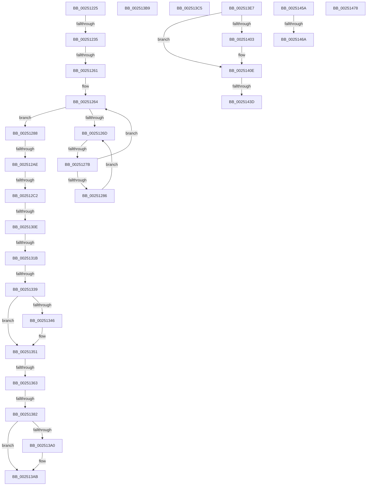

# sub_00251225

- RVA: `0x00251225`–`0x0025148C` (길이 `615` bytes)
- VA: `0x0000000140251225`
- 실행 섹션: `.text`
- PDB 이름 있음: `아니요`; PDB Function 태그: `아니요`
- unwind 정보 RVA: `0x000634BC`
- 디코드: `147`개 명령, `615/615` bytes 표시
- 미해석 바이트: `0` (있으면 어셈블리에 `.byte`로 보존)

> 이 문서는 커널 이미지의 기계어와 PDB 기호를 분석해 생성했습니다. 4번과 5번은 함수 원형과 자료형을 바이너리 사용 방식에서 추정한 C 해석이며 원본 소스 복구 결과는 아닙니다.

## 1. Dependencies

- 직접 호출 지점: **8**; 고유 호출 대상: **5**
- 직접 호출자로 확인된 함수: **0**
- RIP 상대 이미지 참조: **6**

### Outgoing calls
- `0x0025134C` → [KiLowerIrqlProcessIrqlFlags](../4F/KiLowerIrqlProcessIrqlFlags_function_004F5698.md) (function, `0x004F5698`)
- `0x0025138B` → [KiSchedulerApcTerminate](../../page/90/KiSchedulerApcTerminate_function_00905D40.md) (function, `0x00905D40`)
- `0x002513A6` → [KiLowerIrqlProcessIrqlFlags](../4F/KiLowerIrqlProcessIrqlFlags_function_004F5698.md) (function, `0x004F5698`)
- `0x002513BB` → [KiRaiseIrqlProcessIrqlFlags](../4F/KiRaiseIrqlProcessIrqlFlags_function_004F56FC.md) (function, `0x004F56FC`)
- `0x00251409` → [KiLowerIrqlProcessIrqlFlags](../4F/KiLowerIrqlProcessIrqlFlags_function_004F5698.md) (function, `0x004F5698`)
- `0x00251446` → [IopCompleteRequest](../20/IopCompleteRequest_function_0020AF50.md) (function, `0x0020AF50`)
- `0x0025146E` → [EtwpTraceImageUnloadApc](../44/EtwpTraceImageUnloadApc_function_0044BF50.md) (function, `0x0044BF50`)
- `0x0025147B` → [KiRaiseIrqlProcessIrqlFlags](../4F/KiRaiseIrqlProcessIrqlFlags_function_004F56FC.md) (function, `0x004F56FC`)

### Direct callers
- 이 함수 시작 RVA로 연결되는 직접 call은 확인되지 않았습니다. 간접 호출은 완전히 역산할 수 없습니다.

### Static image references
- `0x00251254` → RVA `0x00FC6D20` (`ALMOSTRO`; read)
- `0x0025126F` → RVA `0x00FC52AC` (`ALMOSTRO`; reference)
- `0x0025129B` → RVA `0x00AADF90` (`KeSpecialUserApcKernelRoutine`; read)
- `0x00251363` → RVA `0x00905D40` (`KiSchedulerApcTerminate`; read)
- `0x0025141E` → RVA `0x0020AF50` (`IopCompleteRequest`; read)
- `0x0025145A` → RVA `0x0044BF50` (`EtwpTraceImageUnloadApc`; read)

## 2. Other-region calls and transfers

- 다른 실행 섹션으로 향하는 call: **1**
  - `0x0025138B` → [KiSchedulerApcTerminate](../../page/90/KiSchedulerApcTerminate_function_00905D40.md) (`.text` → `PAGE`)
- call이 아닌 외부 분기/꼬리 이동: **17**
  - `0x0025122F` → [sub_00250F85 + 0x210](Unknown_function_00250F85.md) (`tail-transfer`)
  - `0x0025125B` → [sub_002514A5 + 0x73](Unknown_function_002514A5.md) (`tail-transfer`)
  - `0x00251275` → [sub_002514A5 + 0x15F](Unknown_function_002514A5.md) (`tail-transfer`)
  - `0x002512A8` → [sub_002514A5 + 0x20C](Unknown_function_002514A5.md) (`tail-transfer`)
  - `0x002512BC` → [sub_002514A5 + 0x7F](Unknown_function_002514A5.md) (`tail-transfer`)
  - `0x00251308` → [sub_00250F85 + 0x262](Unknown_function_00250F85.md) (`tail-transfer`)
  - `0x00251315` → [sub_00250F85 + 0x262](Unknown_function_00250F85.md) (`tail-transfer`)
  - `0x00251333` → [sub_002514A5 + 0x91](Unknown_function_002514A5.md) (`tail-transfer`)
  - `0x0025135D` → [sub_00250F85 + 0x210](Unknown_function_00250F85.md) (`tail-transfer`)
  - `0x0025137C` → [sub_002514A5 + 0x140](Unknown_function_002514A5.md) (`tail-transfer`)
  - `0x002513B4` → [sub_00250F85 + 0x210](Unknown_function_00250F85.md) (`tail-transfer`)
  - `0x002513C0` → [sub_00250F85 + 0x6B](Unknown_function_00250F85.md) (`tail-transfer`)
  - `0x00251437` → [sub_002514A5 + 0xD2](Unknown_function_002514A5.md) (`tail-transfer`)
  - `0x00251455` → [sub_00250F85 + 0x47](Unknown_function_00250F85.md) (`tail-transfer`)
  - `0x00251464` → [sub_002514A5 + 0xFF](Unknown_function_002514A5.md) (`tail-transfer`)
  - `0x00251473` → [sub_00250F85 + 0x1BB](Unknown_function_00250F85.md) (`tail-transfer`)
  - `0x00251487` → [sub_00250F85 + 0x47](Unknown_function_00250F85.md) (`tail-transfer`)

## 3. Assembly (complete function range)

```asm
00251225  4C 8D B3 A8 00 00 00            lea r14, [rbx + 0xa8]
0025122C  4D 39 36                        cmp qword ptr [r14], r14
0025122F  0F 84 60 FF FF FF               je 0x140251195
00251235  4D 8B EC                        mov r13, r12
00251238  4C 89 65 E8                     mov qword ptr [rbp - 0x18], r12
0025123C  4C 89 65 E0                     mov qword ptr [rbp - 0x20], r12
00251240  4C 89 65 D8                     mov qword ptr [rbp - 0x28], r12
00251244  4C 89 65 50                     mov qword ptr [rbp + 0x50], r12
00251248  44 89 65 48                     mov dword ptr [rbp + 0x48], r12d
0025124C  44 0F 20 C1                     mov rcx, cr8
00251250  45 0F 22 C2                     mov cr8, r10
00251254  83 3D C5 5A D7 00 00            cmp dword ptr [rip + 0xd75ac5], 0
0025125B  0F 85 B7 02 00 00               jne 0x140251518
00251261  41 8B F4                        mov esi, r12d
00251264  F0 48 0F BA 6B 40 00            lock bts qword ptr [rbx + 0x40], 0
0025126B  73 1B                           jae 0x140251288
0025126D  FF C6                           inc esi
0025126F  85 35 37 40 D7 00               test dword ptr [rip + 0xd74037], esi
00251275  0F 84 89 03 00 00               je 0x140251604
0025127B  F3 90                           pause
0025127D  48 8B 43 40                     mov rax, qword ptr [rbx + 0x40]
00251281  48 85 C0                        test rax, rax
00251284  74 DE                           je 0x140251264
00251286  EB E5                           jmp 0x14025126d
00251288  0F B6 B3 C2 00 00 00            movzx esi, byte ptr [rbx + 0xc2]
0025128F  40 0F B6 C6                     movzx eax, sil
00251293  24 FD                           and al, 0xfd
00251295  88 83 C2 00 00 00               mov byte ptr [rbx + 0xc2], al
0025129B  48 8D 05 EE CC 85 00            lea rax, [rip + 0x85ccee]
002512A2  49 8B 0E                        mov rcx, qword ptr [r14]
002512A5  49 3B CE                        cmp rcx, r14
002512A8  0F 84 03 04 00 00               je 0x1402516b1
002512AE  48 8D 51 F0                     lea rdx, [rcx - 0x10]
002512B2  0F 0D 0A                        prefetchw byte ptr [rdx]
002512B5  4C 8B 42 20                     mov r8, qword ptr [rdx + 0x20]
002512B9  4C 3B C0                        cmp r8, rax
002512BC  0F 85 62 02 00 00               jne 0x140251524
002512C2  48 8B 42 30                     mov rax, qword ptr [rdx + 0x30]
002512C6  41 BA 02 00 00 00               mov r10d, 2
002512CC  41 BB 00 00 00 00               mov r11d, 0
002512D2  45 0F 45 D3                     cmovne r10d, r11d
002512D6  45 8B CA                        mov r9d, r10d
002512D9  41 83 C9 04                     or r9d, 4
002512DD  F6 42 01 01                     test byte ptr [rdx + 1], 1
002512E1  48 89 45 E8                     mov qword ptr [rbp - 0x18], rax
002512E5  48 8B 42 38                     mov rax, qword ptr [rdx + 0x38]
002512E9  45 0F 44 CA                     cmove r9d, r10d
002512ED  48 89 45 E0                     mov qword ptr [rbp - 0x20], rax
002512F1  48 8B 42 40                     mov rax, qword ptr [rdx + 0x40]
002512F5  48 89 45 D8                     mov qword ptr [rbp - 0x28], rax
002512F9  48 8B 42 48                     mov rax, qword ptr [rdx + 0x48]
002512FD  48 89 45 50                     mov qword ptr [rbp + 0x50], rax
00251301  4C 8B 11                        mov r10, qword ptr [rcx]
00251304  49 39 4A 08                     cmp qword ptr [r10 + 8], rcx
00251308  0F 85 D9 FE FF FF               jne 0x1402511e7
0025130E  48 8B 41 08                     mov rax, qword ptr [rcx + 8]
00251312  48 39 08                        cmp qword ptr [rax], rcx
00251315  0F 85 CC FE FF FF               jne 0x1402511e7
0025131B  4C 89 10                        mov qword ptr [rax], r10
0025131E  4C 8B E2                        mov r12, rdx
00251321  49 89 42 08                     mov qword ptr [r10 + 8], rax
00251325  4D 8B E8                        mov r13, r8
00251328  44 88 5A 52                     mov byte ptr [rdx + 0x52], r11b
0025132C  44 89 4D 48                     mov dword ptr [rbp + 0x48], r9d
00251330  48 85 D2                        test rdx, rdx
00251333  0F 85 FD 01 00 00               jne 0x140251536
00251339  4C 89 5B 40                     mov qword ptr [rbx + 0x40], r11
0025133D  83 3D DC 59 D7 00 00            cmp dword ptr [rip + 0xd759dc], 0
00251344  74 0B                           je 0x140251351
00251346  44 0F 20 C1                     mov rcx, cr8
0025134A  B2 01                           mov dl, 1
0025134C  E8 47 43 2A 00                  call 0x1404f5698
00251351  B8 01 00 00 00                  mov eax, 1
00251356  44 0F 22 C0                     mov cr8, rax
0025135A  4D 85 E4                        test r12, r12
0025135D  0F 84 32 FE FF FF               je 0x140251195
00251363  48 8D 05 D6 49 6B 00            lea rax, [rip + 0x6b49d6]
0025136A  49 8B CC                        mov rcx, r12
0025136D  4C 8D 4D D8                     lea r9, [rbp - 0x28]
00251371  4C 8D 45 E0                     lea r8, [rbp - 0x20]
00251375  48 8D 55 E8                     lea rdx, [rbp - 0x18]
00251379  4C 3B E8                        cmp r13, rax
0025137C  0F 85 63 02 00 00               jne 0x1402515e5
00251382  48 8D 45 50                     lea rax, [rbp + 0x50]
00251386  48 89 44 24 20                  mov qword ptr [rsp + 0x20], rax
0025138B  E8 B0 49 6B 00                  call 0x140905d40
00251390  45 33 DB                        xor r11d, r11d
00251393  4C 89 5B 40                     mov qword ptr [rbx + 0x40], r11
00251397  44 39 1D 82 59 D7 00            cmp dword ptr [rip + 0xd75982], r11d
0025139E  74 0B                           je 0x1402513ab
002513A0  44 0F 20 C1                     mov rcx, cr8
002513A4  B2 01                           mov dl, 1
002513A6  E8 ED 42 2A 00                  call 0x1404f5698
002513AB  B8 01 00 00 00                  mov eax, 1
002513B0  44 0F 22 C0                     mov cr8, rax
002513B4  E9 DC FD FF FF                  jmp 0x140251195
002513B9  B2 02                           mov dl, 2
002513BB  E8 3C 43 2A 00                  call 0x1404f56fc
002513C0  E9 2B FC FF FF                  jmp 0x140250ff0
002513C5  4C 8B 74 24 60                  mov r14, qword ptr [rsp + 0x60]
002513CA  48 8B B4 24 A0 00 00 00         mov rsi, qword ptr [rsp + 0xa0]
002513D2  4C 89 93 90 00 00 00            mov qword ptr [rbx + 0x90], r10
002513D9  48 83 C4 68                     add rsp, 0x68
002513DD  41 5F                           pop r15
002513DF  41 5D                           pop r13
002513E1  41 5C                           pop r12
002513E3  5F                              pop rdi
002513E4  5B                              pop rbx
002513E5  5D                              pop rbp
002513E6  C3                              ret
002513E7  CC                              int3
002513E8  48 89 08                        mov qword ptr [rax], rcx
002513EB  45 33 DB                        xor r11d, r11d
002513EE  48 89 41 08                     mov qword ptr [rcx + 8], rax
002513F2  C6 46 52 00                     mov byte ptr [rsi + 0x52], 0
002513F6  4C 89 5B 40                     mov qword ptr [rbx + 0x40], r11
002513FA  44 39 1D 1F 59 D7 00            cmp dword ptr [rip + 0xd7591f], r11d
00251401  74 0B                           je 0x14025140e
00251403  44 0F 20 C1                     mov rcx, cr8
00251407  B2 01                           mov dl, 1
00251409  E8 8A 42 2A 00                  call 0x1404f5698
0025140E  B8 01 00 00 00                  mov eax, 1
00251413  44 0F 22 C0                     mov cr8, rax
00251417  80 8B C0 00 00 00 02            or byte ptr [rbx + 0xc0], 2
0025141E  48 8D 05 2B 9B FB FF            lea rax, [rip - 0x464d5]
00251425  4C 8D 4D D8                     lea r9, [rbp - 0x28]
00251429  48 8B CE                        mov rcx, rsi
0025142C  4C 8D 45 E0                     lea r8, [rbp - 0x20]
00251430  48 8D 55 E8                     lea rdx, [rbp - 0x18]
00251434  4C 3B E0                        cmp r12, rax
00251437  0F 85 3A 01 00 00               jne 0x140251577
0025143D  48 8D 45 50                     lea rax, [rbp + 0x50]
00251441  48 89 44 24 20                  mov qword ptr [rsp + 0x20], rax
00251446  E8 05 9B FB FF                  call 0x14020af50
0025144B  80 A3 C0 00 00 00 FD            and byte ptr [rbx + 0xc0], 0xfd
00251452  45 33 E4                        xor r12d, r12d
00251455  E9 72 FB FF FF                  jmp 0x140250fcc
0025145A  48 8D 0D EF AA 1F 00            lea rcx, [rip + 0x1faaef]
00251461  48 3B C1                        cmp rax, rcx
00251464  0F 85 3A 01 00 00               jne 0x1402515a4
0025146A  48 8B 4D E0                     mov rcx, qword ptr [rbp - 0x20]
0025146E  E8 DD AA 1F 00                  call 0x14044bf50
00251473  E9 C8 FC FF FF                  jmp 0x140251140
00251478  0F B6 D0                        movzx edx, al
0025147B  E8 7C 42 2A 00                  call 0x1404f56fc
00251480  C6 83 C0 00 00 00 00            mov byte ptr [rbx + 0xc0], 0
00251487  E9 40 FB FF FF                  jmp 0x140250fcc
```

## 4. C-style interpretation (structured pseudocode)

```c
__int64 __fastcall sub_00251225(void)
{
    __int64 result;
    __int64 v_r10;
    __int64 v_r11;
    __int64 v_rsi;
    unsigned __int64 v_stack_p20;
    unsigned __int64 v_stack_p60;
    unsigned __int64 v_stack_pA0;
    unsigned __int64 v_stack_pB8;

    *(unsigned __int64 *)(v_rbp - 24) = v_r12;
    *(unsigned __int64 *)(v_rbp - 32) = v_r12;
    *(unsigned __int64 *)(v_rbp - 40) = v_r12;
    *(unsigned __int64 *)(v_rbp + 80) = v_r12;
    *(unsigned int *)(v_rbp + 72) = (unsigned int)(v_r12);
loc_00251264:
    if ((*(unsigned int *)(v_rip + 14113477)) >= 0) goto loc_00251288;
loc_0025126D:
    v_rsi = (unsigned int)(((unsigned int)((unsigned int)(v_r12))) + 1);
    if (*(unsigned __int64 *)(v_rbx + 64) == 0) goto loc_00251264;
    goto loc_0025126D;
loc_00251288:
    result = (unsigned __int8)(((unsigned __int8)(*(unsigned __int8 *)(v_rbx + 194))) & (253));
    *(unsigned __int8 *)(v_rbx + 194) = (unsigned __int8)(result);
    v_r10 = 2;
    if ((*(unsigned __int64 *)(*(unsigned __int64 *)(v_rbx + 168) - 16 + 32)) != (v_rip + 8768750)) { v_r10 = 0; }
    a4 = (unsigned int)(((unsigned int)((unsigned int)(v_r10))) | (4));
    *(unsigned __int64 *)(v_rbp - 24) = *(unsigned __int64 *)(*(unsigned __int64 *)(v_rbx + 168) - 16 + 48);
    if (((*(unsigned __int8 *)(*(unsigned __int64 *)(v_rbx + 168) - 16 + 1)) & (1)) == 0) { a4 = (unsigned int)(v_r10); }
    *(unsigned __int64 *)(v_rbp - 32) = *(unsigned __int64 *)(*(unsigned __int64 *)(v_rbx + 168) - 16 + 56);
    *(unsigned __int64 *)(v_rbp - 40) = *(unsigned __int64 *)(*(unsigned __int64 *)(v_rbx + 168) - 16 + 64);
    *(unsigned __int64 *)(v_rbp + 80) = *(unsigned __int64 *)(*(unsigned __int64 *)(v_rbx + 168) - 16 + 72);
    *(unsigned __int64 *)(*(unsigned __int64 *)(*(unsigned __int64 *)(v_rbx + 168) + 8)) = *(unsigned __int64 *)(*(unsigned __int64 *)(v_rbx + 168));
    *(unsigned __int64 *)(*(unsigned __int64 *)(*(unsigned __int64 *)(v_rbx + 168)) + 8) = *(unsigned __int64 *)(*(unsigned __int64 *)(v_rbx + 168) + 8);
    *(unsigned __int8 *)(*(unsigned __int64 *)(v_rbx + 168) - 16 + 82) = 0;
    *(unsigned int *)(v_rbp + 72) = (unsigned int)(a4);
    *(unsigned __int64 *)(v_rbx + 64) = 0;
    result = *(unsigned __int64 *)(*(unsigned __int64 *)(v_rbx + 168) + 8);
    if ((*(unsigned int *)(v_rip + 14113244)) != 0) {
        a1 = v_r10;
        a2 = 1;
        result = KiLowerIrqlProcessIrqlFlags(a1, a2, *(unsigned __int64 *)(*(unsigned __int64 *)(v_rbx + 168) - 16 + 32), a4);
    }
    v_stack_p20 = v_rbp + 80;
    result = KiSchedulerApcTerminate(*(unsigned __int64 *)(v_rbx + 168) - 16, v_rbp - 24, v_rbp - 32, v_rbp - 40);
    v_r11 = 0;
    *(unsigned __int64 *)(v_rbx + 64) = 0;
    if ((*(unsigned int *)(v_rip + 14113154)) != 0) {
        a1 = 1;
        a2 = 1;
        result = KiLowerIrqlProcessIrqlFlags(a1, a2, v_rbp - 32, v_rbp - 40);
    }
}
```

## 5. (Beta) C Style

```c
void sub_00251225(void)
{
    int64_t result;
    int64_t local_r10;
    int64_t local_r11;
    int64_t local_rsi;
    uint64_t v_stack_p20;
    uint64_t v_stack_p60;
    uint64_t v_stack_pA0;
    uint64_t v_stack_pB8;

    *(uint64_t *)(local_rbp - 0x18) = local_r12;
    *(uint64_t *)(local_rbp - 0x20) = local_r12;
    *(uint64_t *)(local_rbp - 0x28) = local_r12;
    *(uint64_t *)(local_rbp + 0x50) = local_r12;
    *(uint32_t *)(local_rbp + 0x48) = (uint32_t)(local_r12);
loc_00251264:
    if ((*(uint32_t *)(v_rip + 0xD75AC5)) >= 0) goto loc_00251288;
loc_0025126D:
    local_rsi = (uint32_t)(((uint32_t)((uint32_t)(local_r12))) + 1);
    if (*(uint64_t *)(local_rbx + 0x40) == 0) goto loc_00251264;
    goto loc_0025126D;
loc_00251288:
    result = (uint8_t)(((uint8_t)(*(uint8_t *)(local_rbx + 0xC2))) & (253));
    *(uint8_t *)(local_rbx + 0xC2) = (uint8_t)(result);
    local_r10 = 2;
    if ((*(uint64_t *)(*(uint64_t *)(local_rbx + 0xA8) - 0x10 + 0x20)) != (v_rip + 8768750)) { local_r10 = 0; }
    a4 = (uint32_t)(((uint32_t)((uint32_t)(local_r10))) | (4));
    *(uint64_t *)(local_rbp - 0x18) = *(uint64_t *)(*(uint64_t *)(local_rbx + 0xA8) - 0x10 + 0x30);
    if (((*(uint8_t *)(*(uint64_t *)(local_rbx + 0xA8) - 0x10 + 0x1)) & (1)) == 0) { a4 = (uint32_t)(local_r10); }
    *(uint64_t *)(local_rbp - 0x20) = *(uint64_t *)(*(uint64_t *)(local_rbx + 0xA8) - 0x10 + 0x38);
    *(uint64_t *)(local_rbp - 0x28) = *(uint64_t *)(*(uint64_t *)(local_rbx + 0xA8) - 0x10 + 0x40);
    *(uint64_t *)(local_rbp + 0x50) = *(uint64_t *)(*(uint64_t *)(local_rbx + 0xA8) - 0x10 + 0x48);
    *(uint64_t *)(*(uint64_t *)(*(uint64_t *)(local_rbx + 0xA8) + 0x8)) = *(uint64_t *)(*(uint64_t *)(local_rbx + 0xA8));
    *(uint64_t *)(*(uint64_t *)(*(uint64_t *)(local_rbx + 0xA8)) + 0x8) = *(uint64_t *)(*(uint64_t *)(local_rbx + 0xA8) + 0x8);
    *(uint8_t *)(*(uint64_t *)(local_rbx + 0xA8) - 0x10 + 0x52) = 0;
    *(uint32_t *)(local_rbp + 0x48) = (uint32_t)(a4);
    *(uint64_t *)(local_rbx + 0x40) = 0;
    result = *(uint64_t *)(*(uint64_t *)(local_rbx + 0xA8) + 0x8);
    if ((*(uint32_t *)(v_rip + 0xD759DC)) != 0) {
        a1 = local_r10;
        a2 = 1;
        result = KiLowerIrqlProcessIrqlFlags(a1, a2, *(uint64_t *)(*(uint64_t *)(local_rbx + 0xA8) - 0x10 + 0x20), a4);
    }
    v_stack_p20 = local_rbp + 80;
    result = KiSchedulerApcTerminate(*(uint64_t *)(local_rbx + 0xA8) - 16, local_rbp - 24, local_rbp - 32, local_rbp - 40);
    local_r11 = 0;
    *(uint64_t *)(local_rbx + 0x40) = 0;
    if ((*(uint32_t *)(v_rip + 0xD75982)) != 0) {
        a1 = 1;
        a2 = 1;
        result = KiLowerIrqlProcessIrqlFlags(a1, a2, local_rbp - 32, local_rbp - 40);
    }
}
```

## 6. Execution-region graph

[열기: 2D/3D 그래프와 함수 탐색 컨트롤 패널](../../../control-panel.html?section=text&rva=0x00251225&view=graph)

- 2D 그래프는 위에서 아래로 흐르고, 3D 그래프는 빈 공간을 드래그해 회전합니다. Shift+드래그는 이동, 휠은 확대·축소, 함수 노드 선택은 대상 보고서 이동입니다.

### Static fallback


