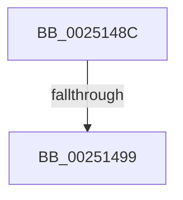

# sub_0025148C

- RVA: `0x0025148C`–`0x002514A5` (길이 `25` bytes)
- VA: `0x000000014025148C`
- 실행 섹션: `.text`
- PDB 이름 있음: `아니요`; PDB Function 태그: `아니요`
- unwind 정보 RVA: `0x000634D8`
- 디코드: `4`개 명령, `25/25` bytes 표시
- 미해석 바이트: `0` (있으면 어셈블리에 `.byte`로 보존)

> 이 문서는 커널 이미지의 기계어와 PDB 기호를 분석해 생성했습니다. 4번과 5번은 함수 원형과 자료형을 바이너리 사용 방식에서 추정한 C 해석이며 원본 소스 복구 결과는 아닙니다.

## 1. Dependencies

- 직접 호출 지점: **0**; 고유 호출 대상: **0**
- 직접 호출자로 확인된 함수: **0**
- RIP 상대 이미지 참조: **1**

### Outgoing calls
- 직접 디코드된 call 명령이 없습니다.

### Direct callers
- 이 함수 시작 RVA로 연결되는 직접 call은 확인되지 않았습니다. 간접 호출은 완전히 역산할 수 없습니다.

### Static image references
- `0x0025148C` → RVA `0x00FC74B8` (`ALMOSTRO`; read)

## 2. Other-region calls and transfers

- 다른 실행 섹션으로 향하는 call: **0**
- call이 아닌 외부 분기/꼬리 이동: **2**
  - `0x00251493` → [KiDeliverApc + 0x5C](KiDeliverApc_function_00250F20.md) (`tail-transfer`)
  - `0x002514A0` → [KiDeliverApc + 0x5C](KiDeliverApc_function_00250F20.md) (`tail-transfer`)

## 3. Assembly (complete function range)

```asm
0025148C  4C 3B 05 25 60 D7 00            cmp r8, qword ptr [rip + 0xd76025]
00251493  0F 87 E3 FA FF FF               ja 0x140250f7c
00251499  48 89 87 68 01 00 00            mov qword ptr [rdi + 0x168], rax
002514A0  E9 D7 FA FF FF                  jmp 0x140250f7c
```

## 4. C-style interpretation (structured pseudocode)

```c
void __fastcall sub_0025148C(__int64 a1, __int64 a2, __int64 a3)
{
    *(unsigned __int64 *)(v_rdi + 360) = result;
}
```

## 5. (Beta) C Style

```c
void sub_0025148C(int64_t Arg1, int64_t Arg2, int64_t Arg3)
{
    *(uint64_t *)(local_rdi + 0x168) = result;
}
```

## 6. Execution-region graph

[열기: 2D/3D 그래프와 함수 탐색 컨트롤 패널](../../../control-panel.html?section=text&rva=0x0025148C&view=graph)

- 2D 그래프는 위에서 아래로 흐르고, 3D 그래프는 빈 공간을 드래그해 회전합니다. Shift+드래그는 이동, 휠은 확대·축소, 함수 노드 선택은 대상 보고서 이동입니다.

### Static fallback


