# sub_002514A5

- RVA: `0x002514A5`–`0x002516B9` (길이 `532` bytes)
- VA: `0x00000001402514A5`
- 실행 섹션: `.text`
- PDB 이름 있음: `아니요`; PDB Function 태그: `아니요`
- unwind 정보 RVA: `0x000634E8`
- 디코드: `121`개 명령, `532/532` bytes 표시
- 미해석 바이트: `0` (있으면 어셈블리에 `.byte`로 보존)

> 이 문서는 커널 이미지의 기계어와 PDB 기호를 분석해 생성했습니다. 4번과 5번은 함수 원형과 자료형을 바이너리 사용 방식에서 추정한 C 해석이며 원본 소스 복구 결과는 아닙니다.

## 1. Dependencies

- 직접 호출 지점: **16**; 고유 호출 대상: **11**
- 직접 호출자로 확인된 함수: **0**
- RIP 상대 이미지 참조: **7**

### Outgoing calls
- `0x002514B3` → [KiCheckVpBackingLongSpinWaitHypercall](../30/KiCheckVpBackingLongSpinWaitHypercall_function_0030F490.md) (function, `0x0030F490`)
- `0x002514C2` → [HvlNotifyLongSpinWait](../30/HvlNotifyLongSpinWait_function_0030F460.md) (function, `0x0030F460`)
- `0x0025150E` → [KiInitializeUserApc](../3D/KiInitializeUserApc_function_003D8D38.md) (function, `0x003D8D38`)
- `0x0025151A` → [KiRaiseIrqlProcessIrqlFlags](../4F/KiRaiseIrqlProcessIrqlFlags_function_004F56FC.md) (function, `0x004F56FC`)
- `0x00251590` → [IopCompletePageWrite](../29/IopCompletePageWrite_function_00298010.md) (function, `0x00298010`)
- `0x002515B8` → [KiUpdateTebApc](../3C/KiUpdateTebApc_function_003C4920.md) (function, `0x003C4920`)
- `0x002515DB` → [EtwpCovSampCaptureApc](../44/EtwpCovSampCaptureApc_function_004440D0.md) (function, `0x004440D0`)
- `0x002515FA` → [PspUserApcReserveKernelRoutine](../../page/A5/PspUserApcReserveKernelRoutine_function_00A56A50.md) (function, `0x00A56A50`)
- `0x00251612` → [KiCheckVpBackingLongSpinWaitHypercall](../30/KiCheckVpBackingLongSpinWaitHypercall_function_0030F490.md) (function, `0x0030F490`)
- `0x00251621` → [HvlNotifyLongSpinWait](../30/HvlNotifyLongSpinWait_function_0030F460.md) (function, `0x0030F460`)
- `0x0025162D` → [KeTestAlertThread](../41/KeTestAlertThread_function_0041C590.md) (function, `0x0041C590`)
- `0x0025164C` → [MiStoreWriteModifiedCompleteApc](../40/MiStoreWriteModifiedCompleteApc_function_00406990.md) (function, `0x00406990`)
- `0x00251663` → [guard_dispatch_icall](../6B/guard_dispatch_icall_function_006BAAD0.md) (function, `0x006BAAD0`)
- `0x00251670` → [guard_dispatch_icall](../6B/guard_dispatch_icall_function_006BAAD0.md) (function, `0x006BAAD0`)
- `0x00251682` → [guard_dispatch_icall](../6B/guard_dispatch_icall_function_006BAAD0.md) (function, `0x006BAAD0`)
- `0x0025168F` → [guard_dispatch_icall](../6B/guard_dispatch_icall_function_006BAAD0.md) (function, `0x006BAAD0`)

### Direct callers
- 이 함수 시작 RVA로 연결되는 직접 call은 확인되지 않았습니다. 간접 호출은 완전히 역산할 수 없습니다.

### Static image references
- `0x002514A5` → RVA `0x00FC6AB8` (`ALMOSTRO`; read)
- `0x00251555` → RVA `0x00AADF90` (`KeSpecialUserApcKernelRoutine`; read)
- `0x00251577` → RVA `0x00298010` (`IopCompletePageWrite`; read)
- `0x002515A4` → RVA `0x003C4920` (`KiUpdateTebApc`; read)
- `0x002515C2` → RVA `0x004440D0` (`EtwpCovSampCaptureApc`; read)
- `0x002515E5` → RVA `0x00A56A50` (`PspUserApcReserveKernelRoutine`; read)
- `0x00251637` → RVA `0x00406990` (`MiStoreWriteModifiedCompleteApc`; read)

## 2. Other-region calls and transfers

- 다른 실행 섹션으로 향하는 call: **1**
  - `0x002515FA` → [PspUserApcReserveKernelRoutine](../../page/A5/PspUserApcReserveKernelRoutine_function_00A56A50.md) (`.text` → `PAGE`)
- call이 아닌 외부 분기/꼬리 이동: **23**
  - `0x002514AD` → [sub_00250F85 + 0x85](Unknown_function_00250F85.md) (`tail-transfer`)
  - `0x002514BA` → [sub_00250F85 + 0x85](Unknown_function_00250F85.md) (`tail-transfer`)
  - `0x002514C7` → [sub_00250F85 + 0x87](Unknown_function_00250F85.md) (`tail-transfer`)
  - `0x00251513` → [sub_00250F85 + 0x210](Unknown_function_00250F85.md) (`tail-transfer`)
  - `0x0025151F` → [sub_00251225 + 0x3C](Unknown_function_00251225.md) (`tail-transfer`)
  - `0x00251531` → [sub_00251225 + 0x9D](Unknown_function_00251225.md) (`tail-transfer`)
  - `0x00251543` → [sub_00251225 + 0x114](Unknown_function_00251225.md) (`tail-transfer`)
  - `0x00251562` → [sub_00251225 + 0x114](Unknown_function_00251225.md) (`tail-transfer`)
  - `0x0025159F` → [sub_00250F85 + 0x47](Unknown_function_00250F85.md) (`tail-transfer`)
  - `0x002515BD` → [sub_00250F85 + 0x1BB](Unknown_function_00250F85.md) (`tail-transfer`)
  - `0x002515E0` → [sub_00250F85 + 0x170](Unknown_function_00250F85.md) (`tail-transfer`)
  - `0x0025160C` → [sub_00251225 + 0x56](Unknown_function_00251225.md) (`tail-transfer`)
  - `0x00251619` → [sub_00251225 + 0x56](Unknown_function_00251225.md) (`tail-transfer`)
  - `0x00251626` → [sub_00251225 + 0x58](Unknown_function_00251225.md) (`tail-transfer`)
  - `0x00251632` → [sub_00250F85 + 0x210](Unknown_function_00250F85.md) (`tail-transfer`)
  - `0x0025165B` → [sub_00250F85 + 0x47](Unknown_function_00250F85.md) (`tail-transfer`)
  - `0x00251675` → [sub_00250F85 + 0x170](Unknown_function_00250F85.md) (`tail-transfer`)
  - `0x0025167D` → [sub_00250F85 + 0x1D5](Unknown_function_00250F85.md) (`tail-transfer`)
  - `0x00251687` → [sub_00250F85 + 0x1BB](Unknown_function_00250F85.md) (`tail-transfer`)
  - `0x00251694` → [sub_00251225 + 0x226](Unknown_function_00251225.md) (`tail-transfer`)
  - `0x0025169F` → [sub_00251225 + 0x80](Unknown_function_00251225.md) (`tail-transfer`)
  - `0x002516AC` → [sub_00251225 + 0x114](Unknown_function_00251225.md) (`tail-transfer`)
  - `0x002516B4` → [sub_00251225 + 0x114](Unknown_function_00251225.md) (`tail-transfer`)

## 3. Assembly (complete function range)

```asm
002514A5  8B 05 0D 56 D7 00               mov eax, dword ptr [rip + 0xd7560d]
002514AB  A8 40                           test al, 0x40
002514AD  0F 84 57 FB FF FF               je 0x14025100a
002514B3  E8 D8 DF 0B 00                  call 0x14030f490
002514B8  84 C0                           test al, al
002514BA  0F 84 4A FB FF FF               je 0x14025100a
002514C0  8B CE                           mov ecx, esi
002514C2  E8 99 DF 0B 00                  call 0x14030f460
002514C7  E9 40 FB FF FF                  jmp 0x14025100c
002514CC  4C 8B 45 E8                     mov r8, qword ptr [rbp - 0x18]
002514D0  4D 85 C0                        test r8, r8
002514D3  75 0A                           jne 0x1402514df
002514D5  40 F6 C6 02                     test sil, 2
002514D9  0F 85 4C 01 00 00               jne 0x14025162b
002514DF  8B 45 48                        mov eax, dword ptr [rbp + 0x48]
002514E2  48 8B D7                        mov rdx, rdi
002514E5  4C 8B 4D E0                     mov r9, qword ptr [rbp - 0x20]
002514E9  83 C8 01                        or eax, 1
002514EC  48 8B 4D 40                     mov rcx, qword ptr [rbp + 0x40]
002514F0  40 F6 C6 02                     test sil, 2
002514F4  0F 44 45 48                     cmove eax, dword ptr [rbp + 0x48]
002514F8  89 44 24 30                     mov dword ptr [rsp + 0x30], eax
002514FC  48 8B 45 50                     mov rax, qword ptr [rbp + 0x50]
00251500  48 89 44 24 28                  mov qword ptr [rsp + 0x28], rax
00251505  48 8B 45 D8                     mov rax, qword ptr [rbp - 0x28]
00251509  48 89 44 24 20                  mov qword ptr [rsp + 0x20], rax
0025150E  E8 25 78 18 00                  call 0x1403d8d38
00251513  E9 7D FC FF FF                  jmp 0x140251195
00251518  B2 02                           mov dl, 2
0025151A  E8 DD 41 2A 00                  call 0x1404f56fc
0025151F  E9 3D FD FF FF                  jmp 0x140251261
00251524  40 F6 C6 02                     test sil, 2
00251528  0F 84 6B 01 00 00               je 0x140251699
0025152E  4C 3B C0                        cmp r8, rax
00251531  E9 8C FD FF FF                  jmp 0x1402512c2
00251536  0F B6 83 C2 00 00 00            movzx eax, byte ptr [rbx + 0xc2]
0025153D  44 89 4D 48                     mov dword ptr [rbp + 0x48], r9d
00251541  A8 01                           test al, 1
00251543  0F 84 F0 FD FF FF               je 0x140251339
00251549  24 FE                           and al, 0xfe
0025154B  44 89 4D 48                     mov dword ptr [rbp + 0x48], r9d
0025154F  88 83 C2 00 00 00               mov byte ptr [rbx + 0xc2], al
00251555  48 8D 15 34 CA 85 00            lea rdx, [rip + 0x85ca34]
0025155C  49 8B 0E                        mov rcx, qword ptr [r14]
0025155F  49 3B CE                        cmp rcx, r14
00251562  0F 84 D1 FD FF FF               je 0x140251339
00251568  48 39 51 10                     cmp qword ptr [rcx + 0x10], rdx
0025156C  0F 84 32 01 00 00               je 0x1402516a4
00251572  48 8B 09                        mov rcx, qword ptr [rcx]
00251575  EB E8                           jmp 0x14025155f
00251577  48 8D 05 92 6A 04 00            lea rax, [rip + 0x46a92]
0025157E  4C 3B E0                        cmp r12, rax
00251581  0F 85 B0 00 00 00               jne 0x140251637
00251587  48 8D 45 50                     lea rax, [rbp + 0x50]
0025158B  48 89 44 24 20                  mov qword ptr [rsp + 0x20], rax
00251590  E8 7B 6A 04 00                  call 0x140298010
00251595  80 A3 C0 00 00 00 FD            and byte ptr [rbx + 0xc0], 0xfd
0025159C  45 33 E4                        xor r12d, r12d
0025159F  E9 28 FA FF FF                  jmp 0x140250fcc
002515A4  48 8D 0D 75 33 17 00            lea rcx, [rip + 0x173375]
002515AB  48 3B C1                        cmp rax, rcx
002515AE  48 8B 4D E0                     mov rcx, qword ptr [rbp - 0x20]
002515B2  0F 85 CA 00 00 00               jne 0x140251682
002515B8  E8 63 33 17 00                  call 0x1403c4920
002515BD  E9 7E FB FF FF                  jmp 0x140251140
002515C2  48 8D 05 07 2B 1F 00            lea rax, [rip + 0x1f2b07]
002515C9  4C 3B E0                        cmp r12, rax
002515CC  48 8D 45 50                     lea rax, [rbp + 0x50]
002515D0  48 89 44 24 20                  mov qword ptr [rsp + 0x20], rax
002515D5  0F 85 92 00 00 00               jne 0x14025166d
002515DB  E8 F0 2A 1F 00                  call 0x1404440d0
002515E0  E9 10 FB FF FF                  jmp 0x1402510f5
002515E5  48 8D 05 64 54 80 00            lea rax, [rip + 0x805464]
002515EC  4C 3B E8                        cmp r13, rax
002515EF  48 8D 45 50                     lea rax, [rbp + 0x50]
002515F3  48 89 44 24 20                  mov qword ptr [rsp + 0x20], rax
002515F8  75 66                           jne 0x140251660
002515FA  E8 51 54 80 00                  call 0x140a56a50
002515FF  E9 C8 FE FF FF                  jmp 0x1402514cc
00251604  8B 05 AE 54 D7 00               mov eax, dword ptr [rip + 0xd754ae]
0025160A  A8 40                           test al, 0x40
0025160C  0F 84 69 FC FF FF               je 0x14025127b
00251612  E8 79 DE 0B 00                  call 0x14030f490
00251617  84 C0                           test al, al
00251619  0F 84 5C FC FF FF               je 0x14025127b
0025161F  8B CE                           mov ecx, esi
00251621  E8 3A DE 0B 00                  call 0x14030f460
00251626  E9 52 FC FF FF                  jmp 0x14025127d
0025162B  B1 01                           mov cl, 1
0025162D  E8 5E AF 1C 00                  call 0x14041c590
00251632  E9 5E FB FF FF                  jmp 0x140251195
00251637  48 8D 05 52 53 1B 00            lea rax, [rip + 0x1b5352]
0025163E  4C 3B E0                        cmp r12, rax
00251641  48 8D 45 50                     lea rax, [rbp + 0x50]
00251645  48 89 44 24 20                  mov qword ptr [rsp + 0x20], rax
0025164A  75 40                           jne 0x14025168c
0025164C  E8 3F 53 1B 00                  call 0x140406990
00251651  80 A3 C0 00 00 00 FD            and byte ptr [rbx + 0xc0], 0xfd
00251658  45 33 E4                        xor r12d, r12d
0025165B  E9 6C F9 FF FF                  jmp 0x140250fcc
00251660  49 8B C5                        mov rax, r13
00251663  E8 68 94 46 00                  call 0x1406baad0
00251668  E9 5F FE FF FF                  jmp 0x1402514cc
0025166D  49 8B C4                        mov rax, r12
00251670  E8 5B 94 46 00                  call 0x1406baad0
00251675  E9 7B FA FF FF                  jmp 0x1402510f5
0025167A  45 33 E4                        xor r12d, r12d
0025167D  E9 D8 FA FF FF                  jmp 0x14025115a
00251682  E8 49 94 46 00                  call 0x1406baad0
00251687  E9 B4 FA FF FF                  jmp 0x140251140
0025168C  49 8B C4                        mov rax, r12
0025168F  E8 3C 94 46 00                  call 0x1406baad0
00251694  E9 B2 FD FF FF                  jmp 0x14025144b
00251699  48 8B 09                        mov rcx, qword ptr [rcx]
0025169C  45 33 E4                        xor r12d, r12d
0025169F  E9 01 FC FF FF                  jmp 0x1402512a5
002516A4  0C 01                           or al, 1
002516A6  88 83 C2 00 00 00               mov byte ptr [rbx + 0xc2], al
002516AC  E9 88 FC FF FF                  jmp 0x140251339
002516B1  45 33 DB                        xor r11d, r11d
002516B4  E9 80 FC FF FF                  jmp 0x140251339
```

## 4. C-style interpretation (structured pseudocode)

```c
__int64 __fastcall sub_002514A5(void)
{
    __int64 result;
    unsigned __int64 v_stack_p20;
    unsigned __int64 v_stack_p28;
    unsigned int v_stack_p30;

    result = KiCheckVpBackingLongSpinWaitHypercall(a1, a2, a3, a4);
    result = HvlNotifyLongSpinWait((unsigned int)((unsigned int)(v_rsi)), a2, a3, a4);
}
```

## 5. (Beta) C Style

```c
void sub_002514A5(void)
{
    int64_t result;
    uint64_t v_stack_p20;
    uint64_t v_stack_p28;
    uint32_t v_stack_p30;

    result = KiCheckVpBackingLongSpinWaitHypercall(a1, a2, a3, a4);
    result = HvlNotifyLongSpinWait((uint32_t)((uint32_t)(local_rsi)), a2, a3, a4);
}
```

## 6. Execution-region graph

[열기: 2D/3D 그래프와 함수 탐색 컨트롤 패널](../../../control-panel.html?section=text&rva=0x002514A5&view=graph)

- 2D 그래프는 위에서 아래로 흐르고, 3D 그래프는 빈 공간을 드래그해 회전합니다. Shift+드래그는 이동, 휠은 확대·축소, 함수 노드 선택은 대상 보고서 이동입니다.

### Static fallback

```mermaid
flowchart TD
  bb_002514A5[BB_002514A5]
  bb_002514B3[BB_002514B3]
  bb_002514C0[BB_002514C0]
  bb_002514CC[BB_002514CC]
  bb_002514D5[BB_002514D5]
  bb_002514DF[BB_002514DF]
  bb_00251518[BB_00251518]
  bb_00251524[BB_00251524]
  bb_0025152E[BB_0025152E]
  bb_00251536[BB_00251536]
  bb_00251549[BB_00251549]
  bb_0025155F[BB_0025155F]
  bb_00251568[BB_00251568]
  bb_00251572[BB_00251572]
  bb_00251577[BB_00251577]
  bb_00251587[BB_00251587]
  bb_002515A4[BB_002515A4]
  bb_002515B8[BB_002515B8]
  bb_002515C2[BB_002515C2]
  bb_002515DB[BB_002515DB]
  bb_002515E5[BB_002515E5]
  bb_002515FA[BB_002515FA]
  bb_00251604[BB_00251604]
  bb_00251612[BB_00251612]
  bb_0025161F[BB_0025161F]
  bb_0025162B[BB_0025162B]
  bb_00251637[BB_00251637]
  bb_0025164C[BB_0025164C]
  bb_00251660[BB_00251660]
  bb_0025166D[BB_0025166D]
  bb_0025167A[BB_0025167A]
  bb_00251682[BB_00251682]
  bb_0025168C[BB_0025168C]
  bb_00251699[BB_00251699]
  bb_002516A4[BB_002516A4]
  bb_002516B1[BB_002516B1]
  bb_002514A5 -->|fallthrough| bb_002514B3
  bb_002514B3 -->|fallthrough| bb_002514C0
  bb_002514CC -->|branch| bb_002514DF
  bb_002514CC -->|fallthrough| bb_002514D5
  bb_002514D5 -->|branch| bb_0025162B
  bb_002514D5 -->|fallthrough| bb_002514DF
  bb_00251524 -->|branch| bb_00251699
  bb_00251524 -->|fallthrough| bb_0025152E
  bb_00251536 -->|fallthrough| bb_00251549
  bb_00251549 -->|flow| bb_0025155F
  bb_0025155F -->|fallthrough| bb_00251568
  bb_00251568 -->|branch| bb_002516A4
  bb_00251568 -->|fallthrough| bb_00251572
  bb_00251572 -->|branch| bb_0025155F
  bb_00251577 -->|branch| bb_00251637
  bb_00251577 -->|fallthrough| bb_00251587
  bb_002515A4 -->|branch| bb_00251682
  bb_002515A4 -->|fallthrough| bb_002515B8
  bb_002515C2 -->|branch| bb_0025166D
  bb_002515C2 -->|fallthrough| bb_002515DB
  bb_002515E5 -->|branch| bb_00251660
  bb_002515E5 -->|fallthrough| bb_002515FA
  bb_002515FA -->|branch| bb_002514CC
  bb_00251604 -->|fallthrough| bb_00251612
  bb_00251612 -->|fallthrough| bb_0025161F
  bb_00251637 -->|branch| bb_0025168C
  bb_00251637 -->|fallthrough| bb_0025164C
  bb_00251660 -->|branch| bb_002514CC
```


