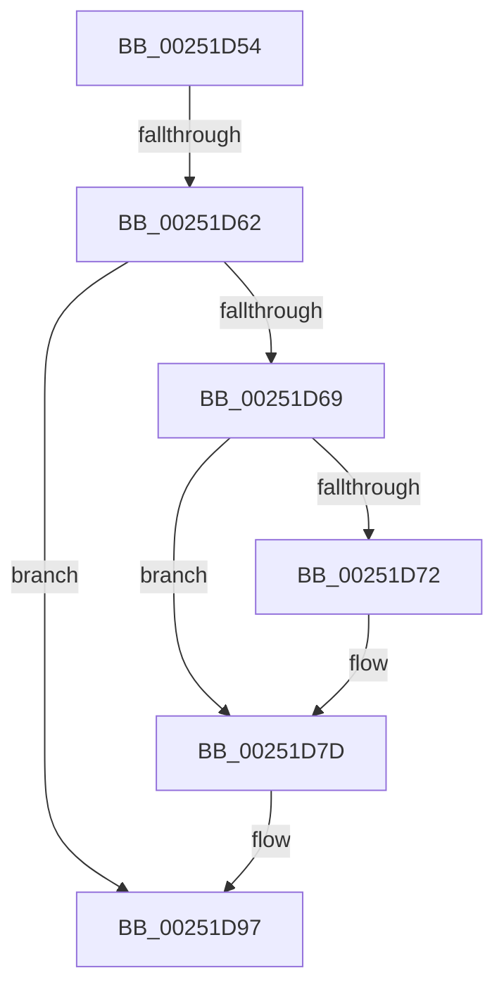

# sub_00251D54

- RVA: `0x00251D54`–`0x00251DA5` (길이 `81` bytes)
- VA: `0x0000000140251D54`
- 실행 섹션: `.text`
- PDB 이름 있음: `아니요`; PDB Function 태그: `아니요`
- unwind 정보 RVA: `0x00063544`
- 디코드: `21`개 명령, `81/81` bytes 표시
- 미해석 바이트: `0` (있으면 어셈블리에 `.byte`로 보존)

> 이 문서는 커널 이미지의 기계어와 PDB 기호를 분석해 생성했습니다. 4번과 5번은 함수 원형과 자료형을 바이너리 사용 방식에서 추정한 C 해석이며 원본 소스 복구 결과는 아닙니다.

## 1. Dependencies

- 직접 호출 지점: **2**; 고유 호출 대상: **2**
- 직접 호출자로 확인된 함수: **0**
- RIP 상대 이미지 참조: **1**

### Outgoing calls
- `0x00251D78` → [KiLowerIrqlProcessIrqlFlags](../4F/KiLowerIrqlProcessIrqlFlags_function_004F5698.md) (function, `0x004F5698`)
- `0x00251D92` → [KiDeliverApc](KiDeliverApc_function_00250F20.md) (function, `0x00250F20`)

### Direct callers
- 이 함수 시작 RVA로 연결되는 직접 call은 확인되지 않았습니다. 간접 호출은 완전히 역산할 수 없습니다.

### Static image references
- `0x00251D69` → RVA `0x00FC6D20` (`ALMOSTRO`; read)

## 2. Other-region calls and transfers

- 다른 실행 섹션으로 향하는 call: **0**
- call이 아닌 외부 분기/꼬리 이동: **2**
  - `0x00251D5C` → [sub_00251E24](Unknown_function_00251E24.md) (`tail-transfer`)
  - `0x00251DA3` → [sub_00251DA5 + 0xD](Unknown_function_00251DA5.md) (`tail-transfer`)

## 3. Assembly (complete function range)

```asm
00251D54  4C 89 74 24 68                  mov qword ptr [rsp + 0x68], r14
00251D59  48 85 C0                        test rax, rax
00251D5C  0F 85 C2 00 00 00               jne 0x140251e24
00251D62  8B 45 74                        mov eax, dword ptr [rbp + 0x74]
00251D65  A8 40                           test al, 0x40
00251D67  74 2E                           je 0x140251d97
00251D69  83 3D B0 4F D7 00 00            cmp dword ptr [rip + 0xd74fb0], 0
00251D70  74 0B                           je 0x140251d7d
00251D72  44 0F 20 C1                     mov rcx, cr8
00251D76  B2 01                           mov dl, 1
00251D78  E8 1B 39 2A 00                  call 0x1404f5698
00251D7D  41 BE 01 00 00 00               mov r14d, 1
00251D83  45 0F 22 C6                     mov cr8, r14
00251D87  83 65 74 BF                     and dword ptr [rbp + 0x74], 0xffffffbf
00251D8B  45 33 C0                        xor r8d, r8d
00251D8E  33 D2                           xor edx, edx
00251D90  33 C9                           xor ecx, ecx
00251D92  E8 89 F1 FF FF                  call 0x140250f20
00251D97  83 3D 82 4F D7 00 00            cmp dword ptr [rip + 0xd74f82], 0
00251D9E  4C 8B 74 24 68                  mov r14, qword ptr [rsp + 0x68]
00251DA3  74 0D                           je 0x140251db2
```

## 4. C-style interpretation (structured pseudocode)

```c
__int64 __fastcall sub_00251D54(__int64 a1, __int64 a2, int a3, __int64 a4, __int64 a5, __int64 a6, __int64 a7, __int64 a8, __int64 a9, __int64 a10, __int64 a11, __int64 a12, __int64 a13)
{
    __int64 result;
    unsigned __int64 v_stack_p68;

    v_stack_p68 = v_r14;
    if ((((unsigned __int8)((unsigned int)(*(unsigned int *)(v_rbp + 116)))) & (64)) == 0) goto loc_00251D97;
    result = (unsigned int)(*(unsigned int *)(v_rbp + 116));
    if ((*(unsigned int *)(v_rip + 14110640)) != 0) {
        a1 = v_cr8;
        a2 = 1;
        result = KiLowerIrqlProcessIrqlFlags(a1, a2, a3, a4);
    }
    a3 = 0;
    a2 = 0;
    a1 = 0;
    result = KiDeliverApc(a1, a2, a3, a4);
loc_00251D97:
}
```

## 5. (Beta) C Style

```c
int64_t sub_00251D54(int64_t Arg1, int64_t Arg2, int32_t Arg3, int64_t Arg4, uint64_t Arg5, uint64_t Arg6, uint64_t Arg7, uint64_t Arg8, uint64_t Arg9, uint64_t Arg10, uint64_t Arg11, uint64_t Arg12, int64_t Arg13)
{
    int64_t result;
    uint64_t v_stack_p68;

    v_stack_p68 = local_r14;
    if ((((uint8_t)((uint32_t)(*(uint32_t *)(local_rbp + 0x74)))) & (64)) == 0) goto loc_00251D97;
    result = (uint32_t)(*(uint32_t *)(local_rbp + 0x74));
    if ((*(uint32_t *)(v_rip + 0xD74FB0)) != 0) {
        Arg1 = v_cr8;
        Arg2 = 1;
        result = KiLowerIrqlProcessIrqlFlags(Arg1, Arg2, Arg3, Arg4);
    }
    Arg3 = 0;
    Arg2 = 0;
    Arg1 = 0;
    result = KiDeliverApc(Arg1, Arg2, Arg3, Arg4);
loc_00251D97:
}
```

## 6. Execution-region graph

[열기: 2D/3D 그래프와 함수 탐색 컨트롤 패널](../../../control-panel.html?section=text&rva=0x00251D54&view=graph)

- 2D 그래프는 위에서 아래로 흐르고, 3D 그래프는 빈 공간을 드래그해 회전합니다. Shift+드래그는 이동, 휠은 확대·축소, 함수 노드 선택은 대상 보고서 이동입니다.

### Static fallback


