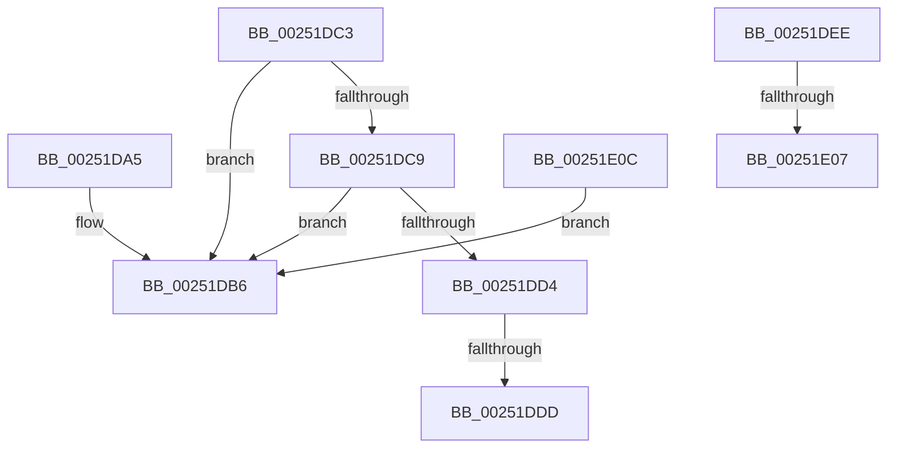

# sub_00251DA5

- RVA: `0x00251DA5`–`0x00251E24` (길이 `127` bytes)
- VA: `0x0000000140251DA5`
- 실행 섹션: `.text`
- PDB 이름 있음: `아니요`; PDB Function 태그: `아니요`
- unwind 정보 RVA: `0x00063558`
- 디코드: `39`개 명령, `127/127` bytes 표시
- 미해석 바이트: `0` (있으면 어셈블리에 `.byte`로 보존)

> 이 문서는 커널 이미지의 기계어와 PDB 기호를 분석해 생성했습니다. 4번과 5번은 함수 원형과 자료형을 바이너리 사용 방식에서 추정한 C 해석이며 원본 소스 복구 결과는 아닙니다.

## 1. Dependencies

- 직접 호출 지점: **2**; 고유 호출 대상: **2**
- 직접 호출자로 확인된 함수: **0**
- RIP 상대 이미지 참조: **0**

### Outgoing calls
- `0x00251DAD` → [KiLowerIrqlProcessIrqlFlags](../4F/KiLowerIrqlProcessIrqlFlags_function_004F5698.md) (function, `0x004F5698`)
- `0x00251DFA` → [KiDirectSwitchThread](../21/KiDirectSwitchThread_function_0021D770.md) (function, `0x0021D770`)

### Direct callers
- 이 함수 시작 RVA로 연결되는 직접 call은 확인되지 않았습니다. 간접 호출은 완전히 역산할 수 없습니다.

### Static image references
- 디코드된 RIP-relative 메모리 참조가 없습니다.

## 2. Other-region calls and transfers

- 다른 실행 섹션으로 향하는 call: **0**
- call이 아닌 외부 분기/꼬리 이동: **3**
  - `0x00251DD7` → [sub_00251ED3](Unknown_function_00251ED3.md) (`tail-transfer`)
  - `0x00251E01` → [KiExitDispatcher + 0x46](KiExitDispatcher_function_00251CF0.md) (`tail-transfer`)
  - `0x00251E07` → [KiExitDispatcher + 0x36](KiExitDispatcher_function_00251CF0.md) (`tail-transfer`)

## 3. Assembly (complete function range)

```asm
00251DA5  44 0F 20 C1                     mov rcx, cr8
00251DA9  40 0F B6 D6                     movzx edx, sil
00251DAD  E8 E6 38 2A 00                  call 0x1404f5698
00251DB2  44 0F 22 C6                     mov cr8, rsi
00251DB6  48 8B 5C 24 70                  mov rbx, qword ptr [rsp + 0x70]
00251DBB  48 83 C4 40                     add rsp, 0x40
00251DBF  5F                              pop rdi
00251DC0  5E                              pop rsi
00251DC1  5D                              pop rbp
00251DC2  C3                              ret
00251DC3  CC                              int3
00251DC4  48 85 C0                        test rax, rax
00251DC7  74 ED                           je 0x140251db6
00251DC9  0F B6 87 BA 38 00 00            movzx eax, byte ptr [rdi + 0x38ba]
00251DD0  84 C0                           test al, al
00251DD2  75 E2                           jne 0x140251db6
00251DD4  38 47 20                        cmp byte ptr [rdi + 0x20], al
00251DD7  0F 84 F6 00 00 00               je 0x140251ed3
00251DDD  C6 47 06 01                     mov byte ptr [rdi + 6], 1
00251DE1  48 8B 5C 24 70                  mov rbx, qword ptr [rsp + 0x70]
00251DE6  48 83 C4 40                     add rsp, 0x40
00251DEA  5F                              pop rdi
00251DEB  5E                              pop rsi
00251DEC  5D                              pop rbp
00251DED  C3                              ret
00251DEE  CC                              int3
00251DEF  D1 EA                           shr edx, 1
00251DF1  80 E2 01                        and dl, 1
00251DF4  44 0F B6 C2                     movzx r8d, dl
00251DF8  8B D6                           mov edx, esi
00251DFA  E8 71 B9 FC FF                  call 0x14021d770
00251DFF  84 C0                           test al, al
00251E01  0F 85 2F FF FF FF               jne 0x140251d36
00251E07  E9 1A FF FF FF                  jmp 0x140251d26
00251E0C  48 8B 4F 08                     mov rcx, qword ptr [rdi + 8]
00251E10  0F B6 84 24 80 00 00 00         movzx eax, byte ptr [rsp + 0x80]
00251E18  83 49 74 04                     or dword ptr [rcx + 0x74], 4
00251E1C  88 81 86 01 00 00               mov byte ptr [rcx + 0x186], al
00251E22  EB 92                           jmp 0x140251db6
```

## 4. C-style interpretation (structured pseudocode)

```c
__int64 __fastcall sub_00251DA5(__int64 a1, __int64 a2, __int64 a3, __int64 a4, __int64 a5, __int64 a6, __int64 a7, __int64 a8, __int64 a9, __int64 a10, __int64 a11, __int64 a12, __int64 a13, __int64 a14)
{
    __int64 result;
    __int64 v_rsp;
    unsigned __int8 v_stack_p130;
    unsigned __int64 v_stack_pC8;

    result = KiLowerIrqlProcessIrqlFlags(v_cr8, (unsigned __int8)(v_rsi), a3, a4);
loc_00251DB6:
    v_rsp = (v_rsp) + (64);
    return result;
}
```

## 5. (Beta) C Style

```c
int64_t sub_00251DA5(int64_t Arg1, int64_t Arg2, int64_t Arg3, int64_t Arg4, uint64_t Arg5, uint64_t Arg6, uint64_t Arg7, uint64_t Arg8, uint64_t Arg9, uint64_t Arg10, uint64_t Arg11, uint64_t Arg12, uint64_t Arg13, int64_t Arg14)
{
    int64_t result;
    int64_t local_rsp;
    uint8_t v_stack_p130;
    uint64_t v_stack_pC8;

    result = KiLowerIrqlProcessIrqlFlags(v_cr8, (uint8_t)(local_rsi), Arg3, Arg4);
loc_00251DB6:
    local_rsp = (local_rsp) + (64);
    return result;
}
```

## 6. Execution-region graph

[열기: 2D/3D 그래프와 함수 탐색 컨트롤 패널](../../../control-panel.html?section=text&rva=0x00251DA5&view=graph)

- 2D 그래프는 위에서 아래로 흐르고, 3D 그래프는 빈 공간을 드래그해 회전합니다. Shift+드래그는 이동, 휠은 확대·축소, 함수 노드 선택은 대상 보고서 이동입니다.

### Static fallback


