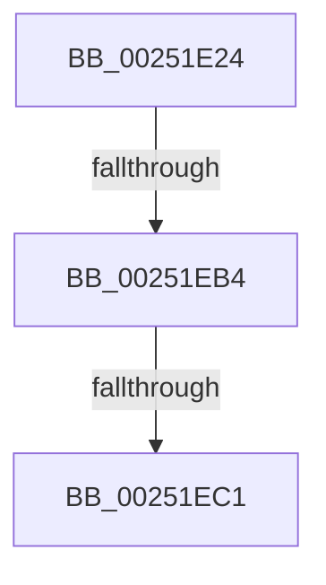

# sub_00251E24

- RVA: `0x00251E24`–`0x00251ED3` (길이 `175` bytes)
- VA: `0x0000000140251E24`
- 실행 섹션: `.text`
- PDB 이름 있음: `아니요`; PDB Function 태그: `아니요`
- unwind 정보 RVA: `0x00063570`
- 디코드: `40`개 명령, `175/175` bytes 표시
- 미해석 바이트: `0` (있으면 어셈블리에 `.byte`로 보존)

> 이 문서는 커널 이미지의 기계어와 PDB 기호를 분석해 생성했습니다. 4번과 5번은 함수 원형과 자료형을 바이너리 사용 방식에서 추정한 C 해석이며 원본 소스 복구 결과는 아닙니다.

## 1. Dependencies

- 직접 호출 지점: **8**; 고유 호출 대상: **8**
- 직접 호출자로 확인된 함수: **0**
- RIP 상대 이미지 참조: **1**

### Outgoing calls
- `0x00251E29` → [KiAbProcessPreContextSwitch](../21/KiAbProcessPreContextSwitch_function_0021D420.md) (function, `0x0021D420`)
- `0x00251E4D` → [KiAcquireMultiplePrcbLocks](../39/KiAcquireMultiplePrcbLocks_function_00393160.md) (function, `0x00393160`)
- `0x00251E64` → [KiCaptureTotalCyclesCurrentThread](../37/KiCaptureTotalCyclesCurrentThread_function_0037CB90.md) (function, `0x0037CB90`)
- `0x00251E6F` → [KiUpdatePriorityMatrixForRunningTransition](../37/KiUpdatePriorityMatrixForRunningTransition_function_0037B3A0.md) (function, `0x0037B3A0`)
- `0x00251E8D` → [KiQueueReadyThread](../21/KiQueueReadyThread_function_0021C7B0.md) (function, `0x0021C7B0`)
- `0x00251E9C` → [KiSwapContext](../6B/KiSwapContext_function_006B9740.md) (function, `0x006B9740`)
- `0x00251EA7` → [KiAbProcessPostContextSwitch](../24/KiAbProcessPostContextSwitch_function_00248790.md) (function, `0x00248790`)
- `0x00251EC9` → [KiLowerIrqlProcessIrqlFlags](../4F/KiLowerIrqlProcessIrqlFlags_function_004F5698.md) (function, `0x004F5698`)

### Direct callers
- 이 함수 시작 RVA로 연결되는 직접 call은 확인되지 않았습니다. 간접 호출은 완전히 역산할 수 없습니다.

### Static image references
- `0x00251EB4` → RVA `0x00FC6D20` (`ALMOSTRO`; read)

## 2. Other-region calls and transfers

- 다른 실행 섹션으로 향하는 call: **0**
- call이 아닌 외부 분기/꼬리 이동: **3**
  - `0x00251EAE` → [sub_00251D54 + 0x43](Unknown_function_00251D54.md) (`tail-transfer`)
  - `0x00251EBB` → [sub_00251D54 + 0x2F](Unknown_function_00251D54.md) (`tail-transfer`)
  - `0x00251ECE` → [sub_00251D54 + 0x2F](Unknown_function_00251D54.md) (`tail-transfer`)

## 3. Assembly (complete function range)

```asm
00251E24  33 D2                           xor edx, edx
00251E26  48 8B CD                        mov rcx, rbp
00251E29  E8 F2 B5 FC FF                  call 0x14021d420
00251E2E  48 8B C7                        mov rax, rdi
00251E31  48 89 7C 24 60                  mov qword ptr [rsp + 0x60], rdi
00251E36  48 83 E0 FE                     and rax, 0xfffffffffffffffe
00251E3A  48 8D 4C 24 60                  lea rcx, [rsp + 0x60]
00251E3F  41 BE 01 00 00 00               mov r14d, 1
00251E45  48 89 44 24 20                  mov qword ptr [rsp + 0x20], rax
00251E4A  41 8B D6                        mov edx, r14d
00251E4D  E8 0E 13 14 00                  call 0x140393160
00251E52  48 8B 5F 10                     mov rbx, qword ptr [rdi + 0x10]
00251E56  48 8B D5                        mov rdx, rbp
00251E59  48 8B CF                        mov rcx, rdi
00251E5C  48 C7 47 10 00 00 00 00         mov qword ptr [rdi + 0x10], 0
00251E64  E8 27 AD 12 00                  call 0x14037cb90
00251E69  48 8B D3                        mov rdx, rbx
00251E6C  48 8B CF                        mov rcx, rdi
00251E6F  E8 2C 95 12 00                  call 0x14037b3a0
00251E74  4C 8B C5                        mov r8, rbp
00251E77  C6 85 83 02 00 00 20            mov byte ptr [rbp + 0x283], 0x20
00251E7E  48 8D 54 24 20                  lea rdx, [rsp + 0x20]
00251E83  40 88 B5 86 01 00 00            mov byte ptr [rbp + 0x186], sil
00251E8A  48 8B CF                        mov rcx, rdi
00251E8D  E8 1E A9 FC FF                  call 0x14021c7b0
00251E92  44 0F B6 C6                     movzx r8d, sil
00251E96  48 8B D3                        mov rdx, rbx
00251E99  48 8B CD                        mov rcx, rbp
00251E9C  E8 9F 78 46 00                  call 0x1406b9740
00251EA1  48 8B CD                        mov rcx, rbp
00251EA4  0F B6 D8                        movzx ebx, al
00251EA7  E8 E4 68 FF FF                  call 0x140248790
00251EAC  84 DB                           test bl, bl
00251EAE  0F 84 E3 FE FF FF               je 0x140251d97
00251EB4  83 3D 65 4E D7 00 00            cmp dword ptr [rip + 0xd74e65], 0
00251EBB  0F 84 C2 FE FF FF               je 0x140251d83
00251EC1  44 0F 20 C1                     mov rcx, cr8
00251EC5  41 0F B6 D6                     movzx edx, r14b
00251EC9  E8 CA 37 2A 00                  call 0x1404f5698
00251ECE  E9 B0 FE FF FF                  jmp 0x140251d83
```

## 4. C-style interpretation (structured pseudocode)

```c
__int64 __fastcall sub_00251E24(__int64 a1, int a2, __int64 a3, __int64 a4, __int64 a5, __int64 a6, __int64 a7, __int64 a8, __int64 a9, __int64 a10, __int64 a11, __int64 a12)
{
    __int64 result;
    unsigned __int64 v_stack_p20;
    unsigned __int64 v_stack_p60;

    a2 = 0;
    result = KiAbProcessPreContextSwitch(v_rbp, a2, a3, a4);
    v_stack_p60 = v_rdi;
    result = (v_rdi) & (-2);
    v_stack_p20 = result;
    result = KiAcquireMultiplePrcbLocks(a12, 1, a3, a4);
    *(unsigned __int64 *)(v_rdi + 16) = 0;
    result = KiCaptureTotalCyclesCurrentThread(v_rdi, v_rbp, a3, a4);
    result = KiUpdatePriorityMatrixForRunningTransition(v_rdi, *(unsigned __int64 *)(v_rdi + 16), a3, a4);
    *(unsigned __int8 *)(v_rbp + 643) = 32;
    *(unsigned __int8 *)(v_rbp + 390) = (unsigned __int8)(v_rsi);
    result = KiQueueReadyThread(v_rdi, v_stack_p20, v_rbp, a4);
    result = KiSwapContext(v_rbp, *(unsigned __int64 *)(v_rdi + 16), (unsigned __int8)(v_rsi), a4);
    result = KiAbProcessPostContextSwitch(v_rbp, *(unsigned __int64 *)(v_rdi + 16), (unsigned __int8)(v_rsi), a4);
    result = KiLowerIrqlProcessIrqlFlags(v_cr8, 1, (unsigned __int8)(v_rsi), a4);
}
```

## 5. (Beta) C Style

```c
int64_t sub_00251E24(int64_t Arg1, int32_t Arg2, int64_t Arg3, int64_t Arg4, uint64_t Arg5, uint64_t Arg6, uint64_t Arg7, uint64_t Arg8, uint64_t Arg9, uint64_t Arg10, uint64_t Arg11, int64_t Arg12)
{
    int64_t result;
    uint64_t v_stack_p20;
    uint64_t v_stack_p60;

    Arg2 = 0;
    result = KiAbProcessPreContextSwitch(local_rbp, Arg2, Arg3, Arg4);
    v_stack_p60 = local_rdi;
    result = (local_rdi) & (-2);
    v_stack_p20 = result;
    result = KiAcquireMultiplePrcbLocks(Arg12, 1, Arg3, Arg4);
    *(uint64_t *)(local_rdi + 0x10) = 0;
    result = KiCaptureTotalCyclesCurrentThread(local_rdi, local_rbp, Arg3, Arg4);
    result = KiUpdatePriorityMatrixForRunningTransition(local_rdi, *(uint64_t *)(local_rdi + 0x10), Arg3, Arg4);
    *(uint8_t *)(local_rbp + 0x283) = 32;
    *(uint8_t *)(local_rbp + 0x186) = (uint8_t)(local_rsi);
    result = KiQueueReadyThread(local_rdi, v_stack_p20, local_rbp, Arg4);
    result = KiSwapContext(local_rbp, *(uint64_t *)(local_rdi + 0x10), (uint8_t)(local_rsi), Arg4);
    result = KiAbProcessPostContextSwitch(local_rbp, *(uint64_t *)(local_rdi + 0x10), (uint8_t)(local_rsi), Arg4);
    result = KiLowerIrqlProcessIrqlFlags(v_cr8, 1, (uint8_t)(local_rsi), Arg4);
}
```

## 6. Execution-region graph

[열기: 2D/3D 그래프와 함수 탐색 컨트롤 패널](../../../control-panel.html?section=text&rva=0x00251E24&view=graph)

- 2D 그래프는 위에서 아래로 흐르고, 3D 그래프는 빈 공간을 드래그해 회전합니다. Shift+드래그는 이동, 휠은 확대·축소, 함수 노드 선택은 대상 보고서 이동입니다.

### Static fallback


