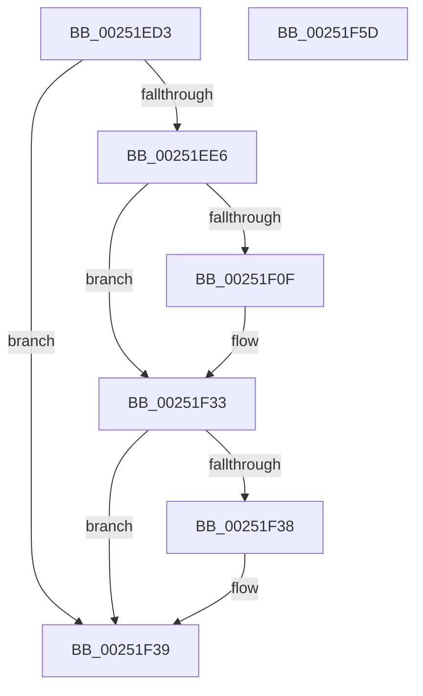

# sub_00251ED3

- RVA: `0x00251ED3`–`0x00251F5E` (길이 `139` bytes)
- VA: `0x0000000140251ED3`
- 실행 섹션: `.text`
- PDB 이름 있음: `아니요`; PDB Function 태그: `아니요`
- unwind 정보 RVA: `0x00063584`
- 디코드: `37`개 명령, `139/139` bytes 표시
- 미해석 바이트: `0` (있으면 어셈블리에 `.byte`로 보존)

> 이 문서는 커널 이미지의 기계어와 PDB 기호를 분석해 생성했습니다. 4번과 5번은 함수 원형과 자료형을 바이너리 사용 방식에서 추정한 C 해석이며 원본 소스 복구 결과는 아닙니다.

## 1. Dependencies

- 직접 호출 지점: **2**; 고유 호출 대상: **2**
- 직접 호출자로 확인된 함수: **0**
- RIP 상대 이미지 참조: **1**

### Outgoing calls
- `0x00251EEF` → [HalpDisableInterrupts](HalpDisableInterrupts_function_002521A0.md) (function, `0x002521A0`)
- `0x00251F4B` → [HalpInterruptSendIpi](HalpInterruptSendIpi_function_00252310.md) (function, `0x00252310`)

### Direct callers
- 이 함수 시작 RVA로 연결되는 직접 call은 확인되지 않았습니다. 간접 호출은 완전히 역산할 수 없습니다.

### Static image references
- `0x00251ED8` → RVA `0x00FC6BC5` (`ALMOSTRO`; read)

## 2. Other-region calls and transfers

- 다른 실행 섹션으로 향하는 call: **0**
- 별도 외부 분기/꼬리 이동을 확인하지 못했습니다.

## 3. Assembly (complete function range)

```asm
00251ED3  33 C0                           xor eax, eax
00251ED5  0F 57 C0                        xorps xmm0, xmm0
00251ED8  38 05 E7 4C D7 00               cmp byte ptr [rip + 0xd74ce7], al
00251EDE  F3 0F 7F 44 24 2C               movdqu xmmword ptr [rsp + 0x2c], xmm0
00251EE4  74 53                           je 0x140251f39
00251EE6  65 4C 8B 04 25 20 00 00 00      mov r8, qword ptr gs:[0x20]
00251EEF  E8 AC 02 00 00                  call 0x1402521a0
00251EF4  41 8B 90 A8 00 00 00            mov edx, dword ptr [r8 + 0xa8]
00251EFB  44 0F B6 C8                     movzx r9d, al
00251EFF  8B CA                           mov ecx, edx
00251F01  83 C9 04                        or ecx, 4
00251F04  41 89 88 A8 00 00 00            mov dword ptr [r8 + 0xa8], ecx
00251F0B  85 D2                           test edx, edx
00251F0D  75 24                           jne 0x140251f33
00251F0F  B9 15 00 01 C0                  mov ecx, 0xc0010015
00251F14  0F 32                           rdmsr
00251F16  48 C1 E2 20                     shl rdx, 0x20
00251F1A  48 0B C2                        or rax, rdx
00251F1D  48 BA 00 00 00 00 01 00 00 00   movabs rdx, 0x100000000
00251F27  48 0B C2                        or rax, rdx
00251F2A  48 8B D0                        mov rdx, rax
00251F2D  48 C1 EA 20                     shr rdx, 0x20
00251F31  0F 30                           wrmsr
00251F33  45 84 C9                        test r9b, r9b
00251F36  74 01                           je 0x140251f39
00251F38  FB                              sti
00251F39  BA 2F 00 00 00                  mov edx, 0x2f
00251F3E  C7 44 24 28 05 00 00 00         mov dword ptr [rsp + 0x28], 5
00251F46  48 8D 4C 24 28                  lea rcx, [rsp + 0x28]
00251F4B  E8 C0 03 00 00                  call 0x140252310
00251F50  48 8B 5C 24 70                  mov rbx, qword ptr [rsp + 0x70]
00251F55  48 83 C4 40                     add rsp, 0x40
00251F59  5F                              pop rdi
00251F5A  5E                              pop rsi
00251F5B  5D                              pop rbp
00251F5C  C3                              ret
00251F5D  CC                              int3
```

## 4. C-style interpretation (structured pseudocode)

```c
__int64 __fastcall sub_00251ED3(__int64 a1, __int64 a2, __int64 a3, __int64 a4, __int64 a5, __int64 a6, __int64 a7, __int64 a8, __int64 a9, __int64 a10, __int64 a11, __int64 a12, __int64 a13, __int64 a14)
{
    __int64 result;
    __int64 v_rsp;
    unsigned int v_stack_p28;
    unsigned __int64 v_stack_p2C;

    result = 0;
    v_stack_p2C = v_xmm0;
    if ((*(unsigned __int8 *)(v_rip + 14109927)) == 0) goto loc_00251F39;
    result = HalpDisableInterrupts(a1, a2, *(unsigned __int64 *)(gs_base + (0 + 32)), a4);
    a1 = (unsigned int)(((unsigned int)((unsigned int)((unsigned int)(*(unsigned int *)(*(unsigned __int64 *)(gs_base + (0 + 32)) + 168))))) | (4));
    *(unsigned int *)(*(unsigned __int64 *)(gs_base + (0 + 32)) + 168) = (unsigned int)(a1);
    if ((unsigned int)((unsigned int)(*(unsigned int *)(*(unsigned __int64 *)(gs_base + (0 + 32)) + 168))) == 0) {
        a1 = 0xC0010015ULL;
        a2 = ((unsigned int)(*(unsigned int *)(*(unsigned __int64 *)(gs_base + (0 + 32)) + 168))) << (32);
        result = (result) | (a2);
        result = (result) | (a2);
        a2 = result;
        a2 = (a2) >> (32);
    }
    if ((unsigned __int8)((unsigned __int8)(result)) != 0) {
    }
    v_stack_p28 = 5;
    result = HalpInterruptSendIpi(a5, 47, *(unsigned __int64 *)(gs_base + (0 + 32)), (unsigned __int8)(result));
    v_rsp = (v_rsp) + (64);
    return result;
}
```

## 5. (Beta) C Style

```c
int64_t sub_00251ED3(int64_t Arg1, int64_t Arg2, int64_t Arg3, int64_t Arg4, int64_t Arg5, uint64_t Arg6, uint64_t Arg7, uint64_t Arg8, uint64_t Arg9, uint64_t Arg10, uint64_t Arg11, uint64_t Arg12, uint64_t Arg13, int64_t Arg14)
{
    int64_t result;
    int64_t local_rsp;
    uint32_t v_stack_p28;
    uint64_t v_stack_p2C;

    result = 0;
    v_stack_p2C = v_xmm0;
    if ((*(uint8_t *)(v_rip + 0xD74CE7)) == 0) goto loc_00251F39;
    result = HalpDisableInterrupts(Arg1, Arg2, *(uint64_t *)(gs_base + (0 + 0x20)), Arg4);
    Arg1 = (uint32_t)(((uint32_t)((uint32_t)((uint32_t)(*(uint32_t *)(*(uint64_t *)(gs_base + (0 + 0x20)) + 0xA8))))) | (4));
    *(uint32_t *)(*(uint64_t *)(gs_base + (0 + 0x20)) + 0xA8) = (uint32_t)(Arg1);
    if ((uint32_t)((uint32_t)(*(uint32_t *)(*(uint64_t *)(gs_base + (0 + 0x20)) + 0xA8))) == 0) {
        Arg1 = 0xC0010015ULL;
        Arg2 = ((uint32_t)(*(uint32_t *)(*(uint64_t *)(gs_base + (0 + 0x20)) + 0xA8))) << (32);
        result = (result) | (Arg2);
        result = (result) | (Arg2);
        Arg2 = result;
        Arg2 = (Arg2) >> (32);
    }
    if ((uint8_t)((uint8_t)(result)) != 0) {
    }
    v_stack_p28 = 5;
    result = HalpInterruptSendIpi(Arg5, 47, *(uint64_t *)(gs_base + (0 + 0x20)), (uint8_t)(result));
    local_rsp = (local_rsp) + (64);
    return result;
}
```

## 6. Execution-region graph

[열기: 2D/3D 그래프와 함수 탐색 컨트롤 패널](../../../control-panel.html?section=text&rva=0x00251ED3&view=graph)

- 2D 그래프는 위에서 아래로 흐르고, 3D 그래프는 빈 공간을 드래그해 회전합니다. Shift+드래그는 이동, 휠은 확대·축소, 함수 노드 선택은 대상 보고서 이동입니다.

### Static fallback


